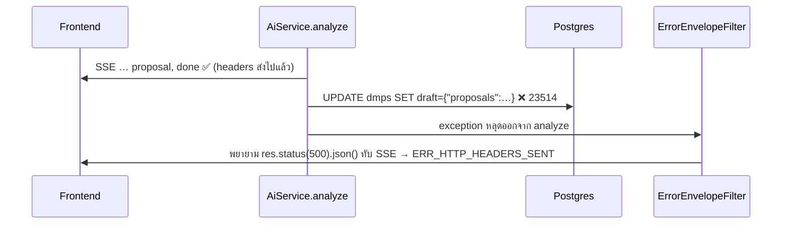

# Error `dmps_draft_object_keys` (23514) + `ERR_HTTP_HEADERS_SENT` ใน analyze-proposal — เกิดอะไรขึ้น และแก้ยังไง

> รายงานนี้อธิบายสำหรับคนที่เพิ่งเข้าทีม: รู้ programming พื้นฐาน แต่ยังไม่คุ้นระบบ DMP / AI ของเรา

## อาการที่เห็น

ผู้ใช้กดวิเคราะห์ไฟล์ proposal (endpoint `POST /ai/analyze-proposal`) แล้ว backend พัง 2 ชั้นต่อกัน:

1. **Query โดนฐานข้อมูลปัดตก** — คำสั่ง `UPDATE dmps` ล้มเหลวด้วย error `23514: new row for relation "dmps" violates check constraint "dmps_draft_object_keys"`
2. **ตามมาด้วย error สับสนอีกชุด** — `ERR_HTTP_HEADERS_SENT: Cannot set headers after they are sent to the client` โผล่ซ้ำ 2 รอบใน log

Error ตัวที่สองไม่ใช่สาเหตุ — มันเป็นเพียง "เศษซาก" จาก error ตัวแรก อ่านสาเหตุต่อข้างล่าง

## ตัวที่ 1: ฐานข้อมูลปฏิเศษ draft ที่ AI เขียน

### กติกาของตาราง `dmps`

คอลัมน์ `draft` เก็บแผนจัดการข้อมูลวิจัย (maDMP) เป็น JSON ทั้งก้อน เราใส่กุญแจป้องกันไว้ตั้งแต่ออกแบบ (ADR-0031): **key บนสุดของ JSON ต้องมาจากชุดที่กำหนดเท่านั้น** — `title`, `description`, `dataset`, `contributor` ฯลฯ 16 ตัว (ดู `DRAFT_KEYS` ใน `src/database/schema/index.ts`)

เปรียบง่าย ๆ: ฐานข้อมูลมี "รายชื่อ key ที่อนุญาต" เหมือน security guard ตรวจบัตร — ถ้า JSON แถม key แปลกหน้าเข้ามา ทั้งก้อนถูกปัดตกทันที ไม่บันทึกเลย นี่คือ guard เชิงป้องกัน ตั้งใจให้ทำงานแบบนี้ เพื่อไม่ให้ข้อมูลเปลือกนอกที่ FE อ่านไม่รู้เรื่องหลุดเข้าตาราง

### วันนั้น AI ส่งอะไรมา

AI ไม่ได้คืนร่างแผน (maDMP draft) ตามที่ endpoint สัญญา แต่คืน**รายการข้อเสนอแนะ** รูป `{"proposals":[{"path":"/title","text":"…","reason":"…"}, …]}` — key `proposals` ไม่อยู่ในรายชื่อที่อนุญาต guard จึงปัดตก → 23514

### ทำไม AI คืนผิดรูป — ต้นเหตุจริง ๆ

ไม่ใช่ฝีมือโมเดล เป็นฝีมือ wiring ของเรา: โมเดลได้รับ**คำสั่งขัดกันเองสองชั้น**

| ชั้น | ตอนนั้นบอกว่าอะไร | รูปคำตอบที่มันบังคับ |
|---|---|---|
| system prompt (`prompts.systems.suggest`) | "เสนอแก้ทีละฟิลด์ พร้อม path/reason" | `{"proposals":[…]}` |
| user message (`analyze_proposal`) | "ร่างแผนใหม่ทั้งฉบับ เขียน draft ได้เลย" | maDMP JSON ก้อนเดียว |

โมเดลเลือกฟัง system prompt (ซึ่งเป็นชั้นที่มีน้ำหนักสูงสุดตามธรรมชาติของ LLM) จึงคืน patch list ทั้งที่งานต้องการ draft ทั้งก้อน — **ต้นเหตุคือ yaml ไม่เคยมี system prompt เฉพาะของ analyze เลย** ข้อความ contract "ร่างทั้งฉบับ" ถูกวางผิดชั้นไปอยู่ใน `default_user_messages` ส่วน `system` ยืมของ suggest มาใช้

## ตัวที่ 2: `ERR_HTTP_HEADERS_SENT` — เศษซากจากการพังลำดับ

เขียน draft ลง DB เกิด**หลัง**จาก stream ส่ง event ครบ (รวม `done` = "สำเร็จ") ไปหา frontend แล้ว ลำดับเดิม:

ปัญหา 2 จุด:

- **ลำดับผิด contract** — frontend ได้ `done` (คิดว่าสำเร็จ) แล้ว socket ระเบิดตามมา ทั้งที่สัญญาไว้ว่า run หนึ่งอันจบด้วย terminal event เดียว (`done` หรือ `error`)
- **filter ไม่กันกรณี stream เปิดแล้ว** — `ErrorEnvelopeFilter` พยายามส่ง JSON error ทับ response ที่ stream อยู่แล้ว → Express โยน `ERR_HTTP_HEADERS_SENT` → Nest เก็บซ้ำอีกรอบ = log 2 ครั้ง

แถมเสียหายต่อข้อมูล: โค้ดช่วงหลัง (`chargeQuota` ตัดโควตา, เขียน thread entry, บันทึก idempotency snapshot) อยู่**หลัง**จุดที่พัง — token ถูกใช้ไปแต่โควตาไม่โดนตัด และ replay ด้วย idempotency key เดิมจะรัน AI ใหม่ทั้งหมด

## วิธีแก้ (5 จุด)

1. **สร้าง system prompt เฉพาะ analyze** — `systems.analyze_proposal` ใน `prompts.yaml` ถือ contract "ร่าง maDMP ทั้งก้อน, key ชุด D1 เท่านั้น" ไปเลย ไม่ยืมของ suggest อีก loader (`prompts.ts`) เพิ่ม key นี้ในชุด fail-fast — yaml ขาดจะไม่ start
2. **ตรวจก่อนเขียน DB** — ฟังก์ชัน `draftWritable` ใน `ai.service.ts` เช็กว่า proposal เป็น object และ key บนสุด ⊆ `DRAFT_KEYS` (กติกาเดียวกับ guard ใน DB พอดี) ใครผิดรูปถูกจับตั้งแต่ชั้นโค้ด ไม่ปล่อยให้ฐานข้อมูลเป็นคนตะโกน หมายเหตุ: ตั้งใจ**ไม่ใช้** `validateDraft` เต็มรูปแบบ — ความครบถ้วนของฟิลด์เป็นกฎตอน submit ไม่ใช่ตอน persist (ผู้ใช้ต้องได้เติมช่องใน editor ต่อได้)
3. **ย้ายทุกอย่างมาก่อน terminal event** — persist, ตัดโควตา, เขียน thread, snapshot idempotency เกิดก่อน `done` ถูกส่ง ถ้า persist ตรวจไม่ผ่าน → ส่ง `error` event แทน `done` frontend เลยรู้ทันทีว่าล้ม ไม่ต้องเดาจาก socket หลุด
4. **filter กัน headersSent** — ถ้า response เริ่มส่งไปแล้ว filter ปิด connection เงียบ ๆ แทนการยิง JSON ทับ เป็นเกราะสุดท้ายให้ทุก endpoint แบบ SSE
5. **title ไม่ fallback เป็นค่าว่าง** — โค้ดเดิมถ้า proposal ไม่มี title จะเขียน `''` ทับชื่อแผนเดิม (ถ้า guard ใน DB ไม่บล็อก ชื่อแผนจะหายเงียบ ๆ) ตอนนี้: มี title ใช้ได้ (ไม่ว่าง, ≤500 ตัวอักษร) ค่อยเขียน ไม่งั้นคงของเดิม

## พิสูจน์ว่าแก้แล้วจริง

- regression test ใหม่ 2 ตัวใน `tests/e2e/ai-stream.test.ts` — จำลองโมเดลคืน `{proposals}` (รูปที่เคยพัง) → ต้องจบ `error`, ไม่มีแผนค้าง, โควตาโดนตัด, replay ไม่ยิง provider ซ้ำ; จำลองคืน draft ถูกรูป → `done` + draft/title/revision 1 ลง DB ถูกต้อง + assert ว่า system prompt ที่ยิงออกไปเป็นของ analyze จริง
- suite เต็ม: 42 files / 303 tests ผ่านหมด + `pnpm typecheck` + `pnpm lint` สะอาด

## บทเรียนที่ติดตัวไป

Contract ของ AI output อย่าให้ประกาศซ้ำสองชั้นโดยขัดกัน — system prompt คือผู้ถือ contract, user message คือคำสั่งงาน และ "guard ที่ถูกออกแบบไว้" (constraint ใน DB ตัวนี้) ทำหน้าที่ได้เป๊ะ: มันปัดขยะก่อนถึงตาราง ทำให้เราเจอ bug ทันทีที่มันเกิด ไม่ใช่เดือนหลังจาก draft เน่าสะสมในระบบ
