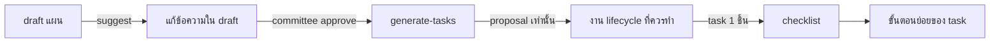

# AI ทำอะไรในระบบ (อธิบายจาก docs/api/ai.md)

## เข้าใจภาพรวมก่อน

AI ในระบบนี้คือผู้ช่วยของนักวิจัย คิดง่าย ๆ ว่าเป็น "ผู้ช่วยเขียนแผนข้อมูล (DMP)" — นักวิจัยกดให้ AI อ่านโปรเจกต์/แผน แล้ว AI ตอบกลับแบบ streaming (ข้อความไหลมาทีละชิ้น ไม่ต้องรอจบ) เหมือนที่เราเห็น ChatGPT พิมพ์ทีละคำ แต่ใช้เทคนิคชื่อ **SSE** (Server-Sent Events) คือ server เปิด connection ไว้แล้วส่ง event มาเรื่อย ๆ จนจบ

ใครใช้ได้: เฉพาะ role `researcher` ที่เป็น**เจ้าของแผน**เท่านั้น ถ้าไม่ใช่เจ้าของ ระบบตอบ 404 แบบไม่บอกว่าแผนมีอยู่ (ซ่อนข้อมูลว่ามี plan อะไรบ้าง) ถ้าไม่ใช่ researcher เลยตอบ 403

ข้อจำกัดที่ต้องรู้ก่อนเรียก API:

- **โควตา** — จำกัดจำนวน token ต่อเดือน (reset ต้นเดือนถัดไป เวลา UTC) และถ้า call fail หรือถูกยกเลิกกลางทาง token ที่โมเดลประมวลผลไปแล้วก็**ถูกหักเหมือนกัน**
- **Idempotency-Key** — ทุก endpoint ที่ให้ AI ลงมือทำ (analyze-proposal และ run action) ต้องส่ง header `Idempotency-Key` มาด้วย คือ "ป้ายชื่อ" ที่เราตั้งเองให้แต่ละครั้งที่สั่งงาน เพื่อกันสั่งซ้ำโดยบังเอิญ (เช่น user กดปุ่มสองรอบ): ขาด → 400, key นี้ run จบแล้ว → ส่งผลลัพธ์เดิมกลับมาโดยไม่หักโควตา (เก็บ 24 ชม.), key นี้กำลัง run อยู่ → 409
- **scope** — ใน path ใส่ `dmp_id` (chat ผูกกับแผน) หรือ `unscoped` (chat อิสระ ไม่ผูกแผน) แต่ใต้ `unscoped` ใช้ได้แค่ action `chat` อย่างเดียว อย่างอื่นตอบ 400

## AI ทำอะไรได้บ้าง และได้ output แบบไหน

AI มี 2 งานใหญ่:

1. **วิเคราะห์ proposal → ร่างแผนใหม่**

- (`POST /ai/analyze-proposal`): ส่งไฟล์ proposal ของโปรเจกต์ให้อ่าน แล้ว AI ร่างแผนข้อมูล (maDMP JSON) ใหม่ทั้งฉบับ ถ้ายังไม่มีแผน ระบบสร้างแผนให้ก่อนแล้วเขียน draft ลงไป (ตั้ง `draft`, `title`, `draft_revision = 1`) และผูกไฟล์ proposal กับโปรเจกต์ — ถ้า run ล้มเหลวและแผนเป็นของที่สร้างขึ้นใน call นี้เอง แผนจะถูกลบทิ้ง ไม่ทิ้งแผนเปล่า ๆ จาก proposal ที่อ่านไม่รู้เรื่อง

2. **Action ต่อแผน 5 แบบ**

- (`POST /dmps/:scope/ai/:action`): action เดียวที่ใช้กับ `unscoped` ได้คือ `chat`

| Action | ทำอะไร | output ที่ควรได้ |
| --- | --- | --- |
| `chat` | สนทนาเรื่องแผน (ระบุ section ได้) | ข้อความตอบ ไหลมาทาง `delta` ต่อกันเป็นข้อความเต็ม จบด้วย `done` |
| `suggest` | ให้ข้อเสนอแนะต่อแผน | ข้อความคำแนะนำทาง `delta` (และ/หรือ `proposal` ถ้าเป็น structured) |
| `regenerate-field` | สร้างฟิลด์ใน draft ใหม่ | เนื้อหาฟิลด์ใหม่ ปกติมาทาง `proposal` (structured JSON) |
| `generate-tasks` | เสนองาน lifecycle จากแผน | รายการงาน เป็น structured output ทาง `proposal` |
| `checklist` | เช็คความครบถ้วนของแผน | รายการตรวจ/ผลเช็ค เป็น structured output ทาง `proposal` |

### เจาะลึก 5 action: use case, outcome และแตะข้อมูลส่วนไหน (จากซอร์สโค้ด `ai.service.ts` / `ai.tools.ts`)

หัวใจที่ต้องเข้าใจก่อน: **5 action นี้ backend ไม่เขียนข้อมูลธุรกิจใด ๆ เลย** — AI เป็น "ผู้เสนอ ไม่ใช่ผู้ลงมือ" มันอ่านอย่างเดียว แล้วเสนอเป็น proposal ให้ผู้ใช้ตัดสิน ข้อมูลจริงถูกแก้ตอน frontend apply เท่านั้น

สิ่งที่ AI อ่านได้ต่อ run มีแค่ 4 tool (all read-only): `read_proposal` (ข้อความไฟล์ proposal), `search_proposal` (ค้น semantic ใน proposal), `read_draft` (draft maDMP ปัจจุบัน), `read_domain_profiles` (ชุดฟิลด์ metadata เฉพาะสาขา) ส่วนที่เขียนได้มีแค่ thread กับ quota

#### รายละเอียด 4 tool

ทั้ง 4 ตัวเป็น function ที่โมเดลเรียกเองระหว่าง run (react-loop) ได้ผลกลับมาเป็นข้อความ tool message — **ไม่มี tool เขียน draft และไม่มี web search** (SPEC-ai กำหนด) ข้อสังเกตสำคัญ: กรณีข้อมูลไม่พร้อม tool จะ**ไม่ throw ทำ run ล้ม** แต่คืนข้อความบอกทางเลือกให้โมเดลแก้เอง (เช่น RAG ยังไม่ embed เสร็จ → บอกให้ไปใช้ `read_proposal` แทน)

| Tool | Arguments | อ่านอะไร มาจากไหน | คืนอะไรให้โมเดล | กรณีไม่มีข้อมูล |
| ---- | --------- | ------------------ | ----------------- | ----------------- |
| `read_proposal` | ไม่มี | ไฟล์ proposal ที่**ผูกกับโปรเจกต์** (`project.proposal_file_id`) — อ่านจาก chunk ที่ extract ไว้แล้วในไฟล์ feature | ข้อความทั้งเอกสาร จัดกลุ่มตาม heading (`## heading` + เนื้อหาเต็ม section) | คืนข้อความ "ยังไม่มี proposal แนบกับโครงการนี้" |
| `search_proposal` | `{query}` (required) | ค้น semantic (RAG/embedding) ในไฟล์ proposal เดียวกัน | hits ที่เกี่ยวข้องพร้อม heading_path + content + score ต่อชิ้น | ไม่เจอ → บอกให้ใช้ `read_proposal` อ่านทั้งเอกสาร; RAG ไม่พร้อม → บอกสาเหตุ + ทางเลือก (ไม่ error ทั้ง run) |
| `read_draft` | ไม่มี | แผนที่ run ผูกอยู่ (`dmp_id` ใน path) — อ่าน field `draft` ตรง ๆ จาก DB | maDMP JSON ทั้งก้อน stringify | run แบบ `unscoped` → บอกว่า "ไม่ผูกกับ DMP — ไม่มี draft ให้อ่าน" |
| `read_domain_profiles` | ไม่มี | ชุด domain profiles (metadata fields เฉพาะสาขา) — คงที่ มาจาก config ไม่ได้จาก DB | JSON array ของ profile: key/label/description + fields ทั้งหมด (key/label/type/required) | ไม่มีกรณีล้ม — ข้อมูลคงที่เสมอ |

ข้อจำกัดของบริบทต่อ run ที่ควรรู้ (ผูกตอนเริ่ม loop จาก path ที่เรียก):

- **ไม่ผูกโปรเจกต์ = ไม่เห็น proposal** — action ใต้ `unscoped` (chat อิสระ) `projectId = null` ทั้ง `read_proposal` และ `search_proposal` ใช้ไม่ได้
- **proposal ต้องถูกผูกไว้กับโปรเจกต์ก่อน** (field `proposal_file_id` ของโปรเจกต์ — ปกติ `analyze-proposal` เป็นตัวผูกให้) แค่อัปโหลดไฟล์ purpose `proposal` แต่ยังไม่ผูก จะยังอ่านไม่ได้
- **read_draft ใช้ได้เฉพาะ run ใต้ `dmp_id`** — และมันคือแหล่งความจริงเดียวที่ action แบบ `suggest`/`regenerate-field` ใช้อ้าง เพราะ chat history เป็นแค่ข้อความ ไม่ใช่ state ของแผน
- **`read_domain_profiles` ไม่ผูก scope** — ใช้ได้ทุก run ใช้ตอน AI ต้องเลือก domain/ฟิลด์ให้ตรงสาขาของโปรเจกต์

tool ที่ชื่อไม่รู้จักหรือ arguments ไม่ใช่ JSON ไม่ทำ run ล้มเหมือนกัน — dispatch คืนข้อความ error ให้โมเดลแก้แล้วลองใหม่เอง

### โมเดลรู้ได้ยังไงว่ามี tool อะไรให้ใช้

คำตอบสั้น ๆ: **ไม่ได้รู้จาก system prompt แต่รู้จาก tool definitions ที่ส่งไปพร้อมทุก request** — นี่คือกลไกมาตรฐานของ tool-calling API (OpenAI-compatible) ไม่ใช่ข้อความธรรมดา

ทีละขั้น (ตามซอร์สโค้ด):

1. `react-loop.ts` ทุกรอบของ loop เรียก `client.complete({ ..., tools: this.tools.all.map((t) => t.def), ... })` — คือส่ง "เมนู tool" ไปด้วยทุกครั้ง ไม่ใช่ส่งครั้งแรกครั้งเดียว
2. แต่ละ tool def มี 3 ส่วน: `name` (ชื่อเรียก), `description` (คำอธิบายภาษาอังกฤษว่า tool นี้ทำอะไร เมื่อไรควรใช้), `parametersJsonSchema` (JSON Schema ของ arguments — บอกว่าต้องส่ง field อะไร ตัวไหน required)
3. adapter (`open-router-client.ts`) แปล def เหล่านี้เป็น field `tools` ใน wire format ของ provider — provider เป็นคน inject ให้โมเดลเห็นเป็น structured field ของ API เอง

โมเดลเลือก tool เองจาก description + schema ตรงกับสิ่งที่อยากรู้ แล้วตอบกลับมาเป็น `finish_reason = "tool_calls"` พร้อมชื่อ tool + arguments เป็น JSON string — loop ไป `dispatch()` รัน tool จริง แล้วยัดผลลัพธ์กลับเข้า messages เป็น tool message เพื่อให้โมเดลอ่านต่อในรอบถัดไป (วนได้สูงสุด 6 รอบ กัน loop ไม่จบ)

ข้อดีของการแยกแบบนี้: โมเดลเห็น tool เป็น structured data ไม่ใช่ข้อความที่ต้อง parse เอง และถ้าเราอยากชี้นำ "กลยุทธ์" การใช้ (เช่น "ค้นก่อนแล้วค่อยอ่านทั้งเอกสาร") ค่อยเติมใน system prompt ของ `prompts.yaml` — ปัจจุบัน prompt ของ `chat` มีประโยค "อ้างข้อมูลจาก tools เท่านั้น" เป็นการชี้นำระดับนี้อยู่แล้ว

| Action | Use case | Outcome ที่ได้ | ข้อมูลที่ backend แตะจริง | ใครเอาลงข้อมูลจริง |
| ------ | -------- | -------------- | ------------------------- | ------------------- |
| `chat` | คุยเรื่องแผน (ระบุ `section` ได้) พร้อมประวัติ 10 entries ล่าสุดเป็น context | คำตอบเป็นข้อความ (`delta`); ถ้าเสนอแก้ ระบบ prompt บังคับให้เสนอเป็น proposal (JSON) ไม่ให้เขียนทับ draft เอง | เขียนอย่างเดียว: thread | ผู้ใช้ `PUT ai-thread/:entry_id` (accepted/rejected) แล้ว frontend apply proposal ลง draft |
| `suggest` | รีวิว/ปรับแผนรอบใหญ่ — เสนอหลายฟิลด์พร้อมกันจาก draft ปัจจุบันหรือ proposal | proposal `{"proposals":[{"path":"/…","text":"…","reason":"…"}]}` — path เป็น JSON pointer, ต่อ path หนึ่งข้อเสนอ มีเหตุผลกำกับ | เขียนอย่างเดียว: thread | เหมือน `chat` — ผู้ใช้ accept/reject ราย path แล้ว frontend apply |
| `regenerate-field` | ร่างข้อความใหม่ให้**ฟิลด์เดียว**ตาม `direction` ที่กำหนด (path เป้าหมายมาทาง body `path` ถ้ามี) | proposal `{"path":"/…","text":"…"}` — path เป็น JSON pointer ลง draft | เขียนอย่างเดียว: thread | frontend เขียน `text` ลง draft ตาม `path` (draft_revision เพิ่ม) |
| `generate-tasks` | ร่าง lifecycle tasks จาก**เวอร์ชันที่มีผลบังคับ**ของแผน | proposal `{"tasks":[{"title","details","lifecycle_stage","priority","dataset_id?"}]}` — stage/priority ตรง enum ของ task, `dataset_id` อ้าง dataset ใน draft (เว้นได้เมื่อเป็น task ข้าม-output) | ไม่สร้าง task จริง — task จริงยังเกิดจาก flow finalize/approve → `domain-engine` `generateTasks` | ผู้ใช้รับ proposal แล้ว import เป็น task `generated_by: "ai"` |
| `checklist` | ร่างขั้นตอน checklist ให้ task หนึ่ง ตาม lifecycle stage ของ output นั้น (บริบท task มาทาง body: `task_title`/`lifecycle_stage`/`dataset_title` — โมเดลไม่มี tool อ่าน task) | proposal `{"steps":[{"label":"…"}]}` | ไม่แก้ checklist jsonb ของ task — ต้องเพิ่มผ่าน `POST/PUT /tasks/:taskId/checklist` | frontend รับ proposal แล้วยิง tasks endpoint |

จำเป็น mental model: **"แก้ A / ลบ B / เพิ่ม C" การตัดสินใจอยู่ที่ผู้ใช้เสมอ** AI แค่ อ่าน (tool read-only) → ร่าง (`delta`/`proposal`) → บันทึก thread → รอตัดสิน (`PUT ai-thread/:entry_id`) → ผู้ใช้/frontend ลงมือเขียนข้อมูลจริง ข้อยกเว้นเขียนตรงมีตัวเดียวคือ `analyze-proposal` ที่เขียน draft ทั้งฉบับเองทันทีเมื่อสำเร็จ

นอกจากนี้ system prompt ห้าม AI แนะนำ repository/licence เฉพาะเจาะจง (ให้แนะไปปรึกษา data steward ของสถาบันแทน) — เป็นข้อจำกัดด้าน compliance ไม่ใช่ข้อจำกัดทางเทคนิค

#### ตัวอย่าง `proposal` JSON ที่ event `proposal` ส่งมา ต่อ action

ก่อนดู JSON — จุดที่งงง่ายที่สุด: `suggest`, `generate-tasks`, `checklist` ทำงาน**คนละชั้น**ของโลก ไม่ได้แข่งกัน:

| Action | แตะชั้นไหน | มันคืออะไร (analogy) | ข้อควรรู้ |
| ------ | ---------- | --------------------- | ---------- |
| `suggest` | เอกสารแผน (draft) | รีวิว draft แล้ว**เสนอแก้ข้อความหลายฟิลด์พร้อมกัน** — "แก้/เติมเนื้อหาให้เอกสาร" | frontend apply ลง draft ตาม path |
| `generate-tasks` | งานที่ต้องทำจริง | อ่านเวอร์ชันที่บังคับใช้แล้ว**เสนอว่าต้องทำงานอะไรบ้าง** ตาม lifecycle (collect → process → analyse → preserve → share) — "to-do list ของโครงการ" | **ไม่สร้าง task จริงในระบบ** — task จริงเกิดจาก flow committee approve → `domain-engine` `generateTasks` proposal นี้เป็นตัวเสนอให้ user ดูเท่านั้น |
| `checklist` | task **หนึ่งชิ้น**ที่มีอยู่แล้ว | แกะ task 1 ตัวออกเป็น**ขั้นตอนย่อย** — "break down to-do 1 อันเป็น sub-steps" | ไม่เขียนลง task เอง — FE ยิง `POST/PUT /tasks/:taskId/checklist` เอา output ไปใช้ |



ทั้งสามตัวยังเป็น "ผู้เสนอ" เหมือนกันหมด — จบ run แล้วมีแค่ proposal ใน thread รอ user ตัดสิน ไม่มีตัวไหนเขียนข้อมูลจริงเอง

รูปร่างมาจาก prompt ของแต่ละ action ใน `src/features/ai/prompts/prompts.yaml` (สิ่งเดียวที่กำหนดรูป output) เทียบกับ contract ของ field ปลายทาง (`dmp.ts`, `task.ts`, `task-generator.ts`) — ตัวอย่างด้านล่างคือรูปที่ frontend ต้องเข้าใจจะ apply ให้ตรง:

`chat` / `suggest` — prompt บังคับ "JSON object ของ proposals": คือ object ที่ key เป็น path ของฟิลด์ใน draft (สังเกตว่า backend ไม่ได้ parse โครงข้างใน — เก็บเป็น JSONB ก้อนเดียว การตีความ path เป็นหน้าที่ frontend):

```json
{
  "title": "การจัดการข้อมูลวิจัย: โครงการศึกษาพฤติกรรมผึ้ง",
  "description": "ปรับคำอธิบายให้ครอบคลุมขอบเขตการเก็บข้อมูลภาคสนาม 3 ปี",
  "dataset[0].access": "open"
}
```

`regenerate-field` — prompt บังคับ "JSON object {path, text} เท่านั้น" ฟิลด์เดียวต่อ run:

```json
{ "path": "dataset[0].title", "text": "ชุดข้อมูลภาพถ่ายจากกล้องดักผึ้ง ปี 2568" }
```

`generate-tasks` — prompt บังคับ "JSON object ของรายการ tasks" รูป item ตามแบบ task จริงที่ `domain-engine` `generateTasks` จะสร้าง (`title`, `details`, `lifecycle_stage` — stage เป็น enum collect/process/analyse/preserve/share):

```json
{
  "tasks": [
    {
      "title": "Collect: ชุดข้อมูลภาพถ่ายจากกล้องดักผึ้ง",
      "details": "collect the dataset output \"ชุดข้อมูลภาพถ่ายจากกล้องดักผึ้ง\" in line with the approved plan",
      "lifecycle_stage": "collect"
    },
    {
      "title": "Deposit and preserve: ชุดข้อมูลภาพถ่ายจากกล้องดักผึ้ง",
      "details": "deposit and preserve the dataset output in line with the approved plan",
      "lifecycle_stage": "preserve"
    }
  ]
}
```

`checklist` — prompt บังคับ "JSON object ของ steps" เป็น label ของ step ตาม stage ของ output นั้น (frontend เอาไปเติมเป็น `checklist` items `{item_id, label, done}` ของ task ผ่าน `POST/PUT /tasks/:taskId/checklist`):

```json
{
  "steps": [
    "เลือก repository ที่รับ dataset ประเภทนี้ (ปรึกษา data steward)",
    "เตรียม metadata ตามมาตรฐานของ repository",
    "อัปโหลดไฟล์และขอ DOI",
    "อัปเดต evidence ของ task เป็น rdm_deposit"
  ]
}
```

`analyze-proposal` — proposal คือ **draft maDMP ทั้งฉบับ** ตาม `dmpSchema` (backend เขียนลง `draft` เองทันที + ดึง `title` ถ้ามี) ไม่ใช่รายการ path:

```json
{
  "title": "แผนจัดการข้อมูลวิจัย: โครงการศึกษาพฤติกรรมผึ้ง",
  "description": "...",
  "language": "th",
  "begin_date": "2026-01-01",
  "end_date": "2028-12-31",
  "ethical_issues_exist": false,
  "contributor": [{ "name": "สมชาย ใจดี", "role": "project_leader", "is_contact": true }],
  "cost": [],
  "dataset": [{
    "type": "raw",
    "title": "ชุดข้อมูลภาพถ่ายจากกล้องดักผึ้ง ปี 2568",
    "access": "open",
    "personal_data": "no",
    "sensitive_data": "no",
    "protection_level": "public",
    "security_classification_level": "unrestricted",
    "personal_data_plan": "ไม่มีข้อมูลส่วนบุคคล — ภาพถ่ายเฉพาะพฤติกรรมผึ้ง",
    "domain": "life_sciences",
    "domain_metadata": { "organism": "Apis florea" }
  }],
  "schema_version": "v3.0"
}
```

> [!NOTE] Reconstructed from code — field ปลายทาง (`lifecycle_stage`, checklist item, `dmpSchema`) มาจาก `src/shared/contracts/` ตรง ๆ แต่ key ระดับบน (`tasks`, `steps`, path syntax ของ `chat`/`suggest`) รูปตาม prompt เท่านั้น ไม่มี schema enforce — frontend ต้อง validate ก่อน apply

#### โครง draft object ฉบับเต็ม — field ที่เป็นไปได้ทั้งหมด

Draft คือ `dmpSchema.partial()` (maDMP v3.0 แบบส่งได้บางส่วน — ADR-0020) มาจาก `src/shared/contracts/{dmp,contributor,cost,dataset,identifier,distribution}.ts` โดยตรง — นี่คือรูปที่ `suggest`/`analyze-proposal` ควรคืนและ frontend validate ก่อน apply:

**ระดับบน (dmp)** — `*` = จำเป็นต่อการ submit/finalize (draft partial ส่งขาดได้ แต่ส่งแผนต้องครบ):

| Field | ชนิด | ค่าที่เป็นไปได้ / default |
| ----- | ---- | ------------------------- |
| `title` ★ | string (ไม่ว่าง) | |
| `description` ★ | string (ไม่ว่าง) | |
| `language` | string (≥2 ตัวอักษร) | เช่น `tha`, `eng` |
| `dmp_id`, `project_id` | string | mint โดย backend — AI ไม่ควรเสนอ |
| `alternate_identifier` | object | `{identifier: string, type: doi\|handle\|url\|orcid\|ror\|other}` |
| `begin_date` ★, `end_date` ★ | date (`YYYY-MM-DD`) | locked เมื่อแผน approved — แก้ไม่ได้ผ่าน draft |
| `ethical_issues_exist` ★ | boolean | |
| `ethical_issues_description` | string | |
| `ethical_issues_report` | string (URL หรือ `""`) | |
| `indigenous_considerations` | string | |
| `contributor` ★ | array ≥1 | ด้านล่าง |
| `cost` | array (default `[]`) | ด้านล่าง |
| `dataset` ★ | array ≥1 | ด้านล่าง |
| `schema_version` | string (locked) | `v3.0` เสมอ — **ห้ามแตะ** |

**contributor[]** (ผู้ร่วมงาน):

| Field | ชนิด | หมายเหตุ |
| ----- | ---- | -------- |
| `name` ★ | string (ไม่ว่าง) | |
| `role` ★ | string | |
| `title`, `surname` | string | |
| `email` | email หรือ `""` | |
| `orcid` | `####-####-####-###X` หรือ `""` | regex ตรวจ |
| `is_contact` | boolean (default `false`) | contact เดี่ยวบังคับตอน submit |
| `contributor_id`, `user_id` | string | `user_id` เชื่อมบัญชีในระบบ (บัญชี 1 → contributor 1 ต่อแผน) |

**cost[]**:

| Field | ชนิด |
| ----- | ---- |
| `title` ★ | string |
| `value` ★ | number ≥ 0 |
| `currency_code` | string 3 ตัวอักษร (default `THB`) |
| `cost_id`, `description` | string |

**dataset[]** — discriminated union บน `type`: `raw` / `software` / `publication` / `other` — base fields เหมือนกัน ต่างกันเฉพาะส่วนท้าย:

| Field | ชนิด | ค่าที่เป็นไปได้ / default |
| ----- | ---- | ------------------------- |
| `type` ★ | enum | `raw` \| `software` \| `publication` \| `other` — ตัวเลือก fields เพิ่มด้านล่าง |
| `title` ★ | string | |
| `access` ★ | enum | `open` \| `shared` \| `closed` |
| `personal_data` ★ | enum | `yes` \| `no` \| `unknown` |
| `sensitive_data` ★ | enum | `yes` \| `no` \| `unknown` |
| `protection_level` ★ | string | เช่น `public`, `restricted`, `confidential` |
| `security_classification_level` ★ | string | |
| `status` | enum (default `planned`) | `planned` \| `collected` \| `processed` \| `preserved` \| `shared` |
| `description`, `located_at`, `language` | string | |
| `personal_data_plan` | string | |
| `data_quality_assurance` | string | |
| `keyword` | string[] (default `[]`) | |
| `domain` | enum (default `generic`) | `generic` \| `life_sciences` \| `health_medical` \| `social_science` \| `humanities` \| `geospatial` \| `physical_sciences` \| `engineering_computing` |
| `domain_metadata` | object ตาม profile | ต้องตรง fields ของ `domain` ที่เลือก (ตรวจด้วย domain profile registry) — ดูได้ทาง tool `read_domain_profiles` |
| `protection_level_other_nomenclature` / `_other` | string | ใช้เมื่อ protection level เป็น "อื่น ๆ" (v3.0 ขอทั้งชื่อ scheme และระดับ) |
| `security_classification_level_other_nomenclature` / `_other` | string | เช่นเดียวกัน |
| `dataset_id` | string | mint โดย backend |
| `preservation` | object (default `{doi_requested: false}`) | `{repository, duration, format, doi_requested: boolean, statement}` |
| `distribution` | array | ด้านล่าง |

เฉพาะตาม `type`:

- `raw` → `schema_fields`: array ของ `{name ★, type ★, description}`
- `software` → `repository_url` (URL หรือ `""`), `software_version`
- `publication`, `other` → ไม่มี field เพิ่ม

**distribution[]** (DCAT — ของ dataset แต่ละอัน):

| Field | ชนิด |
| ----- | ---- |
| `title` ★ | string |
| `data_access` ★ | enum `open` \| `shared` \| `closed` (ระดับ distribution — ต่างจาก `access` ของ dataset) |
| `access_url`, `download_url` | URL หรือ `""` |
| `format`, `license` | string |
| `byte_size` | integer ≥ 0 |
| `distribution_id`, `file_id` | string (`file_id` เชื่อมไฟล์ที่อัปโหลด) |

ข้อจำกัดย้ำอีกครั้ง: `dmp_id` / `project_id` / `dataset_id` / `user_id` เป็น id ที่ backend mint — proposal จาก AI ที่ใส่ id มาเองไม่ควรถูก apply และ `schema_version` locked เสมอ ส่วนกฎ cross-field (วันย้อนหลัง, contact เดี่ยว, license ต้องเปิดเมื่อ access เปิด) ตรวจที่ `validateDraft` ตอน submit/finalize ไม่ใช่ตอนบันทึก draft

### รูปหน้าตาของ output (SSE stream)

ทุก run ของ AI ตอบ `200` พร้อม `Content-Type: text/event-stream` แล้วส่ง event เรียงมาจนถึง event จบ (`done` หรือ `error`) — หนึ่ง run มี terminal event หนึ่งตัวเสมอ ข้อความ error ที่เกิด**ก่อน** stream เริ่มไม่ได้อยู่ในรูปนี้ แต่เป็น error envelope ปกติของระบบ (เช่น 429 โควตาหมด ตอบก่อน stream เริ่มเลย)

ชนิด event (แยกด้วย field `event`):

- `status` — ข้อความสถานะ เช่น เตือนว่าโควตาเหลือ ≤ 20%
- `tool` — ผลจาก tool read-only ที่โมเดลเรียก (รูปร่างตาม tool)
- `delta` — เศษข้อความของคำตอบ ต่อ ๆ กันเป็นข้อความเต็ม
- `proposal` — ผลลัพธ์ structured เช่น maDMP JSON
- `done` — จบแบบสำเร็จ
- `error` — จบแบบล้มเหลว

ตัวอย่าง stream ที่จบแบบสำเร็จ:

```
event: status
data: {"event":"status","message":"โควตา AI คงเหลือ 12000 tokens"}

event: delta
data: {"event":"delta","text":"ร่างแผนจาก proposal ..."}

event: proposal
data: {"event":"proposal","proposal":{"title":"..."}}

event: done
data: {"event":"done","entry_id":"...","dmp_id":"018f3a2c-...","usage":{...}}
```

สิ่งที่ `done` แนบมาให้:

- `entry_id` — id ของ assistant entry ที่ run นี้เขียนลง thread (เอาไว้ตัดสิน proposal ต่อ)
- `dmp_id` — แผนที่เกี่ยวข้อง (เมื่อ run อยู่ใต้ `dmp_id` หรือ analyze-proposal สร้างแผนสำเร็จ)
- `usage` — สรุป token ของ run: `input_tokens`, `output_tokens`, `cached_input_tokens`, `total_tokens`

ถ้าจบแบบ `error`: ได้ `code` (รหัสที่ระบบแปลจาก provider มาให้เป็นชุดเดียว เช่น `ai_rate_limited` = provider จำกัดอัตรา, `ai_aborted` = ผู้เรียกปิด connection กลางทาง), `message`, `retryable` (retry ได้ไหม), `usage` ของส่วนที่โมเดลทำไปแล้ว (โควตาถูกหักแม้ fail)

### แล้วรู้ได้ยังไงว่า output ของโมเดลเป็น format ที่ใช้ได้จริง

ความจริงที่ต้องยอมรับก่อน: **ไม่มีการบังคับ format แบบ hard guarantee จาก provider** — adapter ไม่ได้ส่ง `response_format`/`json_schema` ไปให้ provider enforce การ guarantee ว่า output "ใช้ได้" เลยมาจากหลายชั้นซ้อนกัน อ่อนไปแข็ง ดังนี้:

1. **ชั้น system prompt (ชี้นำ ไม่รับประกัน)** — prompt ของแต่ละ action ใน `prompts.yaml` บอกชัดว่า "คำตอบสุดท้ายเป็น JSON object ... เท่านั้น" (เช่น `suggest`, `regenerate-field`, `generate-tasks`, `checklist`) — โมเดลส่วนใหญ่ทำตาม แต่นี่คือข้อตกลง ไม่ใช่กลไก
2. **ชั้น parse หลังจบ run (lenient ไม่ throw)** — `parseProposal()` ใน `react-loop.ts` เอาข้อความสุดท้ายมา `JSON.parse` ถ้า parse ไม่ได้หรือไม่ใช่ object → ไม่ emit `proposal` event เลย ผู้เรียกเห็นแค่ `delta` (ข้อความธรรมดา) จบ `done` ปกติ — คือ "format เพี้ยน" ไม่ล้ม run แค่ proposal หายไป อย่าไปอ่านว่าได้ structured output มาทุกครั้ง
3. **ชั้นคนตัดสิน (guarantee จริงของ 5 action)** — proposal ที่ได้ไม่ได้ลง draft อัตโนมัติ มันถูกเก็บใน thread แล้วรอ `PUT ai-thread/:entry_id` (`accepted`/`rejected`/`stale`) frontend เป็นคน apply ลง draft เองเมื่อ user กดยอมรับ (พร้อม `draft_revision` optimistic concurrency) — ถ้า JSON ที่โมเดลเสนอ field เพี้ยน user เห็นก่อนและกดทิ้งได้ ข้อมูลจริงไม่มีทางเสียจาก AI โดยตรง
4. **ข้อยกเว้นเดียวที่ backend เขียนเอง: `analyze-proposal`** — เงื่อนไขเขียน draft คือ `JSON.parse` สำเร็จ + เป็น object เท่านั้น (title ดึงเป็น string ถ้ามี) ไม่มี validation กับ maDMP schema ก่อนเขียน แลกกับ run ล้ม → ลบแผนที่สร้างเองทิ้ง นี่คือจุดที่ output เพี้ยนสามารถหลุดลง draft ได้จริง — ถ้าต้องการเข้มขึ้น ต้องเพิ่ม Zod validation กับ maDMP contract ตรงนี้ (ตอนนี้ยังไม่มี)

ส่วน **tool arguments** มีเงื่อนไขคล้ายกันแต่วนได้: provider ส่ง arguments มาเป็น JSON string ถ้า parse ไม่ได้หรือชื่อ tool ไม่รู้จัก dispatch คืนข้อความ error เป็น tool message ให้โมเดลเห็นแล้วแก้เองในรอบถัดไป (จำกัด 6 รอบ)

สรุปเป็น mental model: **prompt คือการขอร้อง parse คือด่านกรองคร่าว ๆ คน (user/frontend) คือด่านตัดสินจริง** — ระบบนี้เลือกดีไซน์ "โมเดลผิดพลาดได้ แต่ไม่มีทางทำข้อมูลเสียโดยไม่ผ่านมนุษย์" มากกว่า "โมเดลต้องถูกทุกครั้ง"

## แต่ละ endpoint ต่างกันอย่างไร

| Endpoint | Method | ทำอะไร | Input สำคัญ | Output ที่ได้ |
| --- | --- | --- | --- | --- |
| `/ai/quota` | `GET` | ดูโควตา AI ของตัวเอง (reset ให้อัตโนมัติถ้าเลยกำหนดเวลา) | ไม่มี | quota object: `limit`, `used`, `remaining`, `resets_at` |
| `/ai/analyze-proposal` | `POST` | อ่านไฟล์ proposal แล้วร่าง/redraft แผนทั้งฉบับ เขียน draft ให้เลย | `project_id`, `file_id` (required), `dmp_id`, `direction` (optional) + `Idempotency-Key` | SSE stream จบ `done` พร้อม `dmp_id` (ถ้าล้ม แผนที่สร้างเองถูกลบ) |
| `/dmps/:scope/ai/:action` | `POST` | รัน action ต่อแผน (`chat`/`suggest`/`regenerate-field`/`generate-tasks`/`checklist`) | path `scope`, `action` + body ตาม action + `Idempotency-Key` | SSE stream จบ `done` พร้อม `entry_id` (persist ลง thread อัตโนมัติ) |
| `/dmps/:scope/ai-thread` | `GET` | ดึงประวัติบทสนทนาของ scope เรียงเก่า → ใหม่ | `limit` (1–100, default 50), `before` (cursor ถอยหลัง) | list envelope ของ thread entry (ซ่อน entry ที่ hidden เสมอ) |
| `/dmps/:scope/ai-thread/:entry_id` | `PUT` | ตัดสิน proposal ของ entry: `accepted`/`rejected`/`stale` | `status`, `stale_reason` (เมื่อ stale) | thread entry ที่ตั้ง `decision` แล้ว (ตัดสินซ้ำ → 409) |
| `/dmps/:scope/ai-thread/clear` | `POST` | ซ่อน entry ที่ยังไม่ได้ accepted (soft-delete) เก็บ event กับ accepted ไว้ | ไม่มี (แค่ path scope) | `{object:"ai_thread", hidden, kept}` |
| `/ai-thread/adopt` | `POST` | ย้าย thread `unscoped` ทั้งหมดไปผูกกับแผน (chat ก่อนมีแผนแล้วค่อยเลือก) | `from: "unscoped"`, `to: <dmp_id>` | `{object:"ai_thread", scope, moved}` |

อ่านตารางนี้เป็น story ได้: `analyze-proposal` หรือ run action คือการสั่งให้ AI ทำงาน → ผลลัพธ์ถูกเก็บลง thread → `GET ai-thread` คือการย้อนดูบทสนทนา → `PUT .../:entry_id` คือการบอกว่า "เอา proposal นี้อยู่/ทิ้ง" → `clear` เอาไว้เริ่มบทสนทนาใหม่ → `adopt` เอาไว้ย้าย chat ที่คุยตอนยังไม่มีแผนเข้าแผนทีหลัง

## โน้ตเพิ่มเติม

- **Thread entry** มี 3 ชนิด (`kind`): `user` (สิ่งที่เราสั่ง, เขียนก่อน run), `assistant` (คำตอบโมเดล, ตัวที่มี `proposal` ให้ตัดสิน), `event` (metadata ของ run เช่น usage — ไม่แสดงใน chat) ตัดสิน proposal ได้ครั้งเดียวต่อ entry; `clear` ไม่ลบ assistant ที่ `accepted` — รายการตัดสินใจที่รับไปแล้วถูกเก็บไว้ตลอด
- การนับโควตา: output เต็ม + input ที่ไม่ cached เต็ม + input ที่ cached คิดเป็น 10% (ปัดขึ้น)
- สังเกตว่าทุกตัวอย่าง response ในเอกสารมีป้าย "Reconstructed from code" — รูปร่าง field เขียนย้อนจากโค้ด ไม่ใช่ spec ต้นทาง ถ้าจะทำ frontend ควรเทียบกับ Swagger ที่ `/api-docs` อีกชั้น
