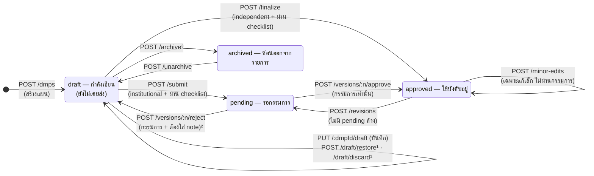

# DMP คืออะไร — อธิบายสำหรับคนที่ไม่เคยได้ยินมาก่อน

ลองนึกภาพนักวิจัยคนหนึ่งที่ได้ทุนไปเก็บตัวอย่างน้ำในแม่น้ำเจ้าพระยา เขาจะได้ข้อมูลมาเพียบ — ผลแล็บ, พิกัดจุดเก็บ, วันที่เก็บ ปัญหาคือข้อมูลพวกนี้มักจะหายไปเมื่อโครงการจบ: เก็บไว้ในเครื่องใครไม่รู้ ไฟล์ตั้งชื่ออะไรก็ไม่รู้ ต่อให้คนอื่นอยากใช้ต่อก็หาไม่เจอ

**Data Management Plan (DMP)** คือเอกสารที่บังคับให้นักวิจัยตอบคำถามเรื่องข้อมูลให้ชัด *ก่อน* เริ่มงาน: จะเก็บข้อมูลอะไร เก็บในรูปแบบไหน ใครเข้าถึงได้ ใช้ license อะไร เก็บรักษาระยะยาวอย่างไร ใครรับผิดชอบ เหมือนเป็น "สัญญาเรื่องข้อมูล" ที่เขียนไว้ล่วงหน้า

## ทำไมต้องมีระบบนี้

แผนเขียนด้วยมืออย่างเดียวไม่พอ เพราะ:

1. **ต้องมีคนตรวจ** — มหาวิทยาลัย/หน่วยงานอยากให้แผนมีคุณภาพ จึงให้คณะกรรมการอนุมัติก่อนใช้งานจริง
2. **ต้องมีหลักฐาน** — เมื่อแผนอนุมัติแล้ว ระบบจะ **สร้างงาน (tasks) ให้อัตโนมัติ** จาก dataset ที่วางไว้ในแผน เช่น "เตรียม license ให้ dataset A" ให้นักวิจัยทำตามและมีหลักฐานว่าทำจริง
3. **แผนเปลี่ยนได้ แต่ต้องมีรอย** — ทุกครั้งที่แผนถูกส่งพิจารณา ระบบเก็บ **version** (เหมือน save point ในเกม) ไว้เสมอ ใครอนุมัติ เมื่อไร เหตุผลอะไร ดูย้อนได้หมด และแผน **ลบไม่ได้เลย** — ถ้าไม่อยากใช้แล้วจะ archive (ซ่อนออกจากรายการ) เท่านั้น เพื่อคงหลักฐานไว้

## ตัวแผนหน้าตาเป็นยังไง

แผนไม่ได้เขียนอิสระแบบเอสเส แต่มีโครงตายตัวตามมาตรฐานสากลชื่อ **maDMP v3.0** (machine-actionable DMP — ตั้งใจให้คอมพิวเตอร์อ่านทำงานต่อได้ ไม่ใช่แค่เอกสาร PDF) ฟิลด์หลักใน draft:

- **title / description / language** — ชื่อ, คำอธิบาย, ภาษาของแผน
- **begin_date / end_date** — ช่วงเวลาโครงการ
- **contributor** — ใครร่วมงานบ้าง (ชื่อ, บทบาท, อีเมล) ต้องมีอย่างน้อย 1 คน
- **dataset** — จะมีชุดข้อมูลอะไรบ้าง อย่างน้อย 1 ชุด พร้อมรายละเอียดเชิงเทคนิค เช่น license, metadata, การเก็บรักษา
- **ethical_issues_exist** (+ description/report) — มีประเด็นจริยธรรมไหม

ใน API ทั้งหมดนี้ถูกเรียกว่า **DMP object** และมี field สำคัญที่ควรรู้จัก:

| Field | คืออะไร |
|---|---|
| `status` | สถานะแผน: `draft` (กำลังเขียน) → `pending` (รอกรรมการ) → `approved` (ใช้บังคับอยู่) |
| `plan_mode` | `institutional` (ส่งกรรมการ) หรือ `independent` (ตัดสินใจเอง) — ได้จากโหมดของโครงการที่ผูกไว้ |
| `draft` | สำเนาที่กำลังแก้อยู่ ยังไม่ใช่แผนทางการ |
| `draft_revision` | ตัวนับ "ฉันเห็น draft เวอร์ชันที่เท่าไร" ใช้กันคนเขียนทับกัน |
| `active_version` | เลข version ที่ใช้บังคับอยู่ตอนนี้ |
| `readiness` | ผลตรวจว่าแผนครบ checklist หรือยัง ถ้าไม่ครบมี `unmet_items` บอกว่าขาดอะไร |

## วงจรชีวิตของแผน



ทุกเส้นบน diagram คือ "endpoint ที่ใช้ได้เมื่อแผนอยู่สถานะนั้น" — ยิง endpoint ผิดสถานะเมื่อไร จะเจอ error 409 ตามตาราง errors ของ endpoint นั้นทันที

**เงื่อนไขประตูที่ไม่ได้อยู่บนเส้น (เจอเป็น error):**

- ทุก endpoint ที่ตัดสินจาก draft (update/restore/discard/submit/revisions/minor-edits/finalize) ต้องแนบ `draft_revision` ให้ตรงกับปัจจุบันเสมอ — ไม่ตรง → `409 draft_conflict` ตัดหน้าเงื่อนไขอื่นหมด
- Submit/Finalize ตรวจ checklist (`validateDraft`) ก่อนเสมอ — เขียนไม่ครบ เช่น ไม่มี dataset เลย → `422 plan_incomplete` พร้อมรายการข้อที่ขาด
- ¹ discard: ต้องเคยส่งแผนแล้วอย่างน้อยหนึ่งครั้ง ไม่งั้น `409 never_submitted` · restore: ห้าม restore version ที่ยัง `pending` (`409 version_pending`)
- ² reject ส่งแผนกลับไป `draft` เมื่อยังไม่มี version ใช้บังคับ แต่ถ้ามีแล้ว แผนคงอยู่ `approved` (version เก่ายังใช้อยู่ ไม่ใช่กลับ draft)
- ³ archive ใช้ได้เมื่อไม่มี version ใช้บังคับ — มีอยู่ → `409 plan_in_force` (tasks/evidence ยังเป็นหลักฐาน)

## draft_revision — ตัวนับกันเขียนทับ (อธิบายละเอียด)

### ปัญหาที่มันแก้

เปิดแผนเดียวกันจากสองที่ (สองแท็บ, โน้ตบุ๊ก + มือถือ, หรือสองคนในทีมที่มีสิทธิ์) แล้วกดบันทึกทั้งคู่ — คนที่กดทีหลังจะเขียนทับงานคนที่กดก่อนโดยไม่รู้ตัว ปัญหานี้เรียกว่า **lost update** และวิธีแก้แบบที่ระบบนี้ใช้เรียกว่า **optimistic concurrency** (optimistic = "หวังดี" ว่าปกติไม่มีใครชนกัน จึงไม่ล็อกอะไรล่วงหน้า แต่เช็คตอนบันทึกว่ามีใครแซงมาก่อนหรือเปล่า)

### draft_revision ทำงานยังไง ทีละขั้น

`draft_revision` คือ **เลขตัวนับของ draft** ที่ระบบเก็บไว้ข้างหนึ่ง ไม่ใช่ของ client:

1. **สร้างแผนใหม่** → `draft_revision = 0` (draft ยังว่าง)
2. **ทุกครั้งที่ draft ถูกเปลี่ยน** เซิร์ฟเวอร์ +1 ให้เอง ไม่ว่าจะเปลี่ยนจาก:
   - `PUT /dmps/:dmpId/draft` (บันทึก draft)
   - `POST .../draft/discard` (ทิ้งการแก้ กลับไป snapshot)
   - `POST .../draft/restore` (โหลด version เก่ามาแก้ต่อ)
3. **client ต้องจำเลขที่ตัวเองเคยเห็นล่าสุดไว้** แล้วส่งกลับมาพร้อมทุกคำสั่งที่ "ตัดสินจาก draft" — คือ Update a draft, Restore a version, Submit, Finalize, Save minor edits, Submit a revision
4. **เซิร์ฟเวอร์เทียบเลข**: ถ้าเลขที่ส่งมา ≠ เลขปัจจุบัน แปลว่าระหว่างที่คุณอ่านกับตอนที่คุณกดส่ง มีใครแก้ draft ไปแล้ว → ปฏิเสธด้วย `409 draft_conflict` และแถม draft ล่าสุด + เลขล่าสุดมาให้ใน error เลย เพื่อให้ merge ต่อได้ทันทีไม่ต้องยิง API หาอีกรอบ

### ยกตัวอย่างจริง ทีละสเต็ป

สมมติสมชายเปิดแผนในแท็บ A และแท็บ B พร้อมกัน (ทั้งคู่เห็น `draft_revision = 3`):

| ขั้น | ใครทำอะไร | ส่ง `draft_revision` | เซิร์ฟเวอร์เห็นยังไง | ผล |
|---|---|---|---|---|
| 1 | แท็บ A บันทึก draft | 3 | 3 = 3 ตรง ✓ | สำเร็จ เลขกลายเป็น 4 |
| 2 | แท็บ B บันทึก draft | 3 | ปัจจุบันคือ 4 ≠ 3 ✗ | **409 `draft_conflict`** + ส่ง draft ล่าสุด (rev 4) กลับไป |
| 3 | แท็บ B รับ error แล้ว rebase: รวมงานตัวเองเข้ากับ draft ล่าสุด แล้วส่งใหม่ | 4 | 4 = 4 ✓ | สำเร็จ เลขเป็น 5 |

จุดสำคัญ: **งานของแท็บ A ไม่หาย** — ระบบบังคับให้แท็บ B ต้องรู้ก่อนว่า draft เปลี่ยน แล้วเลือกเองว่าจะรวมยังไง แทนที่จะเขียนทับเงียบๆ

เทียบกับถ้าไม่มีระบบนี้: แท็บ B ส่งได้สบายๆ ทั้งที่ยึดข้อมูล rev 3 เป็นตั้ง แล้วเนื้อหาที่แท็บ A เขียนใหม่ถูกลบหายทั้งก้อน — รู้ตัวอีกทีเมื่อเปิดดูแล้วข้อความหายไปแล้ว

### จำง่ายๆ

`draft_revision` ทำหน้าที่เหมือน **เลขบัตรคิว**: คุณหยิบคิว 3 ไว้ ถ้าจะเข้ารับบริการ (บันทึก/ส่งแผน) ต้องยังถือคิว 3 อยู่ — ถ้าเลขคิวในมือไม่ตรงกับคิวที่ระบบเรียกอยู่ แปลว่ามีคนแซงคิวไปก่อนแล้ว ระบบจะไม่ให้ผ่าน และบอกเลขคิวปัจจุบันให้คุณไปต่อคิวใหม่ (rebase)

### ข้อควรรู้ของคน implement client

หน้าตาของ error เมื่อเลขไม่ตรง — สังเกตว่า draft ล่าสุดกับเลขล่าสุดถูกแถมมาในตัว error เลย:

```json
{
  "error": {
    "code": "draft_conflict",
    "message": "The draft changed since your last read",
    "draft": { "…": "…latest draft contents…" },
    "draft_revision": 5
  }
}
```

- เลข **ไม่รีเซ็ต** — ไม่ว่า draft จะถูก restore/discard ยังไง เลขขึ้นเรื่อยๆ เสมอ เพราะถ้า reset กลับ 0 จะชนกับเลขเก่าที่ client ยังถืออยู่
- `draft_revision` ต่างจาก **เลข version** — version นับ "ครั้งที่ส่งพิจารณา/ประกาศใช้" (นานๆ ครั้ง, ผ่านกรรมการ) ส่วน draft_revision นับ "ครั้งที่ draft เปลี่ยน" (ถี่มาก ทุก autosave) ตัวเลขสองอันไม่เกี่ยวข้องกันเลย
- ตอนเจอ `409 draft_conflict` **ไม่ต้องให้ user เริ่มพิมพ์ใหม่** — ดึง `draft` กับ `draft_revision` จาก error มา merge กับสิ่งที่ user พิมพ์ค้างไว้ แล้วยิงซ้ำด้วยเลขใหม่ได้เลย

## ใครเห็นอะไร (สิทธิ์การเข้าถึง)

- **researcher** — เห็นเฉพาะแผนของตัวเอง อ่าน/แก้ draft ได้ สร้าง/archived ได้
- **committee / chief** — เห็นเฉพาะแผน institutional ของโครงการที่ระบุ ทำหน้าที่ approve/reject
- **admin** — เรียก API แผนไม่ได้เลย
- กติกาซ่อนการมีอยู่: ถ้าคุณไม่ใช่เจ้าของแผน คำตอบคือ 404 (ไม่ใช่ 403) — ระบบจะไม่เปิดเผยด้วยซ้ำว่าแผนนั้นมีอยู่

## สรุป — ใช้ทำอะไร เพื่ออะไร

สรุปครบในสามบรรทัด:

1. **คืออะไร** — เอกสารวางแผนการจัดการข้อมูลวิจัยตามมาตรฐาน maDMP v3.0 บังคับให้นักวิจัยคิดเรื่องข้อมูลตั้งแต่ก่อนเริ่มงาน
2. **ใช้ทำอะไร** — เป็นเอกสารที่กรรมการตรวจอนุมัติ มี version/history ครบ และเมื่ออนุมัติแล้วระบบสร้างงานตาม dataset ที่วางไว้ให้อัตโนมัติ
3. **เพื่ออะไร** — ไม่ให้ข้อมูลวิจัยหาย/ใช้ต่อไม่ได้ มีหลักฐานความรับผิดชอบ และทำให้แผน "คอมพิวเตอร์อ่านทำต่อได้" ไม่ใช่แค่กระดาษ

## ทำไม endpoint ถึงเยอะขนาดนี้ — มันซ้ำกันเหรอ?

ไม่ซ้ำ — แต่ละตัวตอบคำถาม **ต่างกันหนึ่งข้อ** จนแยกกันไม่ได้ เทคนิคจำคือดูว่า endpoint นั้น *เปลี่ยนอะไร* และ *ใครมีสิทธิ์กด*

### กลุ่ม 1: จัดการแผน (แค่ "ทำเครื่องหมาย" กับแผนก้อนเดียว)

| Endpoint | เปลี่ยนอะไร | ทำไมต้องแยก |
|---|---|---|
| `POST /dmps/:dmpId/archive` | ตั้ง `archived_at` | ซ่อนแผนออกจากรายการ แต่ **หลักฐานยังอยู่ครบ** — แผนลบไม่ได้ จึงต้องมี endpoint นี้แทน delete |
| `POST /dmps/:dmpId/unarchive` | เคลียร์ `archived_at` | ทำกลับสิ่งเดียวกัน แต่กลับด้าน — ใส่รวมใน archive เป็น flag ก็ได้ แต่แยกเป็น action ชัดๆ กันยิงผิดพลาดง่ายกว่า |

สองตัวนี้ **ไม่แตะเนื้อหา draft เลย** — แค่เปิด/ปิด "สวิตช์ซ่อน"

### กลุ่ม 2: แก้เนื้อหา draft (สิทธิ์ researcher เจ้าของแผนเท่านั้น)

| Endpoint | เปลี่ยนอะไร | ทำไมต้องแยก |
|---|---|---|
| `PUT /dmps/:dmpId/draft` | เนื้อหา draft เป็นของใหม่ที่ user พิมพ์มา | การบันทึกปกติ |
| `POST .../draft/discard` | ทิ้งทุกการแก้ กลับไป snapshot ล่าสุดที่มีอยู่ | ผู้ใช้จำเป็นต้องมีปุ่ม "เริ่มใหม่จากจุดที่เคยส่ง" — และเป็น **undo ของระบบ ไม่ใช่การพิมพ์ทับ** user ไม่ต้องรู้เนื้อหาเก่า เซิร์ฟเวอร์กู้ให้เอง |
| `POST .../draft/restore` | โหลด snapshot ของ *version เลขที่ระบุ* มาใส่ draft | เหมือน discard แต่ระบุปลายทางเองได้ — discard กลับไปจุดล่าสุด ส่วน restore เลือกย้อนไปกี่ version ก็ได้ ทั้งคู่แตกต่างที่ "กลับไปที่ไหน" |

สามตัวนี้ยิงมากี่ครั้งก็ไม่มีผลต่อกรรมการหรือ version ทางการ — เพราะ **draft ยังไม่ใช่แผนทางการ** จะพิมพ์ซ้ำๆ กี่รอบก็เป็นแค่งานส่วนตัว

### กลุ่ม 3: ตัดสินจาก draft — จุดเปลี่ยนสถานะ (state transition)

นี่คือกลุ่มที่ดูซ้ำที่สุด (submit / revisions / finalize / minor-edits ทั้งหมด "ส่งแผน") แต่จริงๆ แต่ละตัวมีเงื่อนไขเข้า-ออกต่างกันจนรวมกันไม่ได้:

| Endpoint | ใครกด | เงื่อนไข | เกิดอะไรขึ้น |
|---|---|---|---|
| `POST .../submit` | researcher | แผน **ยังไม่เคย** มี version เลย | สร้าง version 1 สถานะ `pending` — เข้าสู่การพิจารณาครั้งแรก |
| `POST .../revisions` | researcher | มี version ใช้บังคับแล้ว **และ** ไม่มี `pending` ค้าง | สร้าง version ใหม่ให้กรรมการพิจารณารอบต่อไป |
| `POST .../minor-edits` | researcher | มี version ใช้บังคับ **และ** ทุกการแก้ต้องเป็น "เล็ก" | fold เข้า version เดิมทันที **ไม่ผ่านกรรมการ** — ถ้ามีการแก้ใหญ่จะถูกปฏิเสธ ให้ไปใช้ revisions |
| `POST .../finalize` | researcher (แผน independent) | แผน **ไม่ใช่** institutional | ประกาศใช้เลยไม่รอกรรมการ + สร้าง tasks ชุดแรก |
| `POST .../versions/:n/approve` | **กรรมการ** | version นั้นอยู่ใน `pending` | version กลายเป็นตัวใช้บังคับ |
| `POST .../versions/:n/reject` | **กรรมการ** | version นั้นอยู่ใน `pending` + ต้องใส่เหตุผล | ตีกลับ แผนกลับไปแก้ต่อ |

จุดที่ทำให้ **รวมกันไม่ได้** มี 3 เหตุผล:

1. **คนละคนกด** — submit/revisions/finalize/minor-edits คือนักวิจัย, approve/reject คือกรรมการ ถ้ายุบเป็น endpoint เดียว ต้องเดาจาก body ว่าผู้เรียกเป็นใคร ทำให้ตรวจสิทธิ์และ audit log พร่ามัว
2. **คนละกฎ** — submit ห้ามมี version อยู่แล้ว, revisions ต้องมี version ใช้บังคับ, minor-edits ต้องมี version ใช้บังคับ **และ** ห้ามมีการแก้ใหญ่, finalize ต้องเป็น independent กฎแต่ละอันพิสูจน์แยกขาด รวมกันแล้วต้องเขียน `if` ซ้อนกันหลายชั้นใน endpoint เดียว — error code ที่ user เจอจะกลายเป็นอะไรไม่รู้
3. **คนละผลลัพธ์** — submit สร้าง version ใหม่, minor-edits แตะ version เดิม, finalize สร้าง tasks เพิ่ม, approve เปลี่ยน `active_version` — ฝั่ง frontend ต้องรู้ชัดว่ากดปุ่มไหนแล้วหน้าจอเปลี่ยนยังไง

### เทียบกับสิ่งที่คุ้น: Git

ถ้าคุณเคยใช้ Git ระบบนี้คือ Git แบบมีบอส:

| DMP API | Git สิ่งที่ใกล้เคียง |
|---|---|
| `PUT /draft` | แก้ไฟล์ใน working directory |
| `draft/discard` | `git checkout -- .` (ทิ้งการแก้) |
| `draft/restore` | `git checkout <commit>` (โหลด commit เก่ามาแก้ต่อ) |
| `submit` / `revisions` | เปิด pull request |
| `approve` / `reject` | กด merge / request changes ใน PR |
| `minor-edits` | push commit เล็กๆ เข้า PR ที่ merge แล้วไปเลย |
| `finalize` | force merge โดยไม่รอ review (ใช้ได้เมื่อโครงการไม่ต้องมีบอส) |
| `archive` / `unarchive` | archive repository (ซ่อนอ่านอย่างเดียว ไม่ลบ) |

ไม่มี endpoint ไหนซ้ำหน้าที่ตัวไหน — ซ้ำได้แค่ "คำ" ในชื่อ แต่คำถามที่แต่ละตัวตอบต่างกันหมด

## แผนถูกเก็บไว้ที่ไหนใน database

ใน API เรียกว่า "plan" แต่ใน database ตารางชื่อ **`dmps`** — อย่าค้นหาด้วยคำว่า plans แล้วเผลอคิดว่าไม่มี นิยามอยู่ที่ `src/database/schema/index.ts` (สร้างจริงโดย migration ใน `src/database/migrations/`)

โครงสร้าง 3 ตาราง:

| ตาราง | เก็บอะไร | คอลัมน์สำคัญ |
|---|---|---|
| `dmps` | แผน — แถวเดียวต่อแผนหนึ่ง | `draft` (**JSONB** = เนื้อหา maDMP ทั้งก้อน รวม dataset/contributor/cost ที่ nested อยู่ข้างใน), `draft_revision`, `status`, `archived_at`, `active_version` |
| `dmp_versions` | ทุก version ที่เคย submit/finalize | `snapshot` (JSONB เนื้อหา ณ ตอนนั้น), `status`, `changes`, `decision_note` |
| `tasks` | งานที่ระบบ generate จาก dataset ในแผน | FK (`dmp_id`) ชี้กลับไปที่ `dmps` |

จุดที่มือใหม่สับสนบ่อย:

- **ไม่มีตาราง `drafts` หรือ `datasets` แยก** — เนื้อหา draft อยู่ในคอลัมน์ JSONB เดียว (`dmps.draft`) เหตุผลคือ draft เป็นก้อนเดียวที่ autosave ทั้งก้อนทุกครั้ง (ADR-0020) ไม่จำเป็นต้องแยกเป็นแถวๆ
- **"ลบไม่ได้" ในทางปฏิบัติ** = ไม่มีโค้ดไหนรัน `DELETE FROM dmps` เลย — ปลายทางเดียวคือ set `archived_at` ให้แผนหลุดจากรายการปกติ แถม `dmp_versions` ตั้ง FK เป็น `ON DELETE CASCADE` ชี้มาที่แผน แปลว่าถ้าบังคับลบแผน version/หลักฐานทั้งหมดจะหายตาม จึงห้ามลบตั้งแต่ต้น
- กฎ "หนึ่ง pending ต่อแผน" ไม่ได้บังคับในโค้ดอย่างเดียว แต่เป็น **unique index ที่ Postgres เฝ้าไว้เอง** (`dmp_versions_one_pending_uq` — unique เฉพาะแถวที่ `status = 'pending'`) แม้โค้ดพลาด ฐานข้อมูลก็จะปฏิเสธแถวซ้ำเอง

## แก้ draft แล้วเข้า `dmp_versions` ไหม?

**ไม่เข้า** — ตราบใดที่แผนยังเป็น draft อยู่ การแก้ผ่าน `PUT /dmps/:dmpId/draft` (รวม discard/restore ด้วย) จะแตะแค่ **แถวเดียวใน `dmps`**: อัปเดตคอลัมน์ `draft` (JSONB ทับของเดิม) และ `draft_revision` +1 แถวใน `dmp_versions` ถูกสร้างเฉพาะ 3 จังหวะ — **submit** (ครั้งแรก), **submit a revision** (รอบถัดไป), **finalize** (independent) — ตอนนั้น draft จะถูก "แช่แข็ง" เป็น `snapshot` ลง version

ข้อยกเว้นเดียวที่แตะ `dmp_versions` โดยไม่สร้างแถวใหม่: **minor-edits** — fold เนื้อหาใหม่เข้า version ที่ใช้บังคับอยู่เดิม (แถวเดิม คอลัมน์ `minor_edits` อัปเดต)

ผลข้างเคียงที่ควรรู้: แผนที่ยังเป็น draft ถ้าเขียนทับหลายรอบ เนื้อหาเก่าจะ **หายถาวร** เพราะไม่มี snapshot เก็บไว้ — ประวัติเริ่มจดจริงเมื่อ submit ครั้งแรกเท่านั้น การ discard/restore ย้อนได้เฉพาะกลับไป snapshot จาก version ที่เคยส่งแล้ว แผนที่ไม่เคยส่งเลยจะ discard ไม่ได้ด้วยซ้ำ (409 `never_submitted` — เพราะไม่มีจุดกลับให้ไป)
