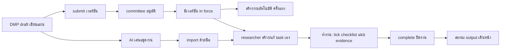

# Tasks API — อธิบายเข้าใจง่าย

อธิบายจาก `docs/api/tasks.md` สำหรับคนที่เพิ่งเข้ามาดูระบบนี้ครั้งแรก

## Task คืออะไร

Task คือ to-do item บนแผนการจัดการข้อมูลวิจัย (DMP) — เหมือน task ใน Jira/Trello ที่คุณเคยใช้ แต่ผูกอยู่กับ "แผนข้อมูล" ของงานวิจัยหนึ่งฉบับ และมีบทบาทในการทำงานจริงหลังแผนผ่านการอนุมัติ

แผน (DMP) เป็นเอกสารบอกว่า "เราจะจัดการข้อมูลวิจัยอย่างไร" แต่เอกสารเองไม่ทำงาน — task คือส่วนที่แปลงแผนให้เป็นงานจริงที่มีคนทำ มีสถานะ มีวันกำหนด และมีหลักฐานว่าทำแล้ว

Task หนึ่งอันประกอบด้วย:

- **ชื่องาน + รายละเอียด** — เช่น "ถ่ายภาพซ้ำชุดเก็บรักษา"
- **lifecycle_stage** — งานนี้อยู่ระยะไหนของชีวิตข้อมูล: `collect` (เก็บ) → `process` (จัดระเบียบ) → `analyse` (วิเคราะห์) → `preserve` (เก็บรักษา) → `share` (เผยแพร่)
- **status** — `todo` / `in_progress` / `done` / `cancelled` (ปิดงานต้องใช้ endpoint Complete เท่านั้น ห้าม PATCH ส่ง `done` ตรง ๆ — ระบบตีกลับ 409)
- **priority** — `low` / `medium` / `high`
- **checklist** — ตัดงานเป็น step ย่อย เช่น "ถ่ายภาพมุมหน้า", "ตรวจสี" tick ทีละ step; ความคืบหน้า (`progress_percent`) ระบบคำนวณให้เองจากสัดส่วน step ที่ tick แล้ว
- **evidence** — หลักฐานว่างานทำจริง: ไฟล์ที่อัปโหลด / ลิงก์ / DOI จาก repository
- **dataset_id** (ไม่บังคับ) — ถ้างานนี้ทำเพื่อ output (dataset) หนึ่งตัว จะผูกไว้; ถ้าไม่ผูกคือ "งานทั่วไป" ของแผน

## ใช้ทำอะไร เพื่ออะไร

1. **ทำให้แผนไม่ใช่แค่กระดาษ** — งานที่เขียนไว้ในแผนถูกติดตามได้จริงว่าเริ่มหรือยัง คืบกี่เปอร์เซ็นต์ เสร็จเมื่อไหร่
2. **บังคับหลักฐานตามความสำคัญของงาน** — ตอนปิดงาน ระบบตรวจว่า evidence "ดีพอ" ไหมตามชนิดงาน:

   | ลักษณะงาน | ขอหลักฐานแค่ไหน |
   | --- | --- |
   | งานทั่วไป (ไม่ผูก output) | ประกาศว่าทำแล้วก็พอ |
   | งานผูก output, stage collect/process/analyse | ต้องแนบหลักฐาน: ไฟล์ / URL / DOI |
   | งาน stage preserve/share บนแผน institutional | ต้องเป็น DOI จาก repository เท่านั้น — เพราะ DOI เป็นหลักฐานที่ปลอมไม่ได้ (ผู้วิจัยสร้างเองไม่ได้ ต้องได้จาก repository) |
   | งาน stage preserve/share บนแผน independent | แนบหลักฐานไฟล์ / URL / DOI ได้ |

3. **ผลักสถานะของ dataset เดินหน้า** — ปิดงานที่ผูก output เมื่อไหร่ สถานะของ output นั้นถูกดันไปตาม stage ของงาน (ไปหน้าเท่านั้น ไม่มีวันถอยหลัง)
4. **กันการลบประวัติ** — งานที่มีบันทึกการทำงานแล้ว (มี evidence, มี step ที่ tick, หรือเคยเสร็จ) ลบถาวรไม่ได้ ต้องยกเลิกแทน เพื่อให้ประวัติการทำงานอยู่กับระบบตลอด

## เกี่ยวข้องกับ DMP อย่างไร

- Task อยู่ใต้แผนเสมอ (มี `dmp_id`) และสร้างได้เฉพาะเมื่อแผนมี **เวอร์ชันที่มีผล (in force)** แล้ว — คือผ่านการอนุมัติแล้ว นั่นหมายคือ task เกิดหลังกระบวนการตรวจรับรองแผน ไม่ใช่ตอนร่างแผนอยู่
- ถ้างานผูกกับ output ต้องเป็น output ที่มีอยู่จริงในเวอร์ชันที่มีผล — ส่ง id มั่วมาโดนตีกลับ 400 (`dataset_not_in_force`)
- ถ้า output ที่งานผูกอยู่ถูกลบออกจากแผน (ใน revision ที่ผ่านอนุมัติ) งานถูกยกเลิกอัตโนมัติ (`cancel_reason: "output_removed"`) แต่ระบบเก็บ "reopen offer" ไว้ — ถ้า output ตัวนั้นกลับมาในแผนอีก (แม้ได้ id ใหม่) ผู้เขียนแผนเลือก accept เพื่อดึงงานกลับมาทำต่อจากสถานะเดิมพอดี หรือ dismiss เพื่อปล่อยไป

## ใครใช้ task บ้าง ใช้ตอนไหน

| บทบาท | สิทธิ์ | ใช้เมื่อไหร่ |
| --- | --- | --- |
| **researcher** (ผู้เขียนแผนนั้น) | ทำได้ทุกอย่าง: สร้าง แก้ tick ปิด ยกเลิก ลบ นำเข้างาน AI ตอบ reopen offer | ทั้ง workflow การทำงานจริงของตัวเอง |
| **committee / chief** | อ่านอย่างเดียว ผ่านการเป็นสมาชิกโครงการ | ตรวจว่างานของโครงการที่กำกับอยู่คืบไหม — เช่น เรียก `GET /tasks?dmp_id=…` ก่อนประชุมติดตามผล |
| **admin** | เข้าไม่ได้เลย (403 `permission_denied`) | — |

สถานการณ์จริงของ researcher โดยทั่วไป:

1. แผนผ่านอนุมัติ → ระบบ generate ชุดงานตั้งต้นให้อัตโนมัติ (ครั้งเดียว)
2. หรือดึงข้อเสนอของ AI มาดูก่อน แล้วสั่ง "นำเข้า" เป็นงานจริงเอง
3. ระหว่างทำงาน: เพิ่มงานใหม่เอง (`POST /tasks`), ตัดงานเป็น checklist, tick ทีละ step, แนบ evidence
4. งานเสร็จ → กด Complete (ระบบตรวจ evidence ก่อนยอม)
5. ปิดผิด → Reopen เพื่อกลับมาแก้ (evidence กับ tick เดิมยังอยู่)
6. งานไม่ต้องทำแล้ว → Cancel; ถ้ายังไม่มีบันทึกใด ๆ เลย จะ Delete ถาวรก็ได้

## AI มีสิทธิ์อะไรบ้าง

สำคัญ: **AI ไม่ได้เรียก API เอง** — AI เสนอรายการงานมาให้ แล้วผู้ใช้เป็นคนกดนำเข้าเสมอ สิทธิ์ของ AI จึงมีแค่สองทาง:

1. **เสนอชุดงาน (proposal)** — ฝั่งผู้ใช้ดึงข้อเสนอมาดู ยังไม่มีอะไรถูกสร้างในระบบ
2. **สร้างงานอัตโนมัติครั้งเดียวตอนแผนได้รับอนุมัติครั้งแรก** — และถ้ามีการ import งาน AI ด้วยมือก่อน ระบบตั้งธง `tasks_generated` บนแผน ทำให้ไม่ generate ซ้ำอีก

งานที่มาจาก AI ถูกติด `generated_by: "ai"` และผูก `source_version_id` กับเวอร์ชันแผน ณ ตอนนั้น นอกนั้น AI ไม่มีสิทธิ์แก้ tick ปิดงาน หรือแตะ evidence — ทั้งหมดเป็นของ researcher แต่ผู้เขียนแผนสั่งลบงาน AI ที่ *ยังไม่ถูกแตะ* ทิ้งได้ผ่าน import โหมด `replace` (งานที่ผู้ใช้แตะแล้ว — tick checklist / ใส่ evidence / เปลี่ยนสถานะ — รอดทั้งหมด)

## ข้อสังเกตจากเอกสารต้นทาง

- ไฟล์ต้นทางมีโน้ต `> [!NOTE] Reconstructed from code` กับ object ตัวอย่างแทบทุกอัน — เอกสารถูกสร้างย้อนกลับจากโค้ด ไม่ใช่เขียนจาก spec ก่อน ค่าที่แสดง (เช่น id ในตัวอย่าง) จึงควรเช็คกับโค้ดจริงก่อนใช้อ้างอิง
- `GET /tasks` บังคับกรองด้วย `project_id` หรือ `dmp_id` อย่างน้อยหนึ่งตัว (ไม่ส่ง → 400 `filter_required`) และ `limit` ที่ parse ไม่ได้จะใช้ค่าเริ่มต้นเงียบ ๆ — สองพฤติกรรมนี้ต่างกัน (หนึ่ง throw หนึ่งเงียบ) ซึ่งเป็นแบบที่เอกสารระบุ ไม่ใช่ความผิดปกติ
