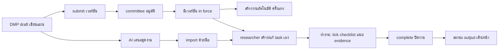
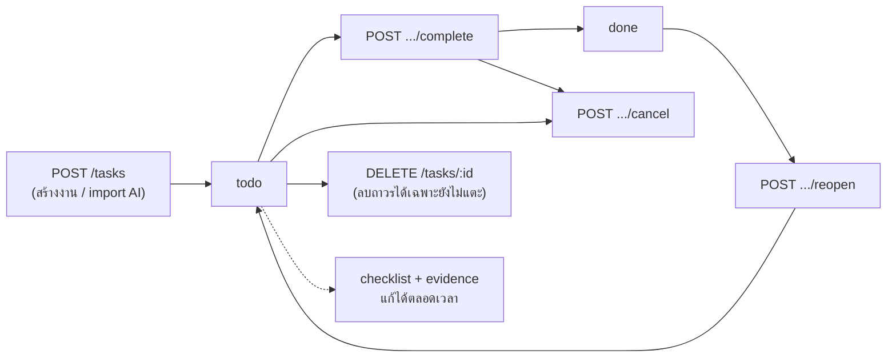

# Tasks API — อธิบายเข้าใจง่าย

อธิบายจาก `docs/api/tasks.md` สำหรับคนที่เพิ่งเข้ามาดูระบบนี้ครั้งแรก

## Task คืออะไร

Task คือ to-do item บนแผนการจัดการข้อมูลวิจัย (DMP) — เหมือน task ใน Jira/Trello ที่คุณเคยใช้ แต่ผูกอยู่กับ "แผนข้อมูล" ของงานวิจัยหนึ่งฉบับ และมีบทบาทในการทำงานจริงหลังแผนผ่านการอนุมัติ

แผน (DMP) เป็นเอกสารบอกว่า "เราจะจัดการข้อมูลวิจัยอย่างไร" แต่เอกสารเองไม่ทำงาน — task คือส่วนที่แปลงแผนให้เป็นงานจริงที่มีคนทำ มีสถานะ มีวันกำหนด และมีหลักฐานว่าทำแล้ว

Task หนึ่งอันประกอบด้วย:

- **ชื่องาน + รายละเอียด** — เช่น "ถ่ายภาพซ้ำชุดเก็บรักษา"
- **lifecycle_stage** — งานนี้อยู่ระยะไหนของชีวิตข้อมูล: `collect` (เก็บ) → `process` (จัดระเบียบ) → `analyse` (วิเคราะห์) → `preserve` (เก็บรักษา) → `share` (เผยแพร่)
- **status** — `todo` / `in_progress` / `done` / `cancelled` (ปิดงานต้องใช้ endpoint Complete เท่านั้น ห้าม PATCH ส่ง `done` ตรง ๆ — ระบบตีกลับ 409)
- **priority** — `low` / `medium` / `high`
- **checklist** — ตัดงานเป็น step ย่อย เช่น "ถ่ายภาพมุมหน้า", "ตรวจสี" tick ทีละ step; ความคืบหน้า (`progress_percent`) ระบบคำนวณให้เองจากสัดส่วน step ที่ tick แล้ว
- **evidence** — หลักฐานว่างานทำจริง: ไฟล์ที่อัปโหลด / ลิงก์ / DOI จาก repository
- **dataset_id** (ไม่บังคับ) — ถ้างานนี้ทำเพื่อ output (dataset) หนึ่งตัว จะผูกไว้; ถ้าไม่ผูกคือ "งานทั่วไป" ของแผน

## ใช้ทำอะไร เพื่ออะไร

1. **ทำให้แผนไม่ใช่แค่กระดาษ** — งานที่เขียนไว้ในแผนถูกติดตามได้จริงว่าเริ่มหรือยัง คืบกี่เปอร์เซ็นต์ เสร็จเมื่อไหร่
2. **บังคับหลักฐานตามความสำคัญของงาน** — ตอนปิดงาน ระบบตรวจว่า evidence "ดีพอ" ไหมตามชนิดงาน:

   | ลักษณะงาน | ขอหลักฐานแค่ไหน |
   | --- | --- |
   | งานทั่วไป (ไม่ผูก output) | ประกาศว่าทำแล้วก็พอ |
   | งานผูก output, stage collect/process/analyse | ต้องแนบหลักฐาน: ไฟล์ / URL / DOI |
   | งาน stage preserve/share บนแผน institutional | ต้องเป็น DOI จาก repository เท่านั้น — เพราะ DOI เป็นหลักฐานที่ปลอมไม่ได้ (ผู้วิจัยสร้างเองไม่ได้ ต้องได้จาก repository) |
   | งาน stage preserve/share บนแผน independent | แนบหลักฐานไฟล์ / URL / DOI ได้ |

3. **ผลักสถานะของ dataset เดินหน้า** — ปิดงานที่ผูก output เมื่อไหร่ สถานะของ output นั้นถูกดันไปตาม stage ของงาน (ไปหน้าเท่านั้น ไม่มีวันถอยหลัง)
4. **กันการลบประวัติ** — งานที่มีบันทึกการทำงานแล้ว (มี evidence, มี step ที่ tick, หรือเคยเสร็จ) ลบถาวรไม่ได้ ต้องยกเลิกแทน เพื่อให้ประวัติการทำงานอยู่กับระบบตลอด

## เกี่ยวข้องกับ DMP อย่างไร

หัวใจของ flow นี้คือ **AI ใช้รอบเดียว**: ชุดงานถูกสร้างครั้งแรกครั้งเดียวตอนแผนผ่านอนุมัติ (หรือจาก import ข้อเสนอของ AI ด้วยมือ) แล้วจบ — จากนั้นเป็นงานของ researcher ทั้งหมด ทำงาน → tick checklist → แนบ evidence → ปิดงาน วนซ้ำไปเรื่อย ๆ โดยไม่มี AI เข้ามาสร้างหรือแก้อะไรอีก

เหตุที่ทำแบบนี้ได้เพราะแผนถูกติดธง `tasks_generated` เอาไว้เมื่อเจนชุดแรกแล้ว — ถ้ามีการอนุมัติเวอร์ชันใหม่หรือ researcher เข้ามากดอะไรเพิ่ม ระบบก็เห็นธงนี้และข้ามการเจนไปเสมอ งานใหม่หลังจากนั้นเกิดจากมือ researcher เท่านั้น ผลคือชุดงานหลังอนุมัติสองรอบจะเหมือนกันเสมอ (สร้างจาก logic ตายตัวเดียวกัน ไม่ผ่าน AI ที่อาจตอบเพี้ยน) และความคืบหน้าที่ tick ไว้ไม่มีทางถูกชุดงานใหม่ทับหาย

- Task อยู่ใต้แผนเสมอ (มี `dmp_id`) และสร้างได้เฉพาะเมื่อแผนมี **เวอร์ชันที่มีผล (in force)** แล้ว — คือผ่านการอนุมัติแล้ว นั่นหมายคือ task เกิดหลังกระบวนการตรวจรับรองแผน ไม่ใช่ตอนร่างแผนอยู่
- ถ้างานผูกกับ output ต้องเป็น output ที่มีอยู่จริงในเวอร์ชันที่มีผล — ส่ง id มั่วมาโดนตีกลับ 400 (`dataset_not_in_force`)
- ถ้า output ที่งานผูกอยู่ถูกลบออกจากแผน (ใน revision ที่ผ่านอนุมัติ) งานถูกยกเลิกอัตโนมัติ (`cancel_reason: "output_removed"`) แต่ระบบเก็บ "reopen offer" ไว้ — ถ้า output ตัวนั้นกลับมาในแผนอีก (แม้ได้ id ใหม่) ผู้เขียนแผนเลือก accept เพื่อดึงงานกลับมาทำต่อจากสถานะเดิมพอดี หรือ dismiss เพื่อปล่อยไป

## ใครใช้ task บ้าง ใช้ตอนไหน

| บทบาท | สิทธิ์ | ใช้เมื่อไหร่ |
| --- | --- | --- |
| **researcher** (ผู้เขียนแผนนั้น) | ทำได้ทุกอย่าง: สร้าง แก้ tick ปิด ยกเลิก ลบ นำเข้างาน AI ตอบ reopen offer | ทั้ง workflow การทำงานจริงของตัวเอง |
| **committee / chief** | อ่านอย่างเดียว ผ่านการเป็นสมาชิกโครงการ | ตรวจว่างานของโครงการที่กำกับอยู่คืบไหม — เช่น เรียก `GET /tasks?dmp_id=…` ก่อนประชุมติดตามผล |
| **admin** | เข้าไม่ได้เลย (403 `permission_denied`) | — |

สถานการณ์จริงของ researcher โดยทั่วไป:

1. แผนผ่านอนุมัติ → ระบบ generate ชุดงานตั้งต้นให้อัตโนมัติ (ครั้งเดียว)
2. หรือดึงข้อเสนอของ AI มาดูก่อน แล้วสั่ง "นำเข้า" เป็นงานจริงเอง
3. ระหว่างทำงาน: เพิ่มงานใหม่เอง (`POST /tasks`), ตัดงานเป็น checklist, tick ทีละ step, แนบ evidence
4. งานเสร็จ → กด Complete (ระบบตรวจ evidence ก่อนยอม)
5. ปิดผิด → Reopen เพื่อกลับมาแก้ (evidence กับ tick เดิมยังอยู่)
6. งานไม่ต้องทำแล้ว → Cancel; ถ้ายังไม่มีบันทึกใด ๆ เลย จะ Delete ถาวรก็ได้

## AI มีสิทธิ์อะไรบ้าง

สำคัญ: **AI ไม่ได้เรียก API เอง** — AI เสนอรายการงานมาให้ แล้วผู้ใช้เป็นคนกดนำเข้าเสมอ สิทธิ์ของ AI จึงมีแค่สองทาง:

1. **เสนอชุดงาน (proposal)** — ฝั่งผู้ใช้ดึงข้อเสนอมาดู ยังไม่มีอะไรถูกสร้างในระบบ
2. **สร้างงานอัตโนมัติครั้งเดียวตอนแผนได้รับอนุมัติครั้งแรก** — และถ้ามีการ import งาน AI ด้วยมือก่อน ระบบตั้งธง `tasks_generated` บนแผน ทำให้ไม่ generate ซ้ำอีก

งานที่มาจาก AI ถูกติด `generated_by: "ai"` และผูก `source_version_id` กับเวอร์ชันแผน ณ ตอนนั้น นอกนั้น AI ไม่มีสิทธิ์แก้ tick ปิดงาน หรือแตะ evidence — ทั้งหมดเป็นของ researcher แต่ผู้เขียนแผนสั่งลบงาน AI ที่ _ยังไม่ถูกแตะ_ ทิ้งได้ผ่าน import โหมด `replace` (งานที่ผู้ใช้แตะแล้ว — tick checklist / ใส่ evidence / เปลี่ยนสถานะ — รอดทั้งหมด)

## ข้อสังเกตจากเอกสารต้นทาง

- ไฟล์ต้นทางมีโน้ต `> [!NOTE] Reconstructed from code` กับ object ตัวอย่างแทบทุกอัน — เอกสารถูกสร้างย้อนกลับจากโค้ด ไม่ใช่เขียนจาก spec ก่อน ค่าที่แสดง (เช่น id ในตัวอย่าง) จึงควรเช็คกับโค้ดจริงก่อนใช้อ้างอิง
- `GET /tasks` บังคับกรองด้วย `project_id` หรือ `dmp_id` อย่างน้อยหนึ่งตัว (ไม่ส่ง → 400 `filter_required`) และ `limit` ที่ parse ไม่ได้จะใช้ค่าเริ่มต้นเงียบ ๆ — สองพฤติกรรมนี้ต่างกัน (หนึ่ง throw หนึ่งเงียบ) ซึ่งเป็นแบบที่เอกสารระบุ ไม่ใช่ความผิดปกติ

## Tasks Endpoints — 17 อันนี้อันไหนทำอะไร

อธิบายจาก `docs/api/tasks.md` สำหรับคนที่เปิดหน้า Endpoints แล้วรู้สึกว่า "complete / reopen / cancel / delete หน้าตาคล้ายกันหมดเลย" — ปกติแล้ว ถ้าคุณเคยเขียน REST API (GET = อ่าน, POST = สร้าง, PATCH = แก้, DELETE = ลบ) จะงงตรงที่ tasks มี POST หลายอันที่ไม่ได้ "สร้าง" อะไรเลย นั่นเพราะส่วนที่เปลี่ยนสถานะของงานถูกออกแบบเป็น **ปุ่มกด** แต่ละปุ่มมีกติกาของตัวเอง ไม่ใช่การ PATCH ส่งค่าไปมั่ว ๆ

## ภาพรวม: มันคือปุ่มในหน้าเว็บ

ลองนึกงานหนึ่งชิ้นใน Trello ที่มีทั้งการ์ด (task), checklist ในการ์ด, ไฟล์แนบ (evidence) — endpoint ทั้ง 17 อันแบ่งเป็น 5 กลุ่มตามสิ่งที่กด:

| กลุ่ม        | กำลังจัดการอะไร          | endpoints |
| ------------ | ------------------------ | --------- |
| ตัวงาน       | task object ทั้งก้อน     | 7 อัน     |
| นำเข้างาน AI | ชุดงานที่ AI เสนอ        | 1 อัน     |
| checklist    | step ย่อยในงาน           | 4 อัน     |
| evidence     | หลักฐานการทำงาน          | 2 อัน     |
| reopen offer | ข้อเสนอเปิดงานคืนจากระบบ | 3 อัน     |

ข้อสังเกตใช้งานร่วม: แทบทุก endpoint คืน **task object ฉบับเต็ม** กลับมาเสมอ (ไม่ใช่แค่ "สำเร็จ") — หน้าเว็บเลยไม่ต้องยิง GET ซ้ำหลังกดปุ่ม ส่วน `GET /tasks` ต้องส่ง `project_id` หรือ `dmp_id` อย่างน้อยหนึ่งตัว ไม่งั้น 400 `filter_required` และเลื่อนหน้าด้วย `starting_after` + `task_id` ตัวสุดท้ายของหน้าปัจจุบัน

## กลุ่ม 1: จัดการตัวงาน (7 อัน)

สี่อันนี้คือ lifecycle ของงาน ต่างกันที่ "เหตุผลที่งานหยุด/กลับมา":

| endpoint | ปุ่มนี้ทำอะไร | กติกาที่ต้องรู้ |
| --- | --- | --- |
| `POST /tasks/:task_id/complete` | ปิดงานว่าเสร็จ — ปุ่มเดียวที่ทำให้สถานะเป็น `done` ได้ | ตรวจ evidence "ดีพอ" ไหมก่อนยอม (งานผูก output stage preserve/share บนแผน institutional ต้องเป็น DOI เท่านั้น); ยิง PATCH ส่ง `status: "done"` ตรง ๆ โดนตีกลับ 409 `use_complete` — นี่คือเหตุผลที่มี endpoint แยก ไม่ใช่ PATCH |
| `POST /tasks/:task_id/reopen` | ปิดผิด กดเปิดคืน | สถานะกลับไป `in_progress` (หรือ `todo` ถ้าไม่มี step ที่ tick เลย); evidence กับ tick เดิม**ไม่หาย** — ต่างจากการสร้างใหม่ซึ่งเริ่มจากศูนย์ |
| `POST /tasks/:task_id/cancel` | งานไม่ต้องทำแล้ว | สถานะ `cancelled` พร้อมจด `cancelled_from` (ว่าก่อนยกเลิกอยู่สเตตไหน); record ยังอยู่บนระบบ ประวัติไม่ถูกลบ |
| `DELETE /tasks/:task_id` | ลบถาวรจากระบบ | **ได้เฉพาะงานที่ยังไม่มีบันทึกใด ๆ** — ไม่มี evidence, ไม่มี step ที่ tick, ไม่เคยเสร็จ; ถ้าแตะแล้วแม้นิดเดียวต้องใช้ cancel แทน (กันประวัติการทำงานหาย) |

สามอันที่เหลือเป็น CRUD ธรรมดา:

| endpoint | ทำอะไร |
| --- | --- |
| `GET /tasks` | ดึงรายการงาน ต้องกรองด้วย `project_id` หรือ `dmp_id` |
| `POST /tasks` | สร้างงานใหม่ เริ่มที่ `todo`, checklist ว่าง, progress 0% |
| `PATCH /tasks/:task_id` | แก้รายละเอียด ชื่อ/priority/วันกำหนด/stage — **แก้ `status` ไม่ได้** (ยกเว้นระหว่าง `todo`↔`in_progress`) เพราะ `done` และ `cancelled` ต้องผ่านปุ่มข้างบน |

## กลุ่ม 2: นำเข้างานจาก AI (1 อัน)

**`POST /dmps/:dmp_id/tasks/generated`** — AI เสนอชุดงานมาแล้ว อันนี้คือปุ่ม "นำเข้า" ข้อเสนอไม่ได้สร้างงานจริงในระบบเอง ต้องยิง endpoint นี้ด้วยมือเสมอ:

| หัวข้อ | รายละเอียด |
| --- | --- |
| `mode: "merge"` | งานเดิมคงไว้ เติมชุดใหม่ต่อ |
| `mode: "replace"` | ลบงาน AI ที่ยังไม่ถูกแตะทิ้ง แล้วใส่ชุดใหม่ — งานที่ผู้ใช้แตะแล้วรอดทั้งหมด |
| response | สรุปเป็นตัวเลข `added` / `removed` / `kept` |
| ผลข้างเคียง | ตั้งธง `tasks_generated` บนแผน ระบบไม่เจนชุดอัตโนมัติตอนอนุมัติซ้ำ (อ่านเพิ่มใน [explained/tasks.md](./tasks.md) หัวข้อ AI) |

## กลุ่ม 3: checklist (4 อัน) — อันที่หน้าตาซ้ำที่สุด

งานหนึ่งอันมี checklist เป็น array เก็บบน task เดียว สี่ endpoint นี้คือ CRUD ของ array นั้น จุดที่ต่างจริง ๆ:

| endpoint | ทำอะไร | จุดที่ต่างจริง ๆ |
| --- | --- | --- |
| `POST /tasks/:task_id/checklist` | เพิ่ม step ทีละอัน (`{"label": "ถ่ายภาพมุมหน้า"}`) ต่อท้าย array | ไม่กระทบ step เดิม |
| `PUT /tasks/:task_id/checklist` | จัดโครง step ใหม่**ทั้งชุด** ส่ง `labels` เป็นชื่อ step ทั้งหมดที่ต้องการ | รักษา step ที่ tick แล้วไว้ด้านหน้า (preservation) แล้วสร้าง step ใหม่จาก `labels` ต่อท้าย — **id ใหม่หมด**; เช่น เดิม `[ถ่ายภาพ✓, ตรวจสอบ]` ส่ง `labels: ["ถ่ายภาพซ้ำ", "ตรวจสอบสี", "จัดเก็บ"]` จะได้ `[ถ่ายภาพ✓(id ใหม่), ถ่ายภาพซ้ำ, ตรวจสอบสี, จัดเก็บ]` |
| `PATCH /tasks/:task_id/checklist/:item_id` | แก้ step เดี่ยว — การใช้งานหลักคือ **tick**: ส่ง `{"done": true}` | ปุ่มเช็คบ็อกซ์ในหน้าเว็บยิงอันนี้ (tick หนึ่งครั้ง = PATCH หนึ่งครั้ง ไม่มี endpoint "tick" ชื่อตรง ๆ); `progress_percent` คำนวณใหม่ให้เอง (สัดส่วน step ที่ tick / ทั้งหมด) |
| `DELETE /tasks/:task_id/checklist/:item_id` | ลบ step ทิ้ง | เหลือตัวอื่น |

## กลุ่ม 4: evidence (2 อัน)

| endpoint | ทำอะไร | ข้อควรรู้ |
| --- | --- | --- |
| `PUT /tasks/:task_id/evidence` | ตั้งหลักฐาน (แทนที่ค่าเดิมทั้งก้อน) — `type` เป็น `none`/`file`/`url`/`rdm_deposit` พร้อม `ref` | ถ้า `ref` ตรงรูปแบบ DOI (เช่น `10.5281/zenodo.10245312`) ระบบบังคับ `type: "rdm_deposit"` ให้เสมอไม่ว่าจะประกาศมาว่าอะไร — DOI คือหลักฐานชนิดเดียวที่ผู้วิจัยปลอมไม่ได้; `type: "file"` ต้องชี้ไฟล์ที่อัปโหลดแล้วจริงบนโครงการ ไม่งั้น 404 |
| `DELETE /tasks/:task_id/evidence` | ล้างหลักฐาน | กลับเป็น `none` |

## กลุ่ม 5: reopen offer (3 อัน) — ต่างจาก POST .../reopen ยังไง

อย่าสับสน: **`POST /tasks/:task_id/reopen`** คือผู้ใช้กดเปิดงานที่ปิดผิดเอง ส่วนกลุ่มนี้คือสถานการณ์กลับกัน — **ระบบเป็นคนยื่นข้อเสนอให้ผู้ใช้** เมื่อ output (dataset) ที่งานผูกอยู่ถูกลบออกจากแผน งานถูกยกเลิกอัตโนมัติด้วยเหตุ `output_removed` แล้วระบบเก็บ offer ไว้ เผื่อ output ตัวนั้นกลับมาในแผนอีก (แม้ได้ id ใหม่) ผู้เขียนแผนจะได้เลือกดึงงานกลับมาทำต่อจากสถานะเดิมพอดี

| endpoint | ทำอะไร | ข้อควรรู้ |
| --- | --- | --- |
| `GET /dmps/:dmp_id/reopen-offers` | ดึง offer ที่ยังเปิดอยู่ทั้งหมดของแผน | — |
| `POST /reopen-offers/:offer_id/accept` | ตกลงรับงานคืน ส่ง `task_ids` เลือกได้ว่าจะเอางานตัวไหนบ้าง (อย่างน้อย 1) | พอยิงแล้ว **offer ทั้งกลุ่มถูกปิด** ไม่ว่าจะเลือกคืนกี่ตัว |
| `POST /reopen-offers/:offer_id/dismiss` | ปัดทิ้ง | ไม่มีงานไหนถูกเปิดคืน (`reopened: 0` เสมอ) |

## เทคนิคจำ: เจอ path แบบไหน = กำลังแตะอะไร

| รูปแบบ path | แตะอะไร |
| --- | --- |
| `/tasks` | ตัวงานหลายอัน (list / create) |
| `/tasks/:task_id` | ตัวงานหนึ่งอัน (แก้ / ลบ) |
| `/tasks/:task_id/complete` \| `reopen` \| `cancel` | ปุ่มเปลี่ยนสถานะของงาน |
| `/tasks/:task_id/checklist...` | step ย่อยในงาน |
| `/tasks/:task_id/evidence` | หลักฐานของงาน |
| `/dmps/:dmp_id/...` | ทำพวกงานหลายอันพร้อมกันบนแผนหนึ่ง (import AI, reopen offers) |
| `/reopen-offers/:offer_id/...` | ข้อเสนอของระบบ ไม่ใช่งานตรง ๆ |
