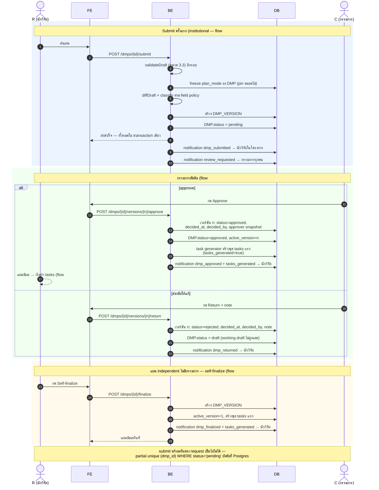
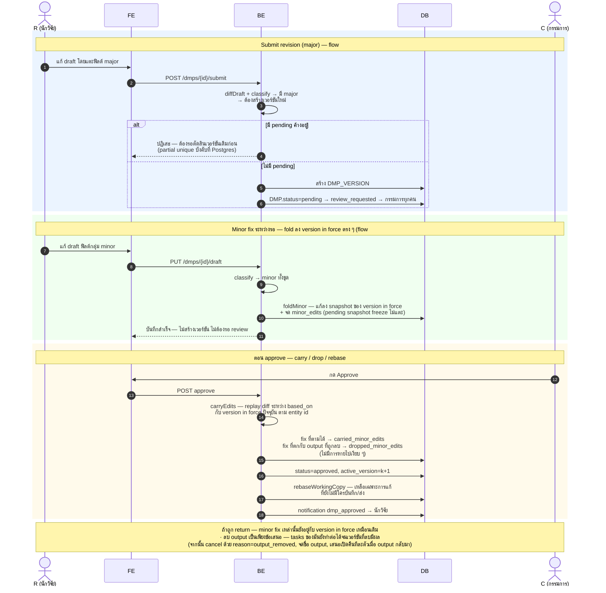
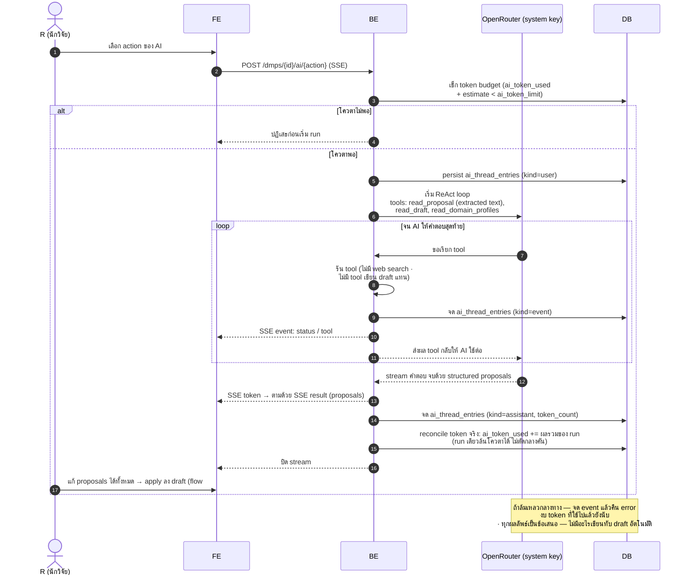
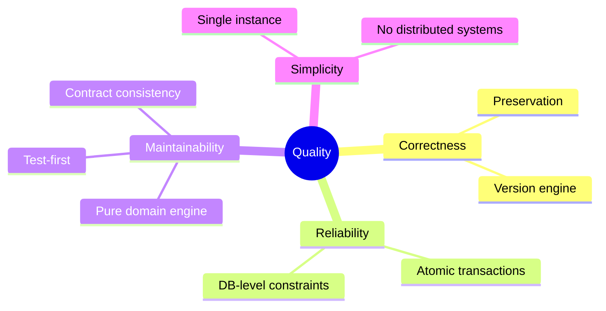

# Architecture Documentation: Backend — ระบบติดตามความคืบหน้าโครงการวิจัย

**Version:** 1.1 **Date:** 2026-10-19 **Status:** Draft

> **เอกสารนี้คืออะไร และอ่านสำหรับใคร** — เอกสารนี้อธิบาย "พิมพ์เขียว" ของระบบหลังบ้าน (backend) ทั้งหมด: ระบบทำอะไร ประกอบด้วยส่วนใดบ้าง และทำไมจึงเลือกตัดสินใจแบบนั้น ผู้อ่านเป้าหมายคือทั้ง developer มือใหม่ที่เพิ่งเข้ามาต่อในโปรเจกต์ และผู้ที่ไม่ได้เขียนโค้ดแต่อยากเข้าใจภาพรวมของระบบ ศัพท์เทคนิคทุกคำจะถูกอธิบายตอนที่ปรากฏครั้งแรก และมีสารบัญศัพท์ (Glossary) ท้ายเอกสารสำหรับเปิดดูย้อนหลัง

---

## สารบัญ

- [1. Introduction and Goals](#1-introduction-and-goals)
- [2. Architecture Constraints](#2-architecture-constraints)
- [3. System Scope and Context](#3-system-scope-and-context)
- [4. Solution Strategy](#4-solution-strategy)
- [5. Building Block View](#5-building-block-view)
- [6. Runtime View](#6-runtime-view)
  - [6.1 Scenario: Submit → Approve](#61-scenario-submit--approve-แผน-institutional-มีผลครั้งแรก--flow-57)
  - [6.2 Scenario: Major revision + minor fixes ขณะรอ](#62-scenario-major-revision--minor-fixes-ขณะรอ-carry--drop--rebase--flow-89)
  - [6.3 Scenario: AI action](#63-scenario-ai-action-react-loop-sse--flow-3)
  - [6.4 สถานการณ์อื่น](#64-สถานการณ์อื่น-สรุป--diagram-เต็มใน-sequence-diagramsmd)
- [7. Deployment View](#7-deployment-view)
- [8. Cross-cutting Concepts](#8-cross-cutting-concepts)
- [9. Architecture Decisions](#9-architecture-decisions)
- [10. Quality Requirements](#10-quality-requirements)
- [11. Risks and Technical Debt](#11-risks-and-technical-debt)
- [12. Glossary](#12-glossary)

---

## 1. Introduction and Goals

### 1.1 Requirements Overview

ระบบนี้เป็น **ระบบหลังบ้าน (backend)** สำหรับ **นักวิจัยและคณะกรรมการ** ใช้เขียนและติดตาม **DMP (Data Management Plan)** — แผนการจัดการข้อมูลวิจัย — ตามรูปแบบมาตรฐานสากล **maDMP v3.0** (เป็นมาตรฐานที่กำหนดให้แผนอยู่ในรูปแบบ JSON ที่คอมพิวเตอร์อ่านได้ด้วยตัวเอง ไม่ใช่แค่เอกสาร Word ธรรมดา)

ในหนึ่งแผนจะมีข้อมูลย่อยประกอบกัน ได้แก่ **research outputs (datasets)** — ผลลัพธ์งานวิจัยที่จะเผยแพร่, **distributions** — วิธีเผยแพร่แต่ละ output, **contributors** — ผู้เกี่ยวข้องในแผน และ **costs** — ค่าใช้จ่ายที่เกี่ยวข้อง นักวิจัยเขียนแผนได้เอง หรือให้ผู้ช่วย AI ช่วยร่างก็ได้

แผนแบ่งเป็นสองประเภทตามผู้อนุมัติ:

- **แผนมีสังกัด (institutional)** — ต้องส่งให้กรรมการตรวจและอนุมัติก่อน แผนจึงจะ "มีผล" (นั่นคือ ระบบจะสร้างงานที่ต้องทำตามให้อัตโนมัติ)
- **แผนไม่มีสังกัด (independent)** — นักวิจัยกดยืนยันเอง (self-finalize) โดยไม่ต้องผ่านกรรมการ

เมื่อแผนมีผลแล้ว ระบบจะแปลงเนื้อหาในแผนเป็น **tasks** — งานที่ต้องทำตามสัญญาในแผน พร้อมช่องแนบ **evidence** (หลักฐานการทำงาน เช่น ไฟล์, ลิงก์ หรือ DOI) เพื่อให้ผู้บริหารโครงการติดตามความคืบหน้าได้

ระบบนี้ให้บริการ **frontend** ที่มีอยู่แล้ว (อยู่ repo `Frontend` แยกต่างหาก) — frontend คือหน้าเว็บที่ผู้ใช้เห็น ส่วนระบบนี้คือส่วนที่ทำงานเบื้องหลัง โมเดลข้อมูลและพฤติกรรมทั้งหมดออกแบบให้สอดคล้องกับฝั่ง client โดยมี **ERD ฝั่ง frontend** (`docs/sources/project-erd.md`) เป็นแหล่งอ้างอิงหลัก (primary source) — ERD คือแผนภาพแสดงว่าระบบมีข้อมูลอะไรบ้างและข้อมูลเหล่านั้นเชื่อมโยงกันอย่างไร

**Key Features:**

- **บัญชีผู้ใช้ 4 บทบาท** — researcher (นักวิจัย), committee (กรรมการ), chief (หัวหน้าโครงการ), admin (ผู้ดูแลระบบ) — สมัครเองได้เฉพาะ researcher ส่วนอีกสามบทบาทสถาบันเป็นผู้สร้างบัญชีให้ (รวมถึงรีเซ็ตรหัสผ่านให้ด้วย)
- **โครงการวิจัย (projects)** — มีสมาชิก และแนบไฟล์ proposal ได้ (ไฟล์ .docx — ระบบจะแตกข้อความออกมาเก็บไว้ให้อ่านสะดวก)
- **DMP**: แก้แบบร่างได้ (draft) พร้อมระบบตรวจความถูกต้อง, ส่งอนุมัติ (submit), แยกแยะว่าการแก้เป็นแก้เล็ก (minor) หรือแก้ใหญ่ (major), มีระบบเวอร์ชัน + คำตัดสินของกรรมการ (approve / return), restore, archive — **ไม่มีทางลบแผนเด็ดขาด**
- **Domain engine**: กลไกกลางที่ทำงานเบื้องหลัง ได้แก่ diff / classify / fold minor / carry / drop / rebase (อธิบายใน Glossary) — เป็น "หัวใจ" ของหลักการรักษาประวัติการแก้ไข (preservation)
- **Tasks**: เกิดขึ้นอัตโนมัติเมื่อแผนมีผลครั้งแรก, มี checklist, ความคืบหน้า (progress) คำนวณอัตโนมัติจาก checklist, evidence รองรับได้หลายรูปแบบ (file / URL / DOI)
- **AI Assistant**: ผู้ช่วย AI ที่ทำงานแบบ agent loop (ReAct) ผ่านบริการ OpenRouter, มีเครื่องมือ (tools) 3 ตัว, จำกัดโควตา token ต่อผู้ใช้, และส่งคำตอบแบบสตรีมทีละส่วน (SSE streaming — อ่านคำอธิบายในหมวด 3.2)
- **การแจ้งเตือน 8 ประเภท** push แบบทันทีผ่าน SSE
- **Export** มาตรฐาน 2 รูปแบบ: GCWG-RDA maDMP v3.0 และ RDA DMP Common Standard v1.3

### 1.2 Quality Goals

ตารางนี้จัดอันดับ "ระบบต้องดีเรื่องอะไรมากที่สุด" — เมื่อต้องเลือกว่าจะทำอย่างไร ให้เอาเป้าหมายอันดับต้นมาตัดสิน:

| Priority | Quality Goal | ความหมายและเหตุผล |
| --- | --- | --- |
| 1 | **Preservation (ความถูกต้องของประวัติ)** | สิ่งที่ผู้ใช้บันทึกไว้ต้องไม่มีทางหายหรือถูกทำลาย — ไม่มีทางลบแผน, task ที่มีงานบันทึกไว้ลบไม่ได้, การแก้ที่ merge ไม่ได้จะถูกจดไว้ใน `dropped_minor_edits` แทนที่จะหายไปเงียบ ๆ และการ submit สองคนพร้อมกันบนแผนเดียวเป็นไปไม่ได้ (ป้องกันด้วย constraint ระดับฐานข้อมูล) |
| 2 | **ความถูกต้องของ version/diff engine** | ความเสี่ยงจริงของระบบไม่ใช่ความช้า แต่คือความถูกต้องของกลไก diff / classify / carry / drop / replay ที่ทำงานตาม entity id — เพราะ workload เล็กมาก (~200 ผู้ใช้/วัน, peak ~2,000) จึงเน้น test-first (เขียน test ก่อนเขียนโค้ด) บน pure functions และมี e2e test ครบทั้ง 14 flows |
| 3 | **ความเรียบง่าย (single instance)** | เป็น modular monolith รันบนเครื่องเดียว (อธิบายเพิ่มในหมวด 4.2) scale แนวตั้ง — ทุก flow ที่ต้องพร้อมกัน (approve → สร้าง tasks → notifications) ทำใน transaction เดียว ตรวจสอบได้ง่าย ไม่มีระบบ distributed ใด ๆ บนเส้นทางหลัก |
| 4 | **Consistency ของ contract BE/FE** | zod schema เป็น source of truth เพียงชุดเดียว — validation ฝั่ง backend, type ฝั่ง backend และ type ฝั่ง frontend มาจากชุดเดียวกันทั้งหมด รวมถึง field policy และ domain profiles ที่ backend ใช้ตัดสิน ต้องเป็นชุดเดียวกับที่ frontend แสดงผล (อธิบาย zod เพิ่มในหมวด 4.1) |

### 1.3 Stakeholders

ใครบ้างที่มีส่วนได้ส่วนเสียกับระบบ และสิ่งที่เขาคาดหวังจากระบบ:

| Role | Name/Team | Expectations |
| --- | --- | --- |
| Researcher | นักวิจัย institutional / citizen | เขียน/ส่งแผน, ทำ tasks, export มาตรฐาน — สิ่งที่บันทึกไว้ต้องไม่มีทางหาย |
| Committee | กรรมการสถาบัน | ตัดสินเวอร์ชันของแผน institutional ผ่าน queue กลาง (global queue) — ใครก็ตัดสินได้ ไม่ต้องรอคนใดคนหนึ่ง |
| Chief | สถาบันมอบบัญชี | ยังไม่มีพฤติกรรมเฉพาะ นอกจากเป็นสมาชิกโครงการ |
| Admin | สถาบันมอบบัญชี | จัดการบัญชี (สร้างบัญชี, ปิดบัญชี, รีเซ็ตรหัสผ่าน) — ไม่สามารถแตะเนื้อหา DMP ของนักวิจัยได้ |
| Frontend team | repo `Frontend` (React 19 + TS) | ใช้ OpenAPI spec (`GET /openapi-json`) generate client, ใช้ zod contract/field-policy ชุดเดียวกับ backend |
| Operations | ops ของสถาบัน | deploy บน VM เดียวด้วย docker-compose, รับผิดชอบ backup (pg_dump + volume snapshot) |
| ผู้พัฒนา backend | team นี้ | โครงสร้างที่สร้างได้จริง, test-first บน domain engine ที่ทำได้จริง |

---

## 2. Architecture Constraints

ข้อจำกัดคือ "ข้อเท็จจริงที่ยอมรับก่อนแล้ว" ที่ตัดสินใจอื่น ๆ ทั้งหมดต้องเดินตาม

### 2.1 Technical Constraints

| Constraint | Description | Background |
| --- | --- | --- |
| TC-1 | **Scale จำกัดและรู้ค่าล่วงหน้า** — ผู้ใช้เฉลี่ย ~200/วัน, peak ~2,000 | ใช้ภายในองค์กรสถาบันเดียว — เครื่องเดียว (instance เดียว) ที่เพิ่มสเปกแนวตั้งรองรับได้สบาย จึงตัด Redis และระบบ distributed ออกจากเส้นทางหลัก |
| TC-2 | **Deploy บน VM เดียว (docker-compose)** | ไม่มี kubernetes หรือ cloud แบบ managed — มี Caddy (TLS) + Postgres + app อยู่ใน compose เดียว; ตอน release ต้อง restart สั้น ๆ หนึ่งครั้ง ซึ่งยอมรับได้ |
| TC-3 | **คอขวดจริงคือ network** (OpenRouter, Postgres) ไม่มีงานหนักทาง CPU | งานส่วนใหญ่คือการรอ API ภายนอกตอบ, SSE connection ที่ค้างเปิดระหว่าง AI run และการ diff/validate JSON — ไม่ใช่การคำนวณหนัก |
| TC-4 | **ไม่มี monorepo ร่วมกับ frontend** | frontend รัน script generate client ใน repo ของตัวเอง โดยดึง spec จาก runtime endpoint `GET /openapi-json` — ไฟล์ spec ไม่ถูก commit ลง repo นี้ |
| TC-5 | **4 การตัดสินยังรอ repo Frontend** | domain profiles ข้อมูลจริง, ชุด tasks แรก, รูปร่าง checklist, enum ของ evidence — ต้องดูต้นแบบจาก repo `Frontend` (ซึ่งยังไม่อยู่บนดิสก์) ก่อนจะปิดการตัดสิน (รายละเอียดในหมวด 9) |
| TC-6 | **AI เป็นบริการภายนอก (OpenRouter)** ผ่าน system key เดียวจาก env | เป็นรายละเอียดภายในของระบบ ไม่ปรากฏใน API contract; ไม่มี web search และไม่มี tool ที่เขียน draft แทนผู้ใช้ |
| TC-7 | **Secrets ผ่าน env เท่านั้น** | `DATABASE_URL`, `JWT_SECRET`, `OPENROUTER_KEY`, `SMTP_URL` — ห้ามเก็บใน repo; ค่าตั้งค่าที่ปรับได้อยู่ใน `config.json` |

### 2.2 Organizational Constraints

| Constraint | Description | Background |
| --- | --- | --- |
| OC-1 | **เฉพาะ researcher สมัครบัญชีเองได้** | committee/chief/admin สถาบันเป็นผู้สร้างบัญชีให้ — admin สร้างด้วยรหัสผ่านชั่วคราวที่บังคับให้เปลี่ยนตอน login ครั้งแรก ทำให้ไม่ต้องพึ่ง email ในการเริ่มต้นระบบ |
| OC-2 | **โมเดลข้อมูลสอดคล้องกับ client ปัจจุบัน** | ERD ฝั่ง frontend เป็นแหล่งอ้างอิงหลักเพียงแหล่งเดียว — กรณีที่ต้องเบี่ยงจาก ERD ต้องจดเหตุผลการตัดสินไว้ (เช่น ใช้ bcrypt แทน SHA-256) |
| OC-3 | **Backup เป็นหน้าที่ของ ops สถาบัน** | pg_dump ตามรอบ + snapshot volume ไฟล์ — จดเป็นขั้นตอนใน runbook ไม่ใช่ automation ภายในระบบ |
| OC-4 | **Email verification ยังไม่ทำ** | ใครก็สมัครด้วย email ใดก็ได้ — จดไว้เป็นช่องโหว่ที่รับรู้และยอมรับไว้ (ดูหมวด 11) |

### 2.3 Conventions

ข้อตกลงร่วมที่ทุกคนในทีมต้องทำตามเหมือนกัน:

| Convention | Description |
| --- | --- |
| CON-1 | จัดโครงสร้างโค้ดแบบ feature-driven ตาม format **project-dna** — ชื่อโฟลเดอร์ตัวพิมพ์เล็กทั้งหมด, โค้ดที่ใช้ร่วมหลาย feature อยู่ที่ `features/shared/` |
| CON-2 | 1 NestJS module ต่อ 1 feature; `features/shared/domain-engine/` ห้าม import `@nestjs/*` และห้ามแตะ DB/HTTP (บังคับด้วย lint) |
| CON-3 | zod schema ใน `features/shared/contracts/` เป็น source of truth — ใน `docs/` มีเฉพาะไฟล์ .md ไม่มี artifact ที่ generate แล้ว |
| CON-4 | วันที่แบบไม่มีเวลา (begin/end ของแผน, start/end ของ task, วันที่ใน domain metadata) เก็บเป็น `YYYY-MM-DD` แยกจาก timestamp เต็ม (`created_at` ฯลฯ) — ห้ามปนกัน |
| CON-5 | ID ทุก entity เป็น **UUID v7** ที่ backend เป็นผู้สร้าง (mint) เสมอ; ตอน export เติม prefix ด้วย dmp_id เป็น safeguard |
| CON-6 | การทดสอบ: `tests/unit/` จัดโครงสร้าง mirror กับ `src/`; package manager คือ **pnpm** (node v24, TypeScript strict) |

---

## 3. System Scope and Context

### 3.1 Business Context

แผนภาพ Context (C4) อยู่ที่ [`c4/c4-context.md`](c4/c4-context.md) — แผนภาพที่แสดงว่าระบบนี้อยู่ตรงไหนของโลกภายนอก: ใครใช้งาน และอะไรอยู่นอกขอบเขตของระบบ (Frontend, OpenRouter, SMTP)

| Actor/System | Description | Communication |
| --- | --- | --- |
| Frontend (repo `Frontend`) | React 19 + TS — ผู้ใช้ทุกบทบาทเข้าใช้ผ่าน app นี้ | HTTPS REST/JSON + SSE (AI stream, การแจ้งเตือนแบบ push) — ยืนยันตัวตนด้วย JWT ผ่าน header |
| OpenRouter | ผู้ให้บริการโมเดล AI ภายนอก | HTTPS — ใช้ system key จาก env; backend เขียน ReAct loop เอง |
| SMTP server | ส่ง email รีเซ็ตรหัสผ่าน | SMTP — ตอน dev รัน MailPit ใน docker-compose (โปรแกรมจำลอง mail server ที่ดักจับ email ทั้งหมดไว้ดูในหน้าเว็บ) |
| Postgres | ฐานข้อมูลหลัก | SQL ผ่าน Drizzle (ORM ที่เรียกใช้ in-process) |
| Disk volume | ไฟล์อัปโหลด (proposal, evidence) | ผ่าน `FileStorage` port (adapter ชื่อ DiskStorage) |

### 3.2 Technical Context

| Interface | Technology | Description |
| --- | --- | --- |
| REST API | HTTPS / JSON | zod → OpenAPI (`@asteasolutions/zod-to-openapi` + `@nestjs/swagger`) — เสิร์ฟ spec ที่ `GET /openapi-json` แบบ runtime |
| SSE streams | `text/event-stream` | Server-Sent Events คือช่องทางที่ server push ข้อมูลส่งหา browser ต่อเนื่องได้โดยไม่ต้องรอ browser ขอเอง ใช้กับ `GET /notifications/stream` และ `POST /dmps/{id}/ai/{action}` — ฝั่ง frontend ใช้ fetch + ReadableStream แทน EventSource เพราะ EventSource แนบ Authorization header ไม่ได้ (ดู ADR-0008) |
| Error envelope | JSON รูปแบบเดียวทั้ง API | `{ error: { code, errors: [{path, code, message}] } }` — `path` เป็น JSON pointer ที่ชี้ตำแหน่งผิดพลาดลงใน draft โดยตรง ทำให้ frontend พาผู้ใช้ "คลิกไปแก้จุดนั้น" ได้เลย |
| Reverse proxy | Caddy | TLS termination (จัดการใบรับรอง HTTPS) + reverse proxy บน VM เดียว |

---

## 4. Solution Strategy

### 4.1 Technology Decisions

| Decision | Technology | Rationale |
| --- | --- | --- |
| ภาษา/framework | **TypeScript + NestJS** | แชร์ type กับ frontend (React 19 + TS) ผ่าน zod ได้ในครั้งเดียว, SSE เป็นความสามารถ in-the-box (event loop จัดการ connection ค้างหลายพันรายการได้สบาย), JSON เป็นจุดแข็งของภาษา — Go เร็วกว่าแต่ต้องนิยาม type สองครั้งสองฝั่ง และ raw performance ไม่ใช่ตัวตัดสินที่ scale นี้ (TC-3); ปฏิเสธ Python/FastAPI ด้วยเหตุผลเดียวกัน |
| ฐานข้อมูล | **PostgreSQL + Drizzle** | ใช้ JSONB + partial unique index ได้ตรงและควบคุม SQL ได้เต็มมือ — constraint "หนึ่ง pending ต่อแผน" และ "เลขเวอร์ชันไม่ซ้ำ" ถูกบังคับโดย Postgres เอง ไม่ต้องพึ่งโค้ด |
| Contract | **zod → OpenAPI → FE generate client** | zod (ไลบรารี schema ของ TypeScript ที่ตรวจข้อมูลตอน runtime ได้ด้วย) เป็น source of truth เดียว; สอดคล้อง TC-4 ที่ไม่มี monorepo |
| Validation | zod (runtime) + กฎหมวด 3.3 ของ requirement | ปฏิเสธพร้อม path ที่ชี้ลง draft (JSON pointer) ให้ frontend นำไปทำ "คลิกไปแก้" |
| ID | **UUID v7** mint โดย backend | ตัดปัญหา collision ข้ามแผนของระบบเดิม (seed ids ซ้ำ) + export เติม prefix ด้วย dmp_id |
| Auth | JWT access อายุสั้น + refresh token ที่ revoke ได้ (bcrypt/argon2id) | เบี่ยงจาก ERD (SHA-256) อย่างมีเจตนา — ERD ระบุเองว่า SHA-256 ไม่ปลอดภัยพอสำหรับรหัสผ่าน (ดู ADR-0006) |
| AI integration | เขียน ReAct loop เอง บน `AiClient` port | ต้องควบคุม SSE event (`status`/`tool`/`token`/`result`) ให้ตรง spec เป๊ะ — จึงไม่ใช้ LangChain |
| Testing | Vitest (unit test-first บน engine) + supertest e2e ครบ 14 flows | preservation คือกฎที่ bug เกิดขึ้นแล้วแพงที่สุด (Quality Goal 1–2) |
| Config | `config.json` + env เฉพาะ secret | เลือกโมเดล AI ต่อ action ได้ใน config.json; secrets ผ่าน env เท่านั้น (TC-7) |

**ทำไมไม่ใช่ Go หรือ Python** — ในแง่ raw performance Go ชนะชัดเจน (goroutine กินแค่ ~KB ต่อ connection ค้าง, compile เป็น native binary) แต่ประสิทธิภาพของภาษาไม่ใช่ตัวตัดสินที่ scale นี้ — ความเสี่ยงจริงของระบบคือความถูกต้องของ diff/version engine (การจำแนก minor/major, carry/drop edits, replay ตาม entity id) ภาษาที่ช่วยให้ logic ชุดนี้ถูกต้องและดูแลรักษาได้ง่าย จึงดีกว่าภาษาที่เร็วกว่า

**Consequences:** ความเร็ว raw ต่ำกว่า Go เป็นสิ่งที่ยอมรับไว้ — หากวันหนึ่ง AI streaming หรือ notification push กลายเป็นคอขวด จุดแก้คือ topology (เพิ่ม instance) ไม่ใช่เปลี่ยนภาษา และ zod schema กลางกลายเป็นข้อผูกมัดของ API contract ต้องรักษาให้เป็น source of truth อย่างแท้จริง

### 4.2 Top-Level Decomposition

**Approach:** **Modular monolith — instance เดียว, scale แนวตั้ง**

> **อธิบายง่าย ๆ:** monolith คือการรวมทุก functionality ไว้ในโปรแกรมเดียว (ขัดกับแนว microservices ที่แยกเป็นหลายโปรแกรมคุยกันผ่าน network) ส่วน "modular" หมายถึงแบ่งโค้ดภายในเป็นโมดูลชัดเจน ได้ประโยชน์ของการแบ่งส่วนโดยไม่เสียความง่ายของการรันโปรแกรมเดียว

- ทุก flow ใน sequence diagrams ต้องเป็น transactional ต่อกัน (approve → สร้าง tasks แรก → notifications ต้องสำเร็จพร้อมกันทั้งชุดหรือไม่สำเร็จเลย) — monolith ใน process เดียวทำให้ transactional flows ง่ายและตรวจสอบได้
- notification push และ AI SSE stream อ่าน event จาก in-process event bus — ตัด Redis ออกจากเส้นทางหลัก (TC-1)
- **เงื่อนไขที่ติดมากับการตัดสินนี้**: storage และ notification publisher ต้องอยู่หลัง interface (port) เดียว เผื่อวันหนึ่งต้อง scale ออก — สลับ disk→S3, in-process bus→Redis ได้โดยไม่ต้องแตะ domain logic; ไม่มี external queue — งาน async เดียวคือ parse .docx ตอน upload ซึ่งทำ in-process; deploy เป็น restart สั้น ๆ ตอน release ยอมรับได้ที่ scale นี้

**Key Modules (9 features + `shared/`):**

- auth
- users
- projects
- files
- dmps
- tasks
- notifications
- ai
- exports — รายละเอียดในหมวด 5

### 4.3 Approaches to Achieve Quality Goals

| Quality Goal | Approach |
| --- | --- |
| Preservation | constraint ระดับฐานข้อมูล (`UNIQUE (dmp_id, number)`, partial unique pending, PK คู่ `(project_id, user_id)`), `draft_revision` แบบ optimistic concurrency (ชนกัน → `409`), กฎ archive/cancel/reopen, `dropped_minor_edits` จดแทนการหายเงียบ ๆ |
| ความถูกต้องของ engine | domain engine เป็น pure functions (ฟังก์ชันที่ให้ผลลัพธ์เดิมเสมอสำหรับ input เดิม และไม่แตะโลกภายนอก) — unit test-first; e2e supertest ต่อ Postgres จริง ครบ 14 flows ของ sequence diagrams |
| เรียบง่าย / auditability | transaction Drizzle เดียวใน service ผู้เรียก, in-process event bus ซ่อนอยู่ใน adapter ของ `NotificationPublisher` เท่านั้น, deploy = restart สั้น ๆ |
| Contract consistency | zod schemas กลาง (`features/shared/contracts/`), field policy และ domain profiles เป็น registry ที่ expose ผ่าน `GET /field-policy` / `GET /domain-profiles` — frontend ใช้ชุดเดียวกับที่ backend ใช้ตัดสิน |

---

## 5. Building Block View

### 5.1 Level 1: Whitebox Overall System

แผนภาพ Containers (C4) อยู่ที่ [`c4/c4-containers.md`](c4/c4-containers.md) — Caddy, NestJS 1 process, PostgreSQL, file volume ใน docker-compose เดียว พร้อมเหตุผลว่า **ทำไมไม่มี** Redis/queue

**Contained Building Blocks:**

| Building Block | Purpose |
| --- | --- |
| Caddy | TLS + reverse proxy |
| NestJS app (1 process) | ทุก use-case — auth, DMP lifecycle, tasks, AI, notifications, exports |
| Postgres | relational tables + `dmps.draft` JSONB |
| Disk volume | ไฟล์ผ่าน `FileStorage` port (DiskStorage adapter) |

### 5.2 Level 2: Features (โครงสร้าง repo)

```
src/
├── features/
│   ├── auth/                 # sign-up, sign-in, refresh, sign-out, guards
│   ├── users/                # profile, admin provisioning, token budget
│   ├── projects/             # projects + members + proposal selection
│   ├── files/                # upload/download, docx parse (mammoth, in-process)
│   ├── dmps/                 # draft CRUD, submit, versions, decisions, archive
│   ├── tasks/                # lifecycle, evidence, preservation rules
│   ├── notifications/        # notification rows + SSE stream
│   ├── ai/                   # ReAct loop, thread, token budget
│   ├── exports/              # madmp-v3 / rda-v1.3 projections
│   └── shared/
│       ├── domain-engine/    # pure functions — ห้าม import @nestjs/*
│       ├── domain-profiles/  # DOMAIN_PROFILE registry + field-policy (path-based)
│       ├── contracts/        # zod schemas ข้าม feature (draft schema, error envelope, SSE events)
│       ├── ports/            # FileStorage, NotificationPublisher, AiClient, MailSender
│       ├── adapters/         # DiskStorage, SsePublisher + InProcessEventBus,
│       │                     #   OpenRouterClient, SmtpMailer
│       └── config/           # config loader (จุดเดียวที่อ่าน config.json)
├── database/                 # drizzle schema + migrations (SQL files) + seeds
tests/                        # unit (mirror src/) / integration / e2e (14 flows) / fixtures
config.json                   # ค่า tunable — mirror โครงสร้างโฟลเดอร์
.env / .env.example           # credentials เท่านั้น
```

กฎที่บังคับด้วย lint: `features/shared/domain-engine/` ห้าม import `@nestjs/*` และห้ามแตะ DB/HTTP (CON-2)

- NestJS module 1 ตัวต่อ 1 feature
- ชื่อโฟลเดอร์ตัวพิมพ์เล็กทั้งหมด

ตารางต่อไปนี้สรุปว่าแต่ละ feature รับผิดชอบอะไร และมี endpoint อะไรบ้าง (endpoint คือ URL ที่ frontend เรียกเข้ามาใช้):

| Feature | รับผิดชอบ | Endpoints หลัก |
| --- | --- | --- |
| `auth` | sign-up (เฉพาะ researcher), sign-in, JWT access + refresh ที่ revoke ได้ | `POST /sign-up`, `/sign-in`, `/refresh`, `/sign-out` |
| `users` | profile, เปลี่ยนรหัสผ่าน, admin provisioning, password reset, `ai_token_limit/used` | `GET/PATCH /me`, `POST /me/password`, `POST /admin/users`, `POST /admin/users/{id}/disable`, `POST /password-reset` |
| `projects` | โครงการ + members, proposal selection, การลบโครงการ (ปฏิเสธถ้ามีแผนอยู่) | `POST/GET /projects`, `GET/PATCH/DELETE /projects/{id}` |
| `files` | upload/download ผ่าน `FileStorage` port, จำกัด 25 MB, parse .docx เก็บ extracted text | `POST /projects/{id}/files`, `GET /files/{id}` |
| `dmps` | draft CRUD (`draft_revision` — ชนกันได้ `409`), diff/classify ตอนบันทึก, submit/finalize, versions + decisions, restore, archive | `PUT /dmps/{id}/draft`, `POST /dmps/{id}/submit\|finalize\|archive\|unarchive`, `POST /dmps/{id}/versions/{n}/approve\|return\|restore`, `DELETE /dmps/{id}/draft/datasets/{ds}` |
| `tasks` | lifecycle + preservation rules, progress คำนวณจาก checklist เสมอ, evidence หลายรูปแบบ | `GET /tasks`, `PATCH /tasks/{id}`, `POST /tasks/{id}/files\|complete\|cancel\|reopen`, `DELETE /tasks/{id}` |
| `notifications` | rows สร้างใน transaction ของเหตุการณ์ + push ผ่าน port, 8 type | `GET /notifications`, `GET /notifications/stream` (SSE), `POST /notifications/{id}/read`, `POST /notifications/read-all` |
| `ai` | ReAct loop บน `AiClient` port, tools 3 ตัว, token budget แบบ estimate→reconcile, thread persist | `POST /dmps/{id}/ai/{action}` (SSE), `GET /dmps/{id}/ai/thread` |
| `exports` | projection ไม่เก็บ — madmp-v3 / rda-v1.3 | `GET /dmps/{id}/export?format=madmp-v3\|rda-v1.3` |
| meta | registry ที่ expose เป็น API | `GET /domain-profiles`, `GET /field-policy`, `GET /openapi-json` |

หมายเหตุ: list endpoints ใช้ `?page=&limit=` (offset) พอ — โหลดสูงสุด ~2,000 peak ไม่จำเป็นต้องใช้ cursor pagination; committee queue เป็น **global queue** (`GET /dmps?status=pending`) — เปิดดู snapshot + changes ของเวอร์ชันที่รอได้ และใครตัดสินก่อนก็ได้ (หนึ่งเวอร์ชัน หนึ่ง decision ตาม requirement หมวด 4.6) — ไม่มี entity การมอบหมายงาน

### 5.3 Level 3: Layering ภายใน feature + domain-engine

```
controller (HTTP/SSE, บาง)
    → service (use-case, ธุรกรรม Drizzle)
        → domain/ (pure functions: diff engine, field policy, validation, export)
        → repository (Drizzle, ตาราง)
    → ports/ (interface): FileStorage, NotificationPublisher, AiClient, MailSender
        → adapters/: DiskStorage, SsePublisher + InProcessEventBus,
                     OpenRouterClient, SmtpMailer
```

> **อธิบายง่าย ๆ:** controller คือผู้รับสาย (รับ request แล้วส่งต่อ) service คือผู้ทำงานจริง (เรียงขั้นตอนและคุม transaction) domain คือกฎของธุรกิจที่เป็น pure function (ทดสอบง่าย เพราะไม่แตะ DB/network) repository คือผู้จัดการอ่าน-เขียนฐานข้อมูล และ port/adapter คือซ็อกเก็ตเสียบอุปกรณ์ภายนอก — เสียบ disk วันนี้ เสียบ S3 วันหน้า โดยโค้ดส่วนอื่นไม่ต้องแก้

กฎสองข้อ (บังคับด้วย lint/review):

1. **Domain engine เป็น pure function** — รับ JSON draft + version in force + field policy แล้วคืนผลลัพธ์ ไม่แตะ DB/HTTP → test-first ได้จริง
2. **ทุก I/O ที่เปลี่ยน implementation ได้ต้องผ่าน port** — สลับ disk→S3, in-process bus→Redis ได้โดยไม่แตะ domain

**Ports และ adapters:**

| Port | Adapter ปัจจุบัน | อีกฝั่งที่รอเสียบในอนาคต |
| --- | --- | --- |
| `FileStorage` | `DiskStorage` (volume) | `S3Storage` |
| `NotificationPublisher` | `SsePublisher` + `InProcessEventBus` | Redis pub-sub |
| `AiClient` | `OpenRouterClient` (system key จาก env) | — |
| `MailSender` | `SmtpMailer` (SMTP จาก env; dev: MailPit) | ผู้ให้บริการอื่น |

**การเชื่อมข้าม feature:** direct service inject เป็นค่า default (`DmpsService` inject `TasksService`, `ExportsService` inject `DmpsService`); ใช้ port เฉพาะ I/O ที่เปลี่ยน implementation ได้; **ไม่มี event bus ทั่วไป** — `InProcessEventBus` มีอยู่แค่ภายใน adapter ของ `NotificationPublisher` เพื่อ push SSE หลัง commit; ธุรกรรม business (approve → สร้าง tasks → notifications) ยังคงเป็น transaction Drizzle เดียวใน service ผู้เรียก

**Domain engine — pure functions ชุดเดียว รองรับทุก flow:**

| ฟังก์ชัน | หน้าที่ | ใช้ใน flow |
| --- | --- | --- |
| `diffDraft(draft, baseSnapshot)` | เทียบ JSON tree สองอันโดยยึด entity id → ได้ `FieldChange[]` | #4, #8, #9, #10 |
| `classify(changes, fieldPolicy)` | จำแนก minor/major — ถ้ามี major ฟิลด์เดียว ถือว่าทั้งชุดเป็น major | #5, #8, #9 |
| `foldMinor(snapshot, changes)` | บันทึกการแก้เล็กลง version in force + จด `minor_edits` | #8, #9 ระหว่างรอ |
| `carryEdits(basedOn, currentInForce, newSnapshot)` | replay การแก้ตาม entity id → แยกได้ว่าอันไหน carried อันไหน dropped | #9 ตอน approve |
| `rebaseWorkingCopy(draft, newSnapshot)` | เหลือเฉพาะการแก้ที่ยังไม่มีใครบันทึก/ส่ง | #9 ตอน approve |
| `validateDraft(draft, profiles)` | ตรวจกฎ validation คืน `errors: [{path, code, message}]` (JSON pointer) | #4, #5, #7 |
| task generator | สร้างชุด tasks แรกเมื่อแผนมีผล (pure function ในชุดเดียวกัน) | #6, #7 |

**โมเดลข้อมูล (แบบผสม):** ใช้ตาราง relational สำหรับ entity ที่มี lifecycle จริง และใช้ JSONB สำหรับ working draft เหตุผล: ERD ฝั่ง frontend (แหล่งอ้างอิงหลักของ requirement) วาด DATASET/DISTRIBUTION/CONTRIBUTOR/COST เป็น entity แยก แต่ requirement หมวด 3.2 ระบุเองว่า ทั้งหมดเป็นค่า nested ใน `draft` ของ DMP และ `DMP_VERSION` เป็น embedded list พร้อมขอให้ backend "enforce เป็น constraint จริง" ทางเลือกที่มีคือ normalize ทั้งหมด, document DB ทั้งหมด หรือแบบผสมบน PostgreSQL — ผลคือเลือกแบบผสม เพราะ:

- **draft เป็น JSONB ก้อนเดียวต่อ DMP** — working copy ถูก diff กับ snapshot, validate ทั้งก้อน และ fold/carry ตาม entity id อยู่แล้ว การฉีกเป็นตารางย่อย ๆ จะซ้ำซ้อนกับโครงสร้างที่ระบบใช้งานจริง
- **DMP_VERSION เป็นตารางจริง (แถวต่อเวอร์ชัน)** — เพื่อให้บังคับ constraint ระดับฐานข้อมูลได้ ตามที่ requirement หมวด 3.2 เรียกร้อง
- **entity ที่มี lifecycle ข้าม draft เป็นตาราง relational**: USER, CREDENTIAL, PROJECT, PROJECT_MEMBER, TASK, FILE_RECORD, NOTIFICATION, AI_THREAD_ENTRY

**ตาราง relational (11 ตาราง):**

| ตาราง | constraint สำคัญ |
| --- | --- |
| `users` | `email` unique แบบ normalize (lowercase + trim), `username` lowercase |
| `credentials` | PK `username`, FK → users, salted hash **bcrypt/argon2id** (เบี่ยงจาก ERD ตาม requirement หมวด 2.3) |
| `refresh_tokens` | FK → users, revoke ได้ — รองรับการปิดสิทธิ์บัญชีที่สถาบันมอบ |
| `projects` | FK `proposal_file_id` → file_records (nullable) |
| `project_members` | PK คู่ `(project_id, user_id)` — enforce หมวด 3.2 ที่ระดับฐานข้อมูล |
| `dmps` | `draft` JSONB, `status`, `plan_mode` (freeze ตอน submit แรก), `active_version`, `archived_at`, `tasks_generated`, `draft_revision` |
| `dmp_versions` | `UNIQUE (dmp_id, number)` + **partial unique `UNIQUE (dmp_id) WHERE status='pending'`** — บังคับ requirement หมวด 4.3/4.4 โดย Postgres เอง; snapshot/changes/minor_edits/carried/dropped เก็บเป็น JSONB |
| `tasks` | FK dmps; `progress_percent` คำนวณจาก checklist เสมอ |
| `file_records` | purpose/docx-extracted-text (เก็บ text ไว้ในตาราง ไม่ใช่ใน metadata — เพื่อให้ agent อ่านของสำเร็จรูป) |
| `notifications` | type ตาม requirement หมวด 7, read_at nullable |
| `ai_thread_entries` | kind user/event/assistant, scope ตาม dmp_id, token_count |

**DATASET / DISTRIBUTION / CONTRIBUTOR / COST ไม่มีตารางเป็นของตัวเอง** — เป็นค่า nested ใน `dmps.draft` (JSONB) DOMAIN_PROFILE เป็น **code registry** (module ใน backend ไม่มีตาราง) เปิดให้อ่านผ่าน `GET /domain-profiles`

**Optimistic concurrency บน draft:** ทุก PUT draft ต้องแนบ `draft_revision` ที่ client เห็นครั้งล่าสุด — ถ้าค่าที่ส่งมาไม่ตรงกับปัจจุบัน แปลว่ามีคนอื่นแก้ไปก่อน ระบบจะตอบ `409` ให้โหลดใหม่ วิธีนี้ป้องกันการสูญเสียงานแก้ ซึ่งเป็นสิ่งที่ requirement หมวด 5.3 (preservation) ห้ามให้เกิด

**Consequences ของโมเดลนี้** — constraint "หนึ่ง pending ต่อแผน" และ "เลขเวอร์ชันไม่ซ้ำ" ถูกบังคับโดย Postgres เอง ไม่ใช่แค่ logic ใน application — การ submit สอง request พร้อมกันจึงเป็นไปไม่ได้ตามธรรมชาติของฐานข้อมูล

- การ query ที่ต้องเจาะเข้า draft (เช่น หา dataset) ใช้ JSONB operator ของ Postgres ยอมรับได้เพราะความถี่ต่ำ ส่วน list หลักอ่านจากคอลัมน์ปกติ
- ถ้าวันหนึ่งต้อง normalize จริง จะแตะเฉพาะ repository layer เพราะ domain engine ทำงานกับ JSON อย่างเดียว

---

## 6. Runtime View

สถานการณ์ทั้ง 14 flows มี sequence diagram ครบใน [`sequence-diagrams.md`](sequence-diagrams.md) — หัวข้อสำคัญสามอัน (6.1–6.3) วาดซ้ำไว้ที่นี่เพื่อให้อ่านเข้าใจภาพได้ทันทีโดยไม่ต้องสลับเอกสาร (ตัวย่อ R/FE/BE/DB/C/AI ตามที่นิยามใน sequence-diagrams.md) หัวข้ออื่นสรุปเฉพาะสาระสำคัญใน 6.4

### 6.1 Scenario: Submit → Approve (แผน institutional มีผลครั้งแรก — flow 5–7)

นักวิจัย submit → ระบบรัน validateDraft, freeze `plan_mode` ลง DMP (pin ค่านี้ตลอดไป), รัน diff + classify จาก field policy → สร้าง DMP_VERSION #1 (pending, snapshot ณ ตอน submit) พร้อม notification (`dmp_submitted`, `review_requested`) กรรมการ approve (ใครก็ได้คนเดียวพอ — หนึ่งเวอร์ชัน หนึ่ง decision) → บันทึก status/decided_at/decided_by/approver snapshot บนเวอร์ชัน, set `active_version`, task generator สร้างชุด tasks แรก + notification — **ทุกอย่างอยู่ใน transaction Drizzle เดียว** constraint `UNIQUE (dmp_id, number)` และ partial unique pending ทำให้การ submit พร้อมกันสอง request เป็นไปไม่ได้โดย Postgres เองเป็นผู้ปฏิเสธ แผน independent ใช้ `POST /finalize` — self-finalize เวอร์ชัน #1 approved ด้วยตัวเอง แผนมีผลทันที



### 6.2 Scenario: Major revision + minor fixes ขณะรอ (carry / drop / rebase — flow 8–9)

นี่คือหัวใจของ preservation — สถานการณ์คือ ระหว่างที่รอกรรมการอนุมัติอยู่ นักวิจัยยังแก้งานต่อได้:

- submit revision ที่แตะฟิลด์ major → สร้าง DMP_VERSION ใหม่โดย `based_on` = version in force ณ ตอน submit (หนึ่ง revision รอได้ครั้งเดียว — partial unique บังคับ)
- **การแก้เล็ก (minor fix) ระหว่างรอ**: fold ตรงลง version in force (จด `minor_edits`, pending snapshot freeze ไม่แตะ)
- ตอน approve: `carryEdits` replay ความต่างตาม entity id → fix ทุกตัวจดลง `carried_minor_edits` หรือ `dropped_minor_edits` (fix ที่ตกไปอยู่กับ output ที่ถูกลบ — ไม่มีการหายไปเงียบ ๆ) แล้ว `rebaseWorkingCopy` เหลือเฉพาะการแก้ที่ยังไม่มีใครบันทึก/ส่ง
- ถ้าถูกส่งกลับ (return) fix เหล่านั้นยังคงอยู่กับ version in force ตามเดิม
- การลบ research output เป็นเพียง **ข้อเสนอ** — tasks ที่ scope กับ output นั้นยังทำต่อได้จนกว่าเวอร์ชันที่ลบมันจะมีผล จึงถูก cancel (`cancel_reason=output_removed`, จดชื่อ output ไว้ให้ตามได้) เมื่อ output กลับมา tasks ถูก**เสนอให้เปิดคืนทีละตัว** ไม่เปิดเองอัตโนมัติ



### 6.3 Scenario: AI action (ReAct loop, SSE — flow 3)

เช็ก token budget ด้วย estimate ก่อนเริ่ม run (ปฏิเสธถ้าโควตาไม่พอ) → persist `ai_thread_entries` (kind=user) → ReAct loop เรียก tools 3 ตัว (`read_proposal` อ่านจาก extracted text, `read_draft`, `read_domain_profiles` — ไม่มี web search และไม่มี tool เขียน draft แทน) สตรีม SSE เป็น `status`/`tool`/`token`/`result` จบ run ด้วย structured proposals — ทุกผลลัพธ์เป็นข้อเสนอที่ผู้ใช้แก้ไขต่อได้ทั้งหมด ไม่มีอะไรเขียนทับ draft อัตโนมัติ reconcile token จริงตอนจบ (run เดียวล้นโควตาได้ ระบบไม่ตัดกลางคัน; ถ้าล้มเหลวกลางทาง งบที่ใช้ไปแล้วยังนับ) extracted text ของ proposal ถูก parse ตอน upload (mammoth, in-process) เก็บใน `file_records` — agent อ่านของสำเร็จรูป ไม่ parse ซ้ำ



### 6.4 สถานการณ์อื่น (สรุป — diagram เต็มใน sequence-diagrams.md)

| # | Scenario | ประเด็นสำคัญ |
| --- | --- | --- |
| 1 | Sign-up / Sign-in | เฉพาะ researcher; username/email ห้ามซ้ำ; ระบุผู้กระทำจาก JWT subject ทุก mutation |
| 2 | สร้างโครงการ + proposal | plan_mode default ตาม account_type; การแทน proposal จด `superseded_at` + notification |
| 4 | แก้ draft + validation | 422 พร้อม path JSON pointer ให้คลิกไปแก้; `draft_revision` ไม่ตรง → 409 |
| 8 | Minor edit | fold ตรงลง version in force ไม่สร้างเวอร์ชัน ไม่ต้องรอ review |
| 10 | Restore เวอร์ชัน | เวอร์ชันที่รอ decision restore ไม่ได้; restore เวอร์ชันอื่นนับเป็นการแก้ธรรมดา (rollback ข้ามการอนุมัติไม่ได้) |
| 12 | ทำงาน tasks | progress คำนวณจาก checklist เสมอ; task ที่มีงานบันทึกลบไม่ได้, ที่เสร็จแล้ว cancel ไม่ได้ (reopen เท่านั้น) |
| 13 | Archive / ลบโครงการ | ไม่มีทางลบแผน; archive ถูกปฏิเสธขณะแผนมีผล; ลบโครงการถูกปฏิเสธตราบใดที่ยังมีแผน |
| 14 | Export | projection ไม่เก็บ — สร้างจาก snapshot ของ version in force (หรือ draft ก่อนมีผล) |

---

## 7. Deployment View

### 7.1 Infrastructure Level 1

แผนภาพ Deployment (C4) อยู่ที่ [`c4/c4-deployment.md`](c4/c4-deployment.md) — VM เดียว, docker-compose: caddy + app + postgres + MailPit (dev) + volumes

### 7.2 Infrastructure Elements

| Element | Technology | Description |
| --- | --- | --- |
| VM เดียว | docker-compose | instance เดียว scale แนวตั้ง (TC-1, TC-2) |
| caddy | Caddy | TLS termination + reverse proxy |
| app | NestJS (node v24) | 1 process — restart สั้น ๆ ตอน release ยอมรับได้ |
| postgres | PostgreSQL | Drizzle — migration เป็น SQL files (drizzle-kit) commit ลง repo, `seeds/` เฉพาะข้อมูลสำหรับ dev/e2e |
| volume ไฟล์ / DB | docker volumes | backup: pg_dump ตามรอบ + snapshot volume (หน้าที่ ops — OC-3) |
| MailPit | dev เท่านั้น | SMTP catch-all สำหรับ password reset ใน dev |

---

## 8. Cross-cutting Concepts

### 8.1 Domain Model

แบบผสม — ตาราง relational สำหรับ entity ที่มี lifecycle จริง, JSONB สำหรับ working draft (รายละเอียดตารางและเหตุผลเต็มในหมวด 5.3 / ADR-0003) รูปร่าง draft ยืนยันแล้วว่าตรง **maDMP v3.0** (JSON schema จริงอยู่ใน `uni/maDMP-Standard/`):

```jsonc
// Working draft (dmps.draft JSONB) — zod schema นิยามใน features/shared/contracts/
{
  "schema_version": "3.0",
  "dates": { "begin": "YYYY-MM-DD", "end": "YYYY-MM-DD" },
  "ethical_issues_description": "…",
  "indigenous_considerations": "…",
  "alternate_identifier": "…",
  "datasets": [           // research outputs — list บนสุดของ draft
    {
      "dataset_id": "UUID v7", "type": "raw|software|publication|other",
      "title", "description", "status", "access", "personal_data", "sensitive_data",
      "personal_data_plan", "protection_level(+other)", "security_classification_level(+other)",
      "keyword": [], "language", "domain": "DomainKey", "domain_metadata": {},
      "preservation": {},
      "distributions": [ /* nest อยู่ใน dataset แต่ละอัน — ไม่มี top-level */ ]
    }
  ],
  "contributors": [ /* … is_contact พอดี 1 คน/แผน, user_id? (ลิงก์บัญชี — requirement หมวด 4.7) */ ],
  "costs": [ /* … currency_code default THB */ ]
}
```

`contracts/` ยังรวม error envelope, SSE event shapes (`status`/`tool`/`token`/`result`) และ zod schema ของ request/response ที่ controller อ้าง — แยกจาก `domain-profiles/` เพื่อให้เพิ่ม domain ใหม่ได้โดยไม่ต้องแตะ contracts

### 8.2 Security

- **Authentication:** JWT access token อายุสั้น + refresh token เก็บใน `refresh_tokens` (revoke ได้ — การปิดบัญชีจะ revoke ทั้งหมด)
- **Password:** salted hash ด้วย **bcrypt/argon2id** (เบี่ยงจาก ERD อย่างมีเจตนา — ดู ADR-0006)
- **Authorization:** ตาม role — sign-up เองได้เฉพาะ researcher; admin provisioning สร้างบัญชี committee/chief/admin ด้วย username + email + **รหัสผ่านชั่วคราว** (แสดงครั้งเดียว บังคับเปลี่ยนตอน login แรก — ไม่พึ่ง email ในการเริ่มระบบ)
- **Audit:** การระบุผู้กระทำอ่านจาก JWT subject ทุก mutation
- **Secrets:** env เท่านั้น (TC-7); token ส่งผ่าน header เท่านั้น — ไม่หลุดเข้า access log (SSE ใช้ fetch + ReadableStream)
- **ช่องที่รับรู้และยอมรับไว้:** email verification ยังไม่ทำ (OC-4)

### 8.3 Error Handling

Envelope เดียวทั้ง API:

```jsonc
// 422
{
  "error": {
    "code": "VALIDATION_FAILED",
    "errors": [
      {
        "path": "/datasets/1/domain_metadata/sample_size",
        "code": "REQUIRED",
        "message": "…",
      },
    ],
  },
}
```

- `path` เป็น **JSON pointer** ที่ชี้ตำแหน่งใน draft ตรง ๆ — frontend นำไปทำ "คลิกไปแก้จุดนี้" ได้ทันที
- `409` สำหรับ `draft_revision` ไม่ตรง (optimistic concurrency) และ pending ค้าง
- field policy นิยามแบบ path-based — ใช้ระบบ JSON pointer เดียวกันทั้งสาย diff → classify → error path:

```jsonc
// ข้อมูล (registry) ไม่ใช่โค้ดแยก — expose ผ่าน GET /field-policy
{
  "major": [
    "/dates/begin",
    "/dates/end",
    "/ethical_issues_description",
    "/indigenous_considerations",
    "/datasets/*/access",
    "/datasets/*/personal_data",
    "/datasets/*/personal_data_plan",
    "/datasets/*/protection_level*",
    "/datasets/*/security_classification_level*",
  ],
  "listPolicies": {
    "/datasets": { "add": "major", "remove": "major" }, // การเพิ่ม/ลบ output (requirement หมวด 4.3)
    // contributors, costs: add/remove เป็น minor ทั้งหมด (ค่า default)
  },
}
```

### 8.4 Validation (กฎหมวด 3.3 ของ requirement)

ปฏิเสธแผนพร้อมระบุฟิลด์ที่ผิด เมื่อ:

- วันสิ้นสุดก่อนวันเริ่มต้น
- มี ethical issues แต่ไม่ได้เขียนคำอธิบาย
- ไม่มี contact หรือมีเกินหนึ่งคน (และ contact ต้องมี email ตามฟิลด์ `mbox` ของ maDMP)
- contributor สองคนลิงก์บัญชีเดียวกัน
- distribution แบบ open แต่ไม่มี license
- `domain_metadata` ไม่ผ่าน profile ของ domain ตนเอง (generic + 7 research domains — registry เป็นข้อมูล expose ผ่าน `GET /domain-profiles`)

### 8.5 Preservation (กฎหมวด 5.3 ของ requirement)

หลักการ: สิ่งที่ผู้ใช้บันทึกไว้ต้องไม่มีทางหายโดยที่เขาไม่รู้

- ไม่มีทางลบแผน — archive เท่านั้น (และ archive ถูกปฏิเสธขณะแผนมีผล), unarchive กลับมาได้
- การออกจาก editor ไม่ลบอะไร — แผนที่มีผลสูญเสียเฉพาะการแก้ที่ยังไม่ได้บันทึก
- Task ที่มีงานบันทึกไว้ (evidence / checklist ติก / ปิดงานแล้ว) ลบไม่ได้ — cancel เท่านั้น และ cancel จะเก็บ evidence ไว้; ที่เสร็จแล้ว cancel ไม่ได้ — reopen เท่านั้น; ลบได้เฉพาะ task ที่ยังไม่มีใครเริ่ม
- การ cancel จด `cancelled_from`, `cancel_reason` (`manual` | `output_removed`) และชื่อ output ที่ถูกลบ — เวอร์ชันใหม่ที่นำ output กลับมาจะ**เสนอ**เปิดคืนทีละ task ให้ผู้ใช้ตัดสินใจเอง

### 8.6 Real-time

- Notification push ผ่าน SSE (`GET /notifications/stream`) — event bus in-process ซ่อนอยู่หลัง `NotificationPublisher` port; row สร้างใน transaction ของเหตุการณ์ แล้ว publish หลัง commit สำเร็จเท่านั้น
- AI streaming ใช้ SSE เช่นกัน — event shapes (`status`/`tool`/`token`/`result`) นิยามใน `contracts/`
- frontend ใช้ **fetch + ReadableStream** ทุกจุด — `EventSource` แนบ Authorization header ไม่ได้ และ AI action เป็น POST ซึ่ง EventSource ใช้ไม่ได้อยู่แล้ว (ADR-0008)

### 8.7 Configuration

`config.json` mirror โครงสร้างโฟลเดอร์ (`_appliesTo` ระบุว่าค่าไหนใช้กับ feature ไหน) — อ่านผ่าน loader ที่ `features/shared/config` ซึ่งเป็นจุดเดียวที่อ่านไฟล์นี้:

```jsonc
{
  "app": { "name": "uni-backend", "debug": false },
  "auth": {
    "_appliesTo": ["src/features/auth/"],
    "accessTokenTtlMinutes": 15,
    "refreshTokenTtlDays": 30,
  },
  "files": {
    "_appliesTo": ["src/features/files/"],
    "maxFileSizeMb": 25,
    "storagePath": "data/files",
  },
  "ai": {
    "_appliesTo": ["src/features/ai/"],
    "models": { "default": "…", "analyze_proposal": "…" },
  },
  "notifications": { "_appliesTo": ["src/features/notifications/"] },
}
```

`.env` — เก็บเฉพาะ credentials: `DATABASE_URL`, `JWT_SECRET`, `OPENROUTER_KEY`, `SMTP_URL` (ดู `.env.example`)

### 8.8 Testability

- `tests/unit/` mirror โครงสร้าง `src/` — unit test-first บน domain engine (pure functions)
- `tests/integration/` — Postgres, disk, OpenRouter (mock server), SMTP
- `tests/e2e/` — supertest ต่อ Postgres จริง ครบ 14 flows — ทุกกฎ preservation มี e2e test คอยคุ้มกัน
- `tests/fixtures/` — แผนตัวอย่าง, draft JSON, .docx สำหรับทดสอบ

### 8.9 Exports

- เป็น **projection ไม่เก็บ** — คือสร้างเอกสาร export ขึ้นมาตอนถูกขอ ไม่เก็บซ้ำในฐานข้อมูล: `GET /dmps/{id}/export?format=madmp-v3|rda-v1.3`
- แหล่ง: snapshot ของ version in force (หลังมีผล) หรือ draft (ก่อนมีผล) พร้อมสถานะ `not submitted`/`submitted`
- approval block ตาม plan_mode + approver; independent → `not applicable`
- id ใน export เติม prefix ด้วย dmp_id เป็น safeguard กัน collision ข้ามแผน (ADR-0012)
- วันที่ปฏิทินออกเป็น `YYYY-MM-DD` เสมอ (CON-4)

---

## 9. Architecture Decisions

(เดิมแยกเป็น ADR เอกสารแยกต่างหาก — รวมไว้ในเอกสารฉบับเดียว; ADR = Architecture Decision Record คือบันทึกการตัดสินใจทางสถาปัตยกรรมพร้อมเหตุผล)

| ID | Decision | Status | Date |
| --- | --- | --- | --- |
| ADR-0001 | Modular monolith — instance เดียว, scale แนวตั้ง, in-process event bus; ports เตรียมไว้สำหรับสลับ S3/Redis ภายหลัง | Accepted | 2026-10-19 |
| ADR-0002 | ทุก I/O ที่เปลี่ยน implementation ได้ผ่าน port (`FileStorage`, `NotificationPublisher`, `AiClient`, `MailSender`); cross-feature เป็น direct service inject — ไม่มี event bus ทั่วไป | Accepted | 2026-10-19 |
| ADR-0003 | โมเดลข้อมูลแบบผสม — DATASET/DISTRIBUTION/CONTRIBUTOR/COST เป็น JSONB ใน `dmps.draft`, DMP_VERSION เป็นตารางจริงบังคับ constraint ด้วย Postgres | Accepted | 2026-10-19 |
| ADR-0004 | TypeScript + NestJS (ปฏิเสธ Go/Python-FastAPI) — type sharing ผ่าน zod, SSE first-class, JSON เป็นจุดแข็ง | Accepted | 2026-10-19 |
| ADR-0005 | เขียน ReAct loop เองบน `AiClient` port — ไม่ใช้ LangChain | Accepted | 2026-10-19 |
| ADR-0006 | bcrypt/argon2id แทน SHA-256 ของ ERD (เบี่ยงอย่างมีเจตนา) | Accepted | 2026-10-19 |
| ADR-0007 | Committee queue เป็น global queue ไม่มีการมอบหมาย — หนึ่งเวอร์ชัน หนึ่ง decision | Accepted | 2026-10-19 |
| ADR-0008 | SSE auth ผ่าน fetch + ReadableStream (ไม่ใช้ EventSource) | Accepted | 2026-10-19 |
| ADR-0009 | Provisioning ด้วยรหัสผ่านชั่วคราวบังคับเปลี่ยน; password reset ผ่าน SMTP (dev: MailPit) | Accepted | 2026-10-19 |
| ADR-0010 | zod → OpenAPI ผ่าน `@asteasolutions/zod-to-openapi` + `@nestjs/swagger`; ไม่ commit `openapi.json` — ใช้ runtime endpoint `GET /openapi-json` | Accepted | 2026-10-19 |
| ADR-0011 | Field policy เป็น path-based registry ตรงระบบ JSON pointer ของ error envelope — expose `GET /field-policy` | Accepted | 2026-10-19 |
| ADR-0012 | UUID v7 mint โดย backend ทุก entity + export เติม prefix ด้วย dmp_id (ปิด open question หมวด 9 ของ requirement) | Accepted | 2026-10-19 |

**เลื่อนการตัดสิน (รอ repo Frontend — TC-5):** ข้อมูลต่อไปนี้มีอยู่เฉพาะใน repo **Frontend** (github.com/Open-Science-and-Data-management/Frontend — ยังไม่ได้อยู่บนดิสก์) repo `ui` ที่อยู่บนดิสก์เป็น mock dashboard ของ requirement ฉบับเก่า ไม่เกี่ยวกัน เมื่อได้ repo แล้วให้ clone เป็น **read-only reference** แล้วตัดสิน 4 ข้อนี้ต่อ:

| เรื่องที่รอ | ต้องดูจากไฟล์ | คำถามที่รอคำตอบ |
| --- | --- | --- |
| domain profiles ข้อมูลจริง | `src/schemas/dataset/domain-profiles.ts` | ชื่อ field ภายในของ 8 profiles (generic + 7 domains) — port เข้า `features/shared/domain-profiles/` ให้ BE/FE validate ชุดเดียวกัน |
| ชุด tasks แรก | (ดูต้นแบบการสร้าง tasks ใน repo) | ชุด tasks แรกเมื่อแผนมีผลมีอะไรบ้าง — ต่อ dataset ตาม lifecycle stage หรือ template เดียวต่อแผน |
| รูปร่าง checklist | (ดูรูปร่าง checklist ใน repo) | ถ้าไม่มีรูปร่างเดิม → ใช้ `{ id, label, done }[]` (progress = done ÷ ทั้งหมด, 0 ข้อ = 0%) |
| enum ของ evidence | (ดูการใช้ evidence ใน repo) | ถ้าไม่มีใครใช้ `rdm_deposit` → ตัดเหลือ `none\|file\|url\|doi`; ก่อนหน้านั้นครอบค่าครบ 5 ค่า |

---

## 10. Quality Requirements

### 10.1 Quality Tree



### 10.2 Quality Scenarios

สถานการณ์ที่ใช้วัดว่าระบบทำ Quality Goal ได้จริงหรือไม่:

| ID | Scenario | Attribute | Target |
| --- | --- | --- | --- |
| QS-1 | Submit พร้อมกันสอง request บนแผนเดียว | Correctness | เป็นไปไม่ได้ — partial unique index ปฏิเสธที่ระดับ Postgres (ไม่มี pending ซ้ำ) |
| QS-2 | Approve revision ขณะมี minor fixes ค้างใน version in force | Correctness (preservation) | fix ทุกตัวถูกจดลง `carried_minor_edits` หรือ `dropped_minor_edits` — ไม่มีการหายไปเงียบ ๆ |
| QS-3 | แก้ draft พร้อมกันจากสองเครื่อง | Correctness | `draft_revision` ไม่ตรง → `409` ให้โหลดใหม่ ไม่มีงานแก้ถูกทับ |
| QS-4 | เปลี่ยนกฎ classification ของเวอร์ชัน | Maintainability | diff/classify/fold/carry/rebase เป็น pure functions — เขียน unit test เป็น scenario ก่อนโค้ดได้ทันที |
| QS-5 | แก้โมเดล draft (เพิ่มฟิลด์) | Maintainability | แก้ zod schema ที่เดียว — BE validation, BE type, FE type เปลี่ยนตามทั้งหมด |
| QS-6 | โหลด peak ~2,000 ผู้ใช้ | Performance | instance เดียวรองรับได้ — คอขวดจริงคือ network (OpenRouter/Postgres) ไม่ใช่ CPU |
| QS-7 | สลับ disk → S3 storage | Modifiability | แตะเฉพาะ adapter ของ `FileStorage` port — domain logic ไม่เปลี่ยน |
| QS-8 | regression ของกฎ preservation | Reliability | e2e ครบ 14 flows ต่อ Postgres จริง — ทุกกฎ preservation มี e2e คุ้มกัน |

---

## 11. Risks and Technical Debt

### 11.1 Risks

| ID | Risk | Impact | Probability | Mitigation |
| --- | --- | --- | --- | --- |
| R-1 | Email verification ยังไม่ทำ — ใครก็สมัครด้วย email ใดก็ได้ | Medium | High (เกิดทันที) | จดเป็นช่องที่รับรู้และยอมรับไว้ — ทำในรอบถัดไปเมื่อสถาบันพร้อม |
| R-2 | 4 การตัดสินรอ repo Frontend (profiles, ชุด tasks แรก, checklist, evidence enum) | Medium | Certain จนกว่าจะได้ repo | ครอบค่าไว้ก่อนอย่างครบถ้วน (checklist `{id,label,done}`, evidence ครบ 5 ค่า) — ตัดสินต่อเมื่อ clone repo เป็น read-only reference |
| R-3 | Release = restart — downtime สั้น ๆ ทุกครั้ง | Low | ทุก release | ยอมรับได้ที่ scale นี้ (TC-2) — ถ้าไม่พอจึงพิจารณา topology ใหม่ |
| R-4 | ความเร็ว raw ต่ำกว่า Go | Low | Low | workload ไม่มีงานหนักทาง CPU — ถ้ากลายเป็นคอขวด จุดแก้คือ topology ไม่ใช่เปลี่ยนภาษา |
| R-5 | Backup เป็น manual process ของ ops | Medium | — | จดใน runbook; pg_dump ตามรอบ + snapshot volume |

### 11.2 Technical Debt

สิ่งที่รู้ว่ายังไม่สมบูรณ์ที่สุด แต่ยอมไว้ชั่วคราวพร้อมลำดับความสำคัญ:

| ID | Debt Item | Impact | Priority |
| --- | --- | --- | --- |
| TD-1 | Chief ยังไม่มีพฤติกรรมเฉพาะ; Admin ยังไม่แตะ DMP | Low | Low |
| TD-2 | การมอบหมาย task ให้ contributor และการแจ้งเตือน contributor ยังไม่มี (requirement หมวด 4.7) | Medium | Medium |
| TD-3 | Query ที่ต้องเจาะเข้า draft ใช้ JSONB operator — ยอมรับได้เพราะความถี่ต่ำ ถ้า normalize จริงจะแตะเฉพาะ repository layer | Low | Low |
| TD-4 | zod schema กลางเป็นข้อผูกมัดของ API contract — ต้องรักษาเป็น source of truth จริง ไม่แก้ข้ามสองฝั่งด้วยตัวเองคนละแบบ | Medium | Medium (วินัยในการรักษา) |

---

## 12. Glossary

ศัพท์เฉพาะที่ใช้ตลอดทั้งเอกสาร — เปิดกลับมาดูได้เมื่ออ่านหมวดไหนติด:

| Term | Definition |
| --- | --- |
| **DMP** | Data Management Plan — แผนการจัดการข้อมูลวิจัย ตามรูปแบบ maDMP v3.0 |
| **maDMP v3.0** | GCWG-RDA machine-actionable DMP standard — รูปร่าง draft ยืนยันแล้วว่าตรง JSON schema นี้ |
| **plan_mode** | `institutional` (ต้องผ่านกรรมการ) หรือ `independent` (self-finalize เองได้) — freeze ตอน submit ครั้งแรก และใช้ค่านั้นตลอดไป |
| **version in force** | เวอร์ชันล่าสุดที่มีผลอยู่ — working draft ถูกเทียบกับ snapshot ของเวอร์ชันนี้เสมอ |
| **working draft** | สำเนาที่ยังแก้ไขได้ของแผน ซึ่งยังไม่ได้บันทึก (minor) หรือส่งอนุมัติ (major) |
| **minor / major edit** | จำแนกจาก field policy เท่านั้น — minor fold ลง version in force ตรง ๆ; major ต้องสร้างเวอร์ชันใหม่รออนุมัติ (มี major ฟิลด์เดียว = ถือว่าทั้งชุดเป็น major) |
| **fold (foldMinor)** | บันทึก minor changes ลง snapshot ของ version in force โดยตรง + จดใน `minor_edits` ของเวอร์ชันนั้น |
| **carry / drop** | ตอน approve revision — replay ความต่างระหว่าง `based_on` กับ version in force ปัจจุบันตาม entity id; อันที่ตามได้จด `carried_minor_edits`, อันที่ตกไปกับ output ที่ถูกลบจด `dropped_minor_edits` แทนการหายเงียบ ๆ |
| **rebase (rebaseWorkingCopy)** | หลัง approve — ปรับ working draft บนเวอร์ชันที่อนุมัติใหม่ เหลือเฉพาะการแก้ที่ยังไม่มีใครบันทึก/ส่ง |
| **self-finalize** | นักวิจัยยืนยันแผน independent เองโดยไม่ผ่านกรรมการ |
| **restore** | โหลด snapshot ของเวอร์ชันหนึ่งเข้า working draft — เวอร์ชันที่รอ decision restore ไม่ได้; นอกนั้นนับเป็นการแก้ไขธรรมดา (rollback ข้ามการอนุมัติไม่ได้) จด `restored_from` |
| **preservation** | หลักการว่าสิ่งที่ผู้ใช้บันทึกไว้ไม่มีทางถูกทำลาย — การ archive/cancel จะจดร่องรอยไว้เท่านั้น ไม่มีการลบ |
| **archive** | การพักแผนไว้ (ไม่ลบ) — ปฏิเสธขณะแผนมีผล; หายจาก list ปกติ แต่ค้นเจอผ่าน filter _Archived_ |
| **task** | งานที่เกิดขึ้นจากแผนที่มีผล — มี checklist, `progress_percent` คำนวณอัตโนมัติ, evidence หลายรูปแบบ (file / URL / DOI) |
| **evidence** | หลักฐานการทำงานของ task — `{none, file, url, doi, rdm_deposit}` (enum รอตัดสิน — หมวด 9) |
| **domain profile** | code registry 8 ชุด (generic + 7 research domains) — กำหนดฟิลด์ `domain_metadata` ของ dataset ในแต่ละ domain, validate อย่างเคร่งครัด |
| **field policy** | path-based registry ของฟิลด์ major — เป็นชุดเดียวกับที่ frontend ใช้แสดง "ต้องขออนุมัติใหม่", expose ผ่าน `GET /field-policy` |
| **draft_revision** | เลข optimistic concurrency บน draft — PUT ต้องแนบค่าที่ client เห็นครั้งล่าสุด ไม่ตรง → `409` |
| **ReAct loop** | agent loop ที่โมเดลตัดสินใจเรียก tools เองหลายรอบก่อนคืนคำตอบ — tools 3 ตัว: `read_proposal`, `read_draft`, `read_domain_profiles` |
| **token budget** | โควตา AI ต่อผู้ใช้ (`ai_token_limit` / `ai_token_used`) — เช็กด้วย estimate ก่อนเริ่ม run, reconcile ตอนจบ |
| **port / adapter** | interface ของ I/O ที่เปลี่ยน implementation ได้ (`FileStorage`, `NotificationPublisher`, `AiClient`, `MailSender`) กับ implementation จริงของมัน |
| **project-dna** | format ของ layout ที่อ้างถึง — feature-driven, ชื่อโฟลเดอร์ตัวพิมพ์เล็ก, `features/shared/` สำหรับ cross-feature code |

---

เอกสารนี้เป็นเอกสารสถาปัตยกรรมฉบับเดียวของระบบ

- ความต้องการเชิงพฤติกรรมอยู่ที่ `docs/architecture/requirement.md`
- 14 flows อยู่ที่ `docs/architecture/sequence-diagrams.md`
- แผนภาพ C4 ทั้งหมดอยู่ที่ `docs/architecture/c4/`
- เมื่อแก้สถาปัตยกรรม ให้แก้เอกสารนี้ก่อน แล้วอัปเดตแผนภาพใน c4/ ตาม
