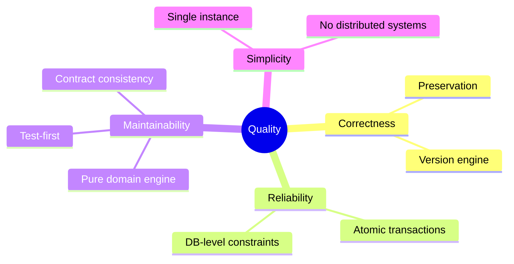

# Architecture Documentation: Backend — ระบบติดตามความคืบหน้าโครงการวิจัย

**Version:** 1.1
**Date:** 2026-10-19
**Status:** Draft

> เอกสารนี้เรียบเรียงตาม template arc42 (12 sections) จากแหล่งข้อมูล:
> `docs/architecture/requirement.md` (18 ต.ค. 2026) และ
> `docs/architecture/sequence-diagrams.md` (14 flows) · primary source ของโมเดลคือ
> `docs/sources/project-erd.md` · แผนภาพ C4 ทั้งหมดอยู่ที่ `docs/architecture/c4/`
> — เอกสารนี้ไม่วาดแผนภาพซ้ำ

---

## 1. Introduction and Goals

### 1.1 Requirements Overview

ระบบหลังบานสำหรับ**นักวิจัยและคณะกรรมการ** รองรับการเขียน **DMP (แผนการจัดการข้อมูลวิจัย
ตามรูปแบบ maDMP v3.0)** — ประกอบด้วย research outputs (datasets), distributions,
contributors และ costs นักวิจัยเขียนแผนได้เองหรือให้ AI ช่วยสร้าง แผนแบบ**มีสังกัด**
(institutional) ต้องผ่านการอนุมัติจากกรรมการก่อนมีผล ส่วนแผนแบบ**ไม่มีสังกัด**
(independent) นักวิจัย self-finalize เองได้ เมื่อแผนมีผลแล้วงานถูกทำตามเป็น **tasks**
พร้อมหลักฐาน (evidence)

ระบบให้บริการ frontend ที่มีอยู่ (repo `Frontend`) — โมเดลข้อมูลและพฤติกรรมทั้งหมด
ออกแบบให้สอดคล้องกับโมเดลฝั่ง client โดย primary source คือ ERD ฝั่ง frontend
(`docs/sources/project-erd.md`)

**Key Features:**

- บัญชีผู้ใช้ 4 บทบาท (researcher / committee / chief / admin) — sign-up เองได้เฉพาะ
  researcher, สถาบันมอบบัญชีที่เหลือ (provisioning + password reset)
- โครงการวิจัย (projects) + สมาชิก + ไฟล์ proposal (.docx — parse เป็น extracted text)
- DMP: draft editing + validation, การส่ง (submit), การจำแนก minor/major edits,
  เวอร์ชัน + การตัดสิน (approve / return), restore, archive — ไม่มีทางลบแผน
- Domain engine: diff / classify / fold minor / carry / drop / rebase — หัวใจของ
  การรักษาประวัติการแก้ไข (preservation)
- Tasks: เกิดอัตโนมัติเมื่อแผนมีผลครั้งแรก, checklist, progress derived, evidence
  polymorphic (file / URL / DOI)
- AI Assistant: agent loop (ReAct) บน OpenRouter, tools 3 ตัว, token budget ต่อผู้ใช้,
  ตอบกลับแบบ SSE streaming
- การแจ้งเตือน 8 ประเภท push ผ่าน SSE
- Export มาตรฐาน 2 รูปแบบ: GCWG-RDA maDMP v3.0 และ RDA DMP Common Standard v1.3

### 1.2 Quality Goals

| Priority | Quality Goal | Description |
|----------|--------------|-------------|
| 1 | **Preservation (ความถูกต้องของประวัติ)** | สิ่งที่บันทึกการทำงานจริงไม่มีทางถูกทำลาย — ไม่มีทางลบแผน, task ที่มีงานบันทึกลบไม่ได้, fix ที่ merge ไม่ได้จด `dropped_minor_edits` แทนการหายเงียบ ๆ, race ของ submit พร้อมกันเป็นไปไม่ได้ (constraint ระดับฐานข้อมูล) |
| 2 | **ความถูกต้องของ version/diff engine** | ความเสี่ยงจริงของระบบคือความถูกต้องของ diff/classify/carry/drop/replay ตาม entity id — ไม่ใช่ raw performance (workload ~200/วัน, peak ~2,000) จึง test-first บน pure functions + e2e ครบ 14 flows |
| 3 | **ความเรียบง่าย (single instance)** | Modular monolith บน instance เดียว scale แนวตั้ง — transactional flows (approve → สร้าง tasks → notifications) เป็น transaction เดียว ตรวจสอบได้ ไม่มี distributed อะไรบน critical path |
| 4 | **Consistency ของ contract BE/FE** | zod schema เป็น source of truth เดียว — validation ฝั่ง BE, type ฝั่ง BE และ type ฝั่ง FE มาจากชุดเดียวกัน รวมถึง field policy และ domain profiles ที่ใช้ตัดสินบน backend ต้องเป็นชุดเดียวกับที่ FE แสดง |

### 1.3 Stakeholders

| Role | Name/Team | Expectations |
|------|-----------|--------------|
| Researcher | นักวิจัย institutional / citizen | เขียน/ส่งแผน, ทำ tasks, export มาตรฐาน — การแก้ที่เสียหายต้องไม่เกิด |
| Committee | กรรมการสถาบัน | ตัดสินเวอร์ชันของแผน institutional ผ่าน global queue — คนใดคนหนึ่งตัดสินได้ |
| Chief | สถาบันมอบ | *ยังไม่มีพฤติกรรมเฉพาะ* นอกจากเป็นสมาชิกโครงการ |
| Admin | สถาบันมอบ | จัดการบัญชี (provisioning, disable, password reset) — ไม่แตะ DMP ของนักวิจัย |
| Frontend team | repo `Frontend` (React 19 + TS) | ใช้ OpenAPI spec (`GET /openapi-json`) generate client, ใช้ zod contract/field-policy ชุดเดียวกับ BE |
| Operations | ops ของสถาบัน | deploy บน VM เดียวด้วย docker-compose, backup pg_dump + volume snapshot |
| ผู้พัฒนา backend | team นี้ | โครงสร้างที่สร้างได้จริง, test-first บน domain engine ได้จริง |

---

## 2. Architecture Constraints

### 2.1 Technical Constraints

| Constraint | Description | Background |
|------------|-------------|------------|
| TC-1 | **Scale จำกัดและทราบค่าล่วงหน้า** — ผู้ใช้เฉลี่ย ~200/วัน, peak ~2,000 | องค์กรสถาบันเดียว — instance เดียว scale แนวตั้งรองรับได้สบาย จึงตัด Redis/distributed ออกจาก critical path |
| TC-2 | **Deploy บน VM เดียว (docker-compose)** | ไม่มี kubernetes/cloud managed — Caddy TLS + Postgres + app ใน compose เดียว; release = restart สั้น ๆ ยอมรับได้ |
| TC-3 | **ตัวจำกัดจริงคือ network** (OpenRouter, Postgres), ไม่มี CPU-bound work | งานหนักคือรอ API ภายนอก, SSE connection ค้างต่อ AI run, JSON diff/validation |
| TC-4 | **ไม่มี monorepo กับ FE** | FE รัน script generate client ใน repo ตัวเอง ผ่าน runtime endpoint `GET /openapi-json` — spec ไม่ commit ลง repo |
| TC-5 | **4 การตัดสินรอ repo Frontend** | domain profiles ข้อมูลจริง, ชุด tasks แรก, รูปร่าง checklist, enum ของ evidence — ต้องดูต้นแบบจาก repo `Frontend` (ยังไม่อยู่บนดิสก์) ก่อนปิดการตัดสิน (หมวด 9) |
| TC-6 | **AI เป็นบริการภายนอก (OpenRouter)** ผ่าน system key เดียวจาก env | internal detail — ไม่ปรากฏใน API contract; ไม่มี web search และไม่มี tool เขียน draft |
| TC-7 | **Secrets ผ่าน env เท่านั้น** | `DATABASE_URL`, `JWT_SECRET`, `OPENROUTER_KEY`, `SMTP_URL` — ห้ามอยู่ใน repo; ค่า tunable อยู่ใน `config.json` |

### 2.2 Organizational Constraints

| Constraint | Description | Background |
|------------|-------------|------------|
| OC-1 | **เฉพาะ researcher สมัครบัญชีเองได้** | committee/chief/admin สถาบันมอบ — admin สร้างด้วยรหัสผ่านชั่วคราวบังคับเปลี่ยนตอน login แรก ไม่พึ่ง email ในการเริ่มระบบ |
| OC-2 | **โมเดลข้อมูลสอดคล้องกับ client ปัจจุบัน** | ERD ฝั่ง frontend เป็น primary source เพียงแหล่งเดียว — ข้อขัดแย้งต้องอ้างการตัดสินที่จดไว้ (เช่น bcrypt แทน SHA-256) |
| OC-3 | **Backup เป็นหน้าที่ ops ของสถาบัน** | pg_dump ตามรอบ + snapshot volume ไฟล์ — จดไว้ใน runbook ไม่ใช่ automation ในระบบ |
| OC-4 | **Email verification ยังไม่ทำ** | ใครก็สมัครด้วย email ใดก็ได้ — จดเป็นช่องที่รู้ตัว (หมวด 11) |

### 2.3 Conventions

| Convention | Description |
|------------|-------------|
| CON-1 | feature-driven layout ตาม format **project-dna** — ชื่อโฟลเดอร์ตัวพิมพ์เล็กทั้งหมด, cross-feature code อยู่ `features/shared/` |
| CON-2 | NestJS module 1 ตัวต่อ 1 feature; `features/shared/domain-engine/` ห้าม import `@nestjs/*` และห้าม touch DB/HTTP (บังคับด้วย lint) |
| CON-3 | zod schema ใน `features/shared/contracts/` เป็น source of truth — `docs/` มีเฉพาะไฟล์ .md ไม่มี generated artifact |
| CON-4 | วันที่ไม่มีเวลา (begin/end แผน, start/end task, วันที่ใน domain metadata) เก็บเป็น `YYYY-MM-DD` แยกจาก timestamp เต็ม (`created_at` ฯลฯ) — ห้ามปะปน |
| CON-5 | ID เป็น **UUID v7** mint โดย backend ทุก entity; export prefix ด้วย dmp_id เป็น safeguard |
| CON-6 | การทดสอบ: `tests/unit/` mirror ต้นไม้ `src/`; package manager คือ **pnpm** (node v24, TypeScript strict) |

---

## 3. System Scope and Context

### 3.1 Business Context

แผนภาพ Context (C4) อยู่ที่ [`c4/c4-context.md`](c4/c4-context.md) — ระบบอยู่ตรงไหนของ
โลก: ใครใช้ และอะไรอยู่นอกขอบเขต (Frontend, OpenRouter, SMTP)

| Actor/System | Description | Communication |
|--------------|-------------|---------------|
| Frontend (repo `Frontend`) | React 19 + TS — ผู้ใช้ทุกบทบาทเข้าผ่าน app นี้ | HTTPS REST/JSON + SSE (AI stream, notification push) — auth ผ่าน JWT header |
| OpenRouter | ผู้ให้บริการโมเดล AI | HTTPS — system key จาก env; backend เขียน ReAct loop เอง |
| SMTP server | ส่ง email password reset | SMTP — dev รัน MailPit ใน docker-compose |
| Postgres | ฐานข้อมูลหลัก | SQL ผ่าน Drizzle (in-process) |
| Disk volume | ไฟล์อัปโหลด (proposal, evidence) | ผ่าน `FileStorage` port (DiskStorage) |

### 3.2 Technical Context

| Interface | Technology | Description |
|-----------|------------|-------------|
| REST API | HTTPS / JSON | zod → OpenAPI (`@asteasolutions/zod-to-openapi` + `@nestjs/swagger`) — เสิร์ฟ `GET /openapi-json` runtime |
| SSE streams | `text/event-stream` | `GET /notifications/stream`, `POST /dmps/{id}/ai/{action}` — FE ใช้ fetch + ReadableStream (EventSource แนบ Authorization header ไม่ได้) |
| Error envelope | JSON เดียวทั้ง API | `{ error: { code, errors: [{path, code, message}] } }` — `path` เป็น JSON pointer ลงใน draft ให้ FE "คลิกไปแก้" |
| Reverse proxy | Caddy | TLS termination + reverse proxy บน VM เดียว |

---

## 4. Solution Strategy

### 4.1 Technology Decisions

| Decision | Technology | Rationale |
|----------|------------|-----------|
| ภาษา/framework | **TypeScript + NestJS** | type sharing กับ FE (React 19 + TS) ผ่าน zod ครั้งเดียว, SSE first-class (event loop จัดการ connection ค้างหลายพันรายการ), JSON เป็นจุดแข็งของภาษา — Go เร็วกว่าแต่ type ต้องนิยามสองครั้ง และ raw performance ไม่ใช่ตัวตัดสินที่ scale นี้ (TC-3); Python/FastAPI ปฏิเสธด้วยเหตุผลเดียวกัน |
| ฐานข้อมูล | **PostgreSQL + Drizzle** | JSONB + partial unique index ควบคุม SQL ได้ตรง — constraint "หนึ่ง pending ต่อแผน" และ "เลขเวอร์ชันไม่ซ้ำ" บังคับโดย Postgres เอง |
| Contract | **zod → OpenAPI → FE generate client** | zod เป็น source of truth; ไม่มี monorepo (TC-4) |
| Validation | zod (runtime) + กฎ หมวด 3.3 ของ requirement | ปฏิเสธพร้อม path ชี้ลง draft (JSON pointer) ให้ FE นำไปคลิกไปแก้ |
| ID | **UUID v7** mint โดย backend | ตัด collision ข้ามแผนของระบบเดิม (seed ids ซ้ำ) + export prefix ด้วย dmp_id |
| Auth | JWT access อายุสั้น + refresh token revocable (bcrypt/argon2id) | เบี่ยงจาก ERD (SHA-256) อย่างมีเจตนา — ERD ระบุเองว่าไม่ปลอดภัยพอ |
| AI integration | เขียน ReAct loop เอง บน `AiClient` port | ต้องควบคุม SSE event (`status`/`tool`/`token`/`result`) ให้ตรง spec เป๊ะ — ไม่ใช้ LangChain |
| Testing | Vitest (unit test-first บน engine) + supertest e2e ครบ 14 flows | preservation คือกฎที่ bug ของมันแพงที่สุด (Quality Goal 1–2) |
| Config | `config.json` + env เฉพาะ secret | โมเดล AI ต่อ action ตั้งได้ใน config.json; secrets ผ่าน env (TC-7) |

**ทำไมไม่ใช่ Go หรือ Python** — ในแง่ raw performance ล้วน Go ชนะ (goroutine ~KB ต่อ
connection ค้าง, native binary) แต่ประสิทธิภาพภาษาไม่ใช่ตัวตัดสินที่ scale นี้ — ความเสี่ยง
จริงของระบบคือความถูกต้องของ diff/version engine (minor/major classification, carry/drop
edits, replay ตาม entity id) ภาษาที่ช่วยให้ logic นี้ถูกต้องและ maintain ได้จึงดีกว่าภาษาที่
เร็วกว่า **Consequences:** ความเร็ว raw ต่ำกว่า Go ยอมรับได้ — หากวันหนึ่ง AI streaming หรือ
notification push กลายเป็น bottleneck จุดแก้คือ topology (เพิ่ม instance) ไม่ใช่เปลี่ยนภาษา ·
zod schema กลางกลายเป็นข้อผูกมัดของ API contract ต้องถูกรักษาเป็น source of truth จริง

### 4.2 Top-Level Decomposition

**Approach:** **Modular monolith — instance เดียว, scale แนวตั้ง**

- ทุก flow ใน sequence diagrams เป็น transactional ต่อกัน (approve → สร้าง tasks แรก →
  notifications ต้อง atomic) — monolith ใน process เดียวทำให้ transactional flows ง่ายและตรวจสอบได้
- notification push และ AI SSE stream อ่าน event จาก in-process event bus — ตัด Redis
  ออกจาก critical path (TC-1)
- **เงื่อนไขที่ติดมากับการตัดสินนี้**: storage และ notification publisher ต้องอยู่หลัง
  interface (port) เดียว เผื่อ scale ออก — สลับ disk→S3, in-process bus→Redis โดยไม่แตะ
  domain logic; ไม่มี external queue — งาน async เดียวคือ parse .docx ตอน upload ซึ่งทำ in-process;
  deploy เป็น restart สั้น ๆ ตอน release ยอมรับได้ที่ scale นี้

**Key Modules (9 features + `shared/`):** auth · users · projects · files · dmps ·
tasks · notifications · ai · exports — รายละเอียดในหมวด 5

### 4.3 Approaches to Achieve Quality Goals

| Quality Goal | Approach |
|--------------|----------|
| Preservation | constraint ระดับฐานข้อมูล (`UNIQUE (dmp_id, number)`, partial unique pending, PK คู่ `(project_id, user_id)`), `draft_revision` optimistic concurrency (409), กฎ archive/cancel/reopen, `dropped_minor_edits` จดแทนการหายเงียบ ๆ |
| ความถูกต้องของ engine | domain engine เป็น pure functions — unit test-first; e2e supertest ต่อ Postgres จริง ครบ 14 flows ของ sequence diagrams |
| เรียบง่าย / auditability | transaction Drizzle เดียวใน service ผู้เรียก, in-process event bus เฉพาะใน adapter ของ `NotificationPublisher`, deploy = restart สั้น ๆ |
| Contract consistency | zod schemas กลาง (`features/shared/contracts/`), field policy และ domain profiles เป็น registry ที่ expose `GET /field-policy` / `GET /domain-profiles` — FE ใช้ชุดเดียวกับที่ backend ตัดสิน |

---

## 5. Building Block View

### 5.1 Level 1: Whitebox Overall System

แผนภาพ Containers (C4) อยู่ที่ [`c4/c4-containers.md`](c4/c4-containers.md) — Caddy,
NestJS 1 process, PostgreSQL, file volume ใน docker-compose เดียว พร้อมเหตุผลว่า
**ทำไมไม่มี** Redis/queue

**Contained Building Blocks:**

| Building Block | Purpose |
|----------------|---------|
| Caddy | TLS + reverse proxy |
| NestJS app (1 process) | ทุก use-case — auth, DMP lifecycle, tasks, AI, notifications, exports |
| Postgres | relational tables + `dmps.draft` JSONB |
| Disk volume | ไฟล์ผ่าน `FileStorage` port (DiskStorage adapter) |

### 5.2 Level 2: Features (โครงสร้าง repo)

```
src/
├── features/
│   ├── auth/                 # sign-up, sign-in, refresh, sign-out, guards
│   ├── users/                # profile, admin provisioning, token budget
│   ├── projects/             # projects + members + proposal selection
│   ├── files/                # upload/download, docx parse (mammoth, in-process)
│   ├── dmps/                 # draft CRUD, submit, versions, decisions, archive
│   ├── tasks/                # lifecycle, evidence, preservation rules
│   ├── notifications/        # notification rows + SSE stream
│   ├── ai/                   # ReAct loop, thread, token budget
│   ├── exports/              # madmp-v3 / rda-v1.3 projections
│   └── shared/
│       ├── domain-engine/    # pure functions — ห้าม import @nestjs/*
│       ├── domain-profiles/  # DOMAIN_PROFILE registry + field-policy (path-based)
│       ├── contracts/        # zod schemas ข้าม feature (draft schema, error envelope, SSE events)
│       ├── ports/            # FileStorage, NotificationPublisher, AiClient, MailSender
│       ├── adapters/         # DiskStorage, SsePublisher + InProcessEventBus,
│       │                     #   OpenRouterClient, SmtpMailer
│       └── config/           # config loader (จุดเดียวที่อ่าน config.json)
├── database/                 # drizzle schema + migrations (SQL files) + seeds
tests/                        # unit (mirror src/) / integration / e2e (14 flows) / fixtures
config.json                   # ค่า tunable — mirror โครงสร้างโฟลเดอร์
.env / .env.example           # credentials เท่านั้น
```

กฎที่บังคับด้วย lint: `features/shared/domain-engine/` ห้าม import `@nestjs/*` และห้าม
touch DB/HTTP (CON-2) · NestJS module 1 ตัวต่อ 1 feature · ชื่อโฟลเดอร์ตัวพิมพ์เล็กทั้งหมด

| Feature | รับผิดชอบ | Endpoints หลัก |
|---|---|---|
| `auth` | sign-up (researcher เท่านั้น), sign-in, JWT access + refresh revocable | `POST /sign-up`, `/sign-in`, `/refresh`, `/sign-out` |
| `users` | profile, เปลี่ยนรหัสผ่าน, admin provisioning, password reset, `ai_token_limit/used` | `GET/PATCH /me`, `POST /me/password`, `POST /admin/users`, `POST /admin/users/{id}/disable`, `POST /password-reset` |
| `projects` | โครงการ + members, proposal selection, การลบโครงการ (ปฏิเสธถ้ามีแผน) | `POST/GET /projects`, `GET/PATCH/DELETE /projects/{id}` |
| `files` | upload/download ผ่าน `FileStorage` port, จำกัด 25 MB, parse .docx เก็บ extracted text | `POST /projects/{id}/files`, `GET /files/{id}` |
| `dmps` | draft CRUD (`draft_revision` — 409), diff/classify ตอนบันทึก, submit/finalize, versions + decisions, restore, archive | `PUT /dmps/{id}/draft`, `POST /dmps/{id}/submit\|finalize\|archive\|unarchive`, `POST /dmps/{id}/versions/{n}/approve\|return\|restore`, `DELETE /dmps/{id}/draft/datasets/{ds}` |
| `tasks` | lifecycle + preservation rules, progress derived จาก checklist, evidence polymorphic | `GET /tasks`, `PATCH /tasks/{id}`, `POST /tasks/{id}/files\|complete\|cancel\|reopen`, `DELETE /tasks/{id}` |
| `notifications` | rows สร้างใน transaction ของเหตุการณ์ + push ผ่าน port, 8 type | `GET /notifications`, `GET /notifications/stream` (SSE), `POST /notifications/{id}/read`, `POST /notifications/read-all` |
| `ai` | ReAct loop บน `AiClient` port, tools 3 ตัว, token budget estimate→reconcile, thread persist | `POST /dmps/{id}/ai/{action}` (SSE), `GET /dmps/{id}/ai/thread` |
| `exports` | projection ไม่เก็บ — madmp-v3 / rda-v1.3 | `GET /dmps/{id}/export?format=madmp-v3\|rda-v1.3` |
| meta | registry ที่ expose เป็น API | `GET /domain-profiles`, `GET /field-policy`, `GET /openapi-json` |

หมายเหตุ: list endpoints ใช้ `?page=&limit=` (offset) พอ — โหลดสูงสุด ~2,000 peak ไม่ต้องถึง
cursor; committee queue เป็น **global queue** (`GET /dmps?status=pending`) — อ่าน snapshot +
changes ของเวอร์ชันที่รอได้ ตัดสินได้คนเดียวพอ (หนึ่งเวอร์ชัน หนึ่ง decision ตาม
requirement หมวด 4.6) — ไม่มี entity การมอบหมาย

### 5.3 Level 3: Layering ภายใน feature + domain-engine

```
controller (HTTP/SSE, บาง)
    → service (use-case, ธุรกรรม Drizzle)
        → domain/ (pure functions: diff engine, field policy, validation, export)
        → repository (Drizzle, ตาราง)
    → ports/ (interface): FileStorage, NotificationPublisher, AiClient, MailSender
        → adapters/: DiskStorage, SsePublisher + InProcessEventBus,
                     OpenRouterClient, SmtpMailer
```

กฎสองข้อ (บังคับด้วย lint/review):
1. **Domain engine เป็น pure function** — รับ JSON draft + version in force + field
   policy คืนผลลัพธ์ ไม่แตะ DB/HTTP → test-first ได้จริง
2. **ทุก I/O ที่เปลี่ยน implementation ได้ต้องผ่าน port** — สลับ disk→S3,
   in-process bus→Redis โดยไม่แตะ domain

**Ports และ adapters:**

| Port | Adapter ตอนนี้ | อีกฝั่งที่รอ |
|---|---|---|
| `FileStorage` | `DiskStorage` (volume) | `S3Storage` |
| `NotificationPublisher` | `SsePublisher` + `InProcessEventBus` | Redis pub-sub |
| `AiClient` | `OpenRouterClient` (system key จาก env) | — |
| `MailSender` | `SmtpMailer` (SMTP จาก env; dev: MailPit) | ผู้ให้บริการอื่น |

**การเชื่อมข้าม feature:** direct service inject เป็น default (`DmpsService` inject
`TasksService`, `ExportsService` inject `DmpsService`); port เฉพาะ I/O ที่เปลี่ยน
implementation ได้; **ไม่มี event bus ทั่วไป** — `InProcessEventBus` มีอยู่แค่ภายใน
adapter ของ `NotificationPublisher` เพื่อ push SSE หลัง commit; ธุรกรรม business (approve →
สร้าง tasks → notifications) ยังเป็น transaction Drizzle เดียวใน service ผู้เรียก

**Domain engine — pure functions ชุดเดียว รองรับทุก flow:**

| ฟังก์ชัน | หน้าที่ | ใช้ใน flow |
|---|---|---|
| `diffDraft(draft, baseSnapshot)` | JSON tree diff ตาม entity id → `FieldChange[]` | #4, #8, #9, #10 |
| `classify(changes, fieldPolicy)` | จำแนก minor/major — มี major ฟิลด์เดียว = ทั้งชุด major | #5, #8, #9 |
| `foldMinor(snapshot, changes)` | บันทึกลง version in force + จด `minor_edits` | #8, #9 ระหว่างรอ |
| `carryEdits(basedOn, currentInForce, newSnapshot)` | replay ตาม entity id → carried + dropped | #9 ตอน approve |
| `rebaseWorkingCopy(draft, newSnapshot)` | เหลือเฉพาะการแก้ที่ยังไม่มีใครบันทึก/ส่ง | #9 ตอน approve |
| `validateDraft(draft, profiles)` | กฎ validation คืน `errors: [{path, code, message}]` (JSON pointer) | #4, #5, #7 |
| task generator | สร้างชุด tasks แรกเมื่อแผนมีผล (pure function ในชุดเดียวกัน) | #6, #7 |

**โมเดลข้อมูล (แบบผสม):** ตาราง relational สำหรับ entity ที่มี lifecycle จริง, JSONB
สำหรับ working draft เหตุผล: ERD ฝั่ง frontend (primary source ของ requirement) วาด
DATASET/DISTRIBUTION/CONTRIBUTOR/COST เป็น entity แยก แต่ requirement หมวด 3.2 ระบุเองว่า
ทั้งหมดเป็นค่า nested ใน `draft` ของ DMP และ `DMP_VERSION` เป็น embedded list พร้อมขอให้
backend "enforce เป็น constraint จริง" ทางเลือกคือ normalize ทั้งหมด, document DB ทั้งหมด
หรือแบบผสมบน PostgreSQL ซึ่งเป็นทางที่เลือก เพราะ:

- **draft เป็น JSONB ก้อนเดียวต่อ DMP** — working copy ถูก diff กับ snapshot, validate
  ทั้งก้อน และ fold/carry ตาม entity id อยู่แล้ว การฉีกเป็นตารางซ้ำซ้อนกับโครงสร้างที่ระบบใช้งานจริง
- **DMP_VERSION เป็นตารางจริง (แถวต่อเวอร์ชัน)** — เพื่อบังคับ constraint ระดับฐานข้อมูล
  ที่ requirement หมวด 3.2 เรียกร้อง
- **entity ที่มี lifecycle ข้าม draft เป็นตาราง relational**: USER, CREDENTIAL,
  PROJECT, PROJECT_MEMBER, TASK, FILE_RECORD, NOTIFICATION, AI_THREAD_ENTRY

**ตาราง relational (11 ตาราง):**

| ตาราง | constraint สำคัญ |
|---|---|
| `users` | `email` unique แบบ normalize (lowercase + trim), `username` lowercase |
| `credentials` | PK `username`, FK → users, salted hash **bcrypt/argon2id** (เบี่ยงจาก ERD ตาม requirement หมวด 2.3) |
| `refresh_tokens` | FK → users, revocable — รองรับการปิดสิทธิ์บัญชีที่สถาบันมอบ |
| `projects` | FK `proposal_file_id` → file_records (nullable) |
| `project_members` | PK คู่ `(project_id, user_id)` — enforce หมวด 3.2 ที่ระดับฐานข้อมูล |
| `dmps` | `draft` JSONB, `status`, `plan_mode` (freeze ตอน submit แรก), `active_version`, `archived_at`, `tasks_generated`, `draft_revision` |
| `dmp_versions` | `UNIQUE (dmp_id, number)` + **partial unique `UNIQUE (dmp_id) WHERE status='pending'`** — บังคับ requirement หมวด 4.3/4.4 โดย Postgres เอง; snapshot/changes/minor_edits/carried/dropped เป็น JSONB |
| `tasks` | FK dmps; `progress_percent` derived จาก checklist เสมอ |
| `file_records` | purpose/docx-extracted-text (text ในตาราง ไม่ใช่ใน metadata — agent อ่านสำเร็จรูป) |
| `notifications` | type ตาม requirement หมวด 7, read_at nullable |
| `ai_thread_entries` | kind user/event/assistant, scope ตาม dmp_id, token_count |

**DATASET / DISTRIBUTION / CONTRIBUTOR / COST ไม่มีตาราง** — เป็นค่า nested ใน
`dmps.draft` (JSONB) DOMAIN_PROFILE เป็น **code registry** (module ใน backend, ไม่มีตาราง)
เปิด `GET /domain-profiles`

**Optimistic concurrency บน draft:** ทุก PUT draft ต้องแนบ `draft_revision` ที่ client
เห็นล่าสุด — ไม่ตรงปัจจุบัน → `409` ให้โหลดใหม่ ป้องกันการสูญเสียงานแก้ซึ่งเป็นรูปแบบของ
preservation ที่ requirement หมวด 5.3 ห้ามเกิด

**Consequences ของโมเดลนี้** — constraint "หนึ่ง pending ต่อแผน" และ "เลขเวอร์ชันไม่ซ้ำ"
ถูกบังคับโดย Postgres เอง ไม่ใช่แค่ logic ใน application — race condition ของ submit
พร้อมกันเป็นไปไม่ได้ · การ query ที่ต้องเจาะเข้า draft (เช่นหา dataset) ใช้ JSONB operator
ของ Postgres ยอมรับได้เพราะความถี่ต่ำ ส่วน list หลักอ่านจากคอลัมน์ปกติ · ถ้าวันหนึ่งต้อง
normalize จริง จะแตะเฉพาะ repository layer เพราะ domain engine ทำงานกับ JSON อย่างเดียว

---

## 6. Runtime View

สถานการณ์ทั้ง 14 flows มี sequence diagram ครบใน
[`sequence-diagrams.md`](sequence-diagrams.md) — เอกสารนี้สรุปเฉพาะสาระสำคัญ ไม่วาด diagram ซ้ำ

### 6.1 Scenario: Submit → Approve (แผน institutional มีผลครั้งแรก — flow 5–7)

นักวิจัย submit → validateDraft, freeze plan_mode ลง DMP (pin ตลอดไป), diff + classify
จาก field policy → สร้าง DMP_VERSION #1 (pending, snapshot ณ submit) พร้อม notification
(`dmp_submitted`, `review_requested`) กรรมการ approve (คนใดคนหนึ่งพอ — หนึ่งเวอร์ชัน หนึ่ง
decision) → บันทึก status/decided_at/decided_by/approver snapshot บนเวอร์ชัน, set
active_version, task generator สร้างชุด tasks แรก + notification — **ทุกอย่างใน
transaction Drizzle เดียว** constraint `UNIQUE (dmp_id, number)` และ partial unique
pending ทำให้ race ของ submit พร้อมกันเป็นไปไม่ได้โดย Postgres เอง แผน independent ใช้
`POST /finalize` — self-finalize, เวอร์ชัน #1 approved ด้วยตัวเอง แผนมีผลทันที

### 6.2 Scenario: Major revision + minor fixes ขณะรอ (carry / drop / rebase — flow 8–9)

หัวใจของ preservation — ระหว่างรอ approval: minor fix fold ตรงลง version in force (จด
`minor_edits`, pending snapshot freeze) · submit revision ที่แตะฟิลด์ major สร้าง
DMP_VERSION ใหม่โดย `based_on` = version in force ณ ตอน submit (หนึ่ง revision รอได้
ครั้งเดียว — partial unique บังคับ) · ตอน approve: `carryEdits` replay ความต่างตาม entity
id → fix ทุกตัวจด `carried_minor_edits` หรือ `dropped_minor_edits` (fix ที่ลง output ที่ถูกลบ
— ไม่มีการหายเงียบ ๆ) แล้ว `rebaseWorkingCopy` เหลือเฉพาะการแก้ที่ยังไม่มีใครบันทึก/ส่ง ·
ถ้าถูกส่งกลับ fix เหล่านั้นอยู่กับ version in force ตามเดิม · การลบ research output เป็น
**ข้อเสนอ** — tasks ที่ scope กับ output นั้นยังทำต่อจนกว่าเวอร์ชันที่ลบมันจะมีผล จึงถูก
cancel (`cancel_reason=output_removed`, จดชื่อ output ไว้ตามหา) เมื่อ output กลับมา tasks
ถูก**เสนอให้เปิดคืนทีละตัว** ไม่เปิดเองอัตโนมัติ

### 6.3 Scenario: AI action (ReAct loop, SSE — flow 3)

เช็ก token budget ด้วย estimate ก่อนเริ่ม run (ปฏิเสธถ้าไม่พอ) → persist `ai_thread_entries`
(kind=user) → ReAct loop เรียก tools 3 ตัว (`read_proposal` จาก extracted text,
`read_draft`, `read_domain_profiles` — ไม่มี web search และไม่มี tool เขียน draft) สตรีม
SSE เป็น `status`/`tool`/`token`/`result` จบ run ด้วย structured proposals — ทุกผลลัพธ์เป็น
ข้อเสนอที่ผู้ใช้แก้ไขต่อได้ทั้งหมด reconcile token ของจริงตอนจบ (run เดียวล้นโควตาได้ ไม่ตัด
กลางคัน; ล้มเหลวกลางทาง budget ที่ใช้ไปยังนับ) extracted text ของ proposal ถูก parse ตอน
upload (mammoth, in-process) เก็บใน `file_records` — agent อ่านสำเร็จรูป ไม่ parse ซ้ำ

### 6.4 สถานการณ์อื่น (สรุป — diagram เต็มใน sequence-diagrams.md)

| # | Scenario | ประเด็นสำคัญ |
|---|---|---|
| 1 | Sign-up / Sign-in | เฉพาะ researcher; username/email ไม่ซ้ำ; attribute ผู้กระทำจาก JWT subject ทุก mutation |
| 2 | สร้างโครงการ + proposal | plan_mode default ตาม account_type; การแทน proposal จด `superseded_at` + notification |
| 4 | แก้ draft + validation | 422 พร้อม path JSON pointer ให้คลิกไปแก้; `draft_revision` ไม่ตรง → 409 |
| 8 | Minor edit | fold ตรงลง version in force ไม่สร้างเวอร์ชัน ไม่มี review |
| 10 | Restore เวอร์ชัน | เวอร์ชันที่รอ decision restore ไม่ได้; restore เวอร์ชันอื่นนับเป็นการแก้ธรรมดา (rollback ข้ามการอนุมัติไม่ได้) |
| 12 | ทำงาน tasks | progress derived จาก checklist; task ที่มีงานบันทึกลบไม่ได้, ที่เสร็จแล้ว cancel ไม่ได้ (reopen เท่านั้น) |
| 13 | Archive / ลบโครงการ | ไม่มีทางลบแผน; archive ถูกปฏิเสธขณะแผนมีผล; ลบโครงการถูกปฏิเสธตราบใดที่มีแผน |
| 14 | Export | projection ไม่เก็บ — จาก snapshot ของ version in force (หรือ draft ก่อนมีผล) |

---

## 7. Deployment View

### 7.1 Infrastructure Level 1

แผนภาพ Deployment (C4) อยู่ที่ [`c4/c4-deployment.md`](c4/c4-deployment.md) — VM เดียว,
docker-compose: caddy + app + postgres + MailPit (dev) + volumes

### 7.2 Infrastructure Elements

| Element | Technology | Description |
|---------|------------|-------------|
| VM เดียว | docker-compose | instance เดียว scale แนวตั้ง (TC-1, TC-2) |
| caddy | Caddy | TLS termination + reverse proxy |
| app | NestJS (node v24) | 1 process — restart สั้น ๆ ตอน release ยอมรับได้ |
| postgres | PostgreSQL | Drizzle — migration เป็น SQL files (drizzle-kit) commit ลง repo, `seeds/` เฉพาะข้อมูลสำหรับ dev/e2e |
| volume ไฟล์ / DB | docker volumes | backup: pg_dump ตามรอบ + snapshot volume (หน้าที่ ops — OC-3) |
| MailPit | dev เท่านั้น | SMTP catch-all สำหรับ password reset ใน dev |

---

## 8. Cross-cutting Concepts

### 8.1 Domain Model

แบบผสม — ตาราง relational สำหรับ entity ที่มี lifecycle จริง, JSONB สำหรับ working draft
(รายละเอียดตารางและเหตุผลเต็มในหมวด 5.3 / ADR-0003) รูปร่าง draft ยืนยันแล้วตรง
**maDMP v3.0** (JSON schema จริงใน `uni/maDMP-Standard/`):

```jsonc
// Working draft (dmps.draft JSONB) — zod schema นิยามใน features/shared/contracts/
{
  "schema_version": "3.0",
  "dates": { "begin": "YYYY-MM-DD", "end": "YYYY-MM-DD" },
  "ethical_issues_description": "…",
  "indigenous_considerations": "…",
  "alternate_identifier": "…",
  "datasets": [           // research outputs — list บนสุดของ draft
    {
      "dataset_id": "UUID v7", "type": "raw|software|publication|other",
      "title", "description", "status", "access", "personal_data", "sensitive_data",
      "personal_data_plan", "protection_level(+other)", "security_classification_level(+other)",
      "keyword": [], "language", "domain": "DomainKey", "domain_metadata": {},
      "preservation": {},
      "distributions": [ /* nest ข้างใน dataset แต่ละอัน — ไม่มี top-level */ ]
    }
  ],
  "contributors": [ /* … is_contact พอดี 1 คน/แผน, user_id? (ลิงก์บัญชี — requirement หมวด 4.7) */ ],
  "costs": [ /* … currency_code default THB */ ]
}
```

`contracts/` ยังรวม error envelope, SSE event shapes (`status`/`tool`/`token`/`result`)
และ zod schema ของ request/response ที่ controller อ้าง — แยกจาก `domain-profiles/`
เพื่อให้เพิ่ม domain ไม่ต้องไปแตะ contracts

### 8.2 Security

**Authentication:** JWT access token อายุสั้น + refresh token เก็บใน `refresh_tokens`
(revocable — การปิดบัญชี revoke ทั้งหมด)
**Password:** salted hash **bcrypt/argon2id** (เบี่ยงจาก ERD อย่างมีเจตนา)
**Authorization:** role-based — sign-up ได้เฉพาะ researcher; admin provisioning สร้าง
บัญชี committee/chief/admin ด้วย username + email + **รหัสผ่านชั่วคราว** (แสดงครั้งเดียว
บังคับเปลี่ยนตอน login แรก — ไม่พึ่ง email ในการเริ่มระบบ)
**Audit:** การ attribute ผู้กระทำอ่านจาก JWT subject ทุก mutation
**Secrets:** env เท่านั้น (TC-7); token ผ่าน header เท่านั้น — ไม่หลุดเข้า access log
(SSE ใช้ fetch + ReadableStream)
**ช่องที่รู้ตัว:** email verification ยังไม่ทำ (OC-4)

### 8.3 Error Handling

Envelope เดียวทั้ง API:

```jsonc
// 422
{ "error": { "code": "VALIDATION_FAILED",
  "errors": [ { "path": "/datasets/1/domain_metadata/sample_size",
                "code": "REQUIRED", "message": "…" } ] } }
```

- `path` เป็น **JSON pointer** ลงใน draft — FE นำไปทำ "คลิกไปแก้" ได้ตรง ๆ
- `409` สำหรับ `draft_revision` ไม่ตรง (optimistic concurrency) และ pending ค้าง
- field policy นิยามแบบ path-based — ตรงระบบ JSON pointer เดียวกันทั้งสาย
  diff → classify → error path:

```jsonc
// ข้อมูล (registry) ไม่ใช่โค้ดแยก — expose ผ่าน GET /field-policy
{
  "major": [
    "/dates/begin", "/dates/end",
    "/ethical_issues_description", "/indigenous_considerations",
    "/datasets/*/access", "/datasets/*/personal_data",
    "/datasets/*/personal_data_plan", "/datasets/*/protection_level*",
    "/datasets/*/security_classification_level*"
  ],
  "listPolicies": {
    "/datasets": { "add": "major", "remove": "major" }   // การเพิ่ม/ลบ output (requirement หมวด 4.3)
    // contributors, costs: add/remove เป็น minor ทั้งหมด (ค่า default)
  }
}
```

### 8.4 Validation (กฎ หมวด 3.3 ของ requirement)

ปฏิเสธแผนพร้อมระบุฟิลด์เมื่อ: วันสิ้นสุดก่อนวันเริ่มต้น · มี ethical issues แต่ไม่มี
คำอธิบาย · ไม่มี contact พอดีหนึ่งคน (และ contact ต้องมี email ตาม maDMP `mbox`) ·
contributor สองคนลิงก์บัญชีเดียวกัน · distribution แบบ open ไม่มี license ·
`domain_metadata` ไม่ผ่าน profile ของ domain ตนเอง (generic + 7 research domains —
registry เป็นข้อมูล expose `GET /domain-profiles`)

### 8.5 Preservation (กฎ หมวด 5.3 ของ requirement)

- ไม่มีทางลบแผน — archive เท่านั้น (ปฏิเสธขณะแผนมีผล), unarchive กลับมาได้
- การออกจาก editor ไม่ลบอะไร — แผนที่มีผลสูญเสียเฉพาะการแก้ที่ยังไม่บันทึก
- Task ที่มีงานบันทึก (evidence / checklist ติก / ปิดแล้ว) ลบไม่ได้ — cancel เก็บ
  evidence ไว้; ที่เสร็จแล้ว cancel ไม่ได้ — reopen เท่านั้น; ลบได้เฉพาะที่ยังไม่มีใครเริ่ม
- การ cancel จด `cancelled_from`, `cancel_reason` (`manual` | `output_removed`) และ
  ชื่อ output ที่ถูกลบ — เวอร์ชันใหม่ที่นำ output กลับมา**เสนอ**เปิดคืนทีละ task

### 8.6 Real-time

- Notification push ผ่าน SSE (`GET /notifications/stream`) — event bus in-process อยู่
  หลัง `NotificationPublisher` port; row สร้างใน transaction ของเหตุการณ์ แล้ว publish
  หลัง commit
- AI streaming ใช้ SSE เช่นกัน — event shapes (`status`/`tool`/`token`/`result`)
  นิยามใน `contracts/`
- FE ใช้ **fetch + ReadableStream** ทุกจุด — `EventSource` แนบ Authorization header ไม่ได้
  และ AI action เป็น POST อยู่แล้วซึ่ง EventSource ใช้ไม่ได้

### 8.7 Configuration

`config.json` mirror โครงสร้างโฟลเดอร์ (`_appliesTo` ต่อ feature) — อ่านผ่าน loader ที่
`features/shared/config` จุดเดียว:

```jsonc
{
  "app":    { "name": "uni-backend", "debug": false },
  "auth":   { "_appliesTo": ["src/features/auth/"], "accessTokenTtlMinutes": 15, "refreshTokenTtlDays": 30 },
  "files":  { "_appliesTo": ["src/features/files/"], "maxFileSizeMb": 25, "storagePath": "data/files" },
  "ai":     { "_appliesTo": ["src/features/ai/"], "models": { "default": "…", "analyze_proposal": "…" } },
  "notifications": { "_appliesTo": ["src/features/notifications/"] }
}
```

`.env` — credentials เท่านั้น: `DATABASE_URL`, `JWT_SECRET`, `OPENROUTER_KEY`,
`SMTP_URL` (ดู `.env.example`)

### 8.8 Testability

- `tests/unit/` mirror ต้นไม้ `src/` — unit test-first บน domain engine (pure functions)
- `tests/integration/` — Postgres, disk, OpenRouter (mock server), SMTP
- `tests/e2e/` — supertest ต่อ Postgres จริง ครบ 14 flows ทุกกฎ preservation มี e2e คุ้มกัน
- `tests/fixtures/` — แผนตัวอย่าง, draft JSON, .docx ทดสอบ

### 8.9 Exports

- เป็น **projection ไม่เก็บ** — `GET /dmps/{id}/export?format=madmp-v3|rda-v1.3`
- แหล่ง: snapshot ของ version in force (หลังมีผล) หรือ draft (ก่อน) พร้อมสถานะ
  `not submitted`/`submitted`
- approval block ตาม plan_mode + approver; independent → `not applicable`
- id ใน export prefix ด้วย dmp_id เป็น safeguard ต่อ collision ข้ามแผน (ADR-0012)
- วันที่ปฏิทินออกเป็น `YYYY-MM-DD` เสมอ (CON-4)

---

## 9. Architecture Decisions

(เดิมแยกเป็น ADR — รวมไว้ในเอกสารฉบับเดียว)

| ID | Decision | Status | Date |
|----|----------|--------|------|
| ADR-0001 | Modular monolith — instance เดียว, scale แนวตั้ง, in-process event bus; ports เตรียมสลับ S3/Redis ภายหลัง | Accepted | 2026-10-19 |
| ADR-0002 | ทุก I/O ที่เปลี่ยน implementation ได้ผ่าน port (`FileStorage`, `NotificationPublisher`, `AiClient`, `MailSender`); cross-feature เป็น direct service inject — ไม่มี event bus ทั่วไป | Accepted | 2026-10-19 |
| ADR-0003 | โมเดลข้อมูลแบบผสม — DATASET/DISTRIBUTION/CONTRIBUTOR/COST เป็น JSONB ใน `dmps.draft`, DMP_VERSION เป็นตารางจริงบังคับ constraint ด้วย Postgres | Accepted | 2026-10-19 |
| ADR-0004 | TypeScript + NestJS (ปฏิเสธ Go/Python-FastAPI) — type sharing ผ่าน zod, SSE first-class, JSON เป็นจุดแข็ง | Accepted | 2026-10-19 |
| ADR-0005 | เขียน ReAct loop เองบน `AiClient` port — ไม่ใช้ LangChain | Accepted | 2026-10-19 |
| ADR-0006 | bcrypt/argon2id แทน SHA-256 ของ ERD (เบี่ยงอย่างมีเจตนา) | Accepted | 2026-10-19 |
| ADR-0007 | Committee queue เป็น global queue ไม่มีการมอบหมาย — หนึ่งเวอร์ชัน หนึ่ง decision | Accepted | 2026-10-19 |
| ADR-0008 | SSE auth ผ่าน fetch + ReadableStream (ไม่ใช้ EventSource) | Accepted | 2026-10-19 |
| ADR-0009 | Provisioning ด้วยรหัสผ่านชั่วคราวบังคับเปลี่ยน; password reset ผ่าน SMTP (dev: MailPit) | Accepted | 2026-10-19 |
| ADR-0010 | zod → OpenAPI ผ่าน `@asteasolutions/zod-to-openapi` + `@nestjs/swagger`; ไม่ commit `openapi.json` — runtime endpoint `GET /openapi-json` | Accepted | 2026-10-19 |
| ADR-0011 | Field policy เป็น path-based registry ตรงระบบ JSON pointer ของ error envelope — expose `GET /field-policy` | Accepted | 2026-10-19 |
| ADR-0012 | UUID v7 mint โดย backend ทุก entity + export prefix ด้วย dmp_id (ปิด open question หมวด 9 ของ requirement) | Accepted | 2026-10-19 |

**เลื่อนการตัดสิน (รอ repo Frontend — TC-5):** ข้อมูลต่อไปนี้มีอยู่เฉพาะใน repo
**Frontend** (github.com/Open-Science-and-Data-management/Frontend — ยังไม่ได้อยู่บนดิสก์)
repo `ui` บนดิสก์เป็น mock dashboard ของ requirement ฉบับเก่า ไม่เกี่ยว เมื่อได้ repo แล้ว
clone เป็น **read-only reference** แล้วตัดสิน 4 ข้อนี้ต่อ:

| เรื่องที่รอ | ต้องดูจากไฟล์ | คำถามที่รอ |
|---|---|---|
| domain profiles ข้อมูลจริง | `src/schemas/dataset/domain-profiles.ts` | ชื่อ field ภายในของ 8 profiles (generic + 7 domains) — port เข้า `features/shared/domain-profiles/` ให้ BE/FE validate ชุดเดียวกัน |
| ชุด tasks แรก | (ดูต้นแบบการสร้าง tasks ใน repo) | ชุด tasks แรกเมื่อแผนมีผลมีอะไรบ้าง — ต่อ dataset ตาม lifecycle stage หรือ template เดียวต่อแผน |
| รูปร่าง checklist | (ดูรูปร่าง checklist ใน repo) | ถ้าไม่มีรูปร่างเดิม → ใช้ `{ id, label, done }[]` (progress = done ÷ ทั้งหมด, 0 ข้อ = 0%) |
| enum ของ evidence | (ดูการใช้ evidence ใน repo) | ถ้าไม่มีใครใช้ `rdm_deposit` → ตัดเหลือ `none\|file\|url\|doi`; ก่อนหน้านั้นครอบค่าครบ 5 ค่า |

---

## 10. Quality Requirements

### 10.1 Quality Tree



### 10.2 Quality Scenarios

| ID | Scenario | Attribute | Target |
|----|----------|-----------|--------|
| QS-1 | Submit พร้อมกันสอง request บนแผนเดียว | Correctness | เป็นไปไม่ได้ — partial unique index ปฏิเสธที่ระดับ Postgres (ไม่มี pending ซ้ำ) |
| QS-2 | Approve revision ขณะมี minor fixes ค้างใน version in force | Correctness (preservation) | fix ทุกตัวจดลง `carried_minor_edits` หรือ `dropped_minor_edits` — ไม่มีการหายเงียบ ๆ |
| QS-3 | แก้ draft พร้อมกันสองเครื่อง | Correctness | `draft_revision` ไม่ตรง → `409` ให้โหลดใหม่ ไม่มีงานแก้ถูกทับ |
| QS-4 | เปลี่ยนกฎ classification ของเวอร์ชัน | Maintainability | diff/classify/fold/carry/rebase เป็น pure functions — scenario unit test เขียนก่อน code ได้ทันที |
| QS-5 | แก้โมเดล draft (เพิ่มฟิลด์) | Maintainability | แก้ zod schema ที่เดียว — BE validation, BE type, FE type ตามทั้งหมด |
| QS-6 | โหลด peak ~2,000 ผู้ใช้ | Performance | instance เดียวรองรับได้ — ตัวจำกัดจริงคือ network (OpenRouter/Postgres) ไม่ใช่ CPU |
| QS-7 | สลับ disk → S3 storage | Modifiability | แตะเฉพาะ adapter ของ `FileStorage` port — domain logic ไม่เปลี่ยน |
| QS-8 | regression ของกฎ preservation | Reliability | e2e ครบ 14 flows ต่อ Postgres จริง — ทุกกฎ preservation มี e2e คุ้มกัน |

---

## 11. Risks and Technical Debt

### 11.1 Risks

| ID | Risk | Impact | Probability | Mitigation |
|----|------|--------|-------------|------------|
| R-1 | Email verification ยังไม่ทำ — ใครก็สมัครด้วย email ใดก็ได้ | Medium | High (เกิดทันที) | จดเป็นช่องที่รู้ตัว — ทำในรอบถัดไปเมื่อสถาบันพร้อม |
| R-2 | 4 การตัดสินรอ repo Frontend (profiles, ชุด tasks แรก, checklist, evidence enum) | Medium | Certain จนกว่าจะได้ repo | ครอบค่าครั้งฉะธรรมไว้ก่อน (checklist `{id,label,done}`, evidence ครบ 5 ค่า) — ตัดสินต่อเมื่อ clone repo เป็น read-only reference |
| R-3 | Release = restart — downtime สั้นทุกครั้ง | Low | ทุก release | ยอมรับได้ที่ scale นี้ (TC-2) — ถ้าไม่พอจึงพิจารณา topology ใหม่ |
| R-4 | ความเร็ว raw ต่ำกว่า Go | Low | Low | workload ไม่มี CPU-bound work — ถ้ากลายเป็น bottleneck จุดแก้คือ topology ไม่ใช่เปลี่ยนภาษา |
| R-5 | Backup เป็น manual process ของ ops | Medium | — | จดใน runbook; pg_dump ตามรอบ + snapshot volume |

### 11.2 Technical Debt

| ID | Debt Item | Impact | Priority |
|----|-----------|--------|----------|
| TD-1 | Chief ยังไม่มีพฤติกรรมเฉพาะ; Admin ยังไม่แตะ DMP | Low | Low |
| TD-2 | การมอบหมาย task ให้ contributor และการแจ้งเตือน contributor ยังไม่มี (requirement หมวด 4.7) | Medium | Medium |
| TD-3 | Query ที่ต้องเจาะเข้า draft ใช้ JSONB operator — ยอมรับได้เพราะความถี่ต่ำ ถ้า normalize จริงจะแตะเฉพาะ repository layer | Low | Low |
| TD-4 | zod schema กลางเป็นข้อผูกมัดของ API contract — ต้องรักษาเป็น source of truth จริง ไม่แก้ข้ามสองฝั่ง | Medium | Medium (วินัยในการรักษา) |

---

## 12. Glossary

| Term | Definition |
|------|------------|
| **DMP** | Data Management Plan — แผนการจัดการข้อมูลวิจัย ตามรูปแบบ maDMP v3.0 |
| **maDMP v3.0** | GCWG-RDA machine-actionable DMP standard — รูปร่าง draft ยืนยันแล้วตรง JSON schema นี้ |
| **plan_mode** | `institutional` (ต้องผ่านกรรมการ) หรือ `independent` (self-finalize) — freeze ตอน submit ครั้งแรก และใช้ค่านั้นตลอดไป |
| **version in force** | เวอร์ชันล่าสุดที่มีผลอยู่ — working draft ถูกเทียบกับ snapshot ของเวอร์ชันนี้เสมอ |
| **working draft** | สำเนาแก้ไขได้ของแผนที่ยังไม่ได้บันทึก (minor) หรือส่งอนุมัติ (major) |
| **minor / major edit** | จำแนกจาก field policy เท่านั้น — minor fold ลง version in force ตรง ๆ; major ต้องสร้างเวอร์ชันใหม่รออนุมัติ (มี major ฟิลด์เดียว = ทั้งชุด major) |
| **fold (foldMinor)** | บันทึก minor changes ลง snapshot ของ version in force โดยตรง + จดใน `minor_edits` ของเวอร์ชันนั้น |
| **carry / drop** | ตอน approve revision — replay ความต่างระหว่าง `based_on` กับ version in force ปัจจุบันตาม entity id; ที่ตามได้จด `carried_minor_edits`, ที่ลง output ที่ถูกลบจด `dropped_minor_edits` แทนการหายเงียบ ๆ |
| **rebase (rebaseWorkingCopy)** | หลัง approve — ปรับ working draft บนเวอร์ชันที่อนุมัติใหม่ เหลือเฉพาะการแก้ที่ยังไม่มีใครบันทึก/ส่ง |
| **self-finalize** | นักวิจัย citizen สรุปแผน independent เองโดยไม่ผ่านกรรมการ |
| **restore** | โหลด snapshot ของเวอร์ชันหนึ่งเข้า working draft — เวอร์ชันที่รอ decision restore ไม่ได้; นอกนั้นนับเป็นการแก้ไขธรรมดา (rollback ข้ามการอนุมัติไม่ได้) จด `restored_from` |
| **preservation** | หลักการว่าสิ่งที่บันทึกการทำงานจริงไม่มีทางถูกทำลาย — archive/cancel ที่จดร่องรอยเท่านั้น |
| **archive** | การพักแผนไว้ (ไม่ลบ) — ปฏิเสธขณะแผนมีผล; หายจาก list ปกติ ค้นเจอผ่าน filter *Archived* |
| **task** | งานที่เกิดจากแผนที่มีผล — มี checklist, `progress_percent` derived, evidence polymorphic (file / URL / DOI) |
| **evidence** | หลักฐานการทำงานของ task — `{none, file, url, doi, rdm_deposit}` (enum รอตัดสิน — หมวด 9) |
| **domain profile** | code registry 8 ชุด (generic + 7 research domains) — กำหนดฟิลด์ `domain_metadata` ของ dataset แต่ละ domain, validate อย่างเคร่งครัด |
| **field policy** | path-based registry ของฟิลด์ major — ชุดเดียวกับที่ FE ใช้แสดง "ต้องขออนุมัติใหม่", expose `GET /field-policy` |
| **draft_revision** | เลข optimistic concurrency บน draft — PUT ต้องแนบค่าที่ client เห็นล่าสุด ไม่ตรง → `409` |
| **ReAct loop** | agent loop ที่โมเดลตัดสินใจเรียก tools เองหลายรอบก่อนคืนคำตอบ — tools 3 ตัว: `read_proposal`, `read_draft`, `read_domain_profiles` |
| **token budget** | โควตา AI ต่อผู้ใช้ (`ai_token_limit` / `ai_token_used`) — เช็กด้วย estimate ก่อนเริ่ม run, reconcile ตอนจบ |
| **port / adapter** | interface ของ I/O ที่เปลี่ยน implementation ได้ (`FileStorage`, `NotificationPublisher`, `AiClient`, `MailSender`) กับ implementation จริงของมัน |
| **project-dna** | format ของ layout ที่อ้าง — feature-driven, ชื่อโฟลเดอร์ตัวพิมพ์เล็ก, `features/shared/` สำหรับ cross-feature code |

---

*เอกสารนี้เป็นเอกสารสถาปัตยกรรมฉบับเดียวของระบบ — ความต้องการเชิงพฤติกรรมอยู่ที่
`docs/architecture/requirement.md`, 14 flows อยู่ที่ `docs/architecture/sequence-diagrams.md`,
แผนภาพ C4 ทั้งหมดอยู่ที่ `docs/architecture/c4/` · เมื่อแก้สถาปัตยกรรม ให้แก้เอกสารนี้ก่อน
แล้วอัปเดตแผนภาพใน c4/ ตาม*
