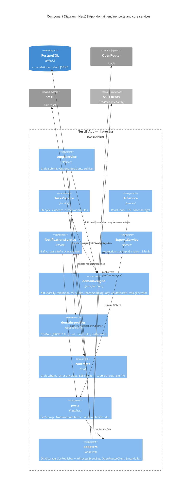

# C4 — Component Diagram (Level 3) — NestJS App และชั้น shared

_แหล่งอ้างอิง: `docs/architecture/arc42.md` หมวด 5.2–5.3_

ไดอะแกรมนี้ซูมเข้าไปถึงขั้น "โค้ดเรียกกันยังไง" และเน้นสองกฎที่เป็นหัวใจของระบบ:

1. **domain engine เป็น pure function** — เป็นฟังก์ชันที่รับ input ไปคำนวณแล้วคืน output เท่านั้น ห้าม import `@nestjs/*` และห้ามแตะ DB หรือ HTTP เอง ข้อดีคือทดสอบง่าย (ไม่ต้องยก Nest หรือ database มารัน) และตรรกะธุรกิจที่ซับซ้อนที่สุดไม่ถูกผูกกับ framework
2. **ทุก I/O ที่มีโอกาสเปลี่ยน implementation ต้องผ่าน port** — ดูคำอธิบาย port ใน [c4-containers.md](c4-containers.md)

ส่วน feature modules ที่เหลือ (`auth`, `users`, `projects`, `files`) มีรูปแบบเดียวกันหมด — controller บาง ๆ → service → repository — จึงไม่วาดทีละตัว

## กฎการเชื่อมข้าม feature (`docs/architecture/arc42.md` หมวด 5.3)

1. **Direct service inject เป็น default** — service เรียก service ด้วยกันได้ตรง ๆ เช่น `DmpsService` inject `TasksService`, `ExportsService` inject `DmpsService` (เป็น monolith instance เดียว ไม่ต้องมีตัวกลาง)
2. **Port ใช้เฉพาะกับ I/O ที่ implementation เปลี่ยนได้** — ได้แก่ notifications, ไฟล์, AI, email เท่านั้น ไม่ใช่ทุกการเรียก
3. **ไม่มี event bus ทั่วไปของระบบ** — `InProcessEventBus` มีอยู่แค่ภายใน adapter ของ `NotificationPublisher` เท่านั้น ธุรกรรม business (เช่น approve → สร้าง tasks → สร้าง notifications) ยังเป็น transaction Drizzle เดียวใน service ผู้เรียก เพื่อให้สำเร็จหรือพลาดพร้อมกันทั้งชุด

## Domain engine (`docs/architecture/arc42.md` หมวด 5.3)

ตรรกะสำคัญของ version flow ทั้งหมดรวมอยู่ที่นี่เป็น pure functions:

| ฟังก์ชัน | หน้าที่ | ใช้ใน flow |
| --- | --- | --- |
| `diffDraft(draft, baseSnapshot)` | เทียบ draft กับ snapshot ฐานแบบ JSON tree diff จับที่ entity id → ได้ `FieldChange[]` | #4, #8, #9, #10 |
| `classify(changes, fieldPolicy)` | ตัดสินระดับการเปลี่ยนแปลง: ถ้ามี major สักฟิลด์เดียว ทั้งชุดถือเป็น major | #5, #8, #9 |
| `foldMinor(snapshot, changes)` | บันทึกการแก้ minor ลง version in force ตรง ๆ + จดไว้ใน `minor_edits` | #8, #9 |
| `carryEdits(basedOn, currentInForce, newSnapshot)` | เอา minor edits ที่แก้ไปแล้วใน version in force ไป replay ลง snapshot ใหม่ → ได้ส่วนที่ carried ต่อ และส่วนที่ต้อง drop | #9 |
| `rebaseWorkingCopy(draft, newSnapshot)` | ปรับ working copy ให้ตั้งอยู่บน snapshot ใหม่ โดยเหลือเฉพาะการแก้ที่ยังไม่มีใครบันทึก/ส่ง | #9 |
| `validateDraft(draft, profiles)` | ตรวจตามกฎ หมวด 3.3 → `errors: [{path, code, message}]` (path เป็น JSON pointer) | #4, #5, #7 |

flow # = เลข flow ใน `docs/architecture/sequence-diagrams.md`
