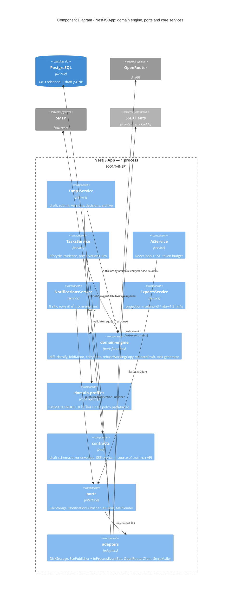

# C4 — Component Diagram (Level 3) — NestJS App และชั้น shared

*แหล่งอ้างอิง: `docs/architecture/arc42.md` หมวด 5.2–5.3*

ไดอะแกรมนี้เน้นสองอย่างที่เป็นกฎของระบบ: **domain engine เป็น pure function**
(ห้าม import `@nestjs/*`, ไม่แตะ DB/HTTP) และ **ทุก I/O ที่เปลี่ยน implementation ได้
ต้องผ่าน port** feature modules ที่เหลือ (`auth`, `users`, `projects`, `files`)
มีรูปแบบเดียวกัน (controller บาง → service → repository) จึงไม่วาดทั้งหมด

## กฎการเชื่อมข้าม feature (`docs/architecture/arc42.md` หมวด 5.3)

1. **Direct service inject เป็น default** — `DmpsService` inject `TasksService`,
   `ExportsService` inject `DmpsService` ได้ตรง ๆ (monolith instance เดียว)
2. **Port เฉพาะ I/O ที่เปลี่ยน implementation ได้** — notifications, ไฟล์, AI, email
3. **ไม่มี event bus ทั่วไป** — `InProcessEventBus` มีอยู่แค่ภายใน adapter ของ
   `NotificationPublisher` ธุรกรรม business (approve → สร้าง tasks → notifications)
   ยังเป็น transaction Drizzle เดียวใน service ผู้เรียก

## Domain engine (`docs/architecture/arc42.md` หมวด 5.3)

| ฟังก์ชัน | หน้าที่ | ใช้ใน flow |
|---|---|---|
| `diffDraft(draft, baseSnapshot)` | JSON tree diff ตาม entity id → `FieldChange[]` | #4, #8, #9, #10 |
| `classify(changes, fieldPolicy)` | มี major ฟิลด์เดียว = ทั้งชุด major | #5, #8, #9 |
| `foldMinor(snapshot, changes)` | บันทึกลง version in force + จด `minor_edits` | #8, #9 |
| `carryEdits(basedOn, currentInForce, newSnapshot)` | replay ตาม entity id → carried + dropped | #9 |
| `rebaseWorkingCopy(draft, newSnapshot)` | เหลือเฉพาะการแก้ที่ยังไม่มีใครบันทึก/ส่ง | #9 |
| `validateDraft(draft, profiles)` | กฎ หมวด 3.3 → `errors: [{path, code, message}]` (JSON pointer) | #4, #5, #7 |

flow # = เลข flow ใน `docs/architecture/sequence-diagrams.md`
