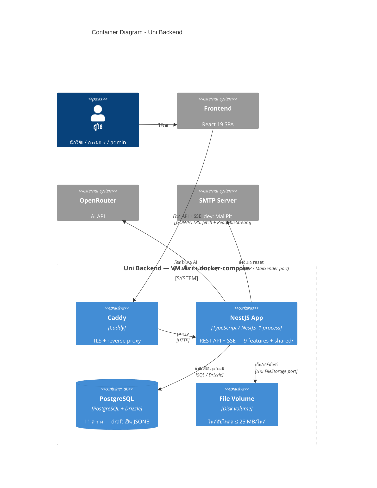

# C4 — Container Diagram (Level 2)

_แหล่งอ้างอิง: `docs/architecture/arc42.md` หมวด 4.2, หมวด 5.1, หมวด 7, หมวด 8.6_

ระดับนี้ซูมเข้ามาถามว่า: **ระบบรันอยู่ด้วยกันจากโปรแกรมอะไรบ้าง** ("container" ในที่นี้หมายถึงหน่วยที่รันอยู่จริง เช่น process, database, volume — ไม่ได้หมายถึง Docker container โดยตรงเสมอไป แม้ระบบนี้จะรันบน Docker จริงก็ตาม)

Container ทั้งหมดอยู่ใน **docker-compose ไฟล์เดียวบน VM เครื่องเดียว** (ดูวิธี deploy จริงใน [c4-deployment.md](c4-deployment.md)) คอขวดจริงของระบบคือ network — การรอ OpenRouter และ Postgres — ไม่ใช่ CPU จึงรัน NestJS เป็น **instance เดียว 1 process** แล้วพอ ไม่จำเป็นต้องรันหลาย process

## ข้อสังเกต

- **ไม่มี Redis, ไม่มี external queue** — สถาปัตยกรรมเลือกไม่ใช้ทั้งคู่ event bus เป็นแค่ in-process (ทำงานใน memory ของ process เดียวกัน) ผ่าน adapter `InProcessEventBus` ของ `NotificationPublisher` ไม่ใช่ container แยก
- **SSE มีใช้สองจุด**: `GET /notifications/stream` (push การแจ้งเตือน) และ `POST /dmps/{id}/ai/{action}` (stream ผลลัพธ์ AI) — ฝั่ง FE ใช้ fetch + ReadableStream แทน `EventSource` เพราะ `EventSource` แนบ Authorization header ไม่ได้ (`docs/architecture/arc42.md` หมวด 8.6)
- **ไฟล์ .docx ถูก parse ใน process เดียวกัน** ตอน upload (ด้วย mammoth) แล้วเก็บ extracted text ไว้ใน `file_records` — ไม่มี background job แยกไปทำงานเบื้องหลัง
- **ทุก I/O ที่มีโอกาสเปลี่ยน implementation ในอนาคต (disk, notification, AI, email) อยู่หลัง port** — port คือ interface ที่โค้ด domain ยื่นความต้องการผ่านมัน โดยไม่ต้องรู้เลยว่าข้างหลังจริง ๆ คืออะไร ด้วยเหตุนี้เอง จึงสลับ disk→S3 หรือ in-process bus→Redis ได้โดยไม่ต้องแตะ domain logic เลย (`docs/architecture/arc42.md` หมวด 5.3 กฎข้อ 2)

## โมดูลภายใน NestJS App

ซูมเข้าไปอีกชั้นดูว่าข้างใน NestJS App มีโมดูลอะไรอยู่เรียงกันอย่างไร ใน [c4-components-app.md](c4-components-app.md)
