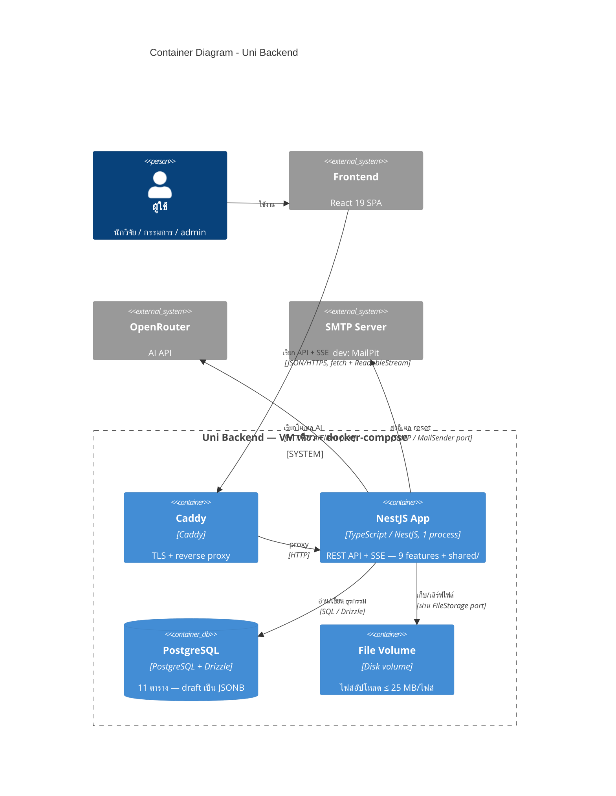

# C4 — Container Diagram (Level 2)

*แหล่งอ้างอิง: `docs/architecture/arc42.md` หมวด 4.2, หมวด 5.1, หมวด 7, หมวด 8.6*

Container ทั้งหมดอยู่ใน **docker-compose เดียวบน VM เดียว** (ดู deployment ใน
[c4-deployment.md](c4-deployment.md)) ตัวจำกัดจริงของระบบคือ network (OpenRouter,
Postgres) ไม่ใช่ CPU จึงรัน NestJS **instance เดียว 1 process**

## ข้อสังเกต

- **ไม่มี Redis, ไม่มี external queue** — event bus เป็น in-process ภายใน adapter
  `InProcessEventBus` ของ `NotificationPublisher` ไม่ใช่ container
- **SSE สองจุด**: `GET /notifications/stream` (notification push) และ
  `POST /dmps/{id}/ai/{action}` (AI streaming) — FE ใช้ fetch + ReadableStream
  เพราะ `EventSource` แนบ Authorization header ไม่ได้ (`docs/architecture/arc42.md` หมวด 8.6)
- **ไฟล์ .docx ถูก parse in-process** (mammoth) ตอน upload — เก็บ extracted text
  ใน `file_records` ไม่มีงาน async แยก
- ทุก I/O ที่เปลี่ยน implementation ได้ (disk, notification, AI, email) อยู่หลัง
  **port** — สลับ disk→S3, in-process bus→Redis ได้โดยไม่แตะ domain logic
  (`docs/architecture/arc42.md` หมวด 5.3 กฎข้อ 2)

## โมดูลภายใน NestJS App

ดูโครงสร้างภายในต่อใน [c4-components-app.md](c4-components-app.md)
