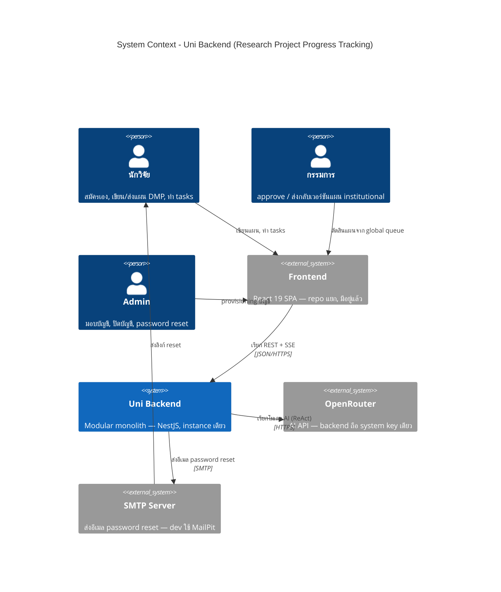

# C4 — System Context (Level 1)

*แหล่งอ้างอิง: `docs/architecture/arc42.md` หมวด 3–4 · `docs/architecture/requirement.md` หมวด 1–2*

System context ของ backend ระบบติดตามความคืบหน้าโครงการวิจัย (DMP ตาม maDMP v3.0)
ระบบเป็น **modular monolith บน NestJS** รัน instance เดียว scale แนวตั้ง (โหลดเฉลี่ย
~200/วัน, peak ~2,000) ให้บริการ frontend (repo `Frontend`, React 19) ที่มีอยู่แล้ว

## ข้อสังเกต

- **Chief** ยังไม่มีพฤติกรรมเฉพาะนอกจากการเป็นสมาชิกโครงการ (`project_role: chief`)
  จึงไม่วาดในไดอะแกรม — ดู requirement หมวด 2.1 และช่องที่รู้ตัวใน `docs/architecture/arc42.md` หมวด 11
- ทุกการเข้าถึง backend ผ่าน **frontend เท่านั้น** — ไม่มีผู้ใช้เรียก API ตรง
- **OpenRouter เป็นรายละเอียดภายใน** ไม่ปรากฏใน API contract — ผู้ใช้เห็นเพียง
  AI assistant ของระบบ (requirement หมวด 6)
- แผนแบบ **institutional** ต้องผ่านกรรมการก่อนมีผล, แผน **independent**
  นักวิจัย self-finalize เองได้ — ต่างกันที่กฎ ไม่ใช่คนละ actor

## เอกสารถัดไป

| ระดับ | ไฟล์ |
|---|---|
| L2 Container | [c4-containers.md](c4-containers.md) |
| L3 Component | [c4-components-app.md](c4-components-app.md) |
| Dynamic | [c4-dynamic-submit.md](c4-dynamic-submit.md) · [c4-dynamic-approve.md](c4-dynamic-approve.md) |
| L4 Deployment | [c4-deployment.md](c4-deployment.md) |
