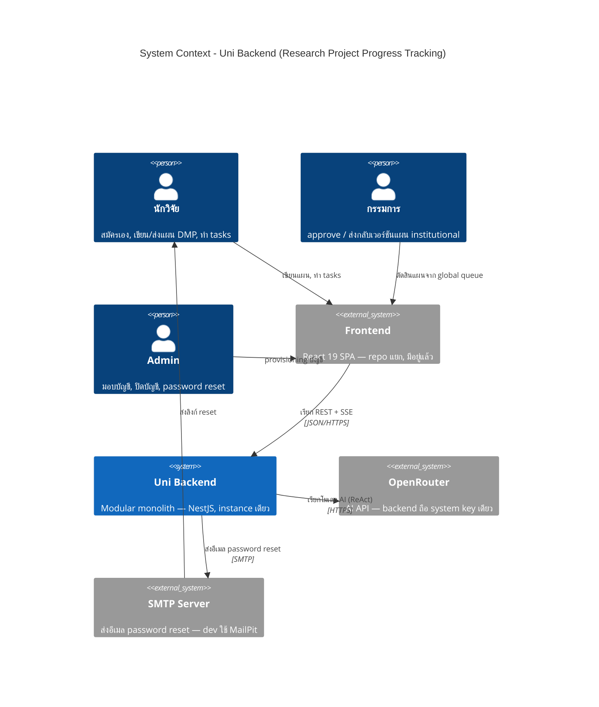

# C4 — System Context (Level 1)

_แหล่งอ้างอิง: `docs/architecture/arc42.md` หมวด 3–4 · `docs/architecture/requirement.md` หมวด 1–2_

ไดอะแกรมระดับนี้ตอบคำถามง่ายที่สุด: **ระบบของเราคือกล่องใด ใครใช้มัน และมันคุยกับอะไรภายนอกบ้าง** โดยยังไม่ซูมเข้าไปดูว่าข้างในมีอะไร

ระบบนี้คือ backend ของระบบติดตามความคืบหน้าโครงการวิจัย (DMP ตามมาตรฐาน maDMP v3.0) เขียนด้วย NestJS แบบ **modular monolith** (โค้ดทุกส่วนอยู่ในแอปเดียว แบ่งเป็นโมดูลตามหน้าที่) รันเป็น instance เดียว ขยายกำลังแบบ scale แนวตั้ง (เพิ่มเครื่องที่เดียวให้แรงขึ้น ไม่ใช่เพิ่มจำนวนเครื่อง) เพราะโหลดเฉลี่ยแค่ ~200 request/วัน พีคสุด ~2,000 ซึ่งตัวเดียวก็รับได้สบาย ระบบนี้ไม่มีหน้าจอของตัวเอง แต่ให้บริการ frontend (repo `Frontend`, React 19) ที่มีอยู่แล้ว

## ข้อสังเกต

- **บทบาท "Chief" ยังไม่มีพฤติกรรมเฉพาะของตัวเอง** — นอกจากการเป็นสมาชิกโครงการ (`project_role: chief`) แล้วยังไม่มีอะไรให้ทำต่างหาก จึงไม่วาดในไดอะแกรม ดู requirement หมวด 2.1 และช่องที่รู้ตัวใน `docs/architecture/arc42.md` หมวด 11
- **ผู้ใช้ทุกคนเข้าถึง backend ผ่าน frontend เท่านั้น** — ไม่มีผู้ใช้คนใดเรียก API ตรง ๆ ดังนั้นลูกศรจากคนจะไปหา frontend เสมอ ไม่ไปหา backend
- **OpenRouter เป็นเรื่องภายในของ backend** — ผู้ใช้ไม่รู้และไม่จำเป็นต้องรู้ว่าระบบใช้ผู้ให้บริการ AI รายไหน API contract ไม่มีชื่อ OpenRouter ปรากฏ ผู้ใช้เห็นเพียง "AI assistant" ของระบบ (requirement หมวด 6)
- **แผนมีสองประเภท ต่างกันที่กฎ ไม่ใช่คนละประเภทผู้ใช้** — แผน **institutional** ต้องรอกรรมการอนุมัติถึงจะมีผล, แผน **independent** นักวิจัย finalize เองได้ (self-finalize) ตัวกรรมการกับนักวิจัยเป็น actor ชุดเดิม

## เอกสารถัดไป

| ระดับ | ไฟล์ |
| --- | --- |
| L2 Container | [c4-containers.md](c4-containers.md) |
| L3 Component | [c4-components-app.md](c4-components-app.md) |
| Dynamic | [c4-dynamic-submit.md](c4-dynamic-submit.md) · [c4-dynamic-approve.md](c4-dynamic-approve.md) |
| L4 Deployment | [c4-deployment.md](c4-deployment.md) |
