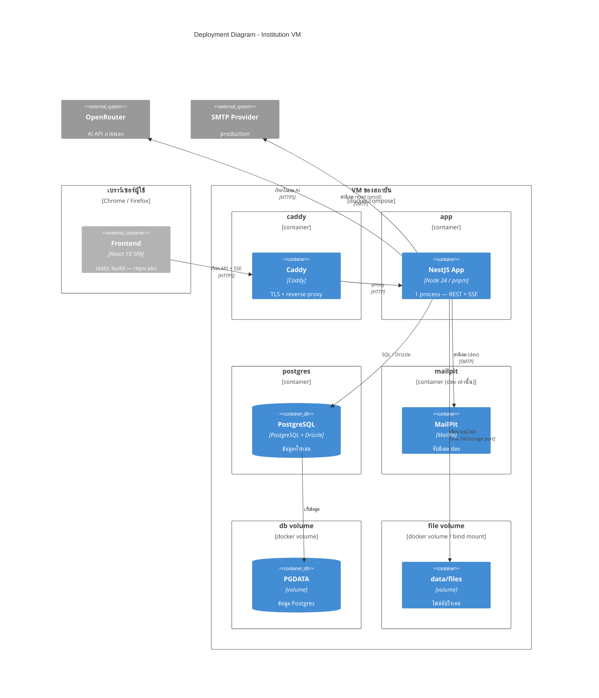

# C4 — Deployment Diagram

*แหล่งอ้างอิง: `docs/architecture/arc42.md` หมวด 4.2, หมวด 7, หมวด 8.2, หมวด 8.7*

deploy เป็น **VM เดียวของสถาบัน + docker-compose** — instance เดียว, scale แนวตั้ง,
release = restart สั้น ๆ (ยอมรับได้ที่โหลด ~200/วัน, peak ~2,000)

## การดำเนินงาน (`docs/architecture/arc42.md` หมวด 7)

| เรื่อง | แนวทาง |
|---|---|
| Migration | SQL files (drizzle-kit) commit ลง repo — review/replay ได้ |
| Backup | `pg_dump` ตามรอบ + snapshot volume ไฟล์ — หน้าที่ ops ของสถาบัน (runbook) |
| Release | restart สั้น ๆ — ยอมรับได้ที่ scale นี้ |
| Config | `config.json` (ค่า tunable) + `.env` (credentials เท่านั้น: `DATABASE_URL`, `JWT_SECRET`, `OPENROUTER_KEY`, `SMTP_URL`) |
| TLS | Caddy จัดการ — app ไม่เห็น TLS |

## ขอบเขตที่ตัดสินไว้แล้ว

- **Scale ออก**: interface เตรียมไว้แล้ว — สลับ `DiskStorage`→`S3Storage`,
  `InProcessEventBus`→Redis pub/sub โดยไม่แตะ domain logic
- **Email verification**: defer — จดเป็นช่องที่รู้ตัว (`docs/architecture/arc42.md` หมวด 11)
