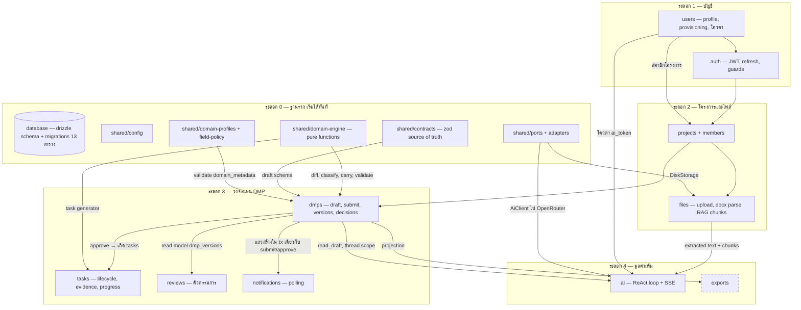

# Development Dependencies — ลำดับการพัฒนาแต่ละ feature

**Date:** 2026-11-04 **Status:** Draft
**อ้างอิง:** [`arc42.md`](arc42.md) (หมวด 5.2 features, หมวด 6 runtime view)

> แผนภาพนี้ใช้สำหรับ **วางแผน dev** — ลูกศร `A → B` อ่านว่า "ต้องมี A ก่อน ถึงเริ่ม B ได้"
> จัดเป็นระลอก (wave) ตามลำดับที่เริ่มพัฒนาได้จริง ไม่ใช่แผนภาพสถาปัตยกรรม runtime

## ข้อสังเกตสำหรับการวางแผน

- **`shared/domain-engine` เริ่มวันแรกได้เลย ไม่รอใคร** — pure functions ห้ามแตะ DB/HTTP (CON-2) เขียน test-first ขนานกับทุกอย่าง แต่ `dmps` ต้องรอมัน
- **`users` แตกสองช่วง** — ตาราง `users`/`credentials` ต้องมีก่อน `auth` (sign-up/sign-in อ่านตารางนี้) แต่ endpoint admin provisioning / password reset มาหลัง `auth` เพราะใช้ guard
- **`notifications` ไม่ใช่ block แรก** — แถวถูกสร้างใน transaction เดียวกับ submit/approve ของ `dmps` ดังนั้น dev ระลอก 3 พร้อมกับ dmps ได้ แต่ endpoint poll อย่างเดียวเริ่มเร็วกว่านั้นได้
- **`ai` มาท้ายสุดของ chain เพราะแหกข้าม 3 feature** — ต้องมีทั้ง `files` (RAG chunks — ADR-0025), `dmps` (read_draft, thread scope), `users` (โควตา token) และ adapter `AiClient` → OpenRouter (key จาก env — TC-6)
- **`exports` deferred** — ออกจาก scope v1 แล้ว (ADR-0019, เส้นประ) FE ทำใน browser ไม่ต้องจองทีม dev
- **ของที่ทุก feature ใช้เหมือนกันและไม่วาดซ้ำใน diagram:** `database`, `shared/config`, `shared/contracts` และ auth guard ครอบทุก endpoint (mutation ระบุผู้กระทำจาก JWT subject)
- **ข้อจำกัดข้อมูล (TC-5) ปิดแล้ว (2026-11-04):** repo `Frontend` อยู่บนดิสก์ — port domain profiles และ task generator (STAGE_PLAN) ตั้งแต่ระลอก 0 ได้ทันที (ADR-0026/0027) ไม่ต้องครอบค่าชั่วคราว
