# เอกสารความต้องการระบบ (Requirement)

**ระบบหลังบาน (Backend) — ระบบติดตามความคืบหน้าโครงการวิจัย** _อัปเดต 18 ตุลาคม 2026 · เขียนทับฉบับ 16 กันยายน 2026_

> เอกสารฉบับนี้อิงข้อมูลจาก `docs/sources/project-erd.md` (ตรวจสอบกับโค้ด frontend ล่าสุดวันที่ 18 ตุลาคม 2026) เป็น primary source เพียงแหล่งเดียว เนื้อหาของ requirement ฉบับก่อนหน้าที่ไม่ปรากฏใน ERD ถูกตัดออกทั้งหมด

---

## 1. ภาพรวมของระบบ

ระบบหลังบานนี้ทำงานร่วมกับ**นักวิจัยและคณะกรรมการ** เพื่อใช้เขียน **DMP (Data Management Plan — แผนการจัดการข้อมูลวิจัย ตามรูปแบบ maDMP v3.0)** โดยแผนหนึ่งแผนประกอบด้วย research outputs (datasets), distributions, contributors และ costs

การไหลของงานเป็นดังนี้:

1. นักวิจัยเขียนแผนได้เอง หรือให้ AI ช่วยร่าง
2. แผนแบบ**มีสังกัด (institutional)** ต้องให้กรรมการอนุมัติก่อนจึงจะมีผล — ส่วนแผนแบบ**ไม่มีสังกัด (independent)** นักวิจัยกดสรุป (self-finalize) เองได้ ไม่ต้องรอใคร
3. เมื่อแผนมีผลแล้ว ระบบแตกงานออกเป็น **tasks** ให้ทำตาม โดยงานแต่ละชิ้นแนบหลักฐานได้

หลักการสำคัญของระบบคือ **preservation** — ข้อมูลที่บันทึกการทำงานจริงจะไม่ถูกลบทิ้งเด็ดขาด ระบบมีแค่สองอย่างคือ การจัดเก็บพักไว้ (archive) และการยกเลิกที่จดร่องรอยไว้เสมอว่า "อะไรถูกยกเลิก ด้วยเหตุผลอะไร"

ระบบหลังบานนี้สร้างมาเพื่อให้บริการ frontend ที่มีอยู่แล้ว (repo `Frontend`) — โมเดลข้อมูลและพฤติกรรมทั้งหมดถูกออกแบบให้ตรงกับโมเดลฝั่ง client ปัจจุบัน ณ วันที่ตรวจสอบล่าสุด

## 2. ผู้ใช้ บัญชี และบทบาท

### 2.1 บทบาท (Roles)

| บทบาท | ที่มาของบัญชี | หน้าที่ |
| --- | --- | --- |
| **Researcher** | สมัครเองผ่านหน้า sign-up | สร้างโครงการ เขียน/แก้ไข/ส่งแผน DMP อัปโหลดไฟล์ ทำ tasks และ self-finalize แผนแบบ independent |
| **Committee** | สถาบันมอบให้ | ตัดสินเวอร์ชันของแผนแบบ institutional (approve หรือส่งกลับ) |
| **Chief** | สถาบันมอบให้ | _ยังไม่มีพฤติกรรมเฉพาะ_ นอกเหนือจากการเป็นสมาชิกโครงการ (`project_role: chief`) |
| **Admin** | สถาบันมอบให้ | บทบาทระดับระบบ ไม่มีพฤติกรรมแก้ไข DMP ของนักวิจัยโดยตรง |

### 2.2 ประเภทบัญชี (Account types)

**เฉพาะนักวิจัยเท่านั้นที่สมัครบัญชีเองได้** — บัญชีนักวิจัยแบ่งเป็นสองประเภทตามค่า `account_type`:

- **Institutional (มีสังกัด)** — ต้องระบุหน่วยงานที่สังกัด (affiliation: organization, department, position) เมื่อนักวิจัยกลุ่มนี้สร้างโครงการ โครงการจะตั้งค่าเริ่มต้นเป็น `plan_mode: institutional` (แผนต้องผ่านกรรมการ)
- **Citizen (ไม่มีสังกัด)** — ไม่มี affiliation อาจระบุที่อยู่แทน โครงการใหม่จะตั้งค่าเริ่มต้นเป็น `plan_mode: independent` (นักวิจัย self-finalize เองได้)

ค่าเริ่มต้นนี้ถูกใช้แค่**ตอนสร้างโครงการ**เท่านั้น หลังจากนั้นแต่ละแผนจะล็อกโหมดของตัวเองตอน submit ครั้งแรก (อธิบายใน หมวด 4.2)

### 2.3 การสมัครและการยืนยันตัวตน

- การ sign-up สร้าง **USER** หนึ่งรายการ และ **CREDENTIAL** หนึ่งรายการ (`role` เป็น `researcher` เสมอ)
- **Username** ต้องไม่ซ้ำ (เก็บเป็นตัวพิมพ์เล็ก)
- **Email** ต้องไม่ซ้ำ โดยเทียบแบบไม่สนตัวพิมพ์และช่องว่าง ตรวจทั้งตอน sign-up และตอนแก้ email ใน profile — ความ unique นี้ใช้หาบัญชีที่ตรงกับ email ของ contributor ในแบบฟอร์ม (ดู หมวด 4.7)
- **รหัสผ่าน**เก็บเฉพาะใน CREDENTIAL ในรูป salted hash (ระบบไม่เก็บรหัสผ่านตรง ๆ ทุกประการ) — ⚠️ **จุดที่ตั้งใจไม่ทำตาม ERD**: ERD ฝั่ง frontend ใช้ SHA-256 และระบุเองว่าไม่ปลอดภัยพอสำหรับ production หลังบานจึงต้องใช้ **bcrypt หรือ argon2id** แทน
- **การจดว่าใครเป็นคนทำ**: ทุกรายการที่ถูกสร้างระหว่างที่มีคน sign in อยู่ ระบบจะจดว่าเป็นฝีมือผู้ใช้คนนั้น ครอบคลุม: การเพิ่มสมาชิกตอนสร้างโครงการ, การอัปโหลดไฟล์, minor edits, การ self-finalize และการปิด tasks

## 3. โมเดลข้อมูล

### 3.1 ER Diagram

```mermaid
erDiagram
    USER ||--o| CREDENTIAL : signs_in_with
    USER ||--o{ PROJECT_MEMBER : participates_in
    PROJECT ||--o{ PROJECT_MEMBER : has_members
    PROJECT o|--o{ DMP : groups
    PROJECT ||--o{ FILE_RECORD : stores
    USER ||--o{ FILE_RECORD : uploads
    PROJECT o|--o| FILE_RECORD : selects_active_proposal
    DMP ||--o{ DMP_VERSION : has_revisions
    USER o|--o{ DMP_VERSION : decides_as_approver
    DMP ||--o{ TASK : produces
    DMP o|--o{ NOTIFICATION : may_reference
    PROJECT o|--o{ NOTIFICATION : may_reference
    USER ||--o{ NOTIFICATION : receives
    DMP ||--|{ DATASET : contains_in_draft
    DMP ||--|{ CONTRIBUTOR : names_in_draft
    USER o|--o{ CONTRIBUTOR : may_be_linked_as
    DMP ||--o{ COST : budgets_in_draft
    DATASET ||--o{ DISTRIBUTION : describes
    DATASET }o--|| DOMAIN_PROFILE : validated_by
    DATASET o|--o{ TASK : may_scope
    FILE_RECORD o|--o{ TASK : may_be_attached_to
    FILE_RECORD o|--o{ DISTRIBUTION : may_back
    DMP o|--o{ AI_THREAD_ENTRY : scopes

    USER {
        string user_id PK "optional in schema"
        string title
        string name
        string surname
        string email "unique per account, ignoring case and spaces"
        UserRole role "admin | chief | committee | researcher"
        int ai_token_limit
        int ai_token_used
        string username "optional; set at sign-up, mirrors CREDENTIAL"
        AccountType account_type "optional; institutional | citizen, researchers only"
        string phone "optional"
        string orcid "optional; same format as CONTRIBUTOR.orcid"
        json affiliation "optional; organization, department, position. Institutional only"
        string address "optional; citizen researchers only"
    }

    CREDENTIAL {
        string username PK "lowercase; unique"
        string user_id FK
        string salt "random per account"
        string hash "password hash (bcrypt/argon2id on backend); never the password"
    }

    PROJECT {
        string project_id PK "optional in schema"
        string project_name
        string description
        string proposal_file_id FK "optional"
        ProjectStatus status "draft | active | done"
        PlanMode plan_mode "institutional | independent"
        date created_at
        date updated_at
    }

    PROJECT_MEMBER {
        string project_id PK, FK
        string user_id PK, FK
        ProjectRole project_role "researcher | committee | chief"
    }

    DMP {
        string dmp_id PK
        string project_id FK "optional"
        string title
        string description
        string language
        DmpStatus status "draft | pending | approved"
        int active_version "optional; DMP_VERSION.number in force"
        PlanMode plan_mode "optional; pinned at first submission"
        date archived_at "optional; plans are archived, never deleted"
        bool tasks_generated
        int dataset_count "summary for the library list"
        int contributor_count "summary for the library list"
        date created_at
        date updated_at
        json draft "dates, ethics, indigenous, alternate_identifier, schema_version v3.0, and the nested lists"
    }

    DMP_VERSION {
        int number "per-DMP; a rejected number is not reused"
        VersionStatus status "pending | approved | rejected (draft unused)"
        EditType edit_type "minor | major"
        json changes "FieldChange list: path, label, from, to, edit_type"
        json snapshot "the plan as submitted"
        date created_at
        date decided_at "optional"
        string decided_by "optional; reviewer's user_id, committee, or the researcher's user_id when self-finalized"
        json approver "optional; user_id, name, position, mbox at decision time"
        string note "optional; reason when sent back"
        json minor_edits "at, by, changes, restored_from; folded in without review"
        int restored_from "optional; the version whose content this brings back"
        json based_on "version in force at submission: number + snapshot"
        json carried_minor_edits "fixes to that version merged in on approval"
        json dropped_minor_edits "fixes that couldn't merge (output removed)"
    }

    DATASET {
        string dataset_id "optional in schema"
        string type "raw | software | publication | other"
        string title
        string description
        DatasetStatus status "planned | collected | processed | preserved | shared"
        DataAccess access "open | shared | closed"
        YesNoUnknown personal_data
        YesNoUnknown sensitive_data
        string personal_data_plan
        string protection_level "maDMP v3.0 list or other"
        string protection_level_other_nomenclature "when other"
        string protection_level_other "level, when other"
        string security_classification_level "maDMP v3.0 list or other"
        string security_classification_level_other_nomenclature "when other"
        string security_classification_level_other "level, when other"
        string keyword "array"
        string language
        DomainKey domain "generic and 7 research domains"
        json domain_metadata "validated strictly by the domain's profile"
        json preservation
    }

    DISTRIBUTION {
        string distribution_id "optional in schema"
        string file_id FK "optional"
        string title
        string access_url
        string download_url
        string format
        int byte_size
        DataAccess data_access
        string license "required when data_access is open"
    }

    CONTRIBUTOR {
        string contributor_id "optional in schema"
        string title
        string name
        string surname
        string role
        string email "required for the contact"
        string orcid "optional"
        bool is_contact "exactly one per plan"
        string user_id FK "optional; one contributor per account per plan"
    }

    COST {
        string cost_id "optional in schema"
        string title
        string description
        number value
        string currency_code "ISO 4217, default THB"
    }

    DOMAIN_PROFILE {
        DomainKey key PK "code registry, not stored"
        string label
        json fields "key, label, type, required, options, help, permission"
    }

    TASK {
        string task_id PK "optional in schema"
        string dmp_id FK
        string dataset_id FK "optional"
        string source_version_id "optional; never written"
        string file_id FK "optional"
        string title
        string details
        date start_date
        date end_date
        int progress_percent "derived from checklist"
        TaskStatus status "todo | in_progress | done | cancelled"
        Priority priority "low | medium | high"
        LifecycleStage lifecycle_stage
        GeneratedBy generated_by "ai | user"
        json checklist
        json evidence "none | file | url | rdm_deposit"
        date completed_at
        string completed_by
        TaskStatus cancelled_from "status a cancellation replaced"
        string cancel_reason "manual | output_removed"
        string cancelled_dataset_title "to find the output if it returns"
    }

    FILE_RECORD {
        string file_id PK "optional in schema"
        string project_id FK
        string uploaded_by FK
        string filename
        FileType file_type "docx | pdf | other"
        FilePurpose purpose "proposal | task_deliverable | evidence"
        json metadata
        date uploaded_at
        date superseded_at
    }

    NOTIFICATION {
        string notification_id PK "optional in schema"
        string user_id FK
        string dmp_id FK "optional"
        string project_id FK "optional"
        NotificationType type "see หมวด 7"
        string title
        string message
        string link
        date read_at
        date created_at
    }

    AI_THREAD_ENTRY {
        string id PK
        string scope "dmp_id, or unscoped"
        string kind "event | user | assistant"
        string action "for events"
        int token_count
        json proposals "for assistant turns"
        date at
    }
```

### 3.2 ข้อสังเกตสำคัญเรื่องโมเดล

- **`DATASET`, `DISTRIBUTION`, `CONTRIBUTOR` และ `COST` ไม่ใช่ตารางอิสระ** — ทั้งหมดถูกเก็บซ้อนอยู่ใน draft ของ DMP ไดอะแกรมวาดแยกออกมาเพื่อให้เห็นความสัมพันธ์ชัดเท่านั้น แต่ backend เก็บรวมไว้ใน draft และอ่าน/วิเคราะห์ตามโครงสร้างที่ซ้อนนี้ `DMP_VERSION` ก็เช่นกัน — เป็นข้อมูลซ้อนใน DMP record ไม่ใช่ตารางแยก
- **`DOMAIN_PROFILE` เป็นแค่ชุดนิยามในโค้ด ไม่ใช่ข้อมูลที่เก็บในฐานข้อมูล** — หน้าที่ของมันคือบังคับว่า `domain_metadata` ของทุก dataset ต้องผ่านตามรูปแบบที่ domain นั้นกำหนด (มี generic + 7 research domains)
- **PK/FK ในไดอะแกรมเป็นข้อเสนอเชิงตรรกะ ยังไม่ใช่ constraint จริง** — ในโมเดลเดิม ID จำนวนมากเป็น optional และการอ้างอิงเป็นแค่ string ID ธรรมดาที่ unique เฉพาะภายในแผนของตัวเองเท่านั้น ฝั่ง backend ควรบังคับเป็น constraint จริง อย่างน้อยคือ คู่ `(project_id, user_id)` ใน PROJECT_MEMBER ต้องไม่ซ้ำ
- **DMP ↔ PROJECT ไม่ใช่ one-to-one** — แผนหนึ่งแผนอาจไม่มี `project_id` เลยก็ได้ และหนึ่งโครงการมีแผนได้หลายแผน
- **`contact` ไม่ใช่ฟิลด์ของ DMP** — contact คือ contributor ที่ติก `is_contact = true` ไว้ (ต่อแผนมีได้แน่นอนพอดีหนึ่งคน) ส่วน classification ระดับแผนไม่มี — ตอน export ระบบจะรวมจาก datasets ทั้งหมด (roll up)
- **`source_version_id` ของ TASK มีประกาศไว้แต่ไม่เคยมีใครเขียนค่าลงไป** — กล่าวคือ task ไม่จดว่าเวอร์ชันไหนของแผนเป็นตัวสร้างมัน
- **Evidence เป็น polymorphic** — แนบได้ทั้งไฟล์, URL และ DOI จึงไม่ใช่ FK ที่ชี้ไปที่ไฟล์เสมอไป

### 3.3 กฎ validation ของแผน

ระบบปฏิเสธแผน (พร้อมระบุฟิลด์ให้ผู้ใช้คลิกไปแก้) เมื่อ:

- วันสิ้นสุดก่อนวันเริ่มต้น
- มี ethical issues แต่ไม่มีคำอธิบาย
- ไม่มี contact พอดีหนึ่งคนในบรรดา contributors
- มี contributor สองคนลิงก์กับบัญชีเดียวกัน
- contact ไม่มี email (maDMP v3.0 กำหนด `contact.mbox`)
- distribution แบบ open ไม่มี license (maDMP v3.0 กำหนด)
- `domain_metadata` ของ dataset ไม่ผ่าน profile ของ domain ตนเอง

### 3.4 ปฏิทินและวันที่

วันที่ในระบบมีสองชนิด ห้ามใช้ปนกัน:

- **วันที่ปฏิทิน** (`YYYY-MM-DD` ไม่มีเวลา) — ใช้กับ begin/end ของแผน, start/end ของ task และวันที่ใน domain metadata
- **timestamp** (date-time เต็มรูปแบบ) — ใช้กับจุดที่ต้องการความละเอียดระดับเวลา เช่น `created_at`, `decided_at`, `uploaded_at`

## 4. กฎของแผนงาน (Plan rules)

### 4.1 Lifecycle และการมีผลของแผน

แผนทุกแผนเริ่มต้นเป็น **draft** แผนจะ "มีผล" ครั้งแรกเมื่อ:

- **แบบ institutional** — กรรมการกด approve เวอร์ชัน 1
- **แบบ independent** — นักวิจัยกด **self-finalize** (สรุปแผนเอง) 

คำศัพท์ที่ใช้ตลอดเอกสารฉบับนี้: **snapshot** คือสำเนาเนื้อหาแผนทั้งก้อน ณ เวลาที่ submit (แช่แข็ง แก้ไม่ได้) และ **version in force** คือเวอร์ชันล่าสุดที่ผ่านการอนุมัติแล้วและกำลังมีผลอยู่ หลังแผนมีผลแล้ว ทุกครั้งที่แก้ไข ระบบจะเทียบ working draft (ฉบับที่กำลังแก้อยู่) กับ snapshot ของ version in force เสมอ

### 4.2 Plan mode ถูก lock ตอน submit ครั้งแรก

แผนจะบันทึก `plan_mode` ของตัวเองตอนถูก submit ครั้งแรก (หรือตอน self-finalize) และใช้ค่านั้นตลอดไป — ต่อให้ภายหลังโครงการเปลี่ยนโหมด แผนที่ส่งไปแล้วก็ไม่เปลี่ยนตาม แผนที่ยังไม่ submit ยังเดินตามโครงการอยู่

อีกกฎหนึ่ง: **การลบโครงการจะถูกปฏิเสธ** ตราบใดที่โครงการยังมีแผนอยู่ (นับรวมแผนที่ archive แล้วด้วย)

### 4.3 การจำแนก minor/major edits

ทุกการแก้ไขถูกจำแนกเป็น minor หรือ major **จาก field policy เท่านั้น** (ใช้ชุดนิยามเดียวกับที่ระบบแสดงรายการ "ต้องขออนุมัติใหม่" ให้ผู้ใช้เห็น) ฟิลด์ที่นับเป็น **major** ปัจจุบันมี:

- วันเริ่มต้น / วันสิ้นสุดของแผน
- ข้อมูล ethical issues และ Indigenous considerations
- ของ research output แต่ละชิ้น: access, personal data, personal data plan, protection level, security classification
- **การเพิ่มหรือลบ** research output

ส่วนการแก้ contributor (รวม contact) และ cost เป็น **minor** ทั้งหมด

พฤติกรรมตอน submit:

- **ทั้งหมดเป็น minor** — บันทึกลง version in force ได้เลย โดยจดรายการแก้ไว้ใน `minor_edits` ของเวอร์ชันนั้น ไม่ต้องสร้างเวอร์ชันใหม่ ไม่มีการ review
- **มี major อย่างน้อยหนึ่งฟิลด์** — ทั้งชุดการแก้ไขกลายเป็น major ทั้งก้อน การ submit จะสร้างเวอร์ชันถัดไป (เลขเวอร์ชันไม่ซ้ำกัน — เลขที่เคยถูก reject จะไม่ถูกนำกลับมาใช้) สถานะเป็น `pending` ระหว่างนี้ version in force ตัวเก่ายังคงมีผลจนกว่ากรรมการจะตัดสิน

### 4.4 หนึ่ง revision รอได้ครั้งเดียว

ขณะที่ยังมีเวอร์ชัน `pending` ค้างอยู่ การ submit revision ใหม่จะถูกปฏิเสธ — เหตุผลคือเวอร์ชันใหม่ต้องสร้างต่อจากเวอร์ชันที่ได้รับอนุมัติ ถ้ายอมให้ส่งทับ ระบบจะได้เวอร์ชันที่สร้างบนเวอร์ชันที่อาจถูก reject ทิ้งในที่สุด

### 4.5 Minor fixes ขณะ revision รออนุมัติ

สถานการณ์: แผนมี revision `pending` อยู่กับกรรมการ แต่นักวิจัยยังอยากแก้ของ minor ต่อ

- Minor fix ระหว่างรอจะถูกบันทึกลง version in force ตามปกติ — snapshot ของเวอร์ชัน pending ยังแช่แข็งตามเดิม ไม่ถูกกระทบ
- กรณีพิเศษคือ **การแก้ใหม่ทั้งหมด** — แก้จุดที่ไม่ตรงกับทั้ง version in force และ snapshot ของ pending กรณีนี้บันทึกได้เฉพาะเมื่อทุกจุดที่แก้เป็น minor เท่านั้น
- เมื่อ revision ได้รับอนุมัติ: ระบบหาความต่างระหว่าง snapshot ตอน submit (จดไว้ใน `based_on`) กับ version in force ปัจจุบัน แล้วนำความต่างเหล่านั้นมาใส่ลงเวอร์ชันใหม่ทีละรายการตาม entity id โดยจดไว้ใน `carried_minor_edits` — แต่ fix บางอันอาจใส่ไม่ได้ (เช่น ไปแก้ output ที่ revision นี้ลบทิ้งไปแล้ว) fix เหล่านั้นจะถูกจดไว้ใน `dropped_minor_edits` แทนการปล่อยให้หายไปเงียบ ๆ สุดท้าย working copy ถูก rebase บนเวอร์ชันที่เพิ่งอนุมัติ (คงเหลือเฉพาะการแก้ที่ยังไม่เคยบันทึกหรือส่ง)
- ถ้า revision ถูกส่งกลับ: fix เหล่านั้นยังอยู่กับ version in force เหมือนเดิม ไม่มีอะไรต้องทำ

### 4.6 การตัดสิน หนึ่งเวอร์ชัน หนึ่ง decision

ผลการตัดสินถูกบันทึก**บนตัวเวอร์ชันนั้นโดยตรง**: `status`, `decided_at`, `decided_by`, `note` (เหตุผลเมื่อส่งกลับ) และ `approver` (สำเนาข้อมูลผู้อนุมัติ ณ ตอนตัดสิน: user_id, name, position, mbox) — หนึ่งเวอร์ชันจึงมีผลตัดสินได้ครั้งเดียว

การส่งกลับ (return) ไม่ใช่จุดจบ: นักวิจัยทำงานต่อจาก version in force ได้เลย แล้ว submit ใหม่ได้โดยไม่ต้อง restore ก่อน ส่วนการ cancel บนแผนที่รอการตัดสินครั้งแรกอยู่: submission ยังคงอยู่กับกรรมการตามที่ส่งไป มีเพียงการแก้ไขที่เกิดขึ้นหลังจากนั้นเท่านั้นที่ถูกทิ้ง

### 4.7 Contributor ↔ บัญชี

- Contributor หนึ่งคนอาจถูกลิงก์กับบัญชีผู้ใช้จริงผ่าน `contributor.user_id` (optional) — ฟอร์มจะเสนอรายชื่อบัญชีที่ email ตรงกัน (เทียบแบบไม่สนตัวพิมพ์) ให้ผู้ใช้เลือก แต่**ไม่ลิงก์ให้เองอัตโนมัติ** และหนึ่งบัญชีลิงก์กับ contributor ได้ไม่เกินหนึ่งคนต่อหนึ่งแผน
- การเปลี่ยนลิงก์นับเป็น minor edit ธรรมดา โดยรายการ changes จะแสดงชื่อบัญชี ไม่ใช่ id
- ลิงก์นี้เป็นข้อมูลภายในของระบบ — ตอน export จะระบุตัวบุคคลด้วย ORCID หรือ email แทน ถ้าบัญชีถูกลบไปแล้ว ลิงก์จะกลายเป็น "Unknown account" ซึ่งฟอร์มจะ flag ให้เห็น
- ขณะนี้ยังไม่มีพฤติกรรมใดที่กระทำต่อลิงก์นี้ (การมอบหมาย task ให้ contributor และการแจ้งเตือน contributor ยังไม่ถูกสร้าง)

### 4.8 การ restore เวอร์ชัน

การ restore คือการโหลด snapshot ของเวอร์ชันหนึ่งกลับเข้ามาเป็น working draft พฤติกรรมต่างกันตามชนิดของเวอร์ชัน:

- Restore **version in force** — การแก้ที่ยังไม่ submit ถูกทิ้ง แต่ไม่มีการจดบันทึกใด ๆ เพราะสิ่งที่มีผลอยู่ไม่ได้เปลี่ยนไปเลย
- Restore **เวอร์ชันอื่น** (approved เก่า หรือเวอร์ชันที่ถูกส่งกลับ) — นับเป็นการแก้ไขธรรมดาตั้งแต่ตรงนั้นเป็นต้นไป: ระบบเทียบกับ version in force แล้วเดินตามกฎปกติ คือบันทึกเลยถ้า minor หรือรอขออนุมัติถ้า major ด้วยเหตุนี้ **rollback ข้ามการอนุมัติจึงทำไม่ได้** การ restore แต่ละครั้งจะจดไว้ใน `restored_from`
- เวอร์ชันที่ยังรอ decision **restore ไม่ได้**

### 4.9 การลบ research output ที่แผนมีผลอยู่

การลบ output ในแผนที่มีผลอยู่เป็นเพียง**ข้อเสนอ** ไม่ใช่การลบทันที — tasks ที่ผูกกับ output นั้นยังทำต่อได้ จนกว่าเวอร์ชันที่ลบมันจะได้รับอนุมัติและมีผลจริง tasks เหล่านั้นจึงถูก cancel (ไม่ใช่ลบ) พร้อมส่ง notification `tasks_cancelled` ระหว่างรออยู่ output นั้นยังนับว่ามีอยู่ (อ่านจาก version in force)

## 5. งานและหลักฐาน (Tasks)

### 5.1 การเกิดของ tasks

- เมื่อแผน**มีผลครั้งแรก** ระบบจะสร้างชุด tasks แรกให้อัตโนมัติ — flag `tasks_generated` บนแผนเปลี่ยนเป็น true พร้อมส่ง notification `tasks_generated`
- หลังจากนั้น tasks ถูกเพิ่มได้เรื่อย ๆ ทั้งจาก AI สร้างให้ (`generated_by: ai`) และจากผู้ใช้สร้างเอง (`generated_by: user`)

### 5.2 โครงสร้างและสถานะ

- Task มี `status` (`todo | in_progress | done | cancelled`), `priority`, `lifecycle_stage`, ตารางเวลา start/end และ checklist — ส่วน `progress_percent` **ระบบคำนวณจาก checklist** (ติกไปกี่รายการแล้ว) ไม่ใช่ค่าที่ใครตั้งเองได้
- Evidence แนบได้หลายรูปแบบ: ไฟล์ (จาก `FILE_RECORD`), URL หรือ DOI
- ไฟล์ในระบบมี `purpose`: `proposal` (เอกสารเสนอโครงการ — โครงการชี้ proposal ที่ active), `task_deliverable` และ `evidence`; ไฟล์ที่ถูกแทนจด `superseded_at`

### 5.3 Preservation — ไม่มีอะไรที่บันทึกการทำงานจริงถูกทำลาย

- **ไม่มีทางลบแผนได้เลย** — ทำได้แค่ `archive` (ซึ่งก็ถูกปฏิเสธถ้าแผนยังมีผลอยู่) แผนที่ archive แล้ว: หายไปจากรายการ My DMPs/Tasks/โครงการตามปกติ, ข้อมูลถูกเก็บครบถ้วน, ค้นเจอได้ผ่าน filter _Archived_ และกลับมาใช้ต่อได้ด้วย unarchive
- **การออกจาก editor ไม่ลบอะไรทั้งสิ้น** — แผนที่มีผลอยู่เสียเฉพาะการแก้ที่ยังไม่ทันบันทึก แผนที่ยังไม่เคย submit จะถูก archive แทนที่จะหายไป
- **Task ที่มีงานบันทึกไว้แล้วลบไม่ได้** — นับว่า "มีงานบันทึกไว้" เมื่อมี evidence, checklist มีรายการที่ถูกติก หรือถูกปิดงานมาก่อน กรณีนี้ทำได้แค่ cancel (evidence ยังถูกเก็บไว้) ส่วน task ที่ยังไม่มีใครเริ่มทำอะไรเลย ลบทิ้งได้
- **Task ที่เสร็จแล้ว cancel ไม่ได้** เพราะจะทับบันทึกความเสร็จ — ทำได้แค่ reopen กลับ
- **ทุกการ cancel จดสิ่งที่ตัวเองแทนที่ไว้เสมอ**: `cancelled_from` (สถานะเดิมก่อนโดนยกเลิก), `cancel_reason` (`manual` — ยกเลิกด้วยมือ หรือ `output_removed` — ยกเลิกเพราะ output โดนลบ) และชื่อ output ที่ถูกลบ (เผื่อใช้ตามหางานกลับในภายหลัง)
- **การนำ task กลับ**: เมื่อเวอร์ชันใหม่นำ output เดิมกลับมา tasks ที่ถูก cancel เพราะการลบครั้งนั้น จะถูก**เสนอให้ผู้ใช้เปิดคืน** — แต่ระบบไม่เปิดให้เองอัตโนมัติ เพราะการ cancel ของมันผ่านการอนุมัติมาแล้ว ผู้ใช้เลือกเปิดคืนทีละ task แต่ละตัวจะกลับสู่สถานะเดิมก่อนโดนยกเลิก และถูกลิงก์กลับเข้ากับ output เดิม (จับคู่ด้วย id หรือชื่อที่จดไว้) — tasks ที่ถูก cancel ด้วยมือจะไม่ถูกเสนอในรายการนี้

## 6. AI Assistant

- AI เป็น**บริการภายนอก** ที่ระบบเรียกผ่าน API ไม่ใช่ผู้ใช้คนหนึ่งในระบบ — ผู้ให้บริการคือ **OpenRouter** โดย backend ถือ system key เดียว (นี่เป็นรายละเอียดภายใน ไม่ปรากฏใน API contract)
- **ทุก action ทำงานเป็น agent loop (ReAct)** — กล่าวคือโมเดลจะตัดสินใจเรียก tools เองหลายรอบ ก่อนคืนคำตอบสุดท้าย Tools ที่ให้โมเดลใช้มีแค่ 4 ตัว: อ่าน proposal (จาก extracted text), **ค้น proposal ด้วย RAG (`search_proposal` — ตอบคำถามเกี่ยวกับเอกสารจาก chunks ที่ embed ไว้ พร้อมตำแหน่งในเอกสาร — ADR-0025)**, อ่าน working draft และอ่าน DOMAIN_PROFILE / กฎ validation — **ไม่มี**การค้นอินเทอร์เน็ต และ**ไม่มี** tool สำหรับเขียน draft (AI ทำได้แค่เสนอ ผู้ใช้เป็นคนกดบันทึกเอง)
- **รายการ actions** (จาก ERD ฝั่ง frontend): `analyze_proposal` (วิเคราะห์ proposal .docx), `regenerate_field`, `batch_regenerate`, `generate_tasks` และ `redraft_steps` — ทุก action ตอบกลับแบบ **SSE streaming** (`status` / `tool` / `token` / `result`: ข้อความภาษาธรรมชาติไหลมาระหว่างทาง แล้วปิดท้ายด้วย structured proposals ที่ validate ได้ทั้งก้อน)
- **โควตาแบบ token ต่อผู้ใช้**: จดบน USER ด้วย `ai_token_limit` และ `ai_token_used` — การจำกัดนับจำนวน token ไม่ใช่จำนวนครั้ง ระบบเช็กด้วยค่าประมาณการ (estimate) **ก่อนเริ่ม run** แล้วมาปรับยอดจริง**ตอนจบ** — run หนึ่งจึงล้นโควตาได้และจะไม่ถูกตัดกลางคัน และถ้าล้มเหลวกลางทาง token ที่ใช้ไปแล้วก็ยังนับว่าใช้ไปแล้ว
- **Extracted text ของ proposal**: ระบบ parse ไฟล์ .docx ตอนอัปโหลด แล้วเก็บ text เอาไว้ใน `FILE_RECORD.metadata` — ทำให้ agent อ่าน text สำเร็จรูปได้เลย ไม่ต้อง parse ซ้ำทุกครั้งที่ run
- **RAG บน proposal (ADR-0025)**: ตอนอัปโหลด ระบบ chunk เอกสารตาม heading/ย่อหน้า แล้ว embed ด้วย multilingual-e5-small (in-process) เก็บใน `FILE_CHUNK` — เอกสารอันเดียวใช้จนจบโปรเจกต์จึง embed ครั้งเดียว; เวลา user ถามคำถามเกี่ยวกับเอกสาร โมเดลเรียก `search_proposal` เพื่อค้น chunks ที่เกี่ยวข้อง (cosine ฝั่ง app, top-5 พร้อมตำแหน่งในเอกสาร) มาตอบ; embedding ไม่นับโควตา AI และถ้า embed ไม่สำเร็จตอน upload ถือว่าไฟล์อ่านไม่ได้ (`422`)
- **Thread**: ประวัติการสนทนาและ event ทั้งหมดถูก persist เป็น `AI_THREAD_ENTRY` — ประกอบด้วย user turn (action + prompt), assistant turn สุดท้าย (พร้อม `proposals` ที่ AI เสนอ และ `token_count` รวมของ run) และ `kind=event` หนึ่งรายการต่อการเรียก tool หนึ่งครั้ง โดย entry ถูก scope ตาม `dmp_id` เมื่อมี หรือเป็น unscoped activity ถ้าไม่ผูกกับแผนใด
- ทุกผลลัพธ์จาก AI เป็นเพียงข้อเสนอ — **ผู้ใช้แก้ไขต่อได้ทั้งหมด** ก่อนจะบันทึกหรือส่ง

## 7. การแจ้งเตือน

Notification มี `type`, `title`, `message`, `link`, อ้าง DMP/โครงการได้ (optional) และ `read_at` (optional) ชนิดทั้งหมด:

| Type | ความหมาย |
| --- | --- |
| `dmp_submitted` | แผนถูกส่ง |
| `dmp_approved` | แผนได้รับอนุมัติ |
| `dmp_finalized` | แผน independent ถูก self-finalize |
| `dmp_returned` | เวอร์ชันถูกส่งกลับ (ถึงนักวิจัย) |
| `review_requested` | ขอให้ตรวจ — ถึง reviewer ทุกคนเมื่อแผน/revision ถูกส่ง |
| `tasks_generated` | ชุด tasks แรกถูกสร้าง |
| `tasks_cancelled` | tasks ถูกยกเลิกจากการลบ output |
| `proposal_superseded` | proposal ของโครงการถูกแทน |

การแจ้งเตือนเรื่องแผนหนึ่ง ๆ ไปหา**นักวิจัยของโครงการนั้น** ไม่ว่าใครเป็นผู้ trigger

## 8. การส่งออกมาตรฐาน (Standards exports)

Export **ไม่ใช่ข้อมูลที่ถูกเก็บแยกต่างหาก** แต่คือผลลัพธ์ที่สร้างขึ้นชั่วขณะจากแผนที่ผ่าน validation แล้ว (เรียกว่า projection) โดยมีกฎว่า export อิงจากข้อมูลส่วนไหน:

- หลังแผนมี version in force — export สร้างจาก **snapshot ของเวอร์ชันนั้น** ไม่ใช่ working draft (การแก้ที่ยังไม่บันทึกหรือยังไม่อนุมัติจะไม่ปรากฏในไฟล์ export และ export panel จะแจ้งข้อความนี้ให้ผู้ใช้ทราบ)
- ก่อนการอนุมัติครั้งแรก — export จาก draft พร้อมสถานะ `not submitted` หรือ `submitted`

| Export | หมายเหตุ |
| --- | --- |
| **GCWG-RDA maDMP v3.0** | บล็อก `approval` มาจากสถานะแผน, plan mode และ `approver` ของ active version — แผน independent export เป็น `not applicable` |
| **RDA DMP Common Standard v1.3** | ไม่มี approval block และ classification fields — protection/security ไปอยู่ใน `security_and_privacy` |

ทั้งสองรูปแบบ carry `domain` และ `domain_metadata` เป็น extensions และวันที่ปฏิทินถูกเขียนเป็น `YYYY-MM-DD`

## 9. คำถามที่รอการตัดสิน (Open questions)

1. **Generated ids ซ้ำข้ามแผน** — ระบบวิเคราะห์เดิมให้ทุกแผนใช้ id ชุดเดียวกัน (`seed-dataset-1`, `seed-contributor-1` ฯลฯ) ทำให้ dataset id และ contributor identifier ในไฟล์ export ของคนละแผนซ้ำกันได้ ระบบจริงจึงต้องสร้าง id ใหม่ที่ไม่ซ้ำกันทั้งระบบ (mint unique id) — สิ่งที่ยังรอตัดสินคือ นอกจากนี้ export ควรเติมหมายเลขแผนนำหน้า id ด้วยหรือไม่ (เช่น `dmp-id/dataset-id`) เพื่อความปลอดภัยซ้ำชั้นหนึ่ง
