# Sequence Diagrams — ระบบติดตามความคืบหน้าโครงการวิจัย

อ้างอิง primary source: `docs/sources/project-erd.md` ผ่าน `docs/architecture/requirement.md`
คู่เทียบ: `docs/sources/main-flowchart.md` (ฉบับย่อ happy path ของ flow แบบ institutional)

> **หมายเหตุการตัดสิน**: flowchart เดิมเขียนว่า "กรรมการอนุมัติครบทุกคน" แต่ requirement หมวด 4.6
> กำหนด **หนึ่งเวอร์ชัน หนึ่ง decision** (`decided_by` คนเดียว, `review_requested` แจ้ง reviewer
> ทุกคนแต่ decision บันทึกบนเวอร์ชันครั้งเดียว) — diagram ทั้งหมดนี้**ยึด requirement**
> ตามการตัดสิน 18 ตุลาคม 2026

สัญลักษณ์ผู้เล่นที่ใช้ซ้ำ:

| ตัวย่อ | หมายถึง |
|---|---|
| R | นักวิจัย (Researcher) |
| C | กรรมการ (Committee) |
| FE | Frontend (repo `Frontend`) |
| BE | Backend ระบบนี้ |
| AI | AI service ภายนอก — OpenRouter เรียกผ่าน API ด้วย system key (ไม่ใช่ผู้ใช้ในระบบ) |
| DB | ฐานข้อมูล |

---

## สารบัญ

**กลุ่ม A — บัญชีและโครงการ**
1. [Sign-up / Sign-in](#1-sign-up--sign-in)
2. [สร้างโครงการ + อัปโหลด proposal](#2-สร้างโครงการ--อัปโหลด-proposal)

**กลุ่ม B — การเขียนแผน**
3. [AI สร้างแผนจาก proposal](#3-ai-สร้างแผนจาก-proposal)
4. [แก้ไข draft + validation](#4-แก้ไข-draft--validation)

**กลุ่ม C — การส่งและตัดสิน**
5. [Submit ครั้งแรก (institutional)](#5-submit-ครั้งแรก-institutional)
6. [กรรมการตัดสิน: approve / ส่งกลับ](#6-กรรมการตัดสิน-approve--ส่งกลับ)
7. [Self-finalize (independent)](#7-self-finalize-independent)

**กลุ่ม D — หลังแผนมีผล**
8. [Minor edit](#8-minor-edit)
9. [Submit revision (major) + minor fixes ขณะรอ](#9-submit-revision-major--minor-fixes-ขณะรอ)
10. [Restore เวอร์ชัน](#10-restore-เวอร์ชัน)
11. [ลบ / นำกลับ research output](#11-ลบ--นำกลับ-research-output)
12. [ทำงาน tasks](#12-ทำงาน-tasks)
13. [Archive แผน / ลบโครงการ](#13-archive-แผน--ลบโครงการ)
14. [Export มาตรฐาน](#14-export-มาตรฐาน)

---

## กลุ่ม A — บัญชีและโครงการ

### 1. Sign-up / Sign-in

> requirement หมวด 2.3 — เฉพาะนักวิจัยสมัครเองได้, username/email ไม่ซ้ำ,
> รหัสผ่านเป็น salted hash (bcrypt/argon2id — เบี่ยงจาก ERD ที่ใช้ SHA-256 อย่างมีเจตนา)

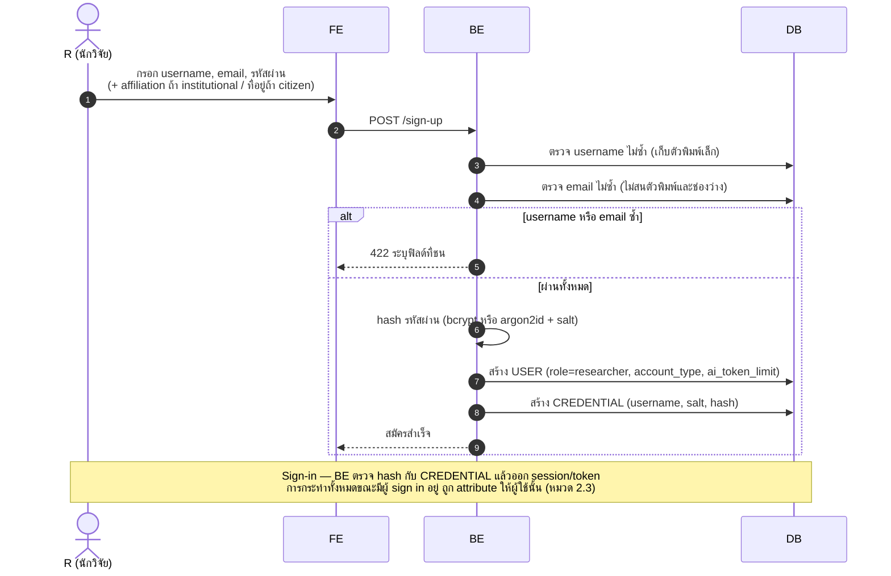

### 2. สร้างโครงการ + อัปโหลด proposal

> requirement หมวด 2.2, หมวด 5.2 — plan_mode default ตาม account_type ของผู้สร้าง,
> ไฟล์มี `purpose: proposal` และ proposal ที่ถูกแทนจด `superseded_at`

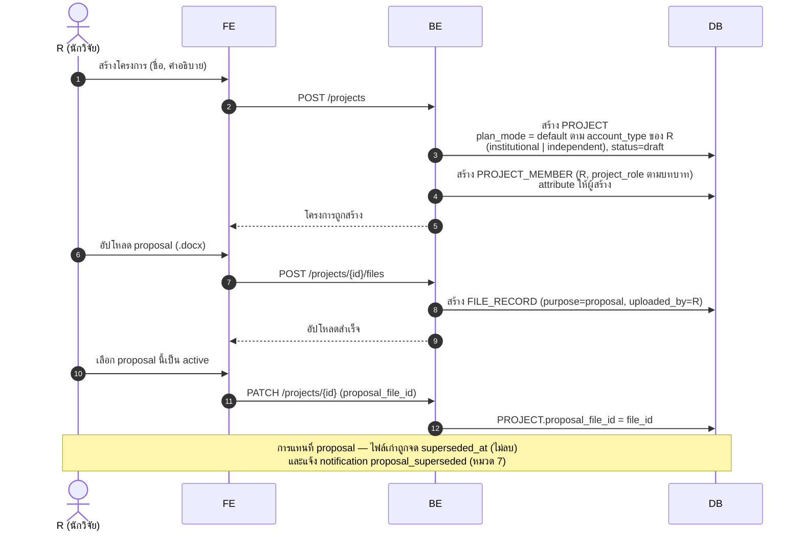

---

## กลุ่ม B — การเขียนแผน

### 3. AI สร้างแผนจาก proposal

> requirement หมวด 6 — AI เป็นบริการภายนอก (OpenRouter ผ่าน system key — internal detail
> ไม่ปรากฏใน API contract), ทุก action รันเป็น **agent loop (ReAct)** ด้วย tools ชุดเดียว,
> ตอบกลับแบบ SSE streaming, จำกัดด้วย token budget ต่อผู้ใช้, thread persist เป็น
> AI_THREAD_ENTRY, ทุกผลลัพธ์เป็นข้อเสนอที่ผู้ใช้แก้ต่อได้ทั้งหมด
> ตามการตัดสิน AI agent 18 ตุลาคม 2026

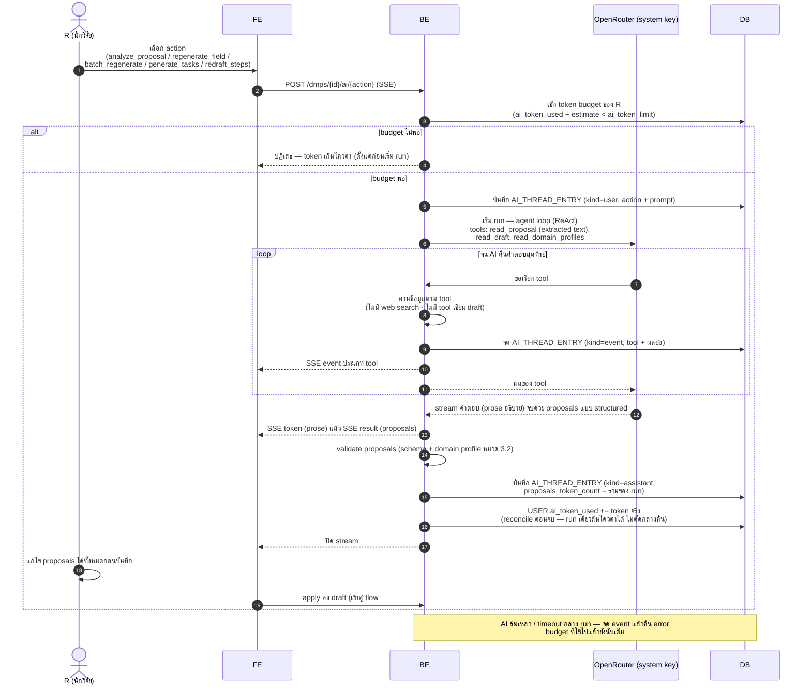

### 4. แก้ไข draft + validation

> requirement หมวด 3.3 — ระบบปฏิเสธพร้อมระบุฟิลด์ให้ผู้ใช้คลิกไปแก้;
> วันที่ไม่มีเวลาเก็บเป็น `YYYY-MM-DD` แยกจาก timestamp (หมวด 3.4)

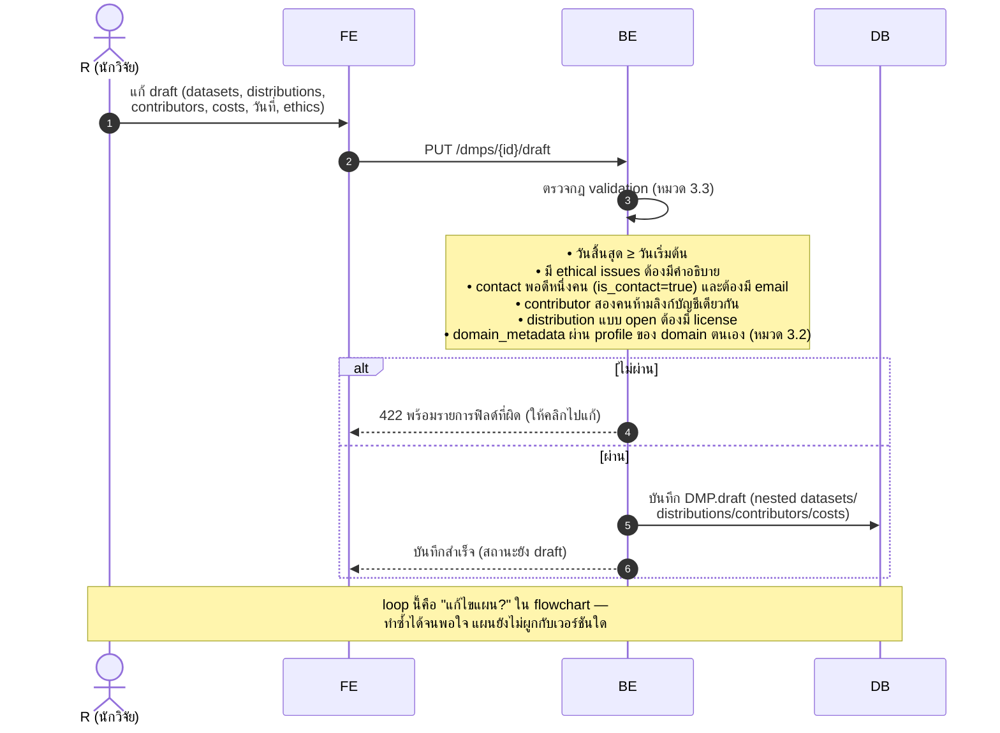

---

## กลุ่ม C — การส่งและตัดสิน

### 5. Submit ครั้งแรก (institutional)

> requirement หมวด 4.2–4.6, หมวด 7 — plan_mode freeze ตอน submit แรก, จำแนก minor/major
> จาก field policy, เวอร์ชัน 1 pending, แจ้งทั้งนักวิจัยและ reviewer ทุกคน

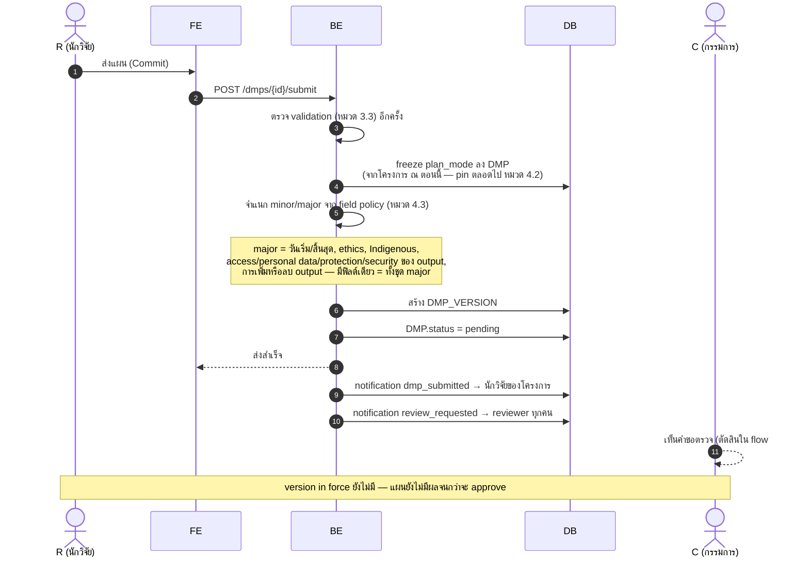

### 6. กรรมการตัดสิน: approve / ส่งกลับ

> requirement หมวด 4.6, หมวด 5.1, หมวด 7 — หนึ่งเวอร์ชัน หนึ่ง decision บันทึกบนตัวเวอร์ชันเอง;
> approve ครั้งแรกทำให้แผนมีผลและเกิดชุด tasks แรก
> ⚠️ ต่างจาก flowchart: **ไม่ต้องอนุมัติครบทุกคน** — reviewer คนใดคนหนึ่งตัดสินได้

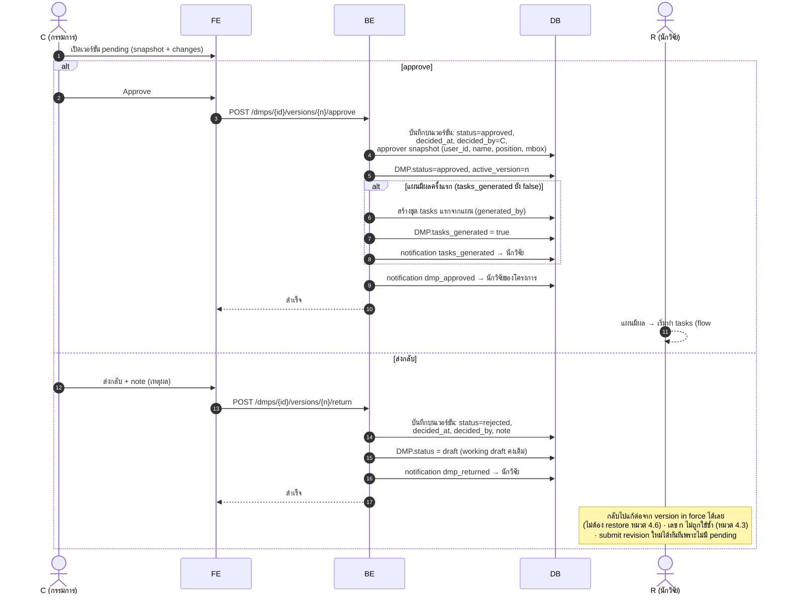

### 7. Self-finalize (independent)

> requirement หมวด 2.2, หมวด 4.1, หมวด 7 — นักวิจัย citizen สรุปแผนเองได้ ไม่ผ่านกรรมการ
> (flowchart ไม่มี branch นี้)

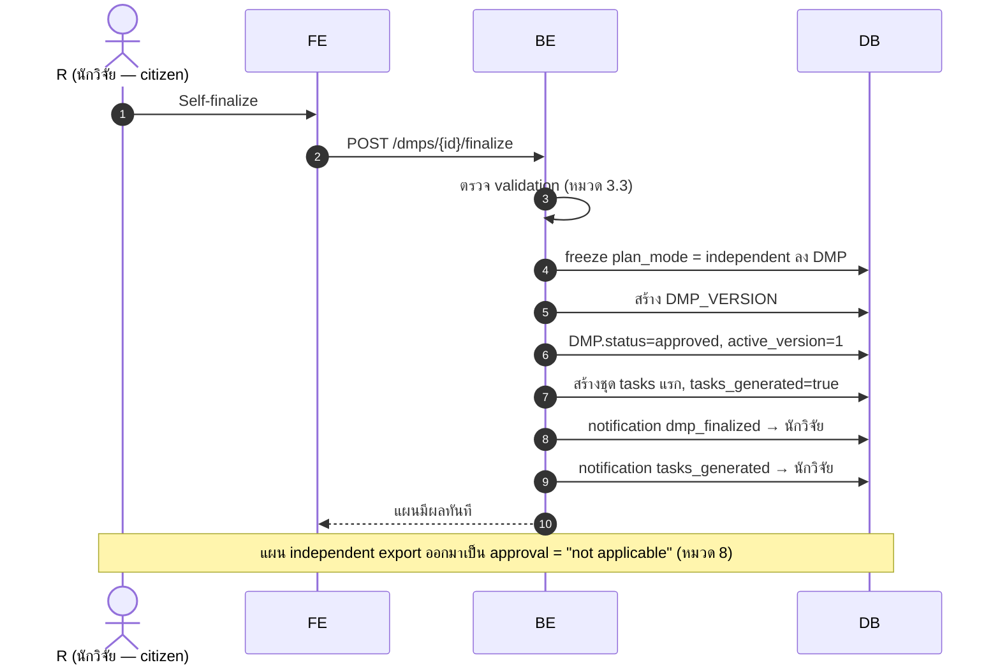

---

## กลุ่ม D — หลังแผนมีผล

### 8. Minor edit

> requirement หมวด 4.3 — contributor (รวม contact) และ cost เป็น minor ทั้งหมด;
> fold ลง version in force โดยตรง ไม่สร้างเวอร์ชันใหม่ ไม่มี review

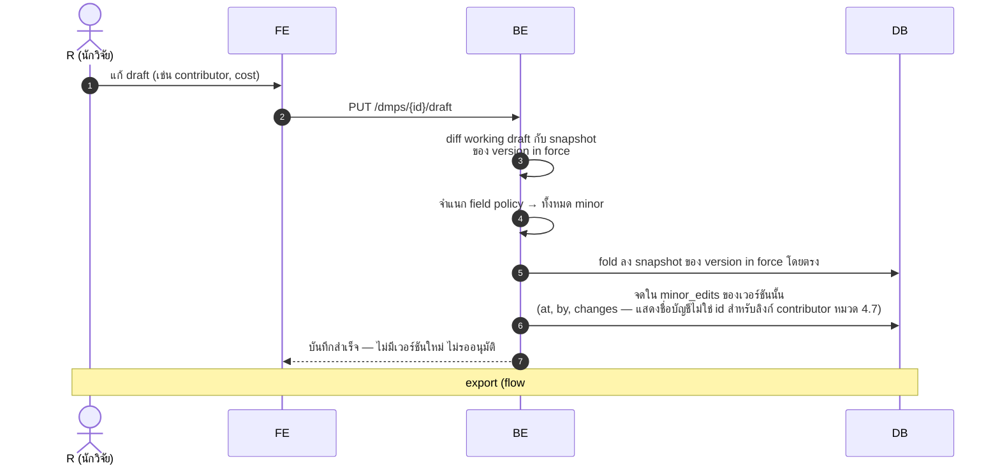

### 9. Submit revision (major) + minor fixes ขณะรอ

> requirement หมวด 4.3–4.5 — หนึ่ง revision รอได้ครั้งเดียว; fix ที่ไม่ผ่านการรวม
> จด `dropped_minor_edits` แทนการหายเงียบ ๆ

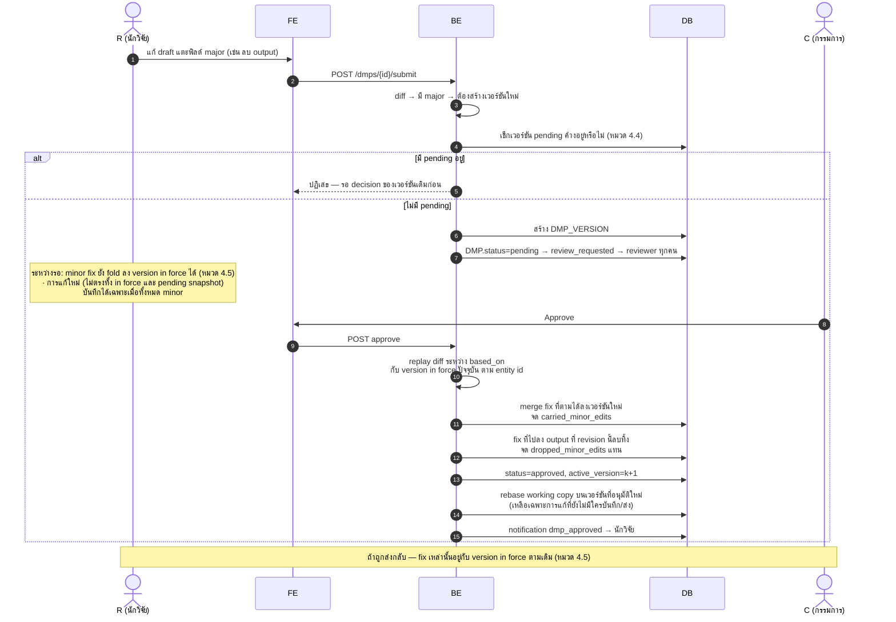

### 10. Restore เวอร์ชัน

> requirement หมวด 4.8 — rollback ข้ามการอนุมัติไม่ได้ เพราะ restore นับเป็นการแก้ไขธรรมดา

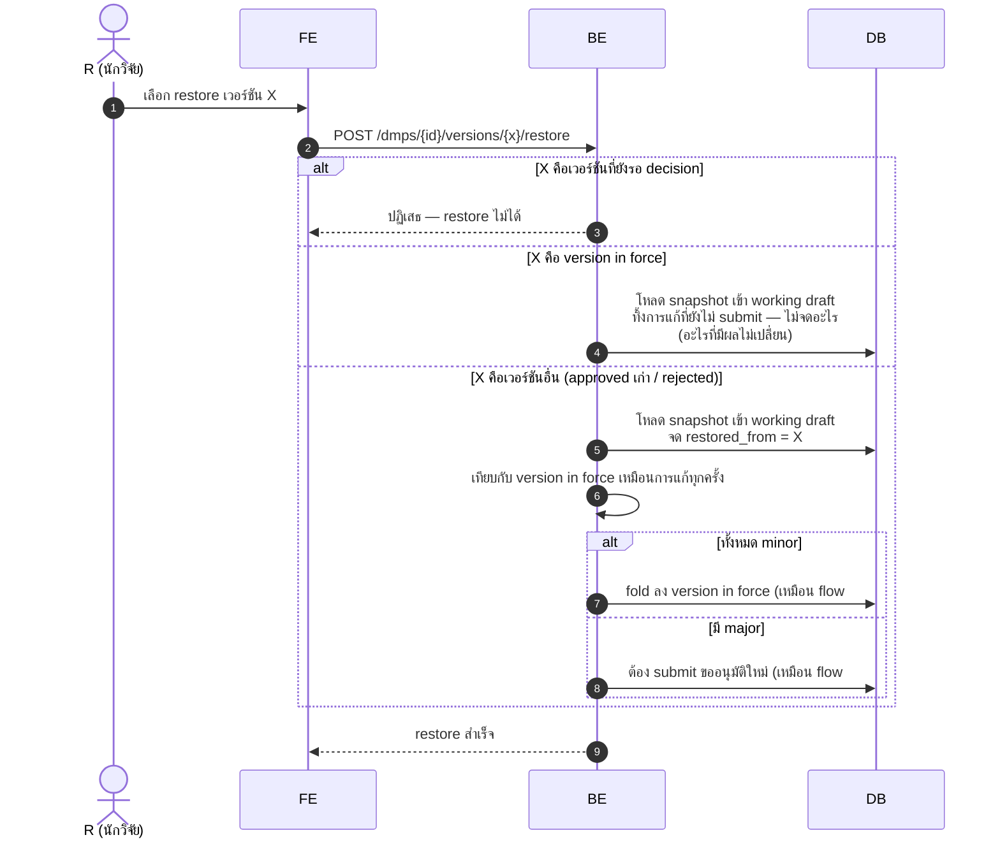

### 11. ลบ / นำกลับ research output

> requirement หมวด 4.9, หมวด 5.3, หมวด 7 — การลบเป็นข้อเสนอ ไม่ใช่ลบทันที;
> tasks ถูก cancel ไม่ใช่ลบ และเปิดคืนได้เมื่อ output กลับมา

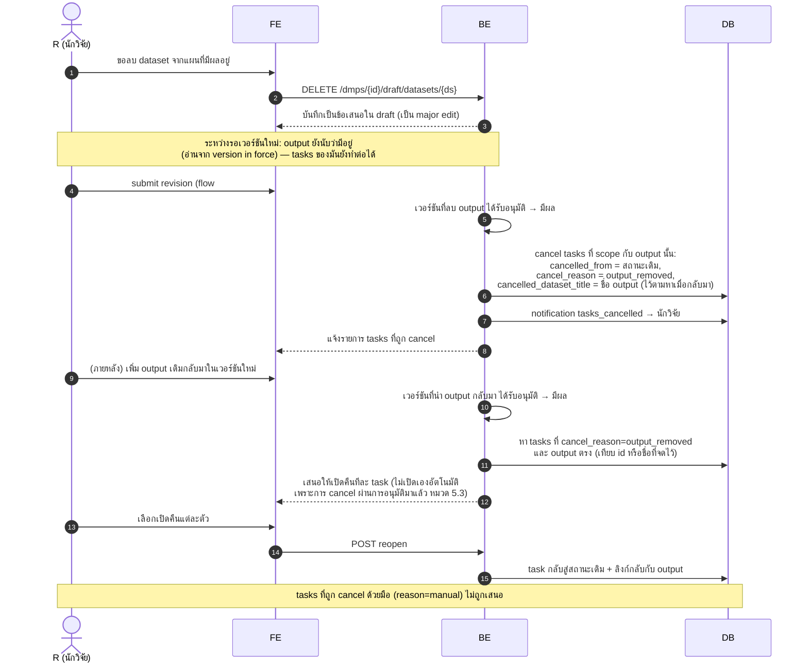

### 12. ทำงาน tasks

> requirement หมวด 5.1–5.3 — progress_percent derived จาก checklist;
> preservation: ไม่มีอะไรที่บันทึกการทำงานจริงถูกทำลาย

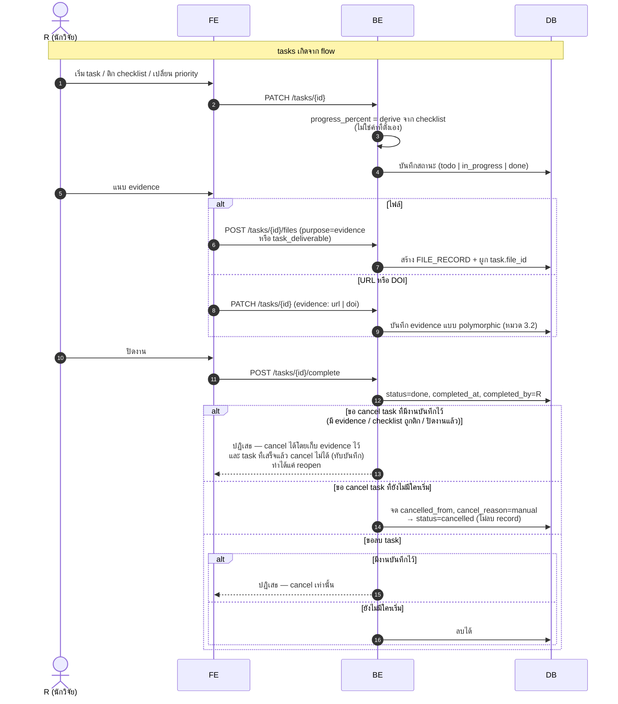

### 13. Archive แผน / ลบโครงการ

> requirement หมวด 4.2, หมวด 5.3 — ไม่มีทางลบแผน; การลบโครงการถูกปฏิเสธตราบใดที่มีแผนอยู่

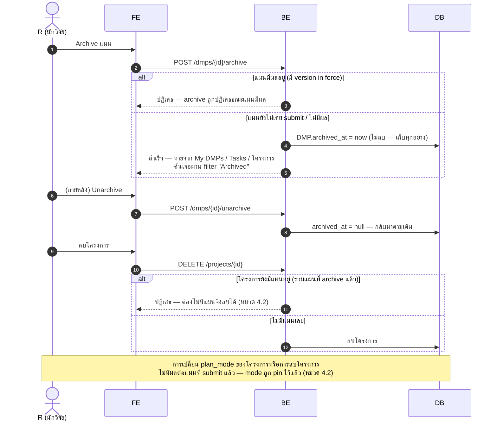

### 14. Export มาตรฐาน

> requirement หมวด 8 — export เป็น projection ไม่ใช่ entity ที่เก็บ

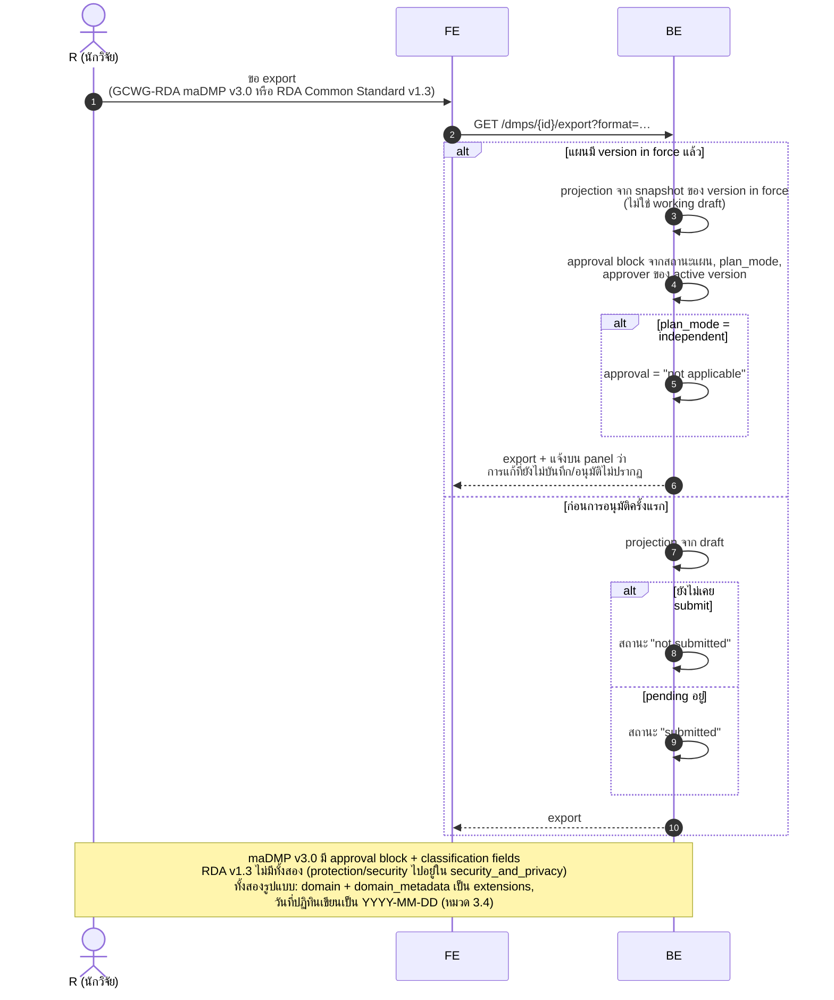

---

## สรุปความต่างจาก `main-flowchart.md`

| Flowchart | Sequence diagram ฉบับนี้ | ที่มา |
|---|---|---|
| "กรรมการอนุมัติครบทุกคน" | reviewer คนใดคนหนึ่งตัดสินได้ — หนึ่งเวอร์ชัน หนึ่ง decision (flow #6) | หมวด 4.6, ตามการตัดสิน |
| ไม่มี branch แบบไม่มีสังกัด | เพิ่ม self-finalize (flow #7) | หมวด 2.2, หมวด 4.1 |
| "แก้ไขแผน" loop เดียว | แยก minor edit (fold ตรง, flow #8) ออกจาก major revision (เวอร์ชันใหม่, flow #9) | หมวด 4.3–4.5 |
| "แจ้งให้แก้ไข → กลับ draft" | กลับมาทำงานต่อจาก version in force ได้เลย ไม่ต้อง restore + เลข rejected ไม่ซ้ำ | หมวด 4.6 |
| Progress bar ปลายทาง | เจาะเป็นการเกิด tasks อัตโนมัติ + การทำงาน tasks (flow #6, #12) | หมวด 5.1–5.3 |
| — | เพิ่ม restore, ลบ/นำกลับ output, archive, export (flow #10, #11, #13, #14) | หมวด 4.8–4.9, หมวด 5.3, หมวด 8 |
| เรียก AI service ครั้งเดียวต่อ action | ทุก action รันเป็น agent loop (ReAct) บน OpenRouter ด้วย tools 3 ตัว ตอบกลับแบบ SSE (flow #3) | หมวด 6, การตัดสิน AI agent |
