# Sequence Diagrams — ระบบติดตามความคืบหน้าโครงการวิจัย

เอกสารนี้อธิบายเป็น sequence diagram ว่า "ใครทำอะไร ตามลำดับไหน" ในแต่ละสถานการณ์ของระบบ

- ข้อมูลอ้างอิงหลัก: `docs/sources/project-erd.md` ผ่าน `docs/architecture/requirement.md`
- เทียบเคียงกับ: `docs/sources/main-flowchart.md` (flowchart ฉบับย่อ ที่ลากเฉพาะ happy path ของ flow แบบ institutional)
- ผู้อ่านควรเปิด requirement ประกบไว้ด้วย เพราะแต่ละ flow จะอ้างหมวดของ requirement กำกับไว้

> **ข้อต่างสำคัญจาก flowchart เดิม**: flowchart เขียนว่า "กรรมการอนุมัติครบทุกคน" แต่ requirement หมวด 4.6 กำหนดไว้ต่างออกไป — **หนึ่งเวอร์ชัน มีการตัดสินได้เพียงครั้งเดียว และกรรมการเพียงคนเดียวก็ตัดสินได้** (`decided_by` เก็บชื่อคนเดียว, เวลาขอ review จะแจ้งกรรมการทุกคน แต่คำตัดสินถูกบันทึกบนเวอร์ชันนั้นเพียงครั้งเดียว) diagram ทั้งหมดในเอกสารนี้ยึด requirement เป็นหลัก ตามการตัดสินใจเมื่อ 18 ตุลาคม 2026

สัญลักษณ์ผู้เล่นที่ใช้ซ้ำ:

| ตัวย่อ | หมายถึง |
| --- | --- |
| R | นักวิจัย (Researcher) — ผู้ใช้ที่เขียนและส่งแผน |
| C | กรรมการ (Committee) — ผู้ตรวจและอนุมัติแผน |
| FE | Frontend (repo `Frontend`) — หน้าเว็บที่ผู้ใช้กดปุ่ม |
| BE | Backend ของระบบนี้ |
| AI | AI service ภายนอก (OpenRouter) — BE เรียกผ่าน API ด้วย system key จึงไม่ใช่ผู้ใช้ในระบบ |
| DB | ฐานข้อมูล |

คำศัพท์ที่ใช้บ่อย:

- **version in force** = เวอร์ชันของแผนที่กำลัง "มีผล" อยู่ (ผ่านการอนุมัติแล้วล่าสุด)
- **snapshot** = สำเนาเนื้อหาแผนทั้งหมด ณ เวลาใดเวลาหนึ่ง (เช่น ณ ตอน submit)
- **working draft** = ฉบับร่างที่นักวิจัยกำลังแก้อยู่ ยังไม่ได้ส่ง

---

## สารบัญ

**กลุ่ม A — บัญชีและโครงการ**

- [Sign-up / Sign-in](#1-sign-up--sign-in)
- [สร้างโครงการ + อัปโหลด proposal](#2-สร้างโครงการ--อัปโหลด-proposal)

**กลุ่ม B — การเขียนแผน**

- [AI สร้างแผนจาก proposal](#3-ai-สร้างแผนจาก-proposal)
- [แก้ไข draft + validation](#4-แก้ไข-draft--validation)

**กลุ่ม C — การส่งและตัดสิน**

- [Submit ครั้งแรก (institutional)](#5-submit-ครั้งแรก-institutional)
- [กรรมการตัดสิน: approve / ส่งกลับ](#6-กรรมการตัดสิน-approve--ส่งกลับ)
- [Self-finalize (independent)](#7-self-finalize-independent)

**กลุ่ม D — หลังแผนมีผล**

- [Minor edit](#8-minor-edit)
- [Submit revision (major) + minor fixes ขณะรอ](#9-submit-revision-major--minor-fixes-ขณะรอ)
- [Restore เวอร์ชัน](#10-restore-เวอร์ชัน)
- [ลบ / นำกลับ research output](#11-ลบ--นำกลับ-research-output)
- [ทำงาน tasks](#12-ทำงาน-tasks)
- [Archive แผน / ลบโครงการ](#13-archive-แผน--ลบโครงการ)
- [Export มาตรฐาน — deferred](#14-export-มาตรฐาน--deferred-adr-0019)

**กลุ่ม E — Cross-cutting (เพิ่มจากการเทียบ frontend contract, 2026-10-26)**

- [Session refresh + sign-out](#15-session-refresh--sign-out)
- [Notification lifecycle](#16-notification-lifecycle)
- [AI chat + thread](#17-ai-chat--thread)
- [File lifecycle](#18-file-lifecycle)

---

## กลุ่ม A — บัญชีและโครงการ

### 1. Sign-up / Sign-in

requirement หมวด 2.3 กำหนดว่า:

- สมัครบัญชีเองได้เฉพาะนักวิจัยเท่านั้น
- username และ email ห้ามซ้ำกับใคร
- รหัสผ่านต้องเก็บแบบ salted hash (bcrypt หรือ argon2id — ตั้งใจไม่ตาม ERD เดิมที่ใช้ SHA-256 เพราะไม่ปลอดภัยพอสำหรับรหัสผ่าน)

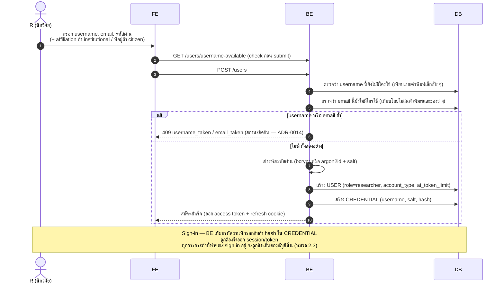

### 2. สร้างโครงการ + อัปโหลด proposal

requirement หมวด 2.2, หมวด 5.2 กำหนดว่า:

- โครงการใหม่ได้ `plan_mode` ตามชนิดบัญชีของคนสร้างโดยอัตโนมัติ
- ไฟล์ที่เป็น proposal มี `purpose: proposal` และ proposal ที่ถูกแทนที่จะถูกจด `superseded_at` (ไม่ลบทิ้ง)

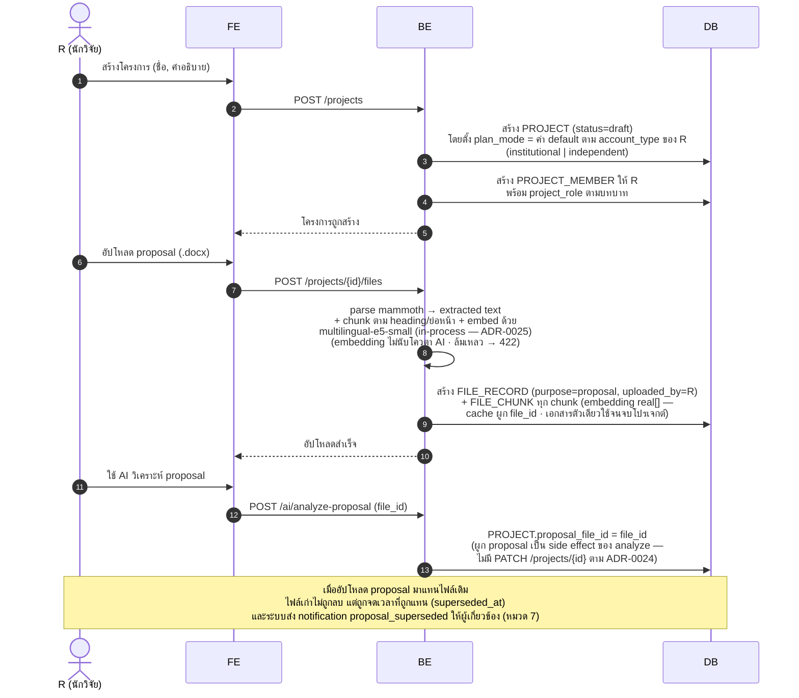

---

## กลุ่ม B — การเขียนแผน

### 3. AI สร้างแผนจาก proposal

requirement หมวด 6 — AI เป็นบริการภายนอก (OpenRouter เรียกด้วย system key ของระบบ รายละเอียดนี้ไม่ปรากฏใน API contract ใด ๆ) กลไกคือ:

- ทุก action ทำงานเป็น **agent loop (ReAct)** — AI จะเรียกถอย tools ชุดเดียวกันได้หลายรอบจนได้คำตอบ
- คำตอบส่งกลับแบบ SSE streaming (ผู้ใช้เห็นข้อความไหลเข้ามาทีละชิ้น ไม่ต้องรอจบ)
- ใช้ token จำกัดด้วยโควตาต่อผู้ใช้
- ประวัติการคุยถูกเก็บเป็น AI_THREAD_ENTRY เพื่อย้อนดูได้
- สิ่งที่ AI เสนอมาเป็นแค่ "ข้อเสนอ" ผู้ใช้แก้ไขได้ทั้งหมดก่อนบันทึกจริง

ตามการตัดสินเรื่อง AI agent เมื่อ 18 ตุลาคม 2026 + ADR-0018/0023 (event set, โควตา, Idempotency-Key):

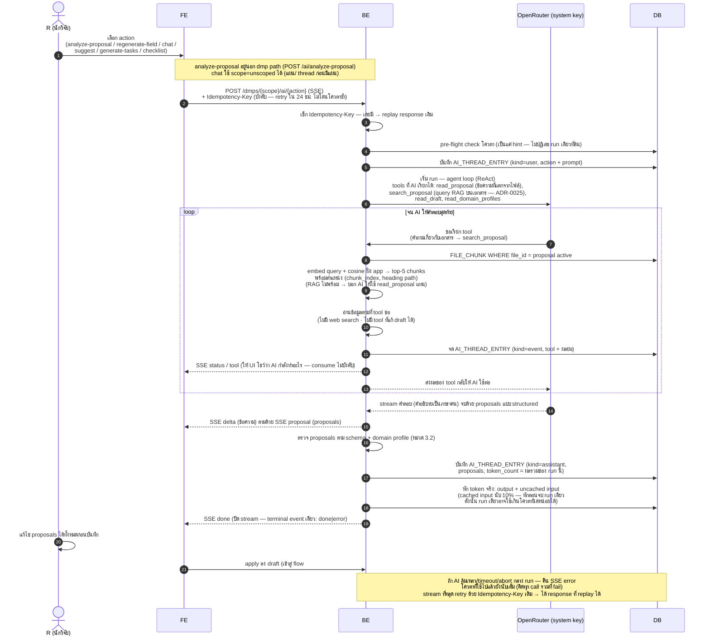

### 4. แก้ไข draft + validation

requirement หมวด 3.3, หมวด 3.4 + ADR-0020:

- save ส่ง **draft ทั้งก้อน** (PUT) พร้อม `draft_revision` — ตรวจเฉพาะ type/format (ร่างครึ่ง ๆ ต้อง save ได้) กฎ completeness หมวด 3.3 ตรวจตอน submit/finalize
- ถ้าข้อมูลไม่ผ่านการตรวจ ระบบต้องบอกกลับพร้อมระบุฟิลด์ที่ผิด เพื่อให้ผู้ใช้คลิกไปแก้ฟิลด์นั้นได้ทันที
- วันที่ (ไม่มีเวลา) เก็บเป็น `YYYY-MM-DD` แยกจาก timestamp

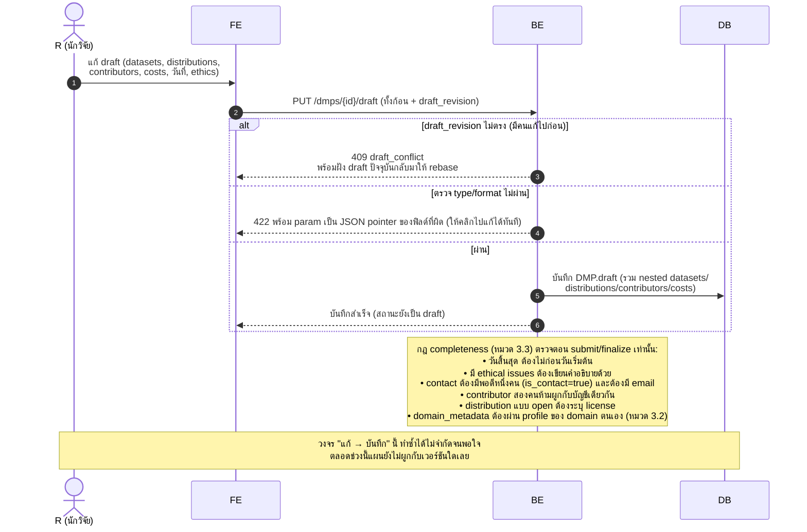

---

## กลุ่ม C — การส่งและตัดสิน

### 5. Submit ครั้งแรก (institutional)

requirement หมวด 4.2–4.6, หมวด 7 — จุดสำคัญของ flow นี้:

- `plan_mode` ถูก "ตรึง" ค่าไว้ตั้งแต่ submit แรก (แก้ไม่ได้อีก)
- ระบบเทียบ draft กับเวอร์ชันเดิม เพื่อจำแนกว่าการเปลี่ยนแปลงเป็น minor หรือ major
- สร้างเวอร์ชัน 1 สถานะ pending พร้อมแจ้งทั้งนักวิจัยและกรรมการทุกคน

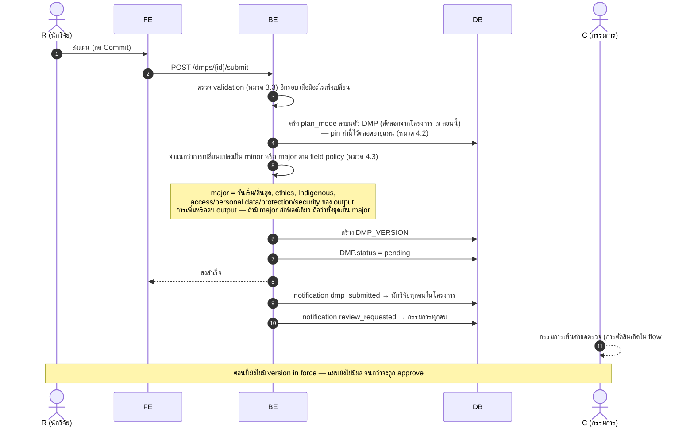

### 6. กรรมการตัดสิน: approve / ส่งกลับ

requirement หมวด 4.6, หมวด 5.1, หมวด 7:

- การตัดสินบันทึกลงตัวเวอร์ชันโดยตรง — หนึ่งเวอร์ชัน ตัดสินได้ครั้งเดียว
- ถ้าเป็นการอนุมัติครั้งแรก แผนจะเริ่มมีผล และระบบจะสร้างชุด tasks แรกให้
- ⚠️ ต่างจาก flowchart เดิม: **ไม่ต้องรอกรรมการอนุมัติครบทุกคน** — กรรมการคนใดคนหนึ่งตัดสินได้เลย

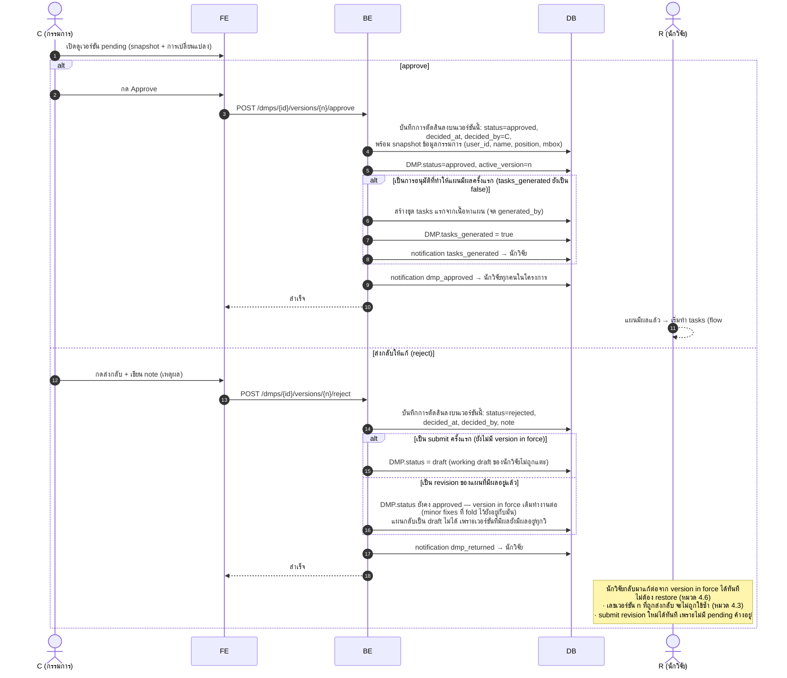

### 7. Self-finalize (independent)

requirement หมวด 2.2, หมวด 4.1, หมวด 7:

- นักวิจัยแบบ citizen ไม่มีกรรมการ จึง "ปิดแผน" ด้วยตัวเองได้เลย ไม่ต้องผ่านการอนุมัติ
- flowchart เดิมไม่มี branch นี้

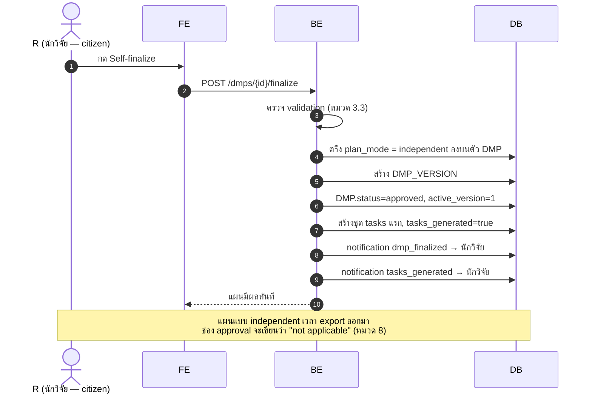

---

## กลุ่ม D — หลังแผนมีผล

### 8. Minor edit

requirement หมวด 4.3:

- contributor (รวม contact) และ cost ทั้งหมดนับเป็น minor
- การแก้ฟิลด์กลุ่มนี้ถูกแก้ลง snapshot ของ version in force **โดยตรง** — ไม่สร้างเวอร์ชันใหม่ ไม่ต้องรออนุมัติ
- **ผู้ใช้เลือกเอง** (ตาม ADR-0021): save draft เป็นกลาง (flow #4) แล้วกด "บันทึกแก้เล็ก" → `minor-edits` หรือ "ส่ง revision" → `revisions` (flow #9) — classify ยังรันฝั่ง server เพื่อตรวจว่าเลือกถูกไหม

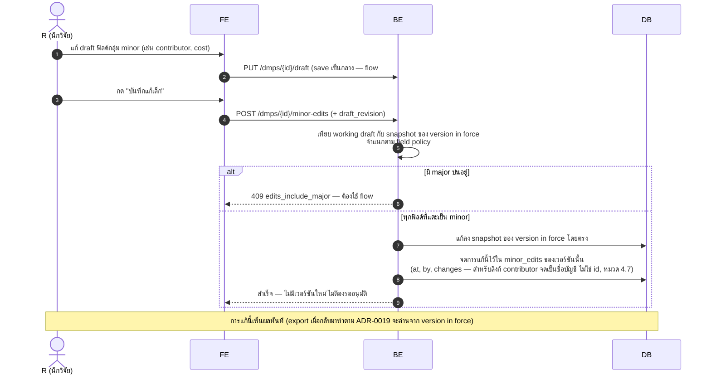

### 9. Submit revision (major) + minor fixes ขณะรอ

requirement หมวด 4.3–4.5:

- มีเวอร์ชัน pending รอการตัดสินได้ครั้งละหนึ่งเท่านั้น
- minor fix ที่รวมเข้าเวอร์ชันใหม่ไม่ได้ ระบบจะจดไว้ใน `dropped_minor_edits` เพื่อไม่ให้การแก้ไขเหล่านั้นหายไปเงียบ ๆ

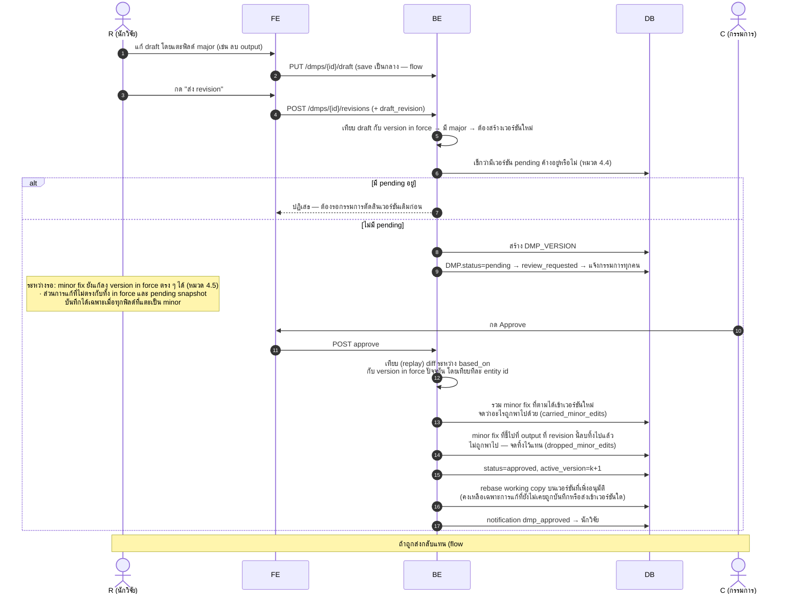

### 10. Restore เวอร์ชัน

requirement หมวด 4.8 — ทำไม rollback ข้ามการอนุมัติไม่ได้:

- ระบบถือว่า restore เป็นเพียง "การแก้ไขธรรมดา"
- ดังนั้นถ้า restore ไปที่เนื้อหาที่ต่างจาก version in force ในฟิลด์ major ก็ต้องผ่านการอนุมัติใหม่เหมือนแก้ไขทั่วไป

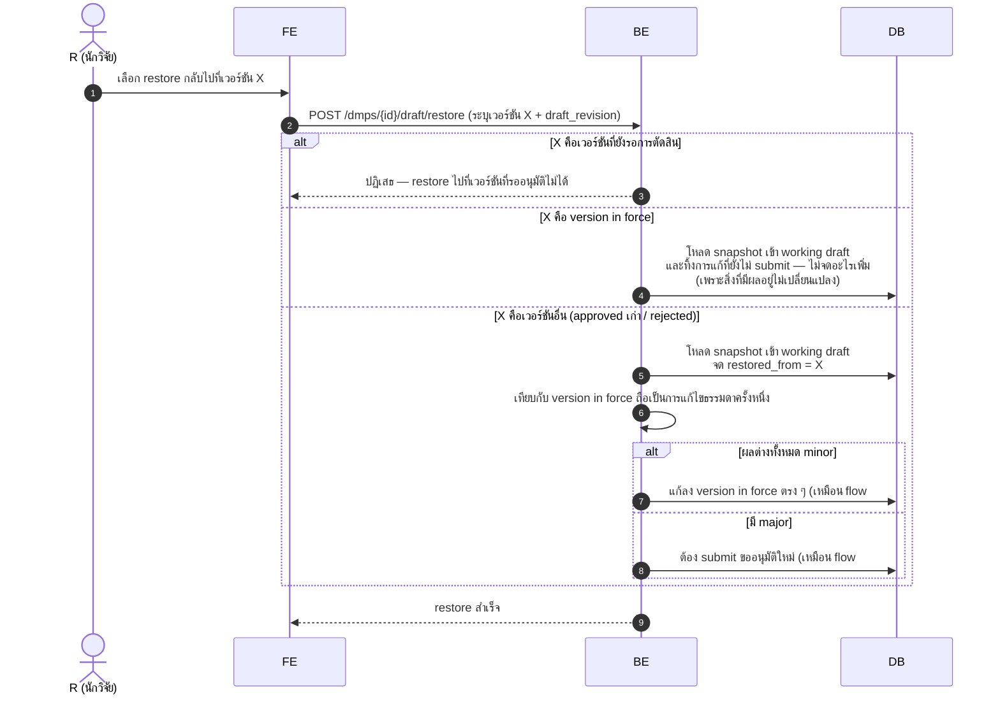

### 11. ลบ / นำกลับ research output

requirement หมวด 4.9, หมวด 5.3, หมวด 7 — จุดสำคัญ:

- การ "ลบ" output จากแผนที่มีผลอยู่เป็นแค่ **ข้อเสนอ** — ต้องผ่านการอนุมัติก่อนจึงจะลบได้จริง
- tasks ที่เกี่ยวข้องถูก cancel (ไม่ใช่ลบ) จึงเปิดคืนได้เมื่อ output ถูกนำกลับมา

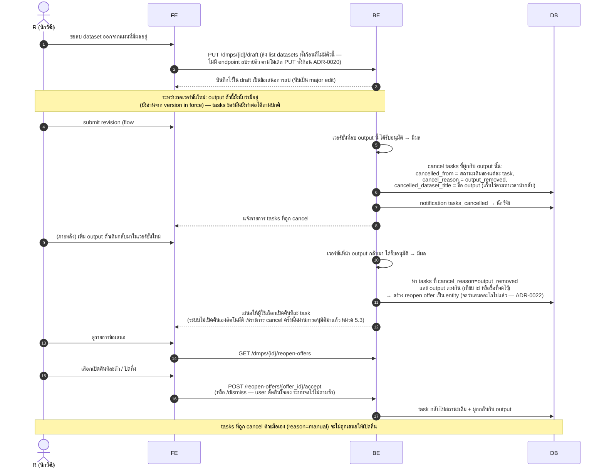

### 12. ทำงาน tasks

requirement หมวด 5.1–5.3:

- progress_percent เป็นค่าที่คำนวณ (derive) จาก checklist เสมอ ไม่ใช่ค่าที่ใครตั้งเองได้
- กฎ preservation: สิ่งที่บันทึกการทำงานจริง (evidence, checklist, การปิดงาน) ห้ามถูกทำลาย

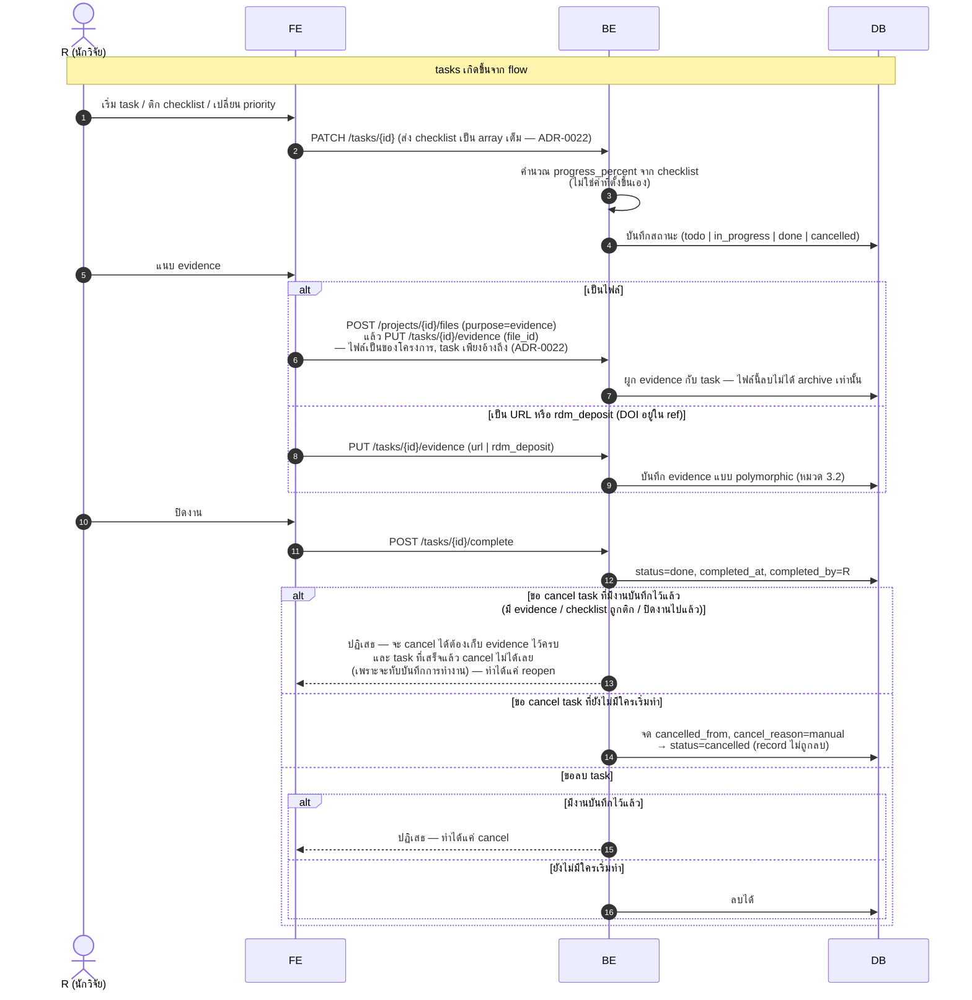

### 13. Archive แผน / ลบโครงการ

requirement หมวด 4.2, หมวด 5.3:

- ไม่มีทางไหนที่ลบแผนได้เลย
- โครงการจะลบได้ก็ต่อเมื่อในนั้นไม่มีแผนเหลืออยู่เลย

### 14. Export มาตรฐาน — deferred (ADR-0019)

requirement หมวด 8 + ADR-0019:

- **ตัดสินใหม่แล้ว:** "Exports stay in the browser, out of the API" — v1 ไม่มี `GET /dmps/{id}/export` ฝั่ง backend, FE ทำ export ใน browser
- flow นี้คงไว้เป็น **design สำรอง** กรณี browser export ไม่พอ (ไฟล์ใหญ่, audit ต้อง signature ฝั่ง server)
- export ไม่ได้เป็น object ที่เก็บในฐานข้อมูล แต่เป็นการ "ฉาย" (projection) ข้อมูลที่มีอยู่ออกมาเป็นไฟล์ ณ เวลานั้น

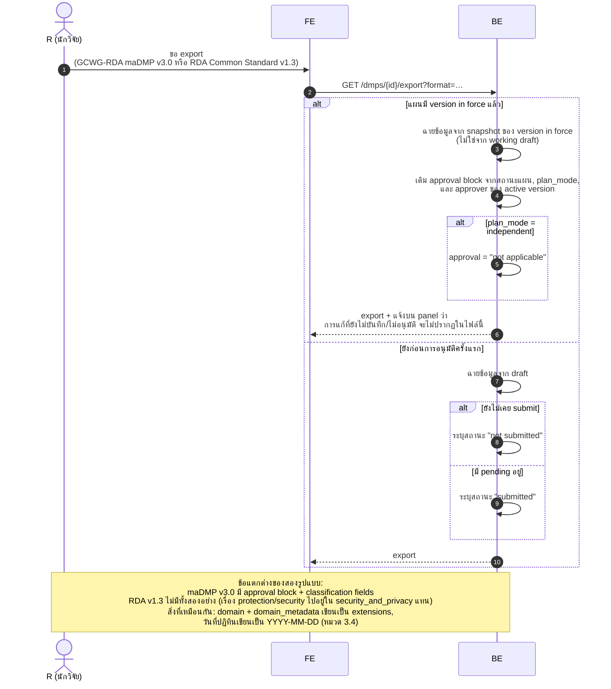

---

## กลุ่ม E — Cross-cutting

### 15. Session refresh + sign-out

พฤติกรรมที่ทุกคำขอของ FE ใช้ — access token หมดอายุ (15 นาที) ต้อง refresh ได้เงียบ ๆ + ADR-0016:

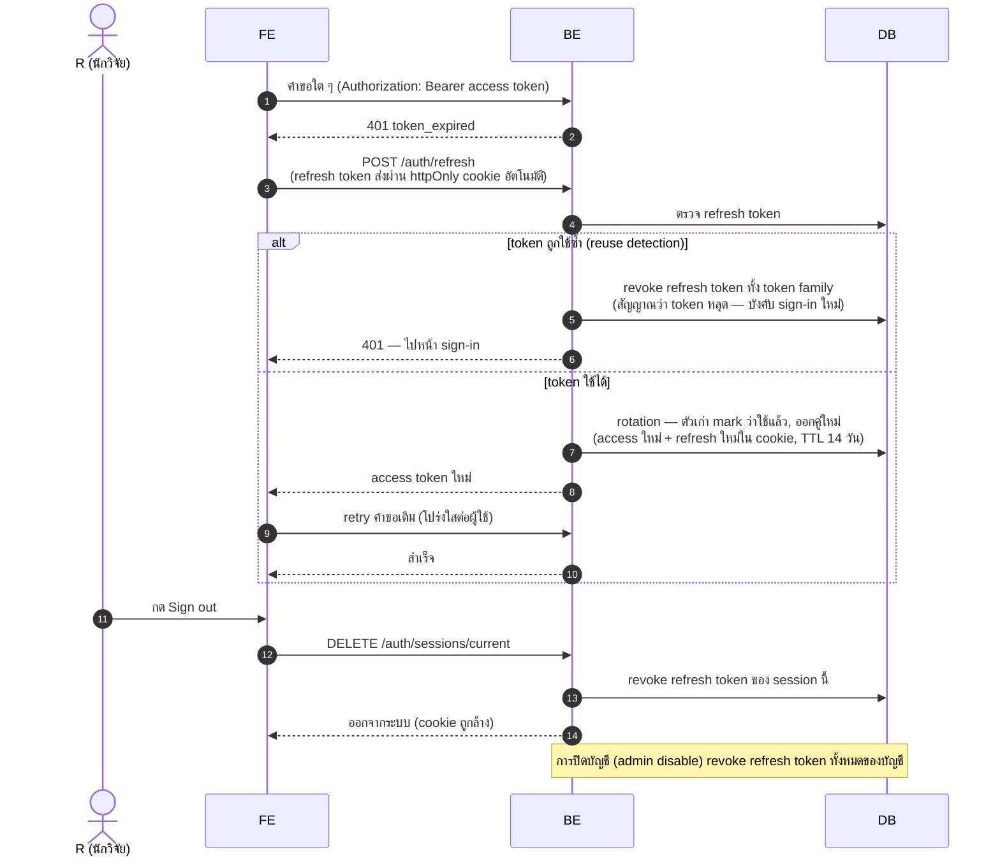

### 16. Notification lifecycle

ADR-0013 — polled, no push; notification คือ UX ไม่ใช่ record จึงลบได้:

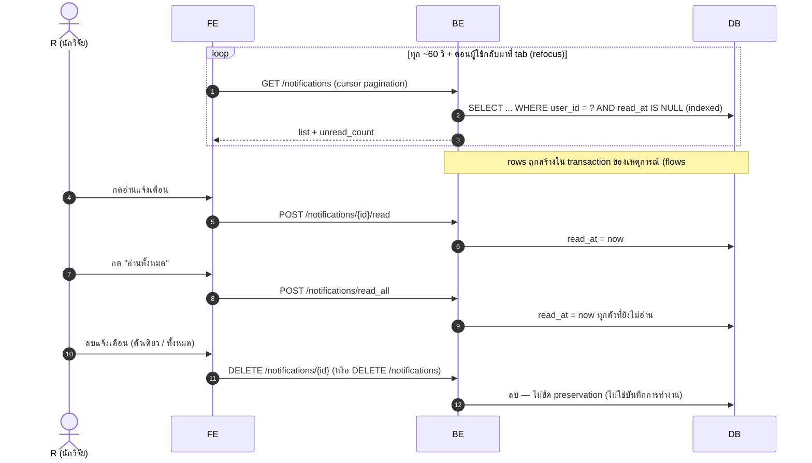

### 17. AI chat + thread

ต่อจาก flow #3 — การคุยอิสระ + การจัดการ thread (ADR-0023); chat เกิดก่อนแผนได้ (scope=`unscoped`):

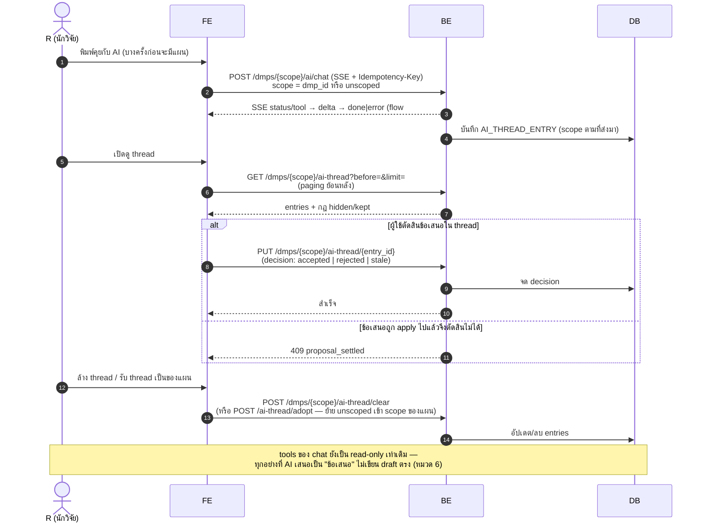

### 18. File lifecycle

ไฟล์เป็นของโครงการ — upload เดียวจุดเดียว, evidence อ้างทีหลัง (ADR-0022/0024):

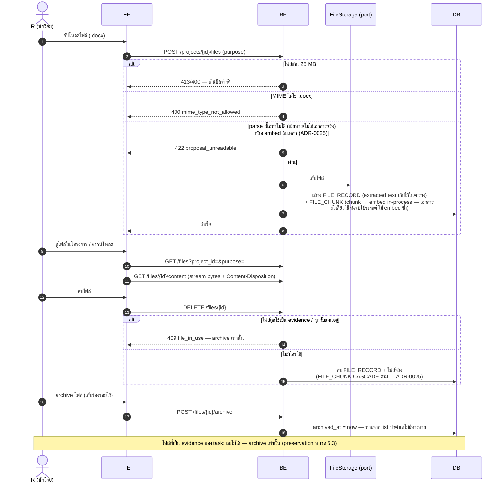

---

## สรุปความต่างจาก `main-flowchart.md`

| Flowchart ว่าอย่างนี้ | เอกสารฉบับนี้เข้าใจว่า | ที่มา |
| --- | --- | --- |
| "กรรมการอนุมัติครบทุกคน" | กรรมการคนใดคนหนึ่งตัดสินได้เลย — หนึ่งเวอร์ชัน ตัดสินได้ครั้งเดียว (flow #6) | หมวด 4.6, ตามการตัดสิน |
| ไม่มี branch สำหรับคนไม่มีสังกัด | เพิ่ม self-finalize ให้นักวิจัย citizen (flow #7) | หมวด 2.2, หมวด 4.1 |
| "แก้ไขแผน" เป็น loop เดียว | แยกชัด: minor edit แก้ลงเวอร์ชันเดิมตรง ๆ (flow #8) ส่วน major revision ต้องสร้างเวอร์ชันใหม่รออนุมัติ (flow #9) | หมวด 4.3–4.5 |
| "แจ้งให้แก้ไข → กลับไป draft" | นักวิจัยกลับมาแก้ต่อจาก version in force ได้เลย ไม่ต้อง restore และเลขเวอร์ชันที่ถูกส่งกลับจะไม่ถูกใช้ซ้ำ | หมวด 4.6 |
| Progress bar ปลายทางเท่านั้น | แตกเป็นสองเรื่อง: การสร้าง tasks อัตโนมัติ + การทำงานของ tasks (flow #6, #12) | หมวด 5.1–5.3 |
| — | เพิ่ม restore, ลบ/นำกลับ output, archive, export (flow #10, #11, #13, #14) | หมวด 4.8–4.9, หมวด 5.3, หมวด 8 |
| เรียก AI service ครั้งเดียวต่อ action | ทุก action ทำงานเป็น agent loop (ReAct) บน OpenRouter ด้วย tools 4 ตัว (รวม `search_proposal` — RAG, ADR-0025) ตอบกลับแบบ SSE (flow #3) | หมวด 6, การตัดสิน AI agent |
