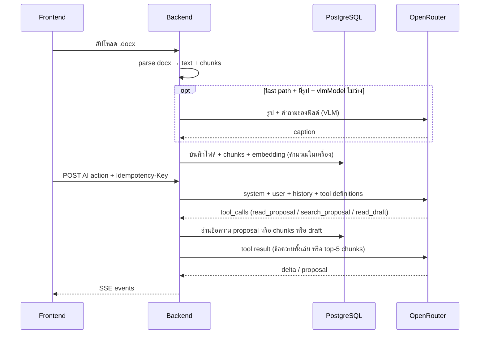

# คำถาม-คำตอบสำหรับสอบป้องกัน: OpenRouter, ReAct, Idempotency และสถาปัตยกรรม

เอกสารนี้ตอบ 7 คำถามจากมุมของ junior software engineer ที่ต้องอธิบายระบบนี้ให้กรรมการฟัง ทุกข้ออ้างจากโค้ดและ ADR ใน repo นี้เป็นหลัก ส่วนที่เป็นการตีความกฎหมายจะระบุว่าไม่ใช่คำแนะนำทางกฎหมาย

## ข้อเสนอโครงการถูกส่งออกไปยัง OpenRouter หรือไม่ เป็นปัญหาความลับหรือ PDPA ไหม

ส่งครับ — แต่ไม่ได้ส่ง "ไฟล์ .docx" ทั้งไฟล์ สิ่งที่ออกไปคือ **ข้อความที่แตกจากเอกสาร** และ **รูปบางรูป** ที่ถูกส่งให้โมเดล vision โดยตรง

ลำดับที่ข้อมูลออกไปมีสองจุด:

1. **ตอนอัปโหลด** — `FilesService.upload()` parse `.docx` เป็นข้อความก่อน แล้วถ้าเข้า fast path ของแบบฟอร์ม FF2569 และเปิด `vlmModel` ไว้ รูปในฟิลด์แบบ image จะถูกส่งเป็น `data:` URI พร้อมคำถามของฟิลด์นั้นไปให้ VLM บน OpenRouter (`qwen/qwen3-vl-30b-a3b-instruct`) เพื่อทำ caption — เป็น best-effort, นับโควตาผู้อัปโหลด, และปิดได้ด้วย `vlmModel = ""`
2. **ตอนเรียก AI action** — request ไป OpenRouter ประกอบด้วย system prompt, ข้อความผู้ใช้, ประวัติแชท 10 รายการล่าสุด (เฉพาะ `chat`), และ tool definitions จากนั้นเมื่อโมเดลตอบกลับมาเป็น `tool_calls` ผลลัพธ์ของ tool จะถูกส่งกลับไปในรอบถัดไป:
   - `read_proposal` → **ข้อความ proposal ทั้งเอกสาร**
   - `search_proposal` → top-5 chunks พร้อม heading และ score
   - `read_draft` → **maDMP draft ทั้งก้อน** (มีชื่อ/อีเมล contributor ได้)
   - `read_domain_profiles` → ชุด field ของสาขา (ข้อมูลคงที่ ไม่ sensitive)

`analyze-proposal` บังคับให้โมเดลเรียก `read_proposal` ก่อน จึงมั่นใจได้ว่า flow นี้ส่งข้อความ proposal ทั้งเล่มออกไป ส่วน `chat` ที่อยู่ใต้ `dmp_id` จะส่ง proposal ก็ต่อเมื่อโมเดลเลือกเรียก tool เอง และ `chat` แบบ `unscoped` จะมี `projectId = null` จึงอ่าน proposal ไม่ได้

จุดสำคัญที่ต้องแยกให้ถูก: **embedding ไม่ได้ส่งข้อมูลออกไป** — `TransformersEmbedding` รัน ONNX ในโปรเซส backend เอง (Qwen3-Embedding) ข้อมูลออกไป OpenRouter เฉพาะตอน VLM caption และตอนโมเดลอ่าน/ค้นเอกสารเท่านั้น

เรื่องความลับและ PDPA: ในทางเทคนิคมี **data egress** ออกจากเครือข่ายสถาบันไปยังผู้ประมวลผลภายนอกจริง และโค้ดปัจจุบัน **ไม่มี** การ redact ข้อมูลส่วนบุคคล, ไม่มี consent flow, ไม่มี retention control, ไม่มี per-user key — ใช้ `OPENROUTER_KEY` กุญแจเดียวของระบบทุกคน ดังนั้นถ้า proposal มีชื่อบุคคล อีเมล เลขบัตร ข้อมูลสุขภาพ หรืองานวิจัยที่ยังไม่เผยแพร่ นี่คือความเสี่ยงทั้งความลับและ PDPA ไม่ใช่เรื่องทฤษฎี

[INFERENCE] ภายใต้ PDPA การส่งข้อมูลส่วนบุคคลไปยังผู้ประมวลผลต่างประเทศต้องมีฐานการประมวลผลที่ชอบด้วยกฎหมายและมีมาตรการคุ้มครองที่เหมาะสม — จะสรุปว่า "ผิดหรือไม่ผิด" จากโค้ดอย่างเดียวไม่ได้ ต้องให้ DPO/ฝ่ายกฎหมายตรวจ DPA และนโยบายข้อมูลของ OpenRouter รวมถึงผู้ให้บริการโมเดลปลายทางที่ OpenRouter route ไปด้วย

คำตอบที่ปลอดภัยสำหรับกรรมการคือ: "ระบบส่งข้อความเอกสารและรูปออกไปยัง OpenRouter จริงในบาง flow; เรายังไม่มีมาตรการ PDPA ครบ จึงควรจำกัด AI กับเอกสารที่ไม่ sensitive, ปิด VLM, ทำ redaction, หรือทำ DPA ก่อนใช้จริง" — ไม่ควรตอบว่า "ไม่ส่ง" เพราะโค้ดส่งจริง



## ทำไมต้องใช้ ReAct และทำไมจำกัด 6 รอบ

ถ้าไม่ให้โมเดลเปิดอ่านอะไรเอง เรามีทางเลือกแค่สองทาง: ยัดเอกสารทั้งเล่มไปกับทุกคำถาม (แพงและอาจเกิน context) หรือให้โมเดลเดาจากสิ่งที่เราป้อน (ผิดง่าย) ReAct ในระบบนี้แก้ปัญหานั้นด้วยการให้โมเดล **เลือกเองว่าจะเรียก tool ตัวไหน** แล้วเอาผลลัพธ์กลับมาอ่านต่อ

กลไกจริงใน `react-loop.ts` คือ:

1. ส่ง messages + tool definitions ไปให้โมเดล
2. ถ้าโมเดลตอบ `finish_reason = "tool_calls"` → backend รัน tool จริง (อ่านอย่างเดียว) แล้ว append ผลลัพธ์เป็น tool message
3. วนกลับไปเรียกโมเดลอีกครั้งจนได้ `finish_reason = "stop"` หรือจนครบเพดาน

ข้อดีคือคำถามง่าย ๆ ไม่ต้องอ่านทั้งเอกสาร (ใช้ `search_proposal` 5 chunks) ส่วนคำถามที่ต้องเห็นภาพรวมก็เรียก `read_proposal` ได้ — โมเดลเป็นคนตัดสินใจจาก description ของ tool ไม่ใช่เราต้องเดาล่วงหน้า

ที่จำกัด 6 รอบเพราะ **ทุกรอบคือการเรียกโมเดลเต็มรอบ** — เปลือง token, เพิ่ม latency, และถ้าโมเดลวนเรียก tool ซ้ำไม่จบจะไม่มี terminal event ให้ frontend การมีเพดานจึงกันทั้งค่าใช้จ่ายและ stream ค้าง:

```ts
const MAX_TOOL_ROUNDS = 6;
// เกิน → throw AiError(ai_invalid_request) → ส่ง SSE error แล้วจบ
```

ข้อควรระวัง: เพดานนี้ **นับรอบการเรียกโมเดล** ไม่ได้นับเฉพาะ tool call — ถ้าโมเดลใช้ tool ครบ 6 รอบแล้วยังต้องตอบอีกหนึ่งรอบ จะโดนตัดก่อนได้คำตอบ และระบบไม่ได้คืนคำตอบบางส่วน เป็น error ทั้ง run (ดู Observations)

เหตุผลที่เลือก 6 ไม่ใช่ 3 หรือ 20: repo อธิบายว่า "กัน loop ไม่จบ" และ prompt สั่งให้ค้นไม่เกิน 2 ครั้ง แต่ **ไม่มี benchmark หรือการคำนวณต้นทุนที่บันทึกไว้ว่าทำไมต้อง 6** — เป็นค่ากันความเสี่ยง ไม่ใช่ค่าที่พิสูจน์แล้วว่าเหมาะสมที่สุด

## Idempotency key กันอะไร

Idempotency key กัน **การทำงานซ้ำเมื่อผู้ใช้หรือเครือข่ายส่งคำสั่งเดิมมาสองครั้ง** ซึ่งในระบบ AI มีผลเสียจริงสามอย่าง: เรียกโมเดลซ้ำ (เสียเงิน), หักโควตาซ้ำ, และเขียน thread ซ้ำ — สำหรับ `analyze-proposal` ยังอาจสร้างแผนซ้ำอีกด้วย

ตัวอย่างจริง: ผู้ใช้กดปุ่ม "วิเคราะห์ proposal" แล้วเน็ตหลุดก่อน stream จบ frontend retry ด้วย key เดิม ระบบจะ:

1. หา key ในตาราง `idempotency_keys` ด้วย `(user_id, key, action)`
2. ถ้าเจอและมี `response_snapshot` → replay event ทั้งชุดเดิม ไม่เรียกโมเดล ไม่หักโควตา ไม่เขียน user entry ซ้ำ
3. ถ้าไม่เจอ → insert key แล้วรันจริง เมื่อจบจึงบันทึก snapshot ทั้งชุด (รวม `done`/`error`)

key เป็นค่าที่ client ตั้งเอง และถูก scope ด้วย user + action ทำให้ผู้ใช้สองคนใช้ key ชื่อเดียวกันได้โดยไม่ชนกัน — แต่ต้องส่ง header นี้ทุก AI action ถ้าขาดจะได้ 400 `field_invalid`

สิ่งที่มัน **ไม่ได้** กัน:

- ไม่ได้ทำให้ทุก endpoint idempotent — ใช้เฉพาะ AI actions
- ไม่ได้กันผู้ใช้กดสองครั้งด้วย key คนละค่า
- ถ้า run แรก crash ก่อนบันทึก snapshot โค้ดจะยอมให้รันใหม่ด้วย key เดิม (เพื่อกู้ run ที่ค้าง) จึงไม่ใช่ exactly-once แบบสมบูรณ์
- ไม่ได้แทนโควตารายเดือน — คนละกลไกกัน

## ทำไมเลือก modular monolith ไม่ใช้ microservices

เพราะ flow หลักของระบบนี้ต้อง **atomic ข้ามหลายส่วน** และ scale ยังเล็กพอที่จะไม่ต้องจ่ายราคาของระบบ distributed

ตัวอย่างที่ชัดที่สุดคือ approve แผน: อนุมัติ → สร้าง tasks ชุดแรก → สร้าง notifications ต้องสำเร็จพร้อมกันทั้งชุดหรือไม่สำเร็จเลย ใน modular monolith ทั้งสามขั้นอยู่ใน Drizzle transaction เดียว จึง rollback ได้ простอและตรวจสอบได้ด้วย test

ถ้าแยกเป็น microservices (เช่น dmps, tasks, notifications คนละ service) การ approve จะกลายเป็นคำขอข้ามเครือข่ายหลาย hop ต้องมี saga/outbox, retry, compensating action, eventual consistency, service discovery, distributed tracing และ deploy หลายตัว — ซับซ้อนเกินความจำเป็นที่ ~200 ผู้ใช้/วัน, peak ~2,000 และ deploy บน VM เดียว

"modular" ไม่ได้หมายถึงแค่แยกโฟลเดอร์: แต่ละ feature มี module/service/repository/controller quartet, domain logic อยู่ใน `shared/domain-engine` แบบ pure, และ I/O ที่อาจเปลี่ยน implementation อยู่ใน ports/adapters (ADR-0002) — ถ้าวันหนึ่งต้องแยก embedding worker หรือ notification service ออก ก็แยกที่ port ได้โดยไม่ต้องรื้อ domain logic

ข้อเสียที่ต้องยอมรับ: process เดียวพังก็พังทั้งระบบ, restart มี downtime สั้น ๆ, และ scale ได้แค่แนวตั้ง/หลาย process ไม่ได้แยก scale เฉพาะ AI หรือ indexing — แต่ที่ scale นี้ tradeoff นี้คุ้มกว่าความซับซ้อนของ microservices

## รองรับผู้ใช้ได้เท่าไร คอขวดอยู่ที่ไหน

ต้องแยก "จำนวนผู้ใช้" ออกจาก "จำนวนคำขอต่อวินาที" ก่อน: ผู้ใช้ 1,000 คนที่ยิงคำขอทุก 2 วินาทีสร้างภาระประมาณ 500 req/s ไม่ใช่ 1,000 req/s

เป้าหมายที่ออกแบบไว้คือผู้ใช้เฉลี่ย ~200 คน/วัน, peak ~2,000 คนพร้อมกัน (TC-1) และ QR01 กำหนด 50 concurrent users ที่ P95 < 100 ms ผลทดสอบภาระงานจริงบนเครื่อง 2 vCPU / 8 GB (ใช้ร่วมกับตัวสร้าง load และ Postgres) สรุปได้ว่า:

| ผู้ใช้พร้อมกัน | Throughput ที่วัดได้ | P95 | อาการ |
| --- | --- | --- | --- |
| 1,000 | ~497 req/s | ≤ 67 ms | ยังเป็นเส้นตรง, utilization ต่ำกว่า 60% |
| ~1,250 | ~557 req/s | 765 ms | จุดหักศอก (knee) — เริ่มคอขวด |
| 1,500 | ~536 req/s | 1,495 ms | คำขอเข้าคิวรอ CPU |
| 2,000 | ~551 req/s | 2,607 ms | throughput แบน, latency พุ่ง แต่ error 0% |

อ่านแบบภาษาคน: ระบบรองรับ ~1,100 คนพร้อมกันที่ P95 < 100 ms (เกิน spec 50 คนประมาณ 22 เท่า) แต่พอแตะ ~1,250 คน เพดาน ~550–570 req/s ก็เต็ม ความเร็วไม่เพิ่มอีกและคิวเริ่มยาว

คอขวดของงาน API ทั่วไปอยู่ที่ **CPU ของ NestJS process เดียว** — `src/main.ts` รันโปรเซสเดียว ไม่มี cluster/PM2 จึงใช้ event loop เดียวบนแกนเดียวในการ validate Zod, serialize JSON, verify JWT และประมวลผล request อื่น ๆ ขณะที่ Postgres ก็แชร์ CPU เครื่องเดียวกัน รวมถึง pool default 10 connection, N+1 ใน `GET /dmps`, การดึง snapshot เต็มทุกครั้ง และ CHECK constraint JSONB ที่เพิ่มต้นทุนฝั่ง DB

แต่ถ้าเป็น **AI action** คอขวดคนละแบบ: เวลาส่วนใหญ่คือรอ OpenRouter ตอบ, การถือ SSE connection เปิดไว้ และโควตา token ต่อผู้ใช้ — ไม่ใช่ CPU ของ backend ดังนั้นคำถาม "รองรับกี่คน" ต้องถามต่อว่าใช้ AI หนักแค่ไหน: 2,000 connection ที่ idle อยู่ได้สบาย แต่ 2,000 คนรัน AI พร้อมกันจะติด rate limit/ค่าใช้จ่ายของผู้ให้บริการและโควตารายคนก่อน CPU

(รายละเอียดการทดสอบและข้อเสนอเพิ่ม capacity อยู่ใน `docs/explained/load-test-scaling.md`)

## ทำไม indexing บล็อกผู้ใช้อื่น

ก่อนอื่นต้องแม่นคำ: **ไม่มี lock หรือ mutex ที่ตั้งใจกันผู้ใช้คนอื่น** สิ่งที่เกิดขึ้นคือ **งาน indexing ทำใน request เดียวและกิน CPU/event loop ของโปรเซสเดียว** จึงทำให้คำขออื่นช้าลงเมื่อไปถึงพร้อมกัน — เป็น resource contention ไม่ใช่การบล็อกโดยตรง

ลำดับงานตอนอัปโหลด `.docx` ใน `FilesService.upload()` คือ:

1. parse เอกสารเป็นข้อความ
2. ถ้าเป็นฟอร์ม FF2569 → extract fields และอาจเรียก VLM caption รูป (network ไป OpenRouter)
3. chunk ข้อความ
4. **embed ทุก chunk** ด้วย `TransformersEmbedding` ในโปรเซส backend
5. insert ไฟล์ + chunks ใน transaction เดียว
6. ตอบ response กลับ

ไม่มี background job หรือ queue — ADR-0025 ตัดสินใจแบบนี้เพราะต้องการให้ "อัปโหลดสำเร็จ = RAG พร้อมใช้" ไม่มี state แขวน และไม่ต้องเพิ่มบริการแยก แต่ผลคือผู้ใช้ต้องรอ embed จบก่อนได้ response

ตัวเลขที่ทำให้เห็นภาพ: โมเดล Qwen3-Embedding q8 ถูก lazy-load ครั้งแรก (~600 MB) และเอกสาร proposal ~40 chunks ใช้เวลา embed ~4–12 วินาทีบน CPU (ADR-0028) ระหว่างนั้น:

- โมเดลโหลดและ inference แย่ง CPU กับ request อื่น
- `BATCH_SIZE = 8` ทำให้ embed ทีละ batch ภายใน call เดียว ไม่มี concurrency limit ระหว่างผู้ใช้อัปโหลดพร้อมกัน
- `retrieve()` ยัง re-embed ทั้งไฟล์ได้ถ้า `embedding_model` ไม่ตรง config หรือ embedding ว่าง — งานนี้อาจเกิดกลาง AI tool call ของผู้ใช้คนอื่นได้
- ถ้าเปิด VLM caption การอัปโหลดยังรอ OpenRouter ทีละรูป (network wait ไม่กิน event loop แต่ทำให้ upload นาน)

ดังนั้นคำตอบที่ตรงคือ: "indexing ไม่ได้บล็อกด้วย lock แต่ทำแบบ synchronous ในโปรเซสเดียว จึงแย่ง CPU กับคำขออื่น; ถ้าต้องการไม่ให้กระทบ ต้องย้ายไป worker/queue หรือจำกัด concurrency"

## ทำไมแจ้งเตือนด้วย polling ไม่ใช้ WebSocket

เพราะการแจ้งเตือนของระบบนี้เป็นข้อมูลทางเดียว ความถี่ต่ำ และ latency ระดับนาทียอมรับได้ — ไม่คุ้มกับราคาของ connection แบบ push ที่ต้องดูแลตลอดเวลา

ADR-0013 บันทึกว่า frontend contract กำหนดให้ poll `GET /notifications` ทุก ~60 วินาที และ poll ซ้ำตอน refocus คำนวณภาระที่ peak 2,000 ผู้ใช้ได้ประมาณ 33 req/s เทียบกับ SELECT ที่มี index อยู่แล้ว (sub-millisecond) ใช้แรงเครื่องไม่ถึง ~3% — polling จึงไม่ใช่คอขวดที่ scale นี้

ถ้าใช้ WebSocket ต้องแลกด้วย: connection ค้าง 2,000 เส้น, reconnect/backoff, การยืนยันตัวตนซ้ำ, proxy buffering/timeout, การ fan-out และ state ต่อ connection — ทั้งที่ข้อมูลเป็น one-way และผู้ใช้ไม่ได้ต้องการ latency ระดับวินาที

ข้อควรรู้: ระบบ **มี SSE อยู่แล้ว** สำหรับ AI streaming แต่ notification เลือก polling เพราะ frontend contract และความเรียบง่าย ไม่ใช่เพราะทำ push ไม่ได้ — `NotificationPublisher` port ยังถูกเก็บไว้ ถ้าวันหน้าต้องการ latency ต่ำหรือจำนวนผู้ใช้สูงขึ้นมาก (เช่น ~10k concurrent) ก็สลับ adapter เป็น SSE/push ได้โดยไม่แตะ domain logic

ข้อเสียของ polling ที่ต้องยอมรับ: มีคำขอเปล่าเมื่อไม่มีแจ้งเตือนใหม่ และ latency สูงสุด ~60 วินาที — ถ้าต้องการแก้ภายหลังสามารถเพิ่ม ETag/If-None-Match หรือเปลี่ยนเป็น SSE

## Observations on the source

- **Notification delivery ขัดกันในเอกสาร:** `AGENTS.md` และ arc42 บางบรรทัดพูดว่า notifications ใช้ SSE/push แต่โค้ดจริง (`notifications.controller.ts`) มีแต่ REST polling, ADR-0013 ตัดสิน polling, และ `docs/api/notifications.md` ระบุชัดว่าไม่มี stream endpoint — เอกสารส่วนที่ยังพูดถึง SSE เป็นข้อมูลเก่า/ขัดแย้ง
- **Idempotency 24 ชั่วโมงไม่ได้ถูกบังคับตอนอ่าน:** `findIdempotencyKey()` ไม่ได้กรอง `expires_at` จึง replay snapshot เก่าเกิน 24 ชม. ได้จนกว่าจะมี cleanup ลบแถว และเอกสารบอกว่า key ซ้ำขณะ run ยังไม่จบจะตอบ 409 แต่โค้ด `idempotencyGate()` กลับปล่อยให้รันใหม่; กรณี insert พร้อมกันสอง request ต้องพึ่ง unique constraint ซึ่งไม่มี mapping เป็น 409 ชัดเจนในเส้นทางที่อ่าน
- **ข้อความเรื่องคอขวดขัดกับผลวัด:** arc42 TC-3/QS-6 บอกว่าคอขวดคือ network และ "ไม่มีงานหนักทาง CPU" แต่ผล load test วัดได้ว่า CPU/event loop เป็นคอขวดของงาน API ที่ ~1,250 concurrent — ทั้งสองอย่างจริงคนละ workload (AI รอ network, CRUD กิน CPU) แต่ประโยคเหมารวมทำให้เข้าใจผิด
- **"ReAct" ในโค้ดเป็น tool-calling loop:** ไม่มี Thought/Action/Observation แบบข้อความของ ReAct ดั้งเดิม เป็นการวน `tool_calls` แบบ OpenAI-compatible — ใช้คำว่า ReAct ได้ในเชิงสถาปัตยกรรม แต่ควรอธิบายกลไกจริงให้ตรง
- **เพดาน 6 รอบนับรอบโมเดล ไม่ใช่รอบ tool:** เอกสารและ prompt เรียก "6 tool rounds" แต่ตัวแปร `MAX_TOOL_ROUNDS` ถูกเพิ่มก่อนเรียกโมเดลทุกครั้ง ดังนั้น run ที่ต้องใช้ tool 6 ครั้งแล้วตอบอีกครั้งจะโดนตัดที่รอบที่ 7 และไม่ได้คำตอบบางส่วน
- **คำถามข้อ 1 ต้องแยกให้ชัด:** ตัวไฟล์ `.docx` ไม่ได้ถูกอัปโหลดไป OpenRouter แต่ข้อความที่ extract แล้วและรูปที่ทำ caption ถูกส่งออกไปจริง — ตอบรวม ๆ ว่า "ส่งไฟล์" หรือ "ไม่ส่ง" จะไม่ตรงทั้งคู่
- **คำถามข้อ 6 ใช้คำว่า "บล็อก" ไม่ตรงกลไก:** ไม่มี lock กันผู้ใช้; ที่เกิดคือ synchronous CPU work ในโปรเซสเดียวและ lazy model load/embed ที่แย่ง ресурс
