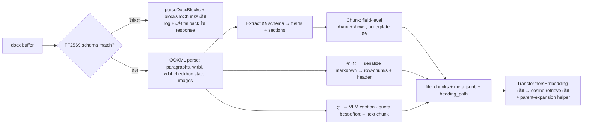

# การวิเคราะห์โครงสร้างเอกสารฟอร์ม FF2569 และกลยุทธ์ RAG แบบ form-aware

> อ้างอิงตัวอย่าง: `docs/research/ข้อเสนอโครงการ FF2569.docx` (Full Proposal, Fundamental Fund 2569, สจล.) ขอบเขต: วิเคราะห์โครงสร้าง + ออกแบบ ยังไม่รวม implement (report-first)

## 1. ข้อเท็จจริงโครงสร้างไฟล์ (จาก OOXML ตรง ๆ)

| ประเด็น | ข้อเท็จจริง | นัยต่อการ ingest |
| --- | --- | --- |
| Heading styles | **ไม่มีเลย** — มีเพียง `ListParagraph` (116 ย่อหน้า) และ `paragraph` (4); หัวข้อทั้งหมดเป็น **bold run** (646 จุด) | ห้ามพึ่ง style layer; ต้อง map โครงสร้างจาก template schema |
| Form fields | checkbox เป็น **content control จริง 154 จุด** (`w14:checkbox`, อ่าน state จาก `w14:checked`) | ค่า ☒/☐ deterministic 100% ไม่ต้อง OCR/guess จาก glyph |
| ตาราง | 11 ตาราง (OECD, คณะผู้วิจัย, ผลการดำเนินงานที่ผ่านมา, Gantt 13 คอลัมน์, พื้นที่ ×2, ครุภัณฑ์, หน่วยงานร่วมลงทุน, Output, ผลลัพธ์, Impacts) | ตารางกว้างฝังทั้งก้อนเป็น 1 chunk เจือ embedding |
| รูปภาพ | 2 drawing (media 5 ไฟล์); อย่างน้อย 1 คือ diagram "กรอบการวิจัย" (Input–Process–Output) ที่มีเนื้อหาจริงเกือบทั้งหัวข้อ | ต้อง caption ด้วย VLM ไม่งั้นหัวข้อนั้นเสียเนื้อหา |
| Pipeline เดิม | `parseDocxBlocks` (`src/features/files/docx.ts`) regex เฉพาะ `h1-3\|p` จาก mammoth HTML | ยัดไฟล์นี้เข้าไปจริง: **ตารางทั้ง 11 หลุดเงียบ ๆ**, `heading_path = null` ทุก chunk, boilerplate ปนคำตอบ → generic path ใช้กับเอกสารฟอร์มไม่ได้ |

### 1.1 จุดเพี้ยนของ template (เหตุที่ห้ามใช้เลขข้อเป็น ID)

- เลขข้อ "10." **ซ้ำ 2 ครั้ง** (สาขา OECD และรายละเอียดคณะผู้วิจัย)
- เลขหัวข้อ **restart ทุก "ส่วนที่"** (ส่วนที่ 2 นับ 1–8 ใหม่, ส่วนที่ 3 นับ 1–4 ใหม่)
- ระเบียบวิธีวิจัย: ข้อ 4/6 **หายไป**, ข้อ 7 ซ้ำ
- ส่วนที่ 3 ข้อ 4: มี 4.1–4.2 แล้วกระโดดเป็น 4.5–4.7; "หน่วยงานร่วมดำเนินการ" (ตาราง) ไม่มีเลขข้อชัดเจน
- คำถามบางข้อใน "ส่วนที่ 3" จริง ๆ เป็นหัวข้อ 1./2. แบบ list (`£` แทน ☐ ในหัวข้อมาตรฐานการวิจัย)
- typo ทั่วไป ("บูรณาการ", "พรี่เมี่ยม") — matching ต้อง tolerant

**สรุป:** canonical field ID ต้องมาจาก schema ที่เรากำหนดเอง ไม่ใช่เลขข้อในเอกสาร

## 2. โครงสร้างฟอร์มตาม logical sections

| ส่วน | Field ID | ชนิด |
| --- | --- | --- |
| header | `funding_type`, `fiscal_year`, `institution` | text |
| ส่วนที่ 1 ข้อมูลทั่วไป | `plan_type`, `research_type`, `sub_plan` | enum (checkbox/dropdown) |
| ส่วนที่ 1 | `title_th`, `title_en`, `keywords_th`, `keywords_en` | text |
| ส่วนที่ 1 | `major_project`, `other_funding` | bool (+text) |
| ส่วนที่ 1 | `ongoing_project` | enum + text (รหัส/ปี/งบรายปี) |
| ส่วนที่ 1 | `previous_results` | table (ผลงานที่ผ่านมา) |
| ส่วนที่ 1 | `oecd_field` | table (สาขาหลัก/ย่อย/ที่เกี่ยวข้อง — enum) |
| ส่วนที่ 1 | `research_team` | table (ชื่อ/หน่วยงาน/บทบาท/สัดส่วน/สถานะ) |
| ส่วนที่ 2 ข้อมูลโครงการ | `executive_summary`, `rationale` | long text |
| ส่วนที่ 2 | `objectives`, `methodology`, `final_outputs`, `annual_targets` | list/text |
| ส่วนที่ 2 | `framework_diagram` | image + VLM caption |
| ส่วนที่ 2 | `subactivity[1..3]` | array: แต่ละก้อนมี {concept, theory, hypothesis, literature_review, references} — **โครงซ้ำ** |
| ส่วนที่ 3 แผนงาน | `work_plan` | table (Gantt 13 คอลัมน์ + ร้อยละ) |
| ส่วนที่ 3 | `research_area`, `benefit_area` | table |
| ส่วนที่ 3 | `budget_plan` | text (4.1) + table ครุภัณฑ์ (4.2) + table หน่วยงานร่วมลงทุน |
| ส่วนที่ 3 | `readiness_level` (TRL/SRL), `impact_pathway` (4.6), `pi_management_experience` (4.7) | text |
| ส่วนที่ 4 ผลผลิต/ผลลัพธ์/ผลกระทบ | `expected_outputs`, `output_to_outcome`, `expected_impacts` | table |

จุดเด่นเชิงโครงสร้าง: `theory_per_subactivity` เป็น **โครงซ้ำ 3 รอบ** ที่หัวข้อย่อยเหมือนกันทุกก้อน — schema ต้องรองรับ array ของ subactivity (ไม่ hardcode ทั้ง 3 ก้อนเป็น field แยก)

## 3. การออกแบบที่ตกลงร่วมกัน (จาก design-tree interview)

| การตัดสินใจ | ทางที่เลือก | เหตุผลหลัก |
| --- | --- | --- |
| Q1 ขอบเขต | template-driven — schema อยู่ config แยก, parser ไม่ hardcode เลขข้อ | เลขข้อซ้ำ + template เปลี่ยนทุกปี |
| Q2 corpus | มีตัวอย่างเดียว (n=1), ไม่มี blank template | boilerplate ของฟอร์มยังอยู่ครบในไฟล์เดียว ใช้เป็น template ได้; validation เป็น manual เท่านั้น |
| Q3 parsing | parse OOXML ตรง (jszip) ต่อ schema; LLM เฉพาะ caption รูป | checkbox state/ตาราง deterministic; mammoth generic เสียตารางทั้งหมด |
| Q4 chunk unit | 1 chunk ต่อ field, **ข้อความคำถามติดทุก chunk**, parent-child (field→section) | ในฟอร์ม คำถามคือบริบท retrieval ที่สำคัญกว่าคำตอบ |
| Q5 ตาราง | row-chunks + header/ชื่อตารางติดทุกแถว + ทั้งตารางเป็น parent | Gantt/OECD กว้างเกินฝังทั้งก้อน |
| Q6 checkbox | เฉพาะตัวที่ติ๊กเข้าข้อความ (`☑ ...`) + enum ลง metadata; ตัวเลือกที่ไม่ติ๊ก = boilerplate ถูกตัดออกจาก index | boilerplate ของแผนงาน 1–3 ยาวและไม่ใช่ข้อมูลโครงการ |
| Q7 การวัด | 2 ชั้น: extraction F1 (manual ต่อ n=1) + retrieval hit@k/MRR จาก golden QA | แยก bug parser ออกจาก embedding |
| Q8 metadata | enum → structured metadata ใช้ filter ตอน search | ตอบคำถามเชิง attribute โดยไม่พึ่ง embedding |
| Q9 deliverable | รายงานนี้ที่ `docs/research/` ภาษาไทย | — |
| Q10 AI quota | VLM caption best-effort: นับเข้าโควตาผู้อัปโหลด (reconcile เดิม ADR-0023) แต่ **ไม่ fail upload** — โควตาหมด → skip caption | สม่ำเสมอกับระบบโควตา แต่ upload ไม่ควรติดเงื่อนไข chat quota |
| Q11 ที่เก็บ schema | `src/features/files/templates/ff2569.ts` (TS + Zod, `template_version: "FF2569"`, field ID เป็น English keys) | ตรง convention Zod-at-boundary; template ใหม่ = ไฟล์ใหม่ |
| Q12 storage | เพิ่ม `meta jsonb` ที่ `file_chunks` + encode path ลง `heading_path` เดิม; **ไม่สร้างตารางใหม่** | migration อันเดียว consumer เดิมไม่แตก |
| Q13 fallback | โครงไม่ตรง schema → generic `blocksToChunks` + log + **รายงาน fallback กลับใน API response ของ upload** | fast path ไม่ใช่ precondition; FE ต้องรู้ |
| Q14 retrieval | `FilesService.retrieve` คงเดิม (flat children top-k); เพิ่ม parent-expansion helper ให้ `read_proposal` | API เดิมไม่พัง, LLM เห็น section เต็ม |

## 4. กลยุทธ์ chunking สรุป

กฎละเอียด:

1. **คำตอบยาวเกิน target (เช่น บทสรุป ~1 หน้า > 450 tokens)** — แตกเป็นหลาย chunk ทุกก้อน prefix ด้วยคำถาม + `part i/n` ใน meta
2. **boilerplate ที่ตัด**: ตัวเลือก enum ที่ไม่ได้ติ๊ก, คำอธิบายประกอบตัวเลือก, หมายเหตุของฟอร์ม — คงอยู่ใน schema แต่ไม่เข้า index
3. **enum fields** (แผนงาน, ประเภทการวิจัย, แผนแม่บทย่อย) ลง `meta` เป็น canonical value เช่น `plan_type: technology_development` เพื่อ metadata filter
4. **heading_path** encode อ่านได้ เช่น `"ส่วนที่ 1 > ข้อ 9 คำสำคัญ"` — consumer เดิม (`read_proposal`, retrieve) ใช้ต่อได้ทันที
5. **parent-child**: `meta.parent_chunk_index` ชี้ parent section chunk; ทั้งตาราง = parent ของ row-chunks

## 5. แผน implement (slices ตามลำดับ)

| Slice | เนื้อหา | Verify |
| --- | --- | --- |
| S1 | `templates/ff2569.ts` — schema + Zod types | `pnpm typecheck` + unit: schema ครบทุก section |
| S2 | OOXML extractor (`features/files`) → FF2569Document (paragraphs/tables/checkbox/images) | unit กับ fixture ไฟล์จริง: นับตาราง=11, checkbox=154 |
| S3 | Field extractor + chunk builder (S1+S2 → Chunk[] พร้อม meta) | unit: ทุก field ID ปรากฏ, boilerplate ไม่ติด index |
| S4 | Migration `file_chunks.meta jsonb` + เส้นทาง upload (match → fallback + response flag) + parent-expansion helper | e2e ชุดอัปโหลด: FF ผ่าน fast path, docx ธรรมดา fallback + flag |
| S5 | Golden QA + วัด hit@k/MRR (tests/integration) | suite เขียวที่ threshold ที่ตกลง |

## 6. ความเสี่ยง

- **n=1**: สมมติฐาน "ฟอร์มตายตัว" พิสูจน์จากตัวอย่างเดียว — เจอเวอร์ชันถัดไป/คนกรอกเพี้ยน (ลบหัวข้อ, เพิ่มแถวตาราง) อาจต้องแก้ schema; ลดความเสี่ยงด้วย tolerant matching + fallback ที่ปลอดภัยแล้ว
- **VLM caption** เพิ่ม dependency โมเดล vision บน OpenRouter — ถ้าไม่มี budget/quota หัวข้อ "กรอบการวิจัย" จะเหลือเฉพาะย่อหน้าอธิบายรอบรูป (ยังใช้ได้ แต่ไม่ครบ)
- **โครงซ้ำ subactivity** พึ่ง pattern ของหัวข้อ ("กิจกรรมย่อยที่ N") — ถ้านักวิจัยแก้หัวข้อ fallback ต่อก้อนนั้น
