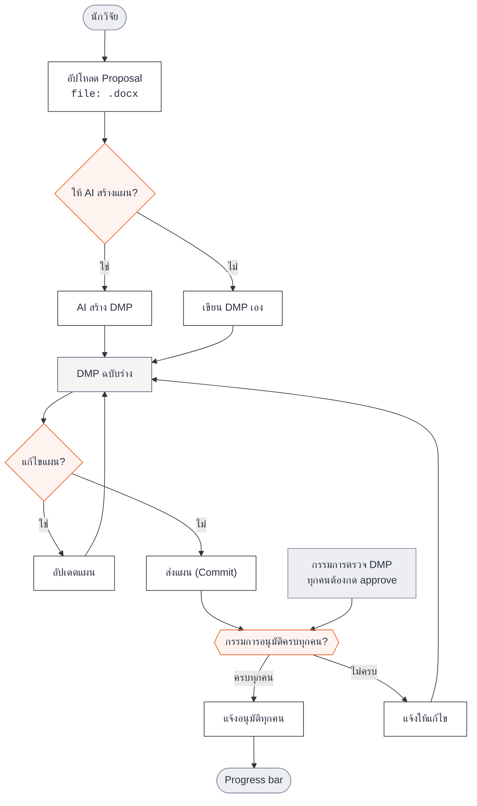

# Main Flowchart

ผังการทำงานหลักของระบบติดตามงานวิจัย — นักวิจัยอัปโหลด proposal สร้างแผน DMP ด้วย AI หรือเขียนเอง แก้ไขจนพอใจ ส่ง Commit ให้กรรมการตรวจ หากอนุมัติครบทุกคนจึงเข้าสู่ Progress bar หากไม่ครบจะแจ้งให้กลับไปแก้ไข

---

original ref: figma (18/10/2026)