# Frontend data model ERD

This diagram reflects the current Zod schemas and client-side stores. It is a logical view of the frontend model, not a claim that these are database tables or that the indicated references are enforced by a database.

Last checked against the code: 18 October 2026.

```mermaid
erDiagram
    USER ||--o| CREDENTIAL : signs_in_with
    USER ||--o{ PROJECT_MEMBER : participates_in
    PROJECT ||--o{ PROJECT_MEMBER : has_members
    PROJECT o|--o{ DMP : groups
    PROJECT ||--o{ FILE_RECORD : stores
    USER ||--o{ FILE_RECORD : uploads
    PROJECT o|--o| FILE_RECORD : selects_active_proposal
    DMP ||--o{ DMP_VERSION : has_revisions
    USER o|--o{ DMP_VERSION : decides_as_approver
    DMP ||--o{ TASK : produces
    DMP o|--o{ NOTIFICATION : may_reference
    PROJECT o|--o{ NOTIFICATION : may_reference
    USER ||--o{ NOTIFICATION : receives
    DMP ||--|{ DATASET : contains_in_draft
    DMP ||--|{ CONTRIBUTOR : names_in_draft
    USER o|--o{ CONTRIBUTOR : may_be_linked_as
    DMP ||--o{ COST : budgets_in_draft
    DATASET ||--o{ DISTRIBUTION : describes
    DATASET }o--|| DOMAIN_PROFILE : validated_by
    DATASET o|--o{ TASK : may_scope
    FILE_RECORD o|--o{ TASK : may_be_attached_to
    FILE_RECORD o|--o{ DISTRIBUTION : may_back
    DMP o|--o{ AI_THREAD_ENTRY : scopes

    USER {
        string user_id PK "optional in schema"
        string title
        string name
        string surname
        string email "unique per account, ignoring case and spaces"
        UserRole role "admin | chief | committee | researcher"
        int ai_token_limit
        int ai_token_used
        string username "optional; set at sign-up, mirrors CREDENTIAL"
        AccountType account_type "optional; institutional | citizen, researchers only"
        string phone "optional"
        string orcid "optional; same format as CONTRIBUTOR.orcid"
        json affiliation "optional; organization, department, position. Institutional only"
        string address "optional; citizen researchers only"
    }

    CREDENTIAL {
        string username PK "lowercase; unique"
        string user_id FK
        string salt "random per account"
        string hash "SHA-256 of salt and password; never the password"
    }

    PROJECT {
        string project_id PK "optional in schema"
        string project_name
        string description
        string proposal_file_id FK "optional"
        ProjectStatus status "draft | active | done"
        PlanMode plan_mode "institutional | independent"
        date created_at
        date updated_at
    }

    PROJECT_MEMBER {
        string project_id PK, FK
        string user_id PK, FK
        ProjectRole project_role "researcher | committee | chief"
    }

    DMP {
        string dmp_id PK
        string project_id FK "optional"
        string title
        string description
        string language
        DmpStatus status "draft | pending | approved"
        int active_version "optional; DMP_VERSION.number in force"
        PlanMode plan_mode "optional; pinned at first submission"
        date archived_at "optional; plans are archived, never deleted"
        bool tasks_generated
        int dataset_count "summary for the library list"
        int contributor_count "summary for the library list"
        date created_at
        date updated_at
        json draft "dates, ethics, indigenous, alternate_identifier, schema_version v3.0, and the nested lists"
    }

    DMP_VERSION {
        int number "per-DMP; a rejected number is not reused"
        VersionStatus status "pending | approved | rejected (draft unused)"
        EditType edit_type "minor | major"
        json changes "FieldChange list: path, label, from, to, edit_type"
        json snapshot "the plan as submitted"
        date created_at
        date decided_at "optional"
        string decided_by "optional; reviewer's user_id, committee, or the researcher's user_id when self-finalized"
        json approver "optional; user_id, name, position, mbox at decision time"
        string note "optional; reason when sent back"
        json minor_edits "at, by, changes, restored_from; folded in without review"
        int restored_from "optional; the version whose content this brings back"
        json based_on "version in force at submission: number + snapshot"
        json carried_minor_edits "fixes to that version merged in on approval"
        json dropped_minor_edits "fixes that couldn't merge (output removed)"
    }

    DATASET {
        string dataset_id "optional in schema"
        string type "raw | software | publication | other"
        string title
        string description
        DatasetStatus status "planned | collected | processed | preserved | shared"
        DataAccess access "open | shared | closed"
        YesNoUnknown personal_data
        YesNoUnknown sensitive_data
        string personal_data_plan
        string protection_level "maDMP v3.0 list or other"
        string protection_level_other_nomenclature "when other"
        string protection_level_other "level, when other"
        string security_classification_level "maDMP v3.0 list or other"
        string security_classification_level_other_nomenclature "when other"
        string security_classification_level_other "level, when other"
        string keyword "array"
        string language
        DomainKey domain "generic and 7 research domains"
        json domain_metadata "validated strictly by the domain's profile"
        json preservation
    }

    DISTRIBUTION {
        string distribution_id "optional in schema"
        string file_id FK "optional"
        string title
        string access_url
        string download_url
        string format
        int byte_size
        DataAccess data_access
        string license "required when data_access is open"
    }

    CONTRIBUTOR {
        string contributor_id "optional in schema"
        string title
        string name
        string surname
        string role
        string email "required for the contact"
        string orcid "optional"
        bool is_contact "exactly one per plan"
        string user_id FK "optional; one contributor per account per plan"
    }

    COST {
        string cost_id "optional in schema"
        string title
        string description
        number value
        string currency_code "ISO 4217, default THB"
    }

    DOMAIN_PROFILE {
        DomainKey key PK "code registry, not stored"
        string label
        json fields "key, label, type, required, options, help, permission"
    }

    TASK {
        string task_id PK "optional in schema"
        string dmp_id FK
        string dataset_id FK "optional"
        string source_version_id "optional; never written"
        string file_id FK "optional"
        string title
        string details
        date start_date
        date end_date
        int progress_percent "derived from checklist"
        TaskStatus status "todo | in_progress | done | cancelled"
        Priority priority "low | medium | high"
        LifecycleStage lifecycle_stage
        GeneratedBy generated_by "ai | user"
        json checklist
        json evidence "none | file | url | rdm_deposit"
        date completed_at
        string completed_by
        TaskStatus cancelled_from "status a cancellation replaced"
        string cancel_reason "manual | output_removed"
        string cancelled_dataset_title "to find the output if it returns"
    }

    FILE_RECORD {
        string file_id PK "optional in schema"
        string project_id FK
        string uploaded_by FK
        string filename
        FileType file_type "docx | pdf | other"
        FilePurpose purpose "proposal | task_deliverable | evidence"
        json metadata
        date uploaded_at
        date superseded_at
    }

    NOTIFICATION {
        string notification_id PK "optional in schema"
        string user_id FK
        string dmp_id FK "optional"
        string project_id FK "optional"
        NotificationType type "includes tasks_cancelled, review_requested, dmp_returned"
        string title
        string message
        string link
        date read_at
        date created_at
    }

    AI_THREAD_ENTRY {
        string id PK
        string scope "dmp_id, or unscoped"
        string kind "event | user | assistant"
        string action "for events"
        int token_count
        json proposals "for assistant turns"
        date at
    }
```

`DATASET`, `DISTRIBUTION`, `CONTRIBUTOR`, and `COST` are nested values in the DMP draft, not independent records in the current client model. Likewise, `DMP_VERSION` describes entries in `DmpRecord.versions`, embedded in each DMP record. The ERD draws these nested structures separately to make their relationships legible. `DOMAIN_PROFILE` is a code registry (`src/schemas/dataset/domain-profiles.ts`), drawn because every dataset's `domain_metadata` is validated against it.

## Plan rules the schema enforces

`dmpSchema` refuses a plan, and the readiness list names the field and focuses its input when clicked, when:

- the end date is before the begin date;
- ethical issues exist but have no description;
- there isn't exactly one contact among the contributors;
- two contributors are linked to the same account;
- the contact has no email (maDMP v3.0 requires `contact.mbox`);
- an open distribution has no licence (maDMP v3.0 requires it);
- a dataset's `domain_metadata` doesn't satisfy its domain profile.

## Accounts and sign-up

Accounts are held in the browser (`src/store/authStore.ts`); there is no server yet. Signing up (`/register`, `registrationSchema`) creates one `USER` and one `CREDENTIAL`:

- **Only researchers sign up.** `role` is always `researcher`; committee and chief accounts are granted by the institution, not chosen.
- **Account type** decides who approves a researcher's plans. `institutional` (มีสังกัด) researchers must name their organisation, and their new projects default to `plan_mode: institutional`. `citizen` (ไม่มีสังกัด) researchers have no affiliation, may give an address, and their new projects default to `independent`. The default is applied when a project is created; a plan then pins its own mode at first submission, as below.
- **The password lives only in `CREDENTIAL`**, as a salted SHA-256 hash. It is never on `USER`, so nothing that reads users (exports, approver records, contributor links) can carry it. This keeps plain text out of storage but is not production security; a deployment moves sign-in behind an API.
- **Usernames are unique** (lowercased) and **emails are unique** ignoring case and spaces, checked at sign-up and when a profile's email is changed. Email uniqueness is what lets the contributor form suggest _the_ account matching a contributor's email.
- **Who acts.** Records written while someone is signed in are attributed to them (`actingUserId()` in `src/config/current-user.ts`): project membership on creation, uploads, minor edits, self-finalizing, completed tasks. Notifications about a plan go to its project's researcher, whoever triggered them. Seed data stays attributed to the seeded researcher.

## Versions and edit classification

A plan becomes active at version 1, approved by a committee (institutional projects) or finalized by the researcher (independent projects). After that, the working draft is compared with the snapshot of the active version (`src/config/plan-diff.ts`):

- **Minor-only edits** are applied to the active version and logged in its `minor_edits`. No new version is created and nothing is reviewed.
- **Any major edit** makes the whole batch major. Submitting creates the next numbered version with status `pending`; the active version stays in force until a decision.

Whether an edit is major is decided only by `isMajorTrigger` in `src/config/field-policy.ts`: `dmpFieldPolicy` and `datasetFieldPolicy` for single fields, `planListPolicy` for adding or removing list entries. The diff compares every field those policies name, and the "needs sign-off again" list shown to people is generated from the same flags. Tests enforce both.

Currently major: begin date, end date, ethical issues, Indigenous considerations; a research output's access, personal data, personal data plan, protection level, and security classification; adding or removing a research output. Contributor (including contact) and cost changes are minor.

**Removing a research output** from a plan in force is proposed, not applied: its tasks keep running until the version that drops it is put in force, and are cancelled (never deleted) then, with a `tasks_cancelled` notification (`src/store/planEffects.ts`). While the removal waits, the output still counts as existing, because `datasetExists` reads the version in force.

**Plan mode is frozen at first submission**, the same way an approver is snapshotted at decision time. A DMP records `plan_mode` when it is first submitted (or self-finalized) and keeps it, so a later change to its project's mode, or the project's deletion, can't move a plan between committee approval and self-finalizing. Every reader goes through `planModeOf`, which takes the frozen value first; there is no project-only lookup for a plan. Plans submitted before freezing existed were frozen on load (storage version 2) with their project's mode at that time. Unsubmitted drafts follow their project until they're submitted. `deleteProject` (`src/store/projectActions.ts`) refuses while a project still has plans.

**One revision waits at a time.** `submitRevision` is refused while another version is pending, since a second would be built on a version that may never be approved.

**Minor fixes while a revision waits** go onto the version in force, like any minor edit, and the pending snapshot stays frozen. A _new_ edit is one that matches neither the version in force nor the pending snapshot; only those can be saved, and only if all are minor. When the revision is approved, the fixes made to the version in force since its submission (the difference between its `based_on` snapshot and the version in force now) are replayed into it by entity id, and recorded in `carried_minor_edits`. A fix to an output the revision removed can't land, and is recorded in `dropped_minor_edits` rather than lost silently. If the revision is sent back, the fixes simply stay on the version in force. On approval the working copy is also rebased onto the newly approved version, keeping only edits nobody has saved or submitted, so a copy that didn't carry the revision can't read as an edit undoing it.

**Cancel on a plan waiting for its first decision** keeps the submission with the committee as submitted; only edits made since are dropped.

**Restoring a version** loads a version's snapshot into the working draft (`restoreVersion`). Restoring the version in force discards unsubmitted edits and records nothing, since nothing in force changes. Restoring any other version, an earlier approved one or one that was sent back, is from then on an ordinary edit: it's compared with the version in force and saved (minor) or submitted for sign-off (major) like any other, so a rollback can't skip approval. The resulting version or minor edit records `restored_from`. A version still waiting on a decision can't be restored.

## Preservation: nothing that records work is destroyed

Tasks and their evidence are the record of work actually done, so:

- **There is no way to delete a plan.** `archiveDmp` sets it aside instead, and is refused while the plan is in force. Archived plans drop out of My DMPs, Tasks and project views, keep everything they held, can be found under My DMPs' _Archived_ filter, and come back with `unarchiveDmp`.
- **Leaving the editor** (`closeDraft`, the editor's Cancel) never deletes: a plan in force only loses unsubmitted edits; an unsubmitted plan is archived.
- **A task with recorded work can't be deleted**: evidence attached, a ticked step, or a completion (`hasRecordedWork`). It can be cancelled, keeping its evidence. Only a task nobody has started can be deleted.
- **A finished task can't be cancelled**, which would overwrite the record of its completion; it can only be reopened.
- **A cancellation records what it replaced** (`cancelled_from`, the reason, and for a removed output its title). When a version brings an output back, tasks cancelled by its removal are _offered_ for reopening, never reopened automatically, since their cancellation went through sign-off. Each is chosen individually, returns to the status it had, and is relinked to the returned output (matched by id, or by the recorded title if it came back under a new id). Tasks cancelled by hand aren't offered.
- `deleteProject` refuses while a project has plans, archived ones included, since deleting it would orphan them.

## Calendar dates

Dates without a time of day (plan begin/end, task start/end, domain dates) are stored as a `Date` at midnight UTC and read only through `src/utils/calendarDate.ts`. Dates saved earlier at local midnight are recognised and read as the day that was picked. Exports write them as `YYYY-MM-DD`. Timestamps (`created_at`, `decided_at`, `uploaded_at`, …) are full date-times and unaffected.

## Standards exports

Exports are projections of a validated plan, not stored entities. Once a plan has a version in force, the export describes **that version's snapshot**, not the working draft: edits that haven't been saved (minor) or approved (major) are left out, and the export panel says so. Before the first approval, the draft is exported, with an approval status of `not submitted` or `submitted`.

| Export | Mapper | Validated against |
| --- | --- | --- |
| GCWG-RDA maDMP v3.0 | `src/schemas/madmp/mapper.ts` | `src/schemas/madmp/vendor/` |
| RDA DMP Common Standard v1.3 | `src/schemas/rda/mapper.ts` | `src/schemas/rda/vendor/` |

The maDMP export takes its `approval` block from the DMP status, plan mode, and the active version's `approver`. Independent plans export as `not applicable`. RDA has no approval block or classification fields; protection and security travel in `security_and_privacy`. Both exports carry `domain` and `domain_metadata` as extensions.

## Open questions

Edge cases found in review that need a decision on intended behaviour before they're built.

1. ~~**Deleting a plan leaves its tasks.**~~ Resolved: plans can't be deleted. Archiving is refused while a plan is in force, and otherwise keeps the plan and its tasks intact. See _Preservation_ above.
2. ~~**No way back after a send-back.**~~ Resolved: "Discard changes" restores the version in force, and a sent-back revision can be restored to fix and resubmit. See _Restoring a version_ above.
3. ~~**Plan mode for unsubmitted plans.**~~ Resolved: the mode is frozen at first submission. Until then a draft follows its project, by design.
4. **Generated ids repeat across plans.** The demo analysis gives every plan the same ids (`seed-dataset-1`, `seed-contributor-1`, …), so exported dataset ids and contributor identifiers collide between different DMPs. Real analysis must mint unique ids; should exports also namespace ids by plan (for example `dmp-id/dataset-id`) as a safeguard?

## Review of the proposed ERD

- **DMP cardinality:** the code allows a DMP to have no `project_id`, and one project can have multiple DMPs. A mandatory one-to-one relationship does not match the schemas or seeded data.
- **Project fields:** the schema includes `plan_mode`. `ProjectStatus` is `draft | active | done`.
- **DMP fields:** `DmpForm` carries `alternate_identifier`, begin/end dates, ethical and indigenous information, contributor/cost/dataset arrays, and `schema_version`. There is no `current_version`, `generated_by`, `contact`, or DMP-level access or classification field; the contact is the contributor with `is_contact`, and the export rolls classifications up from datasets. The active revision is `active_version`, and status/timestamps plus summary fields are held by `DmpRecord`.
- **Versions and approvals:** versions exist as nested `PlanVersion` values; there is no separate `version_id` or `APPROVAL` entity. A decision is recorded on the version itself: `status`, `decided_at`, `decided_by`, `note`, and `approver` (name, position, email, and `user_id` when the approver is a project committee member). One decision per version, so a committee with several reviewers would need its own table.
- **Tasks and files:** tasks include cancelled status, priority, lifecycle stage, checklist, evidence, completion fields, and optional dataset/file references. File purpose includes `task_deliverable` and `evidence`. An optional task `file_id` may point to a file, but evidence references are polymorphic strings (file, URL, or DOI) rather than guaranteed file FKs. `source_version_id` is declared but never written, so tasks don't record which plan version produced them.
- **Notifications:** the type values are `dmp_submitted`, `dmp_approved`, `dmp_finalized`, `tasks_generated`, `tasks_cancelled`, `proposal_superseded`, `review_requested` (to every reviewer when a plan or revision is submitted), and `dmp_returned` (to the researcher when a version is sent back). A notification has title/message/link, optional DMP and project IDs, and optional `read_at`; it has no generic `related_entity` or `is_read` field.
- **AI generation:** there is no `AI_GENERATION` record with inputs, outputs, or token totals. AI activity is a separate persisted thread store of user/assistant turns and lightweight events, scoped by DMP ID when available (or stored as unscoped activity). Its actions are `analyze_proposal`, `regenerate_field`, `batch_regenerate`, `generate_tasks`, and `redraft_steps`.
- **Contributors and users:** a contributor may be linked to an account through the optional `contributor.user_id`; collaborators without accounts stay unlinked. The contributor form offers the account whose email matches (case-insensitive) but never links on its own. One account links to at most one contributor per plan. Changing the link is a minor edit like any other contributor change, and the change list shows account names, not ids. The link stays internal: maDMP and RDA exports identify people by ORCID or email. The link is a plain string, so an account removed later leaves an "Unknown account" that the form flags. Nothing acts on the link yet; assigning tasks to contributors and notifying them are still to be built.
- **IDs and constraints:** many input-schema IDs are optional, and references are plain strings rather than validated foreign keys. Nested IDs (dataset, contributor, cost) are unique only within their plan. `(project_id, user_id)` is unique in `PROJECT_MEMBER` by the store, not the schema: `addMember` refuses an existing pair (and won't change a role as a side effect), and duplicates in saved data are dropped on load. Treat the other PK/FK labels here as logical relational recommendations, not enforced constraints.

---

original link: https://github.com/Open-Science-and-Data-management/Frontend/blob/main/docs/project-erd.md (18/10/2026)
