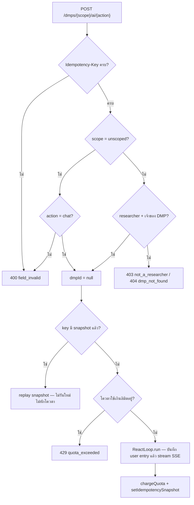
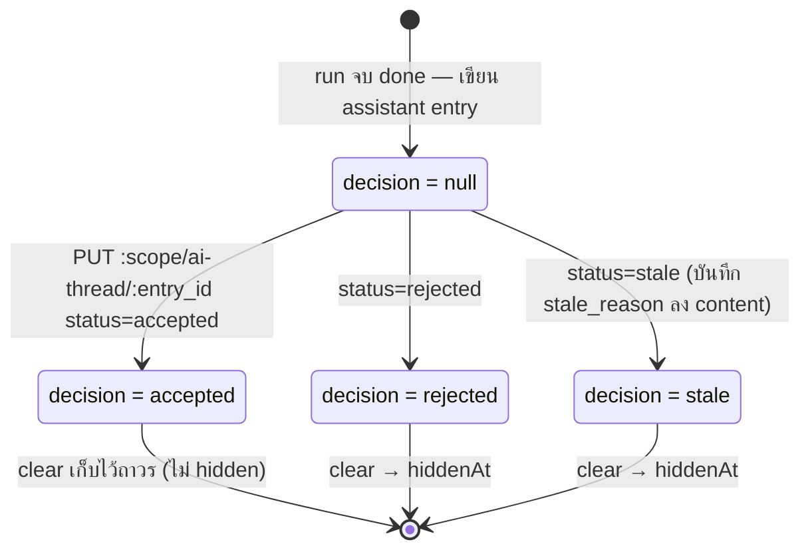

# ai

> โมดูลผู้ช่วย AI ของระบบ: รับคำสั่งร่างและแก้ไขแผน DMP ผ่าน HTTP SSE, รัน ReAct tool-calling loop กับโมเดลผ่าน OpenRouter และจัดการ thread, idempotency และโควตา token รายผู้ใช้เองทั้งหมด

## Overview

- รับผิดชอบ use case AI ทั้งหมด: `chat` / `suggest` / `regenerate-field` / `generate-tasks` / `checklist` ใต้แผน และ `analyze-proposal` สร้างแผนใหม่จากไฟล์ proposal
- รัน ReAct loop เขียนเองบน port `AiClient`: โมเดลเรียก read-only tools (อ่าน proposal / draft / domain profiles) แล้ว stream ผลลัพธ์ออกเป็น `delta` และ `proposal` (JSON)
- ดูแลสถานะประกอบ run ครบวงจร: persist thread (`ai_thread_entries`), idempotency replay (`idempotency_keys`) และโควตา token รายเดือน (`users.ai_token_*`)
- **ไม่ควรทำ / Out of scope:**
  - การ extract ข้อความ / embedding / RAG ของ proposal — เป็นหน้าที่ของ `features/files` โมดูลนี้อ่านผลผ่าน tools เท่านั้น
  - การเขียน draft จาก chat/suggest actions — โมเดลเสนอ proposal ให้ผู้ใช้ accept เท่านั้น (ยกเว้น `analyze-proposal` ที่ service เขียน draft เมื่อ run สำเร็จ)
  - การเลือก model แบบ hard-code — model ต่อ action มาจาก `config.toml [ai.models]` เท่านั้น

## Folder Structure

```text
ai/
├── ai.module.ts       # ผูก DI: เลือก AI_CLIENT เป็น OpenRouterClient หรือ MockAiClient ตาม config ai.mock
├── ai.controller.ts   # HTTP boundary บาง ๆ: set SSE headers + เขียน event เท่านั้น (3 controllers)
├── ai.service.ts      # use cases: scope/role resolve, quota gate, idempotency replay, thread persist
├── ai.tools.ts        # นิยาม tools ของ ReAct 4 ตัว (read-only) + dispatch ตามชื่อ tool
├── react-loop.ts      # ReAct loop บน AiClient port: วนเรียกโมเดล/executes tool จนถึง terminal event
└── ai.repository.ts   # plain Drizzle functions: thread entries, idempotency keys, quota
```

## Business Rules

การเข้าถึงและ scope:

- AI endpoints ใช้ได้เฉพาะ role `researcher` ที่เป็นเจ้าของแผน (`createdBy`) — ไม่ใช่ researcher → `403 not_a_researcher`, ไม่ใช่เจ้าของ → `404 dmp_not_found` เพื่อซ่อนการมีอยู่ของแผน
- scope `unscoped` (chat นอกแผน) รับได้เฉพาะ action `chat`; action อื่นใต้ unscoped → `400 field_invalid`; action นอกชุด `AI_ACTIONS` → `404 action_not_found`

Idempotency และโควตา:

- ทุก AI action (`/dmps/{scope}/ai/{action}`, `/ai/analyze-proposal`) ต้องส่ง header `Idempotency-Key` — ขาด → `400 field_invalid`
- key เดิมที่มี response snapshot แล้ว → replay event ทั้งชุดโดยไม่รันใหม่และไม่หักโควตาซ้ำ (snapshot เก็บได้ 24 ชม.); key ที่ insert แล้วแต่ยังไม่มี snapshot (run ค้าง/crash) → รับ run ใหม่ด้วย key เดิมได้
- โควตาเก็บที่ `users.ai_token_limit` / `users.ai_token_used`, reset แบบ lazy เมื่อถึงต้นเดือนถัดไป UTC; ใช้ถึงลิมิตอยู่แล้ว (เมื่อ limit > 0) → `429 quota_exceeded` พร้อม `resets_at`; limit = 0 หมายถึงไม่จำกัด
- run ที่จะทำโควตาล้นไม่ถูกปฏิเสธล่วงหน้า — ปฏิเสธเฉพาะเมื่อใช้เกินลิมิตอยู่ก่อนแล้ว; โควตาเหลือ ≤ 20% ระบบส่ง event `status` เตือนก่อน run แต่ยังให้รัน
- หักโควตาตอนจบ run ด้วยสูตร `ceil(output + uncached_input + cached_input × 10%)` และนับทุก run รวม fail และ abort (usage แนบมาใน error event ด้วย)

ReAct loop และ tools:

- loop จำกัด `MAX_TOOL_ROUNDS = 6` รอบ — เกิน → terminal error `ai_invalid_request` เพื่อกันวนไม่จบ; ทุก run จบด้วย terminal event (`done` หรือ `error`) ตัวเดียวเสมอ
- tools เป็น read-only 4 ตัว (`read_proposal`, `search_proposal`, `read_draft`, `read_domain_profiles`) — ไม่มี tool เขียน draft และไม่มี web search
- ผล tool เป็น string สำหรับ tool message เสมอ — ชื่อ tool ไม่รู้จัก, arguments ไม่ใช่ JSON หรือข้อมูลไม่พร้อม (เช่น RAG กำลัง embed) → คืนข้อความบอกทางเลือก (เช่น ใช้ `read_proposal` แทน) ให้โมเดลแก้เอง ไม่ทำ run ล้ม
- คำตอบสุดท้ายที่ parse เป็น JSON object ได้ → ออก event `proposal`; parse ไม่ได้ → จบเป็น `delta` ธรรมดา
- action `chat` ยัด history ล่าสุด 10 entries (เฉพาะ kind `user`/`assistant` — `event` และ entry ที่ hidden ไม่ถูกยัด)
- client ปิด connection กลางทาง → abort run และจบด้วย terminal error `ai_aborted` (usage ที่ใช้ไปแล้วยังถูกหักโควตา)

Thread:

- run หนึ่งเขียน thread 3 จุด: entry `user` ตอนเริ่ม, entry `assistant` (text + proposal + token_count) และ entry `event` (usage) เมื่อ `done`
- ตัดสิน proposal ได้ครั้งเดียว — entry ที่มี `decision` แล้ว → `409 proposal_settled`; ตัดสินได้เฉพาะ assistant entry ของเจ้าของ; status ต้องเป็น `accepted`/`rejected`/`stale` (`stale` บันทึก `stale_reason` ลง content)
- `clear` ซ่อน (soft delete ด้วย `hiddenAt`) user + assistant ที่ไม่ได้ `accepted` — เก็บ `event` และที่ accepted ตลอด; การ list ซ่อนรายการ hidden เสมอ
- list thread: limit 1..100 (default 50) เรียงเก่า→ใหม่โดยหน้าแรกคือใหม่สุด, ใช้ `before` เลื่อนหน้าก่อนหน้า; `POST /ai-thread/adopt` ย้าย entry unscoped (`dmp_id` null) ทั้งหมดของเจ้าของเข้าแผนปลายทาง

analyze-proposal:

- ไฟล์ต้องเป็น proposal ของ project นั้นจริง (`purpose = "proposal"`) — ไม่ใช่ → `404 file_not_found`; ไม่มีข้อความที่ extract ได้ → `422 proposal_unreadable` และไม่มีแผนถูกสร้าง
- ถ้าไม่ระบุ `dmp_id` → สร้างแผนใหม่ด้วย planMode ของโครงการ (default `institutional`); run fail → ลบแผนที่เพิ่งสร้างทิ้ง; run สำเร็จ → เขียน `draft`/`title` ใหม่ (`draftRevision = 1`) และตั้ง `projects.proposalFileId`

Model และ error:

- เลือก model ต่อ action จาก `config.toml [ai.models]` (key ตามชื่อ action, ไม่พบ → ใช้ `default`); `ai.mock = true` → `MockAiClient` ไม่ออก network (usage ปลอมคงที่แต่ยังหักโควตาตามสูตรจริง)
- error ดิบของ OpenRouter ไม่รั่วออกนอกชั้น — FE เห็นเฉพาะ code ในชุด `aiErrorCodeSchema` (เช่น `ai_auth_failed`, `ai_rate_limited`, `ai_provider_error`)

## Usage

Entry points สำหรับ client และโมดูลอื่น:

- HTTP (ต้องมี Access token — AuthGuard global, ไม่มี `@Public()`):
  - `GET /ai/quota` — ดูโควตา (`ai_quota`)
  - `POST /ai/analyze-proposal` — วิเคราะห์ proposal เป็นแผนใหม่ (SSE, ต้องมี `Idempotency-Key`)
  - `POST /dmps/{scope}/ai/{action}` — รัน action (`scope` = `dmp_id` หรือ `unscoped` เฉพาะ `chat`) (SSE, ต้องมี `Idempotency-Key`)
  - `GET /dmps/{scope}/ai-thread`, `PUT /dmps/{scope}/ai-thread/{entry_id}`, `POST /dmps/{scope}/ai-thread/clear` — จัดการ thread
  - `POST /ai-thread/adopt` — ย้าย thread unscoped เข้าแผน
- Internal: `AiModule` export `ReactLoop` และ `AiService` ให้โมดูลอื่น inject ได้; ลำดับ SSE คือ discriminated union `AiSseEvent`: `status` → (`tool`) → `delta`* → (`proposal`) → `done` | `error`

```bash
curl -N -X POST https://<host>/dmps/<dmp_id>/ai/chat \
  -H "Authorization: Bearer <access_token>" \
  -H "Idempotency-Key: <uuid>" -H "Content-Type: application/json" \
  -d '{"message":"ช่วยร่าง description ของ dataset นี้"}'
# ได้ SSE: event status/tool/delta/proposal แล้วจบด้วย done{entry_id,usage} หรือ error{code,message}
```

```ts
// โมดูลอื่นที่ inject AiService (export จาก AiModule)
const quota = await ai.quota(claims); // → { object: "ai_quota", limit, used, remaining, resets_at }
```

ข้อกำหนดก่อนใช้งาน: เมื่อ `ai.mock = false` ต้องตั้ง `OPENROUTER_KEY` ใน `.env` (ขาด → `ai_auth_failed` ทุก run) และกำหนด model ใน `config.toml [ai.models]`; แก้ config แล้วต้อง restart

## Dependencies

### Internal

- `features/auth` — `CurrentUser` decorator และ `AccessClaims` (`sub`, `role`) สำหรับตรวจ researcher/เจ้าของ
- `features/files` — `FilesService.retrieve()` (RAG ใน tool `search_proposal`), `filesRepository.findById` / `chunksOfFile` (อ่าน extracted text ของ proposal)
- `features/projects` — `ProjectsService.assertVisible` (ตรวจสิทธิ์มองเห็น project ใน analyze-proposal), `projectsRepository.findById` (`proposalFileId`) และ type `Db`
- `features/dmps` — `dmpsRepository.findById` / `create` / `projectPlanMode` (ตรวจเจ้าของ, สร้างแผนใหม่, อ่าน planMode)
- `database` — DI token `DB`, schema `aiThreadEntries` / `idempotencyKeys` / `users` / `dmps` / `projects`
- `shared/ports/ai-client` — port `AiClient` + symbol `AI_CLIENT`, `AiError`, ชนิด `AiToolDef` / `AiToolCall` / `AiMessage`
- `shared/adapters/open-router` — `OpenRouterClient` (ผูกเข้า `AI_CLIENT` ผ่าน factory ใน ai.module)
- `shared/adapters/mock-ai` — `MockAiClient` สำหรับ dev/test เมื่อ `ai.mock = true`
- `shared/config` — `config().ai.mock` และ `config().ai.models`
- `shared/contracts` — `ai.ts` (request schemas, `AiQuota`, `AiUsageReport`, `AiThreadEntry`, `aiErrorCodeSchema`) และ `envelope.ts` (`AiSseEvent` union)
- `shared/http/error-envelope` — `ApiError` และ `fieldInvalid` สำหรับ error envelope
- `shared/domain-profiles` — `domainProfiles` สำหรับ tool `read_domain_profiles`

### External packages

- `@nestjs/common` — `Controller` / `Injectable` / `Inject` decorator และ DI ทั้งโมดูล
- `drizzle-orm` — query builder (`eq`, `and`, `lt`, `isNull`, `desc`, `sql`) ใน repository และ service
- `zod` — validate request body (`chatInputSchema` ฯลฯ), `adoptSchema`, `updateEntrySchema` และ schema ของ config

### External services

- OpenRouter API (`https://openrouter.ai/api/v1`) — LLM provider ผ่าน `POST /chat/completions` (stream) ด้วย key จาก `OPENROUTER_KEY` ใน `.env` (หากล่ม/key มีปัญหา: ทุก run จบด้วย terminal error เช่น `ai_provider_error` / `ai_network_error` / `ai_auth_failed` — ไม่มี AI ตอบ แต่ REST ส่วน thread/quota ยังทำงาน)
- PostgreSQL — เก็บ `ai_thread_entries`, `idempotency_keys` และคอลัมน์โควตาใน `users` (หากล่ม: AI endpoint ใช้ไม่ได้ทั้งหมด เพราะ gate idempotency/quota และ thread ล้วน query DB)

## Diagrams

### Workflow



### Sequence


### Lifecycle



ตัดสินซ้ำไม่ได้ — ทุก transition เกิดครั้งเดียวจาก `decision = null` (ซ้ำ → `409 proposal_settled`)
