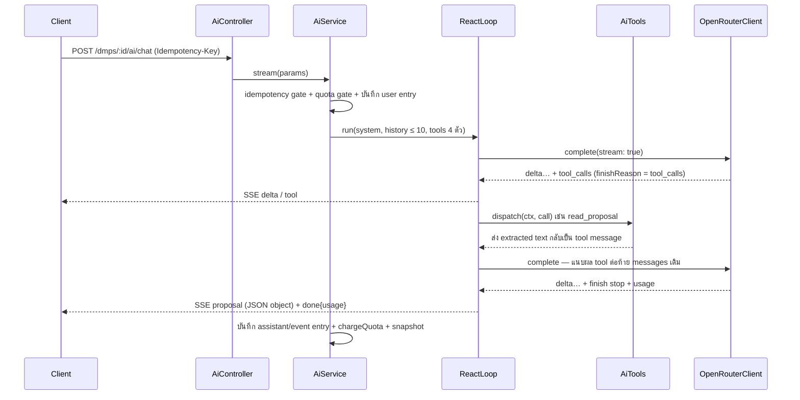

# ai

> โมดูลผู้ช่วย AI: รับคำสั่งร่างและแก้ไขแผน DMP แล้วส่งผลลัพธ์กลับเป็น stream ผ่าน HTTP SSE
> DMP ย่อจาก Data Management Plan ส่วน SSE คือ Server-Sent Events — เทคนิคที่ server ส่ง event ต่อเนื่องไปหา client ผ่าน HTTP
> ภายในรัน ReAct tool-calling loop กับโมเดลผ่าน OpenRouter และดูแล thread, idempotency และโควตา token รายผู้ใช้ครบวงจร

## Table of Contents

- [Overview](#overview)
- [Folder Structure](#folder-structure)
- [Business Rules](#business-rules)
- [Usage](#usage)
- [Dependencies](#dependencies)
- [Diagrams](#diagrams)

## Overview

- รับผิดชอบ use case AI ทั้งหมด ได้แก่ `chat` / `suggest` / `regenerate-field` / `generate-tasks` / `checklist` ใต้แผน
  ส่วน `analyze-proposal` ใช้สร้างแผนใหม่จากไฟล์ proposal
- รัน ReAct loop ที่เขียนเอง ทำงานบน port `AiClient` — port คือ interface ที่โมดูลกำหนดไว้ แล้วผูก implementation จริงเข้ามาตอน DI
  ReAct loop คือ loop ที่สลับกันระหว่างให้โมเดลคิดกับให้โมเดลเรียก tools
  โมเดลเรียกได้เฉพาะ read-only tools ที่อ่าน proposal / draft / domain profiles
  ผลลัพธ์ stream ออกมาเป็น event `delta` และ `proposal`
- ดูแลสถานะประกอบ run ครบวงจร: persist thread ลงตาราง `ai_thread_entries`, replay ด้วย idempotency ผ่านตาราง `idempotency_keys` และโควตา token รายเดือนใน `users.ai_token_*`
  idempotency คือกลไกที่ทำให้ request เดิมที่ส่งซ้ำด้วย key เดิมได้ผลลัพธ์ชุดเดิม โดยไม่รันงานซ้ำ
- **Out of scope:**
  - การ extract ข้อความ / embedding / RAG ของ proposal ไม่อยู่ในโมดูลนี้ เป็นหน้าที่ของ `features/files` โมดูลนี้อ่านผลผ่าน tools เท่านั้น
  - การเขียน draft จาก chat/suggest ไม่เกิดขึ้นในโมดูลนี้ โมเดลเพียงเสนอ proposal ให้ผู้ใช้ accept เท่านั้น ข้อยกเว้นคือ `analyze-proposal` — service เขียน draft ให้เมื่อ run สำเร็จ
  - การ hardcode โมเดลไม่มีในโมดูลนี้ model ต่อ action อ่านจาก `config.toml [ai.models]` เท่านั้น

## Folder Structure

```text
ai/
├── ai.module.ts       # wiring DI: เลือก AI_CLIENT เป็น OpenRouterClient หรือ MockAiClient ตาม config ai.mock
├── ai.controller.ts   # HTTP boundary บาง ๆ: set SSE headers + เขียน event (3 controllers)
├── ai.service.ts      # use case: scope/role resolve, quota gate, idempotency replay, thread persist
├── ai.tools.ts        # นิยาม ReAct tools 4 ตัว (read-only) + dispatch ตามชื่อ tool
├── react-loop.ts      # ReAct loop บน port AiClient: วนเรียกโมเดล/execute tool จนถึง terminal event
└── ai.repository.ts   # plain Drizzle functions: thread entries, idempotency keys, quota
```

## Business Rules

**การเข้าถึงและ scope**

- AI endpoints อนุญาตเฉพาะ role `researcher` ที่เป็นเจ้าของแผน โดยตรวจเจ้าของจาก `createdBy` ของแผน
  ไม่ใช่ researcher → 403 `not_a_researcher`
  ไม่ใช่เจ้าของ → 404 `dmp_not_found` — ตอบ 404 เพื่อซ่อนว่าแผนนี้มีอยู่จริง
- chat นอกแผนใช้ scope `unscoped` scope นี้รับได้เฉพาะ action `chat`
  ถ้าใช้ action อื่นใต้ unscoped → 400 `field_invalid`
- action ที่ไม่อยู่ในชุด `AI_ACTIONS` → 404 `action_not_found`

**Idempotency**

- ทุก AI action (`/dmps/{scope}/ai/{action}`, `/ai/analyze-proposal`) ต้องส่ง header `Idempotency-Key`
  ถ้าขาด → 400 `field_invalid`
- ระบบจับคู่ key กับ (userId, key, action) และเก็บ snapshot ของ response ได้ 24 ชม.
- key เดิมที่มี snapshot แล้ว → replay event ทั้งชุด โดยไม่รันใหม่และไม่หักโควตาซ้ำ
- key ที่ insert แล้วแต่ยังไม่มี snapshot (run ค้าง/crash) → รับ run ใหม่ด้วย key เดิมได้

**โควตา token**

- โควตาเก็บที่ `users.ai_token_limit` / `users.ai_token_used`
  reset เป็นแบบ lazy เมื่อถึงต้นเดือนถัดไป UTC — แปลว่าไม่มี cron รีเซ็ต แต่รีเซ็ตตอนมีการเรียกใช้ครั้งแรกหลังต้นเดือน
- กรณี limit > 0 ถ้าใช้ถึงลิมิตอยู่แล้ว → 429 `quota_exceeded` พร้อม `resets_at`
  limit = 0 หมายถึงไม่จำกัดโควตา
- run ที่จะทำโควตาล้นไม่ถูกปฏิเสธล่วงหน้า ปฏิเสธเฉพาะเมื่อใช้เกินลิมิตอยู่ก่อนแล้ว
- โควตาเหลือ ≤ 20% ของลิมิต ระบบส่ง event `status` เตือนก่อน run แต่ยังให้รัน
- หักโควตาตอนจบ run ด้วยสูตร `ceil(output + uncached_input + cached_input × 10%)`
  นับทุก run รวม run ที่ fail และ abort ด้วย โดย usage แนบมาใน error event เสมอ

**ReAct loop และ tools**

- loop จำกัด `MAX_TOOL_ROUNDS = 6` รอบ — เกิน → terminal error `ai_invalid_request` เพื่อกันวนไม่จบ
- ทุก run จบด้วย terminal event (`done` หรือ `error`) ตัวเดียวเสมอ
- tools เป็น read-only 4 ตัว: `read_proposal`, `search_proposal`, `read_draft`, `read_domain_profiles` — ไม่มี tool เขียน draft และไม่มี web search
- ผล tool ถูกแปลงเป็น string เพื่อส่งกลับเป็น tool message เสมอ
  กรณีชื่อ tool ไม่รู้จัก, arguments ไม่ใช่ JSON หรือข้อมูลยังไม่พร้อม เช่น RAG กำลัง embed — ระบบคืนข้อความบอกทางเลือกให้โมเดลแก้เอง แล้ว run ยังไม่ล้ม
- คำตอบสุดท้ายที่ parse เป็น JSON object ได้ → ออก event `proposal`
  parse ไม่ได้ → จบเป็น `delta` ธรรมดา
- action `chat` ยัด history ล่าสุด 10 entries เท่านั้น โดยนับเฉพาะ kind `user`/`assistant` — kind `event` และ entry ที่ hidden ไม่ถูกยัด
- client ปิด connection กลางทาง → run ถูก abort และจบด้วย terminal error `ai_aborted`
  usage ที่ใช้ไปแล้วยังถูกหักโควตาตามปกติ

**Thread**

- run หนึ่งเขียน thread 3 จุด: entry `user` ตอนเริ่ม, entry `assistant` (text + proposal + token_count) และ entry `event` (usage) เมื่อ `done`
- ตัดสิน proposal ได้ครั้งเดียวต่อ entry ถ้า entry มี `decision` อยู่แล้ว → 409 `proposal_settled`
  ตัดสินได้เฉพาะ assistant entry ของเจ้าของเท่านั้น
- status ที่ยอมรับ: `accepted` / `rejected` / `stale` — โดย `stale` บันทึก `stale_reason` ลง content
- `clear` ทำ soft delete โดยตั้ง `hiddenAt` ให้ user + assistant entry ที่ไม่ได้ `accepted`
  entry kind `event` และ entry ที่ accepted ถูกเก็บตลอด การ list จะซ่อนรายการ hidden เสมอ
- list thread คืนผลเรียงจากเก่าไปใหม่ โดยหน้าแรกคือชุดใหม่สุด
  limit default 50 และ clamp ไว้ในช่วง 1..100 ใช้ `before` เลื่อนไปหน้าก่อนหน้า
- `POST /ai-thread/adopt` ย้าย entry unscoped (`dmp_id` null) ทั้งหมดของเจ้าของเข้าแผนปลายทาง

**analyze-proposal**

- ไฟล์ต้องเป็น proposal ของ project นั้นจริง (`purpose = "proposal"`) — ไม่ใช่ → 404 `file_not_found`
- ไม่มีข้อความที่ extract ได้ → 422 `proposal_unreadable` และไม่มีแผนถูกสร้าง
- ถ้าไม่ระบุ `dmp_id` ระบบสร้างแผนใหม่ด้วย planMode ของโครงการ โดย default เป็น `institutional`
  ถ้า run fail แผนที่เพิ่งสร้างจะถูกลบทิ้ง
- run สำเร็จ → เขียน `draft` / `title` ใหม่ (`draftRevision = 1`) และตั้ง `projects.proposalFileId`

**Model และ error**

- เลือก model ต่อ action จาก `config.toml [ai.models]`
  ถ้าไม่พบ key ตามชื่อ action จะใช้ key `default` ค่าปัจจุบันทุก action เป็น `google/gemini-2.5-flash`
- ตั้ง `ai.mock = true` เพื่อใช้ `MockAiClient` ซึ่งไม่ออก network
  usage เป็นค่าปลอมคงที่ แต่ยังหักโควตาด้วยสูตรจริง
- error ดิบของ OpenRouter ไม่รั่วออกนอกชั้นนี้ ฝั่ง client เห็นเฉพาะ code ในชุด `aiErrorCodeSchema`
  ได้แก่ `ai_auth_failed`, `ai_payment_required`, `ai_rate_limited`, `ai_invalid_request`, `ai_provider_error`, `ai_network_error`, `ai_stream_error`, `ai_aborted`

## Usage

Entry points สำหรับ client และโมดูลอื่น:

- HTTP — ทุก endpoint ต้องมี Access token เพราะ AuthGuard global ไม่มี `@Public()` ให้ข้าม
  - `GET /ai/quota` — ดูโควตา (`ai_quota`)
  - `POST /ai/analyze-proposal` — วิเคราะห์ proposal เป็นแผนใหม่ (SSE, ต้องมี `Idempotency-Key`)
  - `POST /dmps/{scope}/ai/{action}` — รัน action โดย scope ใช้ `dmp_id` หรือ `unscoped` ซึ่งรับเฉพาะ chat (SSE, ต้องมี `Idempotency-Key`)
  - `GET /dmps/{scope}/ai-thread`, `PUT /dmps/{scope}/ai-thread/{entry_id}`, `POST /dmps/{scope}/ai-thread/clear` — จัดการ thread
  - `POST /ai-thread/adopt` — ย้าย thread unscoped เข้าแผน
- Internal: `AiModule` export `ReactLoop` และ `AiService` ให้โมดูลอื่น inject
- ลำดับ event ของ stream เป็น discriminated union `AiSseEvent`: `status` → (`tool`) → `delta`* → (`proposal`) → `done` | `error`

```bash
curl -N -X POST https://<host>/dmps/<dmp_id>/ai/chat \
  -H "Authorization: Bearer <access_token>" \
  -H "Idempotency-Key: <uuid>" -H "Content-Type: application/json" \
  -d '{"message":"ช่วยร่าง description ของ dataset นี้"}'
# ได้ SSE: event status/tool/delta/proposal แล้วจบด้วย done{entry_id,usage} หรือ error{code,message}
```

```ts
// โมดูลอื่นที่ inject AiService (export จาก AiModule)
const quota = await ai.quota(claims); // → { object: "ai_quota", limit, used, remaining, resets_at }
```

- ข้อกำหนดก่อนใช้งาน: เมื่อ `ai.mock = false` ต้องตั้ง `OPENROUTER_KEY` ใน `.env` และกำหนด model ใน `config.toml [ai.models]`
  - ถ้าขาด `OPENROUTER_KEY` ทุก run จะจบด้วย `ai_auth_failed`
  - แก้ config แล้วต้อง restart ก่อนจึงจะมีผล

## Dependencies

### Internal

| Module | Used in | Used for |
| --- | --- | --- |
| `features/auth` | controllers | `@CurrentUser()` และ type `AccessClaims` (`sub`, `role`) สำหรับตรวจ researcher/เจ้าของ |
| `features/files` | `ai.tools.ts`, `ai.service.ts` | `FilesService.retrieve()` (RAG ใน tool `search_proposal`), `filesRepository.findById` / `chunksOfFile` |
| `features/projects` | `ai.service.ts` | `ProjectsService.assertVisible` — ตรวจสิทธิ์มองเห็น project, `projectsRepository` (`proposalFileId`), type `Db` |
| `features/dmps` | `ai.service.ts` | `dmpsRepository.findById` / `create` / `projectPlanMode` — ตรวจเจ้าของ, สร้างแผนใหม่, อ่าน planMode |
| `database` | `ai.repository.ts` | token `DB`; schema `aiThreadEntries`, `idempotencyKeys`, `users`, `dmps`, `projects` |
| `shared/ports/ai-client` | `ai.module.ts`, `react-loop.ts` | port `AiClient` + symbol `AI_CLIENT`, `AiError`, ชนิด tool/message |
| `shared/adapters/open-router` | `ai.module.ts` | `OpenRouterClient` (ผูกเข้า `AI_CLIENT` ผ่าน factory) |
| `shared/adapters/mock-ai` | `ai.module.ts` | `MockAiClient` สำหรับ dev/test เมื่อ `ai.mock = true` |
| `shared/config` | `ai.module.ts`, adapter | `config().ai.mock` และ `config().ai.models` |
| `shared/contracts` | ทั้งโมดูล | `ai.ts` (request schemas, `AiQuota`, `AiUsageReport`, `aiErrorCodeSchema`) และ `envelope.ts` (`AiSseEvent` union) |
| `shared/http/error-envelope` | `ai.service.ts` | `ApiError` และ `fieldInvalid` สำหรับ error envelope |
| `shared/domain-profiles` | `ai.tools.ts` | `domainProfiles` สำหรับ tool `read_domain_profiles` |

### External packages

| Package | Used in | Used for |
| --- | --- | --- |
| `@nestjs/common` | controller / module / service | decorators (`Controller`, `Injectable`, `Inject`) และ DI |
| `drizzle-orm` | `ai.repository.ts` | query builder (`eq`, `and`, `lt`, `isNull`, `desc`, `sql`) |
| `zod` | `ai.service.ts` | validate request body (`chatInputSchema`, `adoptSchema`, `updateEntrySchema`) |
| `@huggingface/transformers` | `transformers-embedding.ts` — adapter ที่ RAG เรียกใช้ผ่าน files | lazy import → `pipeline("feature-extraction")` บน onnxruntime-node |

### External services

| Service | Used in | Used for | Impact |
| --- | --- | --- | --- |
| OpenRouter API | `OpenRouterClient` (`shared/adapters/open-router`) | LLM provider ผ่าน `POST https://openrouter.ai/api/v1/chat/completions` (stream) ด้วย key จาก `OPENROUTER_KEY` | ล่ม/key มีปัญหา → ทุก run จบด้วย terminal error (`ai_provider_error` / `ai_network_error` / `ai_auth_failed`) — แต่ REST ส่วน thread/quota ยังทำงาน |
| PostgreSQL | `ai.repository.ts` | เก็บ `ai_thread_entries`, `idempotency_keys` และคอลัมน์โควตาใน `users` | ล่ม → AI endpoint ใช้ไม่ได้ทั้งหมด เพราะ gate idempotency/quota และ thread ล้วน query DB |

## Diagrams

### Workflow — gate ก่อนรัน AI action

```mermaid
swimlane-beta LR
    subgraph client [Client]
        A[POST /dmps/:scope/ai/:action]
    end
    subgraph svc [ai.service]
        B{Idempotency-Key ครบ?}
        C{scope = unscoped และ action ไม่ใช่ chat?}
        D{researcher เจ้าของแผน?}
        E{key มี snapshot แล้ว?}
        F{โควตาใช้เกินลิมิตอยู่?}
        G[บันทึก user entry แล้วเริ่ม run]
    end
    subgraph loop [react-loop + tools]
        H[ReactLoop.run — วนเรียกโมเดล/tools]
    end
    subgraph repo [ai.repository]
        I[chargeQuota + setIdempotencySnapshot]
    end
    subgraph res [Response]
        R1[400 field_invalid]
        R2[403 not_a_researcher / 404 dmp_not_found]
        R3[replay snapshot — ไม่รันใหม่ ไม่หักโควตา]
        R4[429 quota_exceeded]
        R5[SSE status/tool/delta/proposal → done/error]
    end
    A --> B
    B -->|ขาด| R1
    B -->|ครบ| C
    C -->|ใช่| R1
    C -->|ไม่| D
    D -->|ไม่| R2
    D -->|ใช่| E
    E -->|ใช่| R3
    E -->|ไม่| F
    F -->|ใช่| R4
    F -->|ไม่| G
    G --> H
    H --> I
    I --> R5
```

### Sequence — ReAct run (happy path)



### Lifecycle — การตัดสิน proposal ใน thread


ตัดสินซ้ำไม่ได้ — ทุก transition เกิดครั้งเดียวจาก `decision = null` เท่านั้น
ถ้าตัดสินซ้ำ ระบบตอบ 409 `proposal_settled`

## Observations on the source

- แผนภาพ Workflow ต้นฉบับมี node `C` เขียนว่า `scope = unscoped?` แล้ว branch "ใช่" พาไปที่ `400 field_invalid` ทันที ซึ่งขัดกับกฎใน Business Rules ที่ว่า unscoped ใช้ได้กับ action `chat` เอกสารฉบับนี้จึงแก้ label เป็น `scope = unscoped และ action ไม่ใช่ chat?` เพื่อให้แผนภาพตรงกับกฎ (โครงสร้าง node/edge ไม่ได้เปลี่ยน)
- edge label เดิม `ไม่ — ต้องเป็น action ใน AI_ACTIONS` บนเส้น `C --> D` ไม่ได้อธิบายเงื่อนไขของ transition นั้น จึงย่อเป็น `ไม่` กฎ 404 `action_not_found` ยังอยู่ครบในหัวข้อ Business Rules
