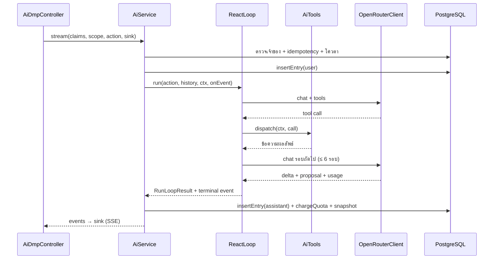

# ai

> ผูกโมเดล AI เข้ากับแผนจัดการข้อมูล (DMP): แชทและ action ต่าง ๆ ผ่าน SSE, เก็บประวัติสนทนา (thread), และวัด/จำกัดการใช้โทเค็นรายผู้ใช้รายเดือน

## Table of Contents

- [Overview](#overview)
- [Folder Structure](#folder-structure)
- [Business Rules](#business-rules)
- [Usage](#usage)
- [Dependencies](#dependencies)
- [Diagrams](#diagrams)

## Overview

- รับคำสั่ง AI จาก frontend (แชท, ร่าง/แก้ field, สร้าง task, checklist, วิเคราะห์ proposal) สตรีมผลลัพธ์กลับแบบ SSE และบันทึกประวัติลง thread
- ควบคุมโควตาโทเค็นรายเดือนต่อผู้ใช้ และรับประกันว่าส่งคำสั่งซ้ำด้วย `Idempotency-Key` เดิมจะได้ผลลัพธ์เดิมโดยไม่ถูกหักโควตาซ้ำ

**Out of scope:**
- ไม่เขียน draft ของแผนเองนอกจาก `analyze-proposal` — tools ของโมเดลอ่านอย่างเดียว (SPEC-ai)
- ไม่รับผิดชอบตัว client เรียกโมเดลจริง — อยู่ที่ `src/shared/adapters/open-router/`

## Folder Structure

```text
ai/
├── ai.module.ts       # ประกอบ module — เลือก AI client จริงหรือ mock ตาม config ai.mock
├── ai.controller.ts   # HTTP boundary เท่านั้น — จัดการ SSE headers/abort แล้วส่งต่อ service
├── ai.service.ts      # Use cases: scope/สิทธิ์, โควตา, idempotency, persist thread
├── ai.repository.ts   # Query ตรงด้วย Drizzle: thread, idempotency key, โควตา
├── react-loop.ts      # ReAct loop เขียนเอง — เรียกโมเดล + เรียก tool สูงสุด 6 รอบ ออก event ผ่าน onEvent
└── ai.tools.ts        # Tools 4 ตัวแบบอ่านอย่างเดียวที่โมเดลเรียกได้ (read_proposal, search_proposal, read_draft, read_domain_profiles)
```

## Business Rules

**การเข้าถึง**
- AI endpoint ทุกตัวใช้ได้เฉพาะ role `researcher` ที่เป็นเจ้าของแผนนั้น (ไม่ใช่เจ้าของ → 404 เพื่อซ่อนการมีอยู่ของแผน)
- `generate-tasks` และ `checklist` ต้องมีแผนสถานะ `approved` ก่อน (committee approve หรือ independent finalize) — ยังไม่อนุมัติ → 409 `plan_not_approved`; `suggest`/`regenerate-field` ใช้ได้ทุกสถานะ, `chat` อยู่ใต้ `unscoped` ได้ (SPEC-ai)

**โควตา**
- ผู้ใช้ที่ใช้โทเค็นเกินลิมิตรายเดือนอยู่แล้วจะถูกปฏิเสธด้วย 429 — run เดียวที่ทำให้ล้นยังรันได้
- โทเค็นถูกหักจริงหลังจบ run เสมอ (output + uncached input + cached input ×10%) และนับทุก run รวมกรณี fail/abort

**Idempotency**
- ทุก action ต้องมี header `Idempotency-Key` — ส่งซ้ำภายใน 24 ชม. ได้ event snapshot เดิมโดยไม่หักโควตาซ้ำ

**ความถูกต้องของข้อมูล**
- `analyze-proposal` สร้างแผนใหม่ก่อนรัน และถ้า run ล้มเหลวจะลบแผนที่เพิ่งสร้างทิ้ง — ไม่มีแผนว่างค้างจาก proposal ที่อ่านไม่ได้
- proposal ที่ extract ข้อความไม่ได้ (ไม่มี chunk) ถูกปฏิเสธด้วย 422 `proposal_unreadable` โดยไม่สร้างแผน

**Thread**
- clear ซ่อนเฉพาะข้อความ user/assistant ที่ยังไม่ถูกตัดสิน — event และ proposal ที่ accepted/rejected ถูกเก็บตลอด

## Usage

| Route | Purpose |
| --- | --- |
| `GET /ai/quota` | ดูโควตาโทเค็นคงเหลือของตัวเอง |
| `POST /ai/analyze-proposal` | วิเคราะห์ proposal แล้วร่างแผนใหม่ (SSE) |
| `POST /dmps/{scope}/ai/{action}` | เรียก action (chat/suggest/regenerate-field/generate-tasks/checklist) สตรีม SSE — generate-tasks/checklist ต้องการแผน approved |
| `GET /dmps/{scope}/ai-thread` | อ่านประวัติ thread ของ scope นั้น |
| `PUT /dmps/{scope}/ai-thread/{entry_id}` | ตัดสิน proposal (accepted/rejected/stale) |
| `POST /dmps/{scope}/ai-thread/clear` | ซ่อนประวัติที่ยังไม่ถูกตัดสิน |
| `POST /ai-thread/adopt` | ย้าย chat unscoped เข้าแผน |

Non-HTTP: export `ReactLoop` และ `AiService` จาก `AiModule` — feature อื่นเรียก use case ได้โดยตรง

ตัวอย่าง — เรียก action แบบ SSE จาก controller ของ feature นี้:

```ts
await this.ai.stream({
  claims: user,           // จาก @CurrentUser()
  scope: dmpId,           // dmp_id หรือ "unscoped" (เฉพาะ chat)
  action: "chat",
  body,                   // { message, section? }
  idempotencyKey,
  signal: abort.signal,   // client หลุด → abort
  sink,                   // เขียน AiSseEvent ออก SSE
});
```

- ทุก action ต้องแนบ header `Idempotency-Key`
- `ai.mock = true` ใน `config.toml` เพื่อไม่ยิง OpenRouter จริง (dev/test)

## Dependencies

### Internal

| Module | Used for |
| --- | --- |
| `files` | อ่าน proposal ที่ extract แล้ว และ semantic search (RAG) ผ่าน `FilesService.retrieve` |
| `dmps` | อ่าน/แก้ draft ของแผน, ตรวจเจ้าของ, สร้างแผนใน `analyze-proposal` |
| `projects` | ตรวจสิทธิ์เห็นโครงการ (`assertVisible`), ผูก proposal file กับโครงการ |
| `auth` | claims ของ session (`@CurrentUser()`, `AccessClaims`) |
| `shared/domain-profiles` | รายการ domain profile ให้ tool `read_domain_profiles` |
| `shared/ports` + `shared/adapters` | port `AI_CLIENT` และ `OpenRouterClient`/`MockAiClient` |

### External packages

| Package | Used for |
| --- | --- |
| `drizzle-orm` | query thread/idempotency/quota ลง Postgres |
| `zod` | validate body ทุก boundary |
| `@nestjs/common` | module/controller/DI |

### External services

| Service | Used for | Impact |
| --- | --- | --- |
| PostgreSQL | เก็บ thread, idempotency snapshot, โควตา | เรียก AI ทุกชนิดใช้ไม่ได้ |
| OpenRouter (ผ่าน `AI_CLIENT` port) | เรียกโมเดลสร้างข้อความ/proposal | ทุก action ล้มเหลวด้วย terminal event `error` — สลับเป็น `ai.mock = true` เพื่อเลี่ยง |

## Diagrams

### Sequence — AI action run (happy path)


