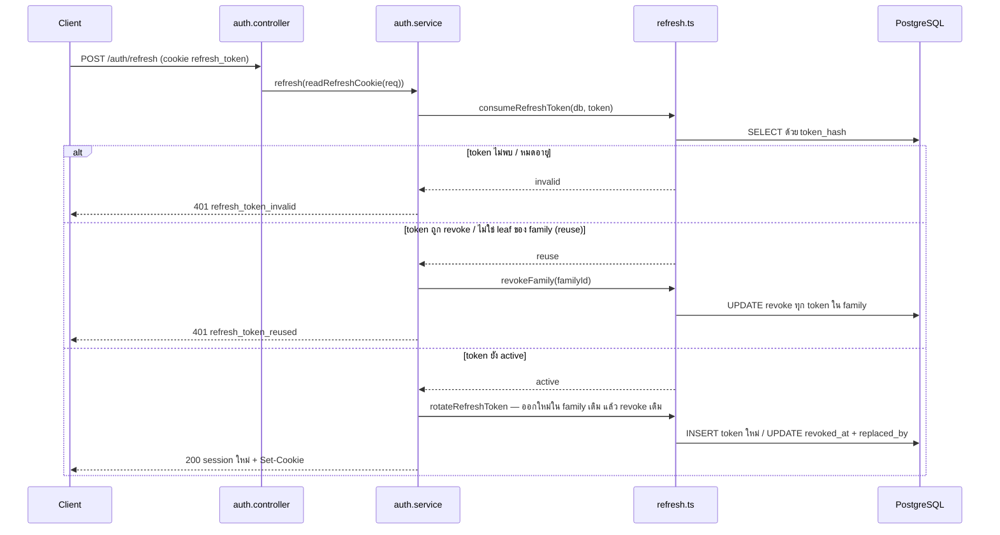
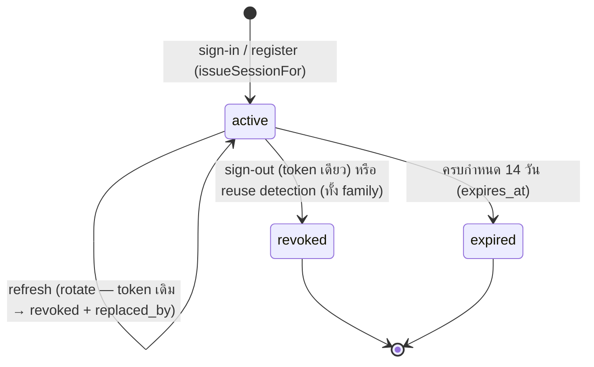

# auth

> โมดูลยืนยันตัวตนของระบบ — ตรวจ username/password แล้วออก session และครอบทุก endpoint ด้วย AuthGuard กลาง
>
> session ประกอบด้วย access token และ refresh token
> access token ใช้รูปแบบ JWT Bearer
> refresh token เป็น opaque string — สตริงสุ่มที่อ่านข้อมูลจากตัวมันเองไม่ได้
> ระบบส่ง refresh token ผ่าน HttpOnly cookie

## Table of Contents

- [Overview](#overview)
- [Folder Structure](#folder-structure)
- [Business Rules](#business-rules)
- [Usage](#usage)
- [Dependencies](#dependencies)
- [Diagrams](#diagrams)

## Overview

- ยืนยันตัวตนด้วย username/password แล้วออก session
- session ประกอบด้วย access token และ refresh token
  - access token เป็น JWT HS256 อายุ 15 นาที
  - refresh token เป็น opaque string อายุ 14 วัน — ระบบเก็บเฉพาะ hash
- รองรับ 3 operations: sign-in, refresh และ sign-out
  - การ refresh ทำ rotation — ออก token ใหม่ทุกครั้งแล้ว revoke token เก่า
  - revoke คือการทำให้ token ใช้ไม่ได้อีก
  - พร้อม reuse detection ระดับ family — จับกรณีใครนำ token ที่ revoke แล้วกลับมาใช้ซ้ำ
  - family คือกลุ่ม token ที่ rotate ต่อกันจาก sign-in เดียว ผูกด้วย `familyId`
- โมดูลลงทะเบียน AuthGuard เป็น global guard — AuthGuard ป้องกันทุก endpoint โดยดีฟอลต์ เว้นแต่เส้นทางประกาศ `@Public()`
- **Out of scope:**
  - การสมัครบัญชีและการ hash/verify รหัสผ่าน — อยู่ใน `features/users` โมดูลนี้เรียกใช้ `verifyPassword` เท่านั้น
  - การควบคุมสิทธิ์แบบละเอียด — role ปรากฏเพียงใน token claims การบังคับสิทธิ์ไม่ได้อยู่ที่โมดูลนี้

## Folder Structure

```text
auth/
├── auth.module.ts       # wiring NestJS — export AuthService และ AuthGuard (ให้ app.module ใช้เป็น APP_GUARD)
├── auth.controller.ts   # บาง: รับ cookie + body แล้วส่งต่อ service (ประกาศ @Public() ทั้ง class)
├── auth.service.ts      # orchestration: sign-in / refresh / sign-out, ตรวจ disabled account
├── session.ts           # AuthGuard (Bearer → req.auth), @Public, @CurrentUser, cookie helpers
├── jwt.ts               # access token: sign/verify JWT HS256 ด้วย jose, TTL จาก config.toml
└── refresh.ts           # refresh token: mint, SHA-256 hash, rotate, consume (reuse detection), revoke family
```

หมายเหตุ: โฟลเดอร์นี้ไม่มี `auth.repository.ts` — query ตาราง `refresh_tokens` เขียน inline ใน `auth.service.ts` และ `refresh.ts`

## Business Rules

**การ sign-in**

- ตรวจ body ด้วย manual validation ไม่ใช่ Zod
- `username` / `password` ต้องเป็น string ไม่ว่าง — ไม่ครบ → ตอบ 400 `parameter_missing`
- ระบบ normalize username ด้วย `trim` + `toLowerCase` ก่อนค้นหาทุกครั้ง
- ตอบ 401 `invalid_credentials` เป็นรหัสเดียวสำหรับทั้งกรณี "ไม่พบผู้ใช้", "รหัสผ่านไม่ถูกต้อง" และ "บัญชีถูกปิด"
- เหตุผล: ไม่เปิดเผยว่า username ใดมีอยู่จริงในระบบ
- บัญชีที่ `disabledAt` มีค่าเข้าสู่ระบบไม่ได้ แม้รหัสผ่านถูกต้อง
- การตรวจรหัสผ่านเรียก `verifyPassword` (Argon2id) จาก `features/users` — โมดูลนี้ไม่จัดการ hash เอง

**Access token**

- โมดูล sign access token เป็น JWT HS256 ด้วยไลบรารี jose
- อายุ 15 นาที ตามค่า `config.toml [auth] accessTokenTtlMinutes`
- claims คือข้อมูลที่ฝังอยู่ใน payload ของ JWT
- claims ประกอบด้วย `sub`, `username` และ `role` — โดย `sub` คือ user_id
- ผู้บริโภคอ่าน claims ผ่าน type `AccessClaims`
- การ verify เป็น stateless — ตรวจจากลายเซ็นในตัว token อย่างเดียว จึงไม่ query ฐานข้อมูล

**Refresh token**

- โมดูลสร้าง refresh token เป็น opaque random string — prefix `rt_` + สุ่ม 32 ไบต์ encode เป็น base64url
- ระบบเก็บเฉพาะ SHA-256 hash ของ token — ค่า hash มี UNIQUE constraint
- อายุ 14 วัน ตามค่า `config.toml [auth] refreshTokenTtlDays`
- ทุกการ refresh ต้อง rotate — ออก token ใหม่ใน `familyId` เดิม แล้ว revoke token เดิม
  - การ revoke ตั้งทั้ง `revokedAt` และ `replacedBy` ให้ token เดิม
- หากมีการใช้ token เดิมซ้ำ ระบบจะ revoke ทั้ง family แล้วตอบ 401 `refresh_token_reused` — ทุก session ของผู้ใช้สิ้นสุดทันที
  - กรณีใช้ซ้ำ คือ token มี `revokedAt` แล้ว หรือไม่ใช่ leaf ของ family
  - leaf คือ token ล่าสุดของ family ที่ยังไม่มี `replacedBy`
- token ไม่พบ หมดอายุ หรือ user เจ้าของถูกลบแล้ว → ตอบ 401 `refresh_token_invalid`

**AuthGuard และ cookie**

- โมดูลลงทะเบียน AuthGuard เป็น `APP_GUARD` — ทุก endpoint ต้องมี Bearer token โดยดีฟอลต์
  - ไม่ส่ง token → 401 `not_signed_in`
  - token ตรวจไม่ผ่านหรือหมดอายุ → 401 `token_expired`
  - ประกาศ `@Public()` เพื่อยกเว้นเส้นทางนั้น
- ระบบตั้ง cookie `refresh_token` ด้วย `Path=/auth; HttpOnly; SameSite=Strict` และ `Expires` เท่ากับอายุของ token
  - เพิ่ม `Secure` เมื่อ request เป็น https — เช็คจาก `req.secure` หรือ header `x-forwarded-proto`
- sign-out เป็น idempotent — เรียกซ้ำกี่ครั้งผลลัพธ์ก็เหมือนเดิม
  - ไม่มี cookie หรือ token ใช้ไม่ได้แล้ว ก็ยังตอบ 200 `{ object: "session", deleted: true }`
  - revoke เฉพาะ token ใน cookie ตัวเดียว

## Usage

เส้นทาง HTTP ทั้งหมดประกาศ `@Public()` ที่ระดับ class — ไม่ต้องมี token ก่อนเรียก:

| Route | Purpose |
| --- | --- |
| `POST /auth/sessions` | sign-in — body `{ username, password }` ได้ session object + Set-Cookie `refresh_token` |
| `POST /auth/refresh` | rotate refresh token จาก cookie → session ใหม่ |
| `DELETE /auth/sessions/current` | sign-out — revoke refresh token และล้าง cookie |

session object ที่คืน: `{ object: "session", access_token, token_type: "Bearer", expires_at, user }`

ฟิลด์ `user` ผ่านการแปลงด้วย `toUserResponse` — key เป็น snake_case และไม่มี password ติดไปด้วย

จุดเชื่อมต่อสำหรับโมดูลอื่น:

- การป้องกัน endpoint: ไม่ต้องทำอะไร — AuthGuard ครอบทุก endpoint อัตโนมัติ เส้นทางสาธารณะประกาศ `@Public()`
- ดึงข้อมูลผู้ใช้ปัจจุบันใน controller: decorator `@CurrentUser()` คืน `AccessClaims` (`sub`, `username`, `role`)
- ตรวจ token แบบ programmatic: `verifyAccessToken(token)` คืน `AccessClaims | null`
- สมัครบัญชีแล้ว sign-in ทันที: users feature เรียก `authService.issueSessionFor(user)` หลังสร้างผู้ใช้
- นับ session ที่ยัง active: เรียก `activeSessionCount(db, userId)` ได้จำนวน refresh token ที่ยังไม่ถูก revoke

```ts
// ดึงผู้กระทำจาก JWT ใน controller ของ feature อื่น
@Get("me")
me(@CurrentUser() auth: AccessClaims) {
  return auth.sub; // user_id
}
```

- Prerequisites: ต้องตั้ง `JWT_SECRET` ใน environment ก่อนรัน — ไม่มี → `main.ts` exit ตอน bootstrap
- TTL อ่านจาก `config.toml [auth]` — แก้ค่าแล้วต้อง restart
- ตาราง `refresh_tokens` ต้อง migrate เรียบร้อยก่อน

## Dependencies

### Internal

| Module | Used in | Used for |
| --- | --- | --- |
| `features/users` | `auth.service.ts` | `usersRepo.findByUsername` / `findCredential` / `toUserResponse`, type `UserRow` / `Db` และ `verifyPassword` (Argon2id) |
| `shared/http` | `auth.service.ts` | `ApiError` สำหรับ error envelope (`parameter_missing`, `invalid_credentials`, …) |
| `shared/config` | `jwt.ts`, `refresh.ts` | อ่าน TTL จาก `config.toml [auth]` |
| `database` | `auth.service.ts`, `refresh.ts` | token `DB` และ schema `users`, `credentials`, `refreshTokens` |

### External packages

| Package | Used in | Used for |
| --- | --- | --- |
| `jose` | `jwt.ts` | sign/verify JWT access token (HS256) |
| `drizzle-orm` | `auth.service.ts`, `refresh.ts` | query PostgreSQL (`eq`, `and`, `isNull`, `sql`) |
| `@nestjs/common` | controller / guard / module | decorators, `Guard` และ DI |
| `@nestjs/core` | `session.ts` | `Reflector` อ่าน metadata `@Public()` |

### External services

| Service | Used in | Used for | Impact |
| --- | --- | --- | --- |
| PostgreSQL | `auth.service.ts`, `refresh.ts` | อ่าน `users` / `credentials`, เขียน-อ่าน `refresh_tokens` | ล่ม → sign-in/refresh/sign-out ล้มเหลวทั้งหมด — แต่การ verify access token ยังทำงานเพราะเป็น stateless |

## Diagrams

### Workflow — sign-in

```mermaid
swimlane-beta LR
    subgraph client [Client]
        A[POST /auth/sessions]
    end
    subgraph svc [auth.service]
        B{username/password ครบ?}
        C{พบ user + credential หลัง normalize?}
        D{disabledAt มีค่า?}
        E{Argon2 verify ผ่าน?}
    end
    subgraph tok [jwt.ts + refresh.ts]
        F[issueRefreshToken + signAccessToken]
    end
    subgraph res [Response]
        G[400 parameter_missing]
        H[401 invalid_credentials]
        I[200 session + Set-Cookie refresh_token]
    end
    A --> B
    B -->|ไม่| G
    B -->|ครบ| C
    C -->|ไม่| H
    C -->|ใช่| D
    D -->|ใช่| H
    D -->|ไม่| E
    E -->|ไม่| H
    E -->|ผ่าน| F
    F --> I
```

### Sequence — refresh พร้อม rotation และ reuse detection



### Lifecycle — สถานะของ refresh token


