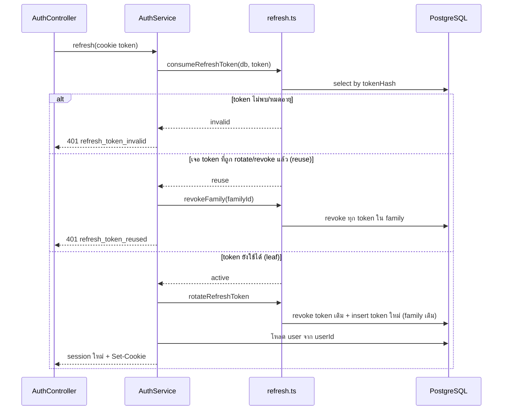
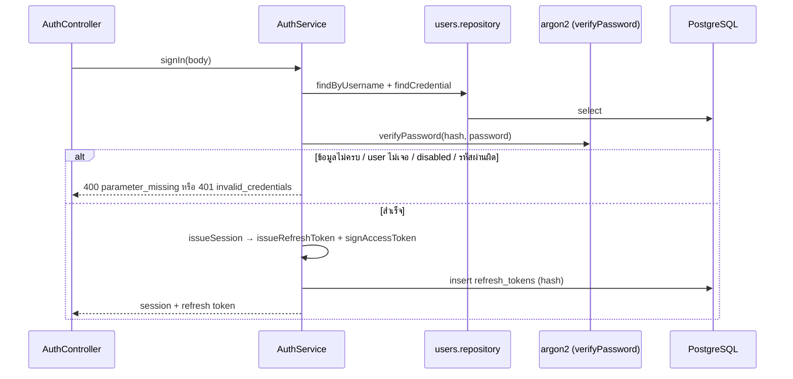

# auth

> รับผิดชอบการยืนยันตัวตนทั้งหมดของระบบ: sign-in/refresh/sign-out, การออกและตรวจ JWT access token, และ session guard ที่ครอบทุก endpoint

## Table of Contents

- [Overview](#overview)
- [Folder Structure](#folder-structure)
- [Business Rules](#business-rules)
- [Usage](#usage)
- [Dependencies](#dependencies)
- [Diagrams](#diagrams)

## Overview

- ยืนยันตัวตนผู้ใช้ (username + password) แล้วออก access token (JWT) และ refresh token เพื่อใช้เข้าใช้งานระบบ
- ให้ `AuthGuard` กับ `CurrentUser` เป็นประตูกลางตรวจสอบสิทธิ์ของทุก API
- **Out of scope:**
  - ไม่จัดการข้อมูลผู้ใช้เอง (สร้าง/แก้ user เป็นหน้าที่ของ `users`)
  - ไม่กำหนดสิทธิ์ราย endpoint (authorization แยกอยู่ที่แต่ละ service)

## Folder Structure

```text
auth/
├── auth.module.ts     # ประกาศ module, export AuthService + AuthGuard
├── auth.controller.ts # HTTP routes (บาง — ทำงานกับ cookie + body เท่านั้น)
├── auth.service.ts    # Business logic: sign-in, refresh, sign-out
├── jwt.ts             # เซ็น/ตรวจ access token (HS256)
├── refresh.ts         # Refresh token: rotation + family reuse detection
└── session.ts         # AuthGuard, @Public, @CurrentUser, refresh cookie helpers
```

## Business Rules

**การยืนยันตัวตน**
- กรณี username ไม่มีจริงและกรณีรหัสผ่านผิดต้องตอบ `invalid_credentials` เดียวกัน เพื่อไม่เปิดเผยว่า username ใดมีอยู่ในระบบ
- บัญชีที่ถูก disable (`disabledAt` ไม่ null) ต้อง sign-in ไม่ได้

**Refresh token (ADR-0016)**
- Refresh token เก็บในฐานข้อมูลเฉพาะค่า hash (SHA-256) ห้ามเก็บ token ดิบ
- ทุกครั้งที่ refresh ต้อง rotate: token เดิมถูก revoke และออก token ใหม่ใน family เดิม
- พบการใช้ token ที่ถูก rotate/revoke ไปแล้ว (reuse) ต้อง revoke ทั้ง family เพื่อตัด session ทั้งหมดของ user
- Refresh token หมดอายุหรือไม่พบในระบบต้องปฏิเสธด้วย `refresh_token_invalid` เสมอ

**Cookie และ token**
- Refresh cookie ต้องตั้ง `HttpOnly` + `SameSite=Strict` + `Path=/auth` เสมอ และเพิ่ม `Secure` เมื่อรับ request ผ่าน HTTPS
- JWT secret มาจาก `JWT_SECRET` — access token ที่เซ็นด้วย key อื่นต้องตรวจไม่ผ่าน
- ทุก endpoint ถูก AuthGuard ครอบ ยกเว้นที่ประกาศ `@Public()` อย่างชัดเจน

## Usage

| Route | Purpose |
| --- | --- |
| `POST /auth/sessions` | ล็อกอิน ได้ session + refresh cookie |
| `POST /auth/refresh` | ต่ออายุ session ด้วย refresh cookie |
| `DELETE /auth/sessions/current` | ล็อกเอาต์ และ revoke refresh token |

Entry points อื่น (non-HTTP):

- `AuthService.issueSessionFor(user)` — ออก session ทันทีหลังสมัคร (`POST /users`)
- `AuthGuard` — global guard ตรวจ Bearer JWT ทุก request
- `@Public()` — เขี่ย endpoint ออกจาก guard
- `@CurrentUser()` — ดึง claims ของผู้ใช้ (`sub`, `username`, `role`) ใน controller

ตัวอย่างการเรียกใช้ (ฝั่ง controller):

```ts
@Post("sessions")
async signIn(@Body() body: unknown, @Req() req: Request, @Res({ passthrough: true }) res: Response) {
  const { body: session, refreshToken, refreshExpiresAt } = await this.auth.signIn(body);
  setRefreshCookie(res, req, refreshToken, refreshExpiresAt);
  return session;
}
```

- ต้องตั้ง `JWT_SECRET` และ TTL ใน `config.toml` (`auth.accessTokenTtlMinutes`, `auth.refreshTokenTtlDays`) ก่อนรัน

## Dependencies

### Internal

| Module | Used for |
| --- | --- |
| `users` | ค้นหา user/credential, `verifyPassword` (argon2), `toUserResponse` |
| `database` (DatabaseModule) | เชื่อม Postgres ผ่าน `DB` token |

### External packages

| Package | Used for |
| --- | --- |
| `jose` | เซ็น/ตรวจ JWT (HS256) |
| `drizzle-orm` | query ตาราง `users`, `refresh_tokens` |
| `@nestjs/core` | `Reflector` สำหรับอ่าน metadata `@Public` |

### External services

| Service | Used for | Impact |
| --- | --- | --- |
| PostgreSQL | เก็บ user credential และ refresh token (hash, family, expiry) | ลงชื่อเข้าใช้/ต่อ session ไม่ได้ทั้งระบบ |

## Diagrams

### Sequence — Token refresh (rotation + reuse detection)



### Sequence — Sign-in


