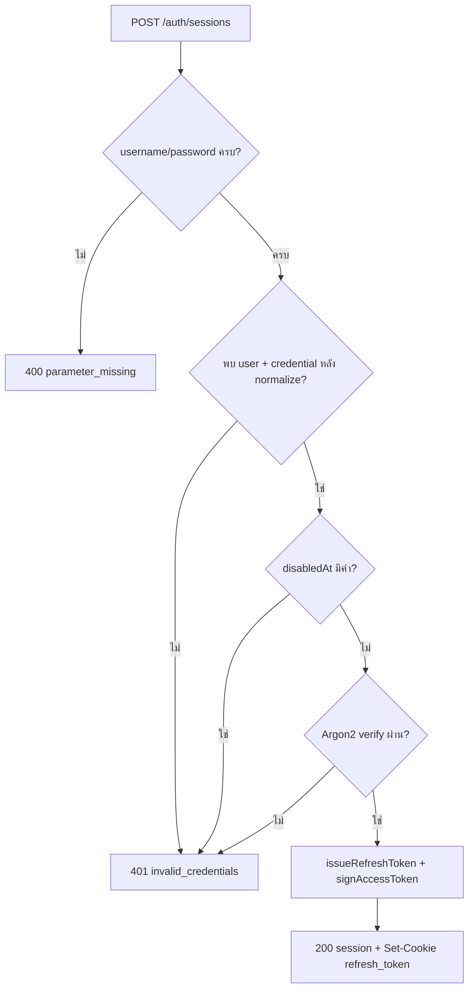
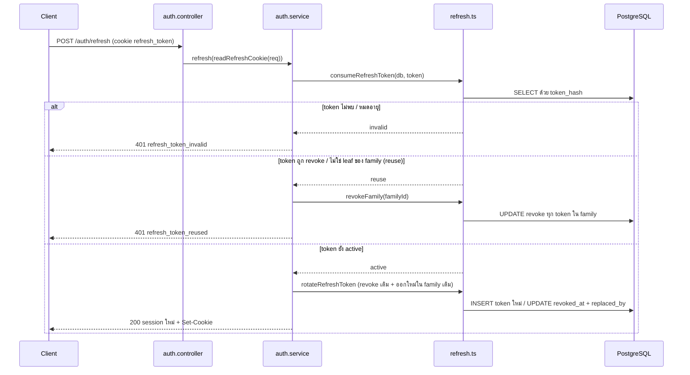
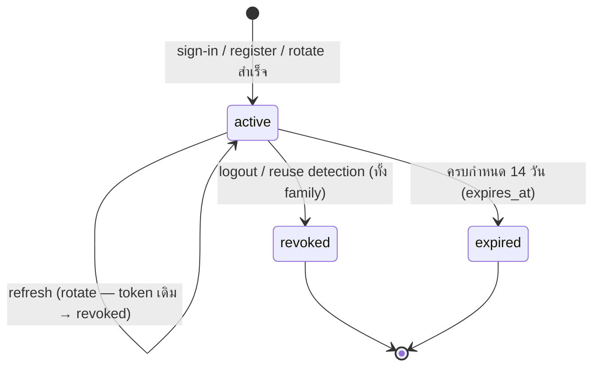

# auth

> โมดูลยืนยันตัวตนของระบบ: ออกและตรวจสอบ access token (JWT Bearer) และ refresh token (opaque, HttpOnly cookie) พร้อมครอบทุก endpoint ด้วย AuthGuard กลาง

## Overview

- ยืนยันตัวตนด้วย username/password แล้วออก session: access token (JWT HS256, 15 นาที) + refresh token (opaque, 14 วัน, เก็บเฉพาะ hash)
- รองรับ sign-in, refresh (พร้อม rotation + reuse detection ระดับ family), และ sign-out
- AuthGuard ถูกลงทะเบียนเป็น global guard — ทุก endpoint ถูกป้องกันโดยดีฟอลต์ ยกเว้นเส้นทางที่ประกาศ `@Public()`
- **ไม่ควรทำ / Out of scope:**
  - การสมัครบัญชีและการ hash/verify รหัสผ่าน — อยู่ใน `features/users` (โมดูลนี้เรียกใช้ผ่าน `verifyPassword` และ `issueSessionFor` เท่านั้น)
  - การควบคุมสิทธิ์แบบละเอียด — role ปรากฏเพียงใน token claims การบังคับสิทธิ์ไม่ได้อยู่ที่โมดูลนี้

## Folder Structure

```text
auth/
├── auth.controller.ts   # บาง: รับ cookie + body แล้วส่งต่อ service (POST /auth/sessions, /auth/refresh, DELETE /auth/sessions/current)
├── auth.service.ts      # orchestration: sign-in / refresh / sign-out, ตรวจ disabled account
├── jwt.ts               # access token: sign/verify JWT HS256 (jose), TTL จาก config.toml
├── refresh.ts           # refresh token: mint, SHA-256 hash, rotate, consume (reuse detection), revoke family
├── session.ts           # AuthGuard (Bearer → req.auth), @Public, @CurrentUser, cookie helpers
└── auth.module.ts       # NestJS wiring — exports AuthService, AuthGuard
```

## Business Rules

- ตอบ `401 invalid_credentials` รหัสเดียวสำหรับทั้งกรณี "ไม่พบผู้ใช้" และ "รหัสผ่านไม่ถูกต้อง" เพื่อไม่เปิดเผยว่า username มีอยู่จริง
- บัญชีที่ `disabledAt` มีค่า (ถูกปิดใช้งาน) เข้าสู่ระบบไม่ได้ แม้รหัสผ่านถูกต้อง
- username ถูก normalize (`trim` + `toLowerCase`) ก่อนค้นหาทุกครั้ง
- AuthGuard ลงทะเบียนเป็น `APP_GUARD` — ทุก endpoint ต้องมี Bearer token โดยดีฟอลต์: ไม่ส่ง token → `401 not_signed_in`, token ตรวจไม่ผ่าน (หมดอายุ/แก้ไข) → `401 token_expired`; ประกาศ `@Public()` เพื่อยกเว้น
- Access token: JWT HS256 (ไลบรารี jose) อายุ 15 นาที ตาม `[auth].accessTokenTtlMinutes` claims ประกอบด้วย `sub` (user_id), `username`, `role`
- Refresh token: opaque random (`rt_` + 32 ไบต์ base64url) ระบบเก็บเฉพาะ SHA-256 hash (มี UNIQUE constraint) อายุ 14 วัน ตาม `[auth].refreshTokenTtlDays`
- ทุกการ refresh ต้อง rotate: revoke token เดิม (ตั้ง `revokedAt` + `replacedBy`) แล้วออก token ใหม่ใน family เดิม
- ตรวจพบการใช้ token เดิมซ้ำ (`revokedAt` มีค่า หรือไม่ใช่ leaf ของ family) ระบบจะ revoke ทั้ง family — ทุก session ของผู้ใช้สิ้นสุดทันที
- ก่อน rotate จะตรวจว่า user เจ้าของ token ยังอยู่จริง — user ถูกลบแล้ว → `401 refresh_token_invalid`
- Cookie `refresh_token` ตั้งด้วย `Path=/auth; HttpOnly; SameSite=Strict` และ `Expires` เท่ากับอายุ token; เพิ่ม `Secure` เมื่อ `req.secure` หรือ header `x-forwarded-proto` เป็น `https`
- การตรวจรหัสผ่านใช้ Argon2id ตามค่า OWASP minimum ใน config (19,456 KiB / timeCost 2 / parallelism 1) — ฟังก์ชัน hash/verify อยู่ใน users feature ไม่ใช่โมดูลนี้
- sign-out เป็น idempotent: ไม่มี cookie หรือ token ใช้ไม่ได้แล้ว ก็ยังตอบ `{ object: "session", deleted: true }`

## Usage

เส้นทาง HTTP (ประกาศ `@Public()` ที่ระดับ class ของ `AuthController` — ไม่ต้องมี token ก่อนเรียก):

| Route | คำอธิบาย |
| --- | --- |
| `POST /auth/sessions` | sign-in — body `{ username, password }` ได้ session object + Set-Cookie `refresh_token` |
| `POST /auth/refresh` | rotate refresh token จาก cookie → session ใหม่ |
| `DELETE /auth/sessions/current` | sign-out — revoke refresh token และล้าง cookie |

session object ที่คืน: `{ object: "session", access_token, token_type: "Bearer", expires_at, user }` (user ผ่าน `toUserResponse` — snake_case ไม่มี password)

จุดเชื่อมต่อสำหรับโมดูลอื่น:

- การป้องกัน endpoint: ไม่ต้องทำอะไร — AuthGuard ถูกลงทะเบียนเป็น `APP_GUARD` กลาง และครอบทุก endpoint โดยอัตโนมัติ หากเป็นเส้นทางสาธารณะให้ประกาศ `@Public()`
- ดึงข้อมูลผู้ใช้ปัจจุบันใน controller: ใช้ decorator `@CurrentUser()` ซึ่งคืน `AccessClaims` (`sub`, `username`, `role`)
- ตรวจ token แบบ programmatic: `verifyAccessToken(token)` คืน `AccessClaims | null`
- สมัครบัญชีแล้ว sign-in ทันที: users feature เรียก `authService.issueSessionFor(user)` หลังสร้างผู้ใช้ (POST /users)
- นับ session ที่ยัง active: `activeSessionCount(db, userId)` — จำนวน refresh token ที่ยังไม่ถูก revoke

```ts
// ดึงผู้กระทำจาก JWT ใน controller ของ feature อื่น
@Get("me")
me(@CurrentUser() auth: AccessClaims) {
  return auth.sub; // user_id
}
```

- Prerequisite: ต้องตั้งค่า `JWT_SECRET` ใน environment ก่อนรัน; TTL อ่านจาก `config.toml` section `[auth]` (โหลดครั้งเดียวตอน bootstrap แก้แล้วต้อง restart); ตาราง `refresh_tokens` ต้องถูก migrate แล้ว

## Dependencies

### Internal

- `src/features/users` — `usersRepo` (findByUsername, findCredential, toUserResponse) type `UserRow`/`Db` และ `verifyPassword` (Argon2id จาก `argon2.ts`)
- `src/shared/http` — `ApiError` สำหรับ error envelope (`parameter_missing`, `invalid_credentials`, …)
- `src/shared/config` — `config()` อ่าน TTL และ argon2 params จาก `config.toml`
- `src/database` — `DatabaseModule` (DB connection token `DB`) และ schema (`users`, `refreshTokens`)
- ผู้บริโภค: `src/app.module.ts` ลงทะเบียน AuthGuard เป็น `APP_GUARD`; `src/features/users` import `AuthModule` เพื่อเรียก `issueSessionFor` และใช้ `Public`, `setRefreshCookie`

### External packages

- `jose` — sign/verify JWT access token (HS256)
- `@nestjs/common` — Controller, Guard, decorator และ `HttpException` ของ NestJS
- `@nestjs/core` — `Reflector` อ่าน metadata `@Public()`
- `drizzle-orm` — query PostgreSQL (`eq`, `and`, `isNull`, `sql`)
- (`argon2` ใช้ผ่าน users feature; `express` ผ่าน `@nestjs/platform-express`; `node:crypto` เป็น builtin)

### External services

- PostgreSQL — ตาราง `users` (อ่าน), `credentials` (อ่าน), `refresh_tokens` (อ่าน/เขียน) (หากล่ม: sign-in/refresh/sign-out ล้มเหลวทั้งหมด — แต่การ verify access token ยังทำงานเพราะเป็น stateless)
- ไม่มี cache ภายนอก (Redis ฯลฯ) — สถานะ session ทั้งหมดอยู่ใน PostgreSQL เท่านั้น

## Diagrams

### Workflow



### Sequence



### Lifecycle


