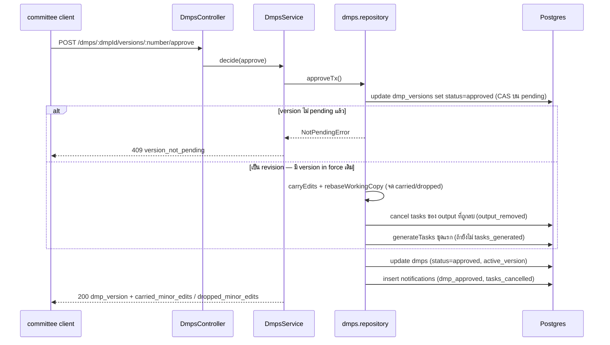
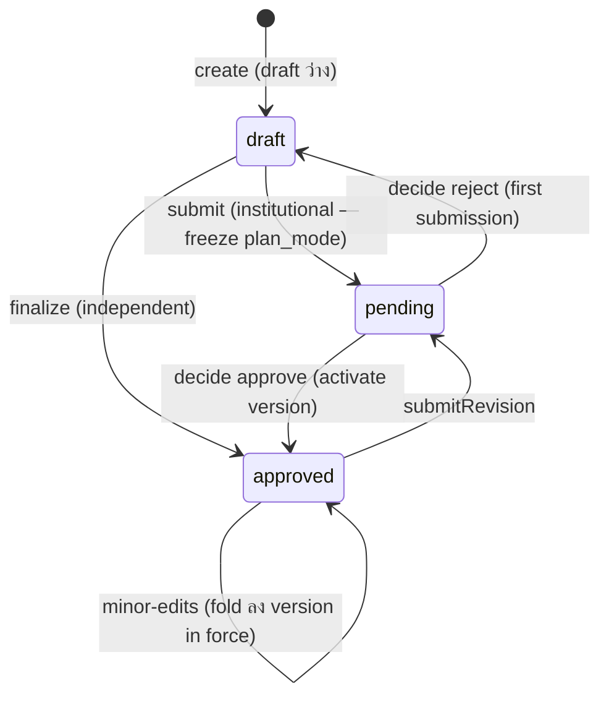

# dmps

> โมดูลนี้ดูแล lifecycle ทั้งหมดของแผนข้อมูล (DMP) ทำงานกับ autosave draft แบบ CAS, versioning แบบ major/minor และขั้นตอน submit → ตัดสิน → มีผล ครอบคลุมทั้งสาย institutional และ independent

## Table of Contents

- [Overview](#overview)
- [Folder Structure](#folder-structure)
- [Business Rules](#business-rules)
- [Usage](#usage)
- [Dependencies](#dependencies)
- [Diagrams](#diagrams)

## Overview

- โมดูลนี้รับผิดชอบ lifecycle ของแผนตั้งแต่สร้าง → แก้ draft → ส่ง → ตัดสิน → มีผลใช้
- เป็น owner ตาราง `dmps` และ `dmp_versions` เพียงโมดูลเดียว
- autosave บันทึก working copy ทั้งก้อน (ADR-0020) กันแก้ทับกันด้วย `draft_revision` — กลไกนี้เรียกว่า optimistic concurrency ถ้าแก้ทับกัน ระบบคืน 409 พร้อมร่างล่าสุดให้ rebase
- ทุกการส่งเก็บ `snapshot` + `changes` จาก `diffDraft` แล้วจำแนก major/minor ด้วย `classify` field major ตัวเดียวทำให้ทั้ง version เป็น major
- แผนมีผลได้สองเส้นทาง สาย institutional → `submit` แล้วรอ committee/chief ตัดสิน สาย independent → author `finalize` เองทันที
- **Out of scope:**
  - การรันงาน/ตรวจ evidence ของแผน — เป็นหน้าที่ของ `features/tasks`
  - การ push การแจ้งเตือนถึงผู้ใช้ — โมดูลนี้เขียนเพียงแถวในตาราง `notifications` เท่านั้น
  - การตัดสินสิทธิ์เข้าถึง project — ขอคำตัดสินจาก `features/projects` (`assertVisible`)

## Folder Structure

```text
dmps/
├── dmps.controller.ts   # HTTP boundary — ผูก 14 routes ของ /dmps ให้ service
├── dmps.service.ts      # use case: ตรวจสิทธิ์/visibility, validate, CAS, locked fields, แต่ง response
├── dmps.repository.ts   # Drizzle query + transaction ต่อ flow (submitTx, approveTx, …)
└── dmps.module.ts       # NestJS module — import ProjectsModule, export DmpsService
```

## Business Rules

**สิทธิ์และการมองเห็น**

- สร้างแผนได้เฉพาะ role `researcher` role อื่นได้ 403 `not_a_researcher`
- ถ้าระบุ `project_id` โครงการนั้นต้องเป็นโครงการที่ผู้เรียกเห็น เช็คด้วย `assertVisible` ถ้าไม่ผ่าน ระบบตอบ 404 เพื่อซ่อนการมีอยู่ของโครงการ
- `plan_mode` ยึดตามโครงการจนกว่า submit แรกจะ freeze ค่าไว้
- `admin` ไม่มีสิทธิ์เข้าถึงแผนใด ๆ ทั้ง list, get และตัดสิน พยายามเข้าถึงได้ 403 `permission_denied` เสมอ
- Researcher เห็น/แก้ได้เฉพาะแผนที่ตนเป็น author แผนของผู้อื่นตอบ 404 `dmp_not_found` ไม่ตอบ 403
- Committee/chief ใช้ได้เฉพาะแผน institutional แผน independent → 403 `plan_not_reviewable`
- list ของ committee/chief ต้องระบุ `project_id` ถ้าไม่ระบุ → 400 `project_id_required` โครงการที่ไม่ใช่ institutional คืนลิสต์ว่าง
- `include=draft` ใส่ `draft` + `draft_revision` ใน response ใช้ได้เฉพาะ author ของแผน committee ขอก็ไม่ได้

**การบันทึก draft แบบ CAS (ADR-0020)**

- การบันทึก (PUT) ต้องส่ง draft ทั้งก้อนพร้อม `draft_revision`
- repository update ด้วยเงื่อนไข `draft_revision = expected` ถ้าค่าไม่ตรง → 409 `draft_conflict` พร้อม `draft` และ `draft_revision` ล่าสุดให้ rebase ถ้าสำเร็จ revision ก้าว +1
- ทุก flow ของ author ที่แตะ draft ต้องส่ง `draft_revision` ให้ตรงค่าปัจจุบัน ครอบคลุม saveDraft, discard, restore, submit, finalize, minor-edits, revisions ไม่ตรง → 409 `draft_conflict`
- Locked fields: `schema_version` ห้ามเปลี่ยนทุกสถานะ `begin_date`/`end_date` ห้ามเปลี่ยนเมื่อแผนเป็น `approved` พยายามเปลี่ยน → 400 `field_locked` ที่ `/draft/<field>`

**พารามิเตอร์ query ของ list**

| พารามิเตอร์ | ค่าที่ยอมรับ | default |
| --- | --- | --- |
| `limit` | integer ≥ 1 cap ที่ 100 — ค่าไม่ถูกต้องใช้ default | 50 |
| `sort` | `updated`, `title`, `status` | `updated` |
| `status` | `draft`, `pending`, `approved` — ค่าอื่น → 400 `field_invalid` | — |
| `q` | ค้น `title` และ `draft.description` แบบ ilike | — |
| `archived` | `true` มีผลเฉพาะ researcher — ทุกกรณีอื่น query เฉพาะแผนยังไม่ archive (`archived_at is null`) | — |
| `include` | `draft`, `versions`, `readiness` (comma-separated ได้) | — |

- query ดึง `limit + 1` แถวเพื่อตั้ง `has_more` (ADR-0015)

**การส่งและการตัดสิน**

- `submit` ใช้ได้เฉพาะครั้งแรก ถ้ามี version แล้ว → 409 `already_submitted`
- แผน independent ห้าม submit → 409 `plan_is_independent` ให้ใช้ finalize แทน
- `submit` และ `finalize` ต้องผ่าน `validateDraft` ครบทุกข้อ ไม่ผ่าน → 422 `plan_incomplete` พร้อม `items` (label กับ section เป็น JSON pointer)
- ตัวอย่างข้อผิดพลาดของ 422: วันย้อนหลัง, contact มากกว่า 1 คน, dataset น้อยกว่า 1, open access ไม่มี license
- `submit` สร้าง version แรกสถานะ `pending` (`edit_type: "major"`) และ freeze `plan_mode = "institutional"`
- หลัง submit แผนเปลี่ยนเป็น `pending` ระบบแจ้ง author (`dmp_submitted`) และ committee/chief ทุกคน (`review_requested`)
- การส่งพร้อมกันถูกบังคับที่ Postgres เอง ด้วย partial unique index `dmp_versions_one_pending_uq` (pending ได้หนึ่งต่อแผน) และ unique (`dmp_id`, `number`)
- ชนกันได้ Postgres error code 23505 ซึ่งระบบแปลงเป็น 409 (`already_submitted` หรือ `revision_pending`)
- `finalize` ใช้ได้เฉพาะ independent (institutional → 409 `plan_is_institutional`)
- `finalize` ทำให้ version ออกผลทันที สถานะ `approved` โดย author เป็น approver ของตัวเอง
- `finalize` สร้าง tasks ชุดแรกจาก `generateTasks` (output `access: "closed"` ไม่ได้ task หมวด `share`) และแจ้ง `dmp_finalized` — ทั้งหมดใน transaction เดียว
- approve/reject ใช้ได้เฉพาะ committee/chief บนแผน institutional body ต้องมี `position` reject ต้องมี `note` (400 `note_required`)
- ตัดสินซ้ำบน version ที่ไม่ใช่ `pending` → 409 `version_not_pending` การตัดสินใช้ CAS บนสถานะ pending ภายใน transaction
- approve: activate version (set `active_version`, แผนเป็น `approved`)
- ถ้า version ที่ approve เป็น revision ระบบจะ carry minor fixes ตาม entity id ด้วย `carryEdits` ตามมาได้ จด `carried_minor_edits` entity ถูกลบไป จด `dropped_minor_edits` แล้ว rebase working copy ของ author ด้วย `rebaseWorkingCopy`
- approve revision: tasks ของ output ที่ revision ลบออก (สถานะ `todo`/`in_progress`) กลายเป็น `cancelled` พร้อม `cancel_reason: "output_removed"` และแจ้ง `tasks_cancelled` พร้อมชื่องาน
- tasks ชุดแรกสร้างเมื่อ approve ครั้งแรกเท่านั้น guard `tasks_generated` กันสร้างซ้ำ
- reject: การส่งครั้งแรกแผนกลับสู่สถานะ `draft` revision ที่ถูกปฏิเสธ version in force คงเดิมและแผนยัง `approved` (ADR-0021)
- ทุกกรณี reject ระบบแจ้ง author `dmp_returned` พร้อม note

**revision และ minor-edits**

- `revision`: แผนต้องเป็น institutional มี version in force และไม่มี pending อื่นรออยู่ (409 `revision_pending`)
- `revision`: ต้องแก้จริงเทียบกับ snapshot ของ in force ถ้าไม่มีอะไรแก้ → 409 `no_new_edits`
- `revision`: ระบบจด `changes` และ `based_on_snapshot` ก่อนส่ง พร้อม reset `restored_from`
- `minor-edits`: ต้องมี version in force ถ้าไม่มี → 409 `plan_not_in_force`
- `minor-edits`: เทียบแล้วไม่มีอะไรเปลี่ยน → 409 `no_new_edits`
- `minor-edits`: มี field major ปนและไม่มี pending → 409 `edits_include_major` ต้องยิง revision แทน
- ระหว่างมี version `pending`: minor-edits fold เฉพาะ field minor ลง snapshot ของ version in force ทันที pending ไม่ถูกแตะ และการแก้ถูกจดต่อท้ายรายการ `minor_edits` ของ in force

**ความ major/minor ของการแก้**

- ความ major/minor ตัดสินจาก field-policy (`isMajorTrigger`) ตอนสร้าง `FieldChange` diff ไม่มีเกณฑ์ของตัวเอง
- field major ระดับ dmp: `begin_date`, `end_date`, `ethical_issues_exist`, `indigenous_considerations`
- field major ระดับ dataset: `access`, `personal_data`, `personal_data_plan`, `protection_level`, `security_classification_level`, `preservation.repository`, `preservation.duration`, `distribution.license`
- ระดับ lists: `dataset` และ `contributor` เป็น major — `cost` เป็น minor
- `schema_version` ถูกตัดออกจาก diff keys
- diff จับคู่ entity ด้วย id เสมอ ไม่ใช่ตำแหน่ง array จึงไม่นับการจัดเรียงใหม่เป็นการแก้

**ความคงทน (archive / discard / restore)**

- archive/unarchive เปลี่ยนเพียง `archived_at` ระบบไม่มีทางลบแผน (preservation)
- แผนที่มี version in force ห้าม archive (409 `plan_in_force`)
- discard: แผนที่ไม่เคยมี version → 409 `never_submitted` (ให้ archive แทน)
- discard: draft กลับไป snapshot ลำดับดังนี้ — version `pending` ก่อน ถ้าไม่มีใช้ snapshot ของ version in force ถ้ายังไม่มีใช้ snapshot ของเวอร์ชันล่าสุด
- restore: ต้องระบุ `number` ที่มีจริง (ไม่มี → 404 `version_not_found`) version สถานะ `pending` ห้าม restore (409 `version_pending`)
- restore version in force ถือเป็นการทิ้ง edit ที่ยังไม่จด
- restore version อื่นจะจด `restored_from` แล้วให้ minor-edits ถัดไปแนบ label นี้ลง `minor_edits` ก่อนเคลียร์ค่าทิ้ง

**รูปแบบ response**

- response เป็น `object: "dmp"` พร้อม `review_snapshot` เลือกตามลำดับ: snapshot ของ version `pending` → ถ้าไม่มีใช้ของ in force → ถ้ายังไม่มีใช้ draft
- `include=readiness` คือผล `validateDraft` บน snapshot นั้น (`complete` + `unmet_items`)
- version response คืน `carried_minor_edits` / `dropped_minor_edits` เสมอ การแก้ที่ตกไปอ่านย้อนหลังได้ ไม่หายเงียบ

## Usage

Entry points ทั้งหมดเป็น HTTP ภายใต้ `/dmps` ผูกที่ `DmpsController` ต้อง sign-in ทุกเส้น (AuthGuard เป็น global guard):

| Route | Purpose |
| --- | --- |
| `POST /dmps` | สร้างแผน (researcher) — body `{ project_id?: uuid }` |
| `GET /dmps` | list ตาม `project_id`, `archived`, `status`, `q`, `sort`, `limit`, `include` |
| `GET /dmps/:dmpId` | อ่านแผน — `include=versions,readiness` รองรับ comma-separated |
| `PUT /dmps/:dmpId/draft` | autosave draft ทั้งก้อน (CAS บน `draft_revision`) |
| `POST /dmps/:dmpId/draft/discard` | ทิ้ง edit ที่ยังไม่จด กลับไป snapshot ที่เคยส่ง |
| `POST /dmps/:dmpId/draft/restore` | โหลด snapshot ของ version ที่ระบุขึ้นเป็น working draft |
| `POST /dmps/:dmpId/archive` | archive — ห้ามเมื่อแผนมี version in force |
| `POST /dmps/:dmpId/unarchive` | นำกลับจาก archive |
| `POST /dmps/:dmpId/submit` | ส่งครั้งแรก (institutional) |
| `POST /dmps/:dmpId/finalize` | ออกผลทันที (independent) |
| `POST /dmps/:dmpId/versions/:number/approve` | อนุมัติ version (committee/chief) |
| `POST /dmps/:dmpId/versions/:number/reject` | ส่งกลับ version (committee/chief — ต้องมี note) |
| `POST /dmps/:dmpId/minor-edits` | fold การแก้ minor ลง version in force |
| `POST /dmps/:dmpId/revisions` | ส่ง version ถัดไป (major/minor) |

- Internal: `DmpsService` ถูก export จาก `DmpsModule` สำหรับ cross-feature (เช่น ai ที่สร้าง/อ่านแผนใหม่)

```ts
// autosave ทั้งก้อน — ส่ง draft_revision ที่อ่านล่าสุดเสมอ (ADR-0020)
const res = await fetch(`/dmps/${dmpId}/draft`, {
  method: "PUT",
  body: JSON.stringify({ draft_revision: 7, draft: { title: "Soil dataset plan" } }),
});
// 409 draft_conflict → error.draft + error.draft_revision คือร่างล่าสุด นำไป rebase แล้วยิงซ้ำ
```

- ต้องมี PostgreSQL พร้อม migration ของตาราง `dmps`, `dmp_versions` ก่อนใช้งาน (เชื่อมผ่าน `DATABASE_URL`)

## Dependencies

### Internal

| Module | Used in | Used for |
| --- | --- | --- |
| `features/auth` | controller / service | type `AccessClaims` (`sub`, `username`, `role`) และ decorator `@CurrentUser()` |
| `features/projects` | `dmps.service.ts` | `ProjectsService.assertVisible()` ตรวจโครงการก่อนผูกแผน และอ่าน `projects.plan_mode` ก่อน freeze |
| `shared/domain-engine` | service / repository | `validateDraft` (checklist 422), `diffDraft`, `classify`, `foldMinor`, `carryEdits` / `rebaseWorkingCopy` (QS-2), `generateTasks` (tasks ชุดแรก) — pure functions ทั้งหมด |
| `shared/contracts` | `dmps.service.ts` | `dmpDraftSchema` / `DmpDraftInput`, `MADMP_SCHEMA_VERSION` (default ของ field ล็อก), `listOf` / `ListEnvelope` |
| `shared/http` | `dmps.service.ts` | `ApiError` / `fieldInvalid` รวมถึง `extra` ของ 409 `draft_conflict` |
| `database` | `dmps.repository.ts` | token `DB`; schema `dmps`, `dmp_versions`, `users`, `projects`, `tasks`, `notifications` |

### External packages

| Package | Used in | Used for |
| --- | --- | --- |
| `@nestjs/common` | controller / service / module | decorators (`Controller`, `Injectable`, `Body`, `Query`, `Param`) และ DI |
| `drizzle-orm` | `dmps.repository.ts` | query builder, transaction และ type `NodePgDatabase` |
| `zod` | `dmps.service.ts` | validate body/query (`createDmpSchema`, `dmpDraftSchema`, เงื่อนไข `draft_revision`) |

### External services

| Service | Used in | Used for | Impact |
| --- | --- | --- | --- |
| PostgreSQL | `dmps.repository.ts` | เก็บตาราง `dmps`, `dmp_versions`, `tasks`, `notifications` (`DATABASE_URL`) | ล่ม → อ่าน-บันทึกแผน ตัดสิน สร้าง tasks ไม่ได้ทั้งหมด และกลไก CAS/unique constraint ที่ใช้กัน race ใช้งานไม่ได้ด้วย |

## Diagrams

### Workflow — บันทึก draft พร้อม CAS

```mermaid
swimlane-beta LR
    subgraph client [Client]
        A[PUT /dmps/:dmpId/draft]
    end
    subgraph svc [dmps.service]
        B{researcher เจ้าของแผน?}
        C{draft + draft_revision ผ่าน dmpDraftSchema?}
        D{input แก้ locked field ต่างจากค่าเดิม?}
    end
    subgraph repo [dmps.repository]
        E{CAS: dmps.draft_revision ตรง expected?}
        F[บันทึก draft — draft_revision +1]
    end
    subgraph res [Response]
        G[404 dmp_not_found]
        H[400 field_invalid]
        I[400 field_locked]
        J[409 draft_conflict พร้อม draft ล่าสุดให้ rebase]
        K[200 dmp_draft]
    end
    A --> B
    B -->|ไม่| G
    B -->|ใช่| C
    C -->|ไม่| H
    C -->|ผ่าน| D
    D -->|ใช่| I
    D -->|ไม่| E
    E -->|ไม่ตรง| J
    E -->|ตรง| F
    F --> K
```

### Sequence — approve revision (institutional)



### Lifecycle — สถานะของแผน



หมายเหตุ: `archived_at` เป็น flag ข้างสถานะ (archive ได้เฉพาะเมื่อยังไม่มี version in force) ไม่ใช่สถานะใน state machine แผนหนึ่งมี version `pending` ได้ครั้งละหนึ่ง บังคับด้วย partial unique index ที่ Postgres
