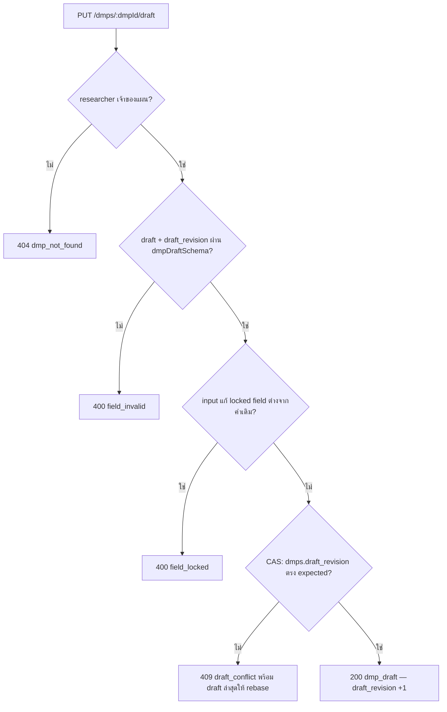
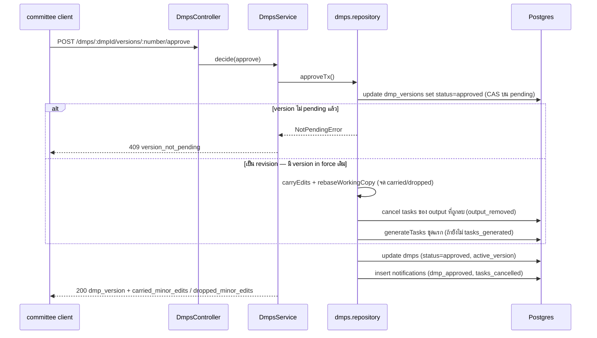
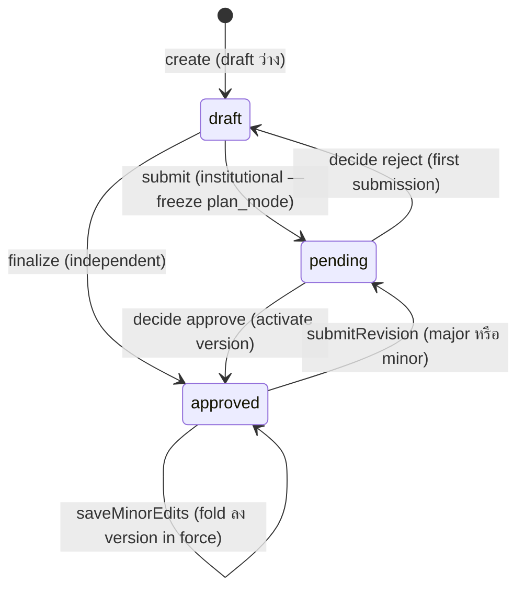

# dmps

> แกน lifecycle ของแผนข้อมูล (DMP): autosave draft แบบ CAS, versioning แบบ major/minor และขั้นตอน submit → ตัดสิน → มีผล ทั้งสาย institutional และ independent

## Overview

- รับผิดชอบ lifecycle ของแผนตั้งแต่สร้าง → แก้ draft → ส่ง → ตัดสิน → มีผลใช้ เป็น owner ตาราง `dmps` และ `dmp_versions` เพียงโมดูลเดียว
- autosave แบบ working copy ทั้งก้อน (ADR-0020) ด้วย `draft_revision` optimistic concurrency — แก้ทับกันแล้วคืน 409 พร้อมร่างล่าสุดให้ rebase
- versioning ทุกการส่ง: เก็บ `snapshot` + `changes` จาก `diffDraft` และจำแนก major/minor ด้วย `classify` — field major ตัวเดียวทำให้ทั้ง version เป็น major
- สองเส้นทางให้แผนมีผล: institutional → `submit` รอ committee/chief ตัดสิน; independent → author `finalize` เองทันที
- **ไม่ควรทำ / Out of scope:**
  - การรันงาน/ตรวจ evidence ของแผน — เป็นหน้าที่ของ `features/tasks`
  - การ push การแจ้งเตือนถึงผู้ใช้ — โมดูลนี้เขียนเพียงแถวในตาราง `notifications` เท่านั้น
  - การตัดสินสิทธิ์เข้าถึง project — ขอคำตัดสินจาก `features/projects` (`assertVisible`)

## Folder Structure

```text
dmps/
├── dmps.controller.ts   # HTTP boundary — ผูก 14 routes ของ /dmps ให้ service
├── dmps.service.ts      # use-case layer: ตรวจสิทธิ์/visibility, validate, CAS, แต่ง response
├── dmps.repository.ts   # Drizzle query + transaction ต่อ flow (submitTx, approveTx, …)
├── dmps.module.ts       # NestJS module — import ProjectsModule, export DmpsService
└── README.md
```

## Business Rules

- สร้างแผนได้เฉพาะ role `researcher` — role อื่นได้ 403 `not_a_researcher`; ระบุ `project_id` ต้องเป็นโครงการที่ผู้เรียกเห็น (`assertVisible`, ไม่ผ่าน → 404 เพื่อซ่อนการมีอยู่) และ `plan_mode` ยึดตามโครงการจนกว่า submit แรกจะ freeze ค่าไว้
- role `admin` ไม่มีสิทธิ์เข้าถึงแผนใด ๆ ทั้ง list, get และตัดสิน — ได้ 403 `permission_denied` เสมอ
- Researcher เห็น/แก้ได้เฉพาะแผนที่ตนเป็น author — แผนของผู้อื่นตอบ 404 `dmp_not_found` เพื่อซ่อนการมีอยู่ ไม่ตอบ 403
- Committee/chief ใช้งานได้เฉพาะแผน institutional — แผน independent → 403 `plan_not_reviewable`; list ของ committee/chief ต้องระบุ `project_id` (400 `project_id_required`) และโครงการที่ไม่ใช่ institutional คืนลิสต์ว่าง
- `include=draft` (คือ `draft` + `draft_revision` ใน response) ได้เฉพาะ author ของแผน — committee ขอก็ไม่ได้
- filter `archived=true` ของ list มีผลเฉพาะ researcher; ทุกกรณีอื่น query เฉพาะแผนที่ยังไม่ archive (`archived_at is null`)
- บันทึก draft (PUT) ต้องส่ง draft ทั้งก้อนพร้อม `draft_revision` — repository update เงื่อนไข `draft_revision = expected` ไม่ตรง → 409 `draft_conflict` พร้อม `draft` และ `draft_revision` ล่าสุดให้ rebase; สำเร็จ revision ก้าว +1
- ทุก flow ของ author ที่แตะ draft (saveDraft, discard, restore, submit, finalize, minor-edits, revisions) ต้องส่ง `draft_revision` ให้ตรงค่าปัจจุบัน ไม่ตรง → 409 `draft_conflict`
- Locked fields: `schema_version` ห้ามเปลี่ยนทุกสถานะ; `begin_date`/`end_date` ห้ามเปลี่ยนเมื่อแผนเป็น `approved` (แก้ได้จนกว่าแผนจะมีผล) — พยายามเปลี่ยน → 400 `field_locked` ที่ `/draft/<field>`
- discard: แผนที่ไม่เคยมี version → 409 `never_submitted` (ให้ archive แทน); ไม่อย่างนั้น draft กลับไป snapshot ของ version `pending` ก่อน ถ้าไม่มีใช้ snapshot ของ version in force ถ้ายังไม่มีใช้ version ล่าสุด
- restore: ต้องระบุ `number` ที่มีจริง (ไม่มี → 404 `version_not_found`); version สถานะ `pending` ห้าม restore (409 `version_pending`); restore version in force ถือเป็นการทิ้ง edit ที่ยังไม่จด ส่วน restore version อื่นจะจด `restored_from` แล้วให้ minor-edits ถัดไปแนบ label นี้ลง `minor_edits` ก่อนเคลียร์ค่าทิ้ง
- archive/unarchive เปลี่ยนเพียง `archived_at` — ไม่มีทางลบแผน (preservation); แผนที่มี version in force ห้าม archive (409 `plan_in_force`)
- `submit` ใช้ได้เฉพาะครั้งแรก — มี version แล้ว → 409 `already_submitted`; แผน independent ห้าม submit → 409 `plan_is_independent` ให้ใช้ finalize แทน
- `submit` และ `finalize` ต้องผ่าน `validateDraft` ครบทุกข้อ — ไม่ผ่าน → 422 `plan_incomplete` พร้อม `items` (label กับ section เป็น JSON pointer) เช่น วันย้อนหลัง, contact มากกว่า 1 คน, dataset น้อยกว่า 1, open access ไม่มี license
- `submit`: สร้าง version แรกสถานะ `pending` (`edit_type: "major"`), freeze `plan_mode = "institutional"`, แผนเปลี่ยนเป็น `pending` พร้อมแจ้ง author (`dmp_submitted`) และ committee/chief ทุกคน (`review_requested`)
- `finalize` เฉพาะ independent: version ออกผลทันที (สถานะ `approved`, author เป็น approver ของตัวเอง), สร้าง tasks ชุดแรกจาก `generateTasks` (output `access: "closed"` ไม่ได้ task หมวด `share`), แจ้ง `dmp_finalized` — ทั้งหมดใน transaction เดียว
- การส่งพร้อมกันถูกบังคับที่ Postgres เอง: partial unique index `dmp_versions_one_pending_uq` (pending ได้หนึ่งต่อแผน) และ unique (`dmp_id`, `number`) — ชนกันได้ code 23505 ซึ่งแปลงเป็น 409 (`already_submitted` หรือ `revision_pending`)
- approve/reject ใช้ได้เฉพาะ committee/chief บนแผน institutional; body ต้องมี `position`; reject ต้องมี `note` (400 `note_required` — ห้ามส่งกลับโดยไม่มีเหตุผล)
- ตัดสินซ้ำบน version ที่ไม่ใช่ `pending` แล้ว → 409 `version_not_pending` — ตัดสินด้วย CAS บนสถานะ pending ภายใน transaction
- approve: activate version (`active_version`, แผนเป็น `approved`); ถ้าเป็น revision (มี version in force อยู่ก่อน) minor fixes ที่ fold ไว้ระหว่างรอจะถูก carry ตาม entity id ด้วย `carryEdits` — ตามมาได้ จด `carried_minor_edits`, entity ถูกลบไป จด `dropped_minor_edits`; working copy ของ author ถูก rebase ต่อท้าย snapshot ใหม่ด้วย `rebaseWorkingCopy`
- approve revision: tasks ของ output ที่ revision ลบออก (สถานะ `todo`/`in_progress`) ถูกเปลี่ยนเป็น `cancelled` พร้อม `cancel_reason: "output_removed"` และแจ้ง `tasks_cancelled` พร้อมชื่องาน
- tasks ชุดแรกถูกสร้างเมื่อ approve ครั้งแรกเท่านั้น — guard `tasks_generated` ป้องกันการสร้างซ้ำเมื่อ approve revision
- reject: first submission แผนกลับสู่สถานะ `draft`; ส่วน revision ที่ถูกปฏิเสธ version in force คงเดิมและแผนยังเป็น `approved` (ADR-0021) — แจ้ง author `dmp_returned` พร้อม note
- minor-edits: ต้องมี version in force (ไม่มี → 409 `plan_not_in_force`); เทียบกับ snapshot ของ in force แล้วไม่มีอะไรเปลี่ยน → 409 `no_new_edits`; มี field major ปนและไม่มี pending → 409 `edits_include_major` (ต้องยิง revision แทน)
- ระหว่างมี version `pending`: minor-edits fold เฉพาะ field minor ลง snapshot ของ version in force ทันที — pending ไม่ถูกแตะ และการแก้ถูกจดต่อท้ายรายการ `minor_edits` ของ in force
- revision: ต้องเป็น institutional มี version in force และไม่มี pending อื่นรออยู่ (409 `revision_pending`); ต้องแก้จริงเทียบกับ snapshot ของ in force (409 `no_new_edits`); จด `changes` จาก `diffDraft` และ `based_on_snapshot` ก่อนส่ง พร้อม reset `restored_from`
- ความ major/minor ตัดสินจาก field-policy (`isMajorTrigger`) ตอนสร้าง `FieldChange` — diff ไม่มีเกณฑ์ของตัวเอง และจับคู่ entity ด้วย id เสมอ ไม่ใช่ตำแหน่ง array จึงไม่นับการจัดเรียงใหม่เป็นการแก้
- list: `limit` ค่า default 50 สูงสุด 100 (ค่าไม่ถูกต้องใช้ default); `sort` รับ `updated|title|status` default `updated`; `status` รับได้เฉพาะ `draft|pending|approved` (นอกเหนือนี้ 400 `field_invalid`); `q` ค้น `title` และ `draft.description` แบบ ilike; ดึง limit+1 แถวเพื่อตั้ง `has_more`
- รูปแบบ response: `object: "dmp"`; `review_snapshot` = snapshot ของ version `pending` → ถ้าไม่มีใช้ของ in force → ถ้ายังไม่มีใช้ draft; `include=readiness` คือผล `validateDraft` บน snapshot นั้น (`complete` + `unmet_items`); version response คืน `carried_minor_edits`/`dropped_minor_edits` เสมอ เพื่อให้การแก้ที่ตกไปอ่านย้อนหลังได้ (ไม่หายเงียบ)

## Usage

Entry points ทั้งหมดเป็น HTTP routes ภายใต้ `/dmps` (ผูกที่ `DmpsController`, ต้อง sign-in ทุกเส้น — AuthGuard เป็น global guard):

- `POST /dmps` — สร้างแผน (researcher) body `{ project_id?: uuid }`
- `GET /dmps` — list ตาม `project_id`, `archived`, `status`, `q`, `sort`, `limit`, `include`
- `GET /dmps/:dmpId` — อ่านแผน `include=versions,readiness` (รองรับ comma-separated)
- `PUT /dmps/:dmpId/draft` — autosave draft ทั้งก้อน (CAS บน `draft_revision`)
- `POST /dmps/:dmpId/draft/discard`, `POST /dmps/:dmpId/draft/restore`
- `POST /dmps/:dmpId/archive`, `POST /dmps/:dmpId/unarchive`
- `POST /dmps/:dmpId/submit` (institutional), `POST /dmps/:dmpId/finalize` (independent)
- `POST /dmps/:dmpId/versions/:number/approve`, `POST /dmps/:dmpId/versions/:number/reject` (committee/chief)
- `POST /dmps/:dmpId/minor-edits`, `POST /dmps/:dmpId/revisions`
- Internal: `DmpsService` ถูก export จาก `DmpsModule` สำหรับ cross-feature (submit/tasks ใน slice ถัดไป, ai)

```ts
// autosave ทั้งก้อน — ส่ง draft_revision ที่อ่านล่าสุดเสมอ (ADR-0020)
const res = await fetch(`/dmps/${dmpId}/draft`, {
  method: "PUT",
  body: JSON.stringify({ draft_revision: 7, draft: { title: "Soil dataset plan" } }),
});
// 409 draft_conflict → error.draft + error.draft_revision คือร่างล่าสุด นำไป rebase แล้วยิงซ้ำ
```

- ต้องมี PostgreSQL พร้อม migration ของตาราง `dmps`, `dmp_versions` ก่อนใช้งาน (เชื่อมผ่าน `DATABASE_URL`)

## Dependencies

### Internal

- `features/auth` — `AccessClaims` (claims `sub`, `username`, `role`) และ decorator `@CurrentUser()` จาก global AuthGuard
- `features/projects` — `ProjectsService.assertVisible()` ตรวจว่าผู้เรียกเห็นโครงการก่อนผูกแผน และอ่าน `projects.plan_mode` เพื่อกำหนด mode ก่อน freeze
- `shared/domain-engine` — `validateDraft` (checklist 422), `diffDraft`, `classify`, `foldMinor`, `carryEdits`/`rebaseWorkingCopy` (QS-2), `generateTasks` (tasks ชุดแรก) — pure functions ทั้งหมด
- `shared/contracts` — `dmpDraftSchema`/`DmpDraftInput` (รูปร่าง draft), `MADMP_SCHEMA_VERSION` (ค่า default ของ field ล็อก), `listOf`/`ListEnvelope` (ซอง list)
- `shared/http` — `ApiError`/`fieldInvalid` สำหรับ error envelope รวมถึง `extra` ของ 409 `draft_conflict`
- `database` — `DB` token และ schema ตาราง `dmps`, `dmp_versions`, `users`, `projects`, `tasks`, `notifications`

### External packages

- `@nestjs/common` — decorators และ DI (`Controller`, `Injectable`, `Module`, `Body`, `Query`, `Param`)
- `drizzle-orm` — query builder, transaction และ type `NodePgDatabase` ของ repository
- `zod` — validate body/query (`createDmpSchema`, `dmpDraftSchema`, เงื่อนไข `draft_revision`)

### External services

- PostgreSQL — เก็บตาราง `dmps`, `dmp_versions`, `tasks`, `notifications` ผ่าน `DATABASE_URL` (Drizzle/Node Postgres; หากล่ม: อ่าน-บันทึกแผน ตัดสิน และสร้าง tasks ไม่ได้ทั้งหมด และกลไก CAS/unique constraint ที่ใช้กัน race ใช้งานไม่ได้ด้วย)

## Diagrams

### Workflow — บันทึก draft พร้อม CAS



### Sequence — approve revision (institutional)



### Lifecycle — สถานะของแผน



หมายเหตุ: `archived_at` เป็น flag ข้างสถานะ (archive ได้เฉพาะเมื่อยังไม่มี version in force) ไม่ใช่สถานะใน state machine; ทุก pending มีได้หนึ่งต่อแผน บังคับด้วย partial unique index ที่ Postgres
