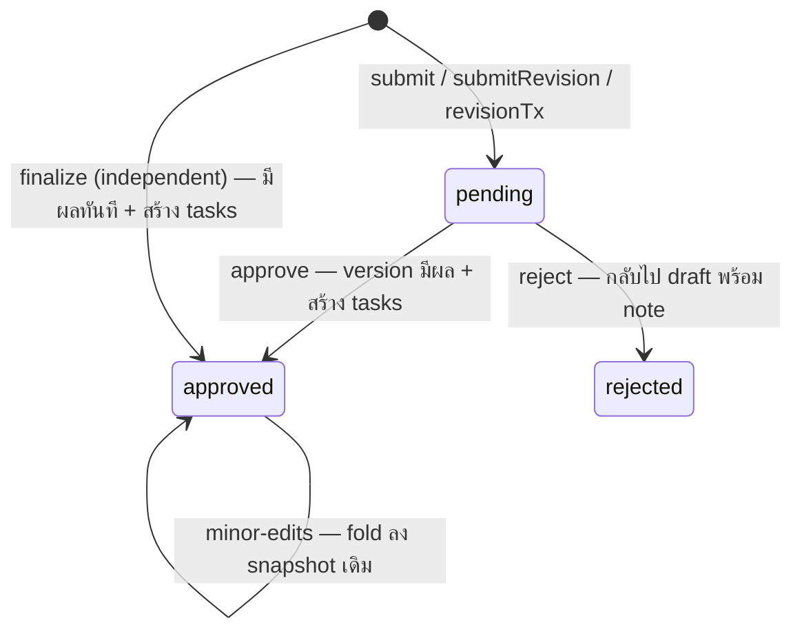

# dmps

> โมดูลแผนการจัดการข้อมูลวิจัย (DMP): นักวิจัยเขียนร่าง ส่งเข้าพิจารณา และดูแลเวอร์ชันที่มีผลของแผน

## Table of Contents

- [Overview](#overview)
- [Folder Structure](#folder-structure)
- [Business Rules](#business-rules)
- [Usage](#usage)
- [Dependencies](#dependencies)
- [Diagrams](#diagrams)

## Overview

- จัดการวงจรของแผน DMP: สร้าง บันทึกร่าง ส่งเข้าคณะกรรมการ (หรือ finalize ด้วยตัวเอง) ตัดสินอนุมัติ/ปฏิเสธ และบันทึกการแก้ไขเป็นเวอร์ชัน
- เมื่อแผนได้รับอนุมัติหรือ finalize โมดูลนี้สร้างงาน lifecycle และแจ้งเตือนให้อัตโนมัติภายใน transaction เดียว

**Out of scope:**

- การจัดการงานที่เกิดจากแผน — อยู่ที่ `features/tasks`
- ระบบรับรองตัวตนและการจัดการโครงการวิจัย — อยู่ที่ `features/auth` และ `features/projects`

## Folder Structure

```text
dmps/
├── dmps.controller.ts   # HTTP boundary — ผูก route ทั้งหมดของ /dmps
├── dmps.service.ts      # use-case layer — ตรวจสิทธิ์/who-sees-what, กฎ locked field, จัดลำดับ flow
├── dmps.repository.ts   # คิวรี Drizzle + transaction (submit/approve/reject/finalize)
└── dmps.module.ts       # ประกาศ NestJS module, export DmpsService ให้ feature อื่น
```

## Business Rules

**สิทธิ์และการมองเห็น**

- สร้าง/แก้/ส่งแผนได้เฉพาะ researcher ผู้เป็นเจ้าของแผน — คนอื่นขอถึงจะเจอ 404 เพื่อซ่อนการมีอยู่ของแผน
- committee/chief ใช้งานได้เฉพาะแผน institutional เท่านั้น — แผน independent คณะกรรมการไม่มีส่วนเกี่ยว (`plan_not_reviewable`)
- admin ยังไม่มีสิทธิ์เข้าถึงข้อมูลแผนใด ๆ ทั้งสิ้น
- approve/reject เวอร์ชันได้เฉพาะ committee/chief และต้องระบุ `position`; reject ต้องมี `note` ทุกครั้ง

**ความถูกต้องของร่าง**

- ทุกการบันทึกร่างและการส่งใช้ optimistic concurrency บน `draft_revision` — เลขไม่ตรงกับล่าสุดต้องได้ 409 พร้อมร่างปัจจุบันให้ rebase ห้ามเขียนทับงานของกัน
- `schema_version` เป็น locked field แก้ไม่ได้ตลอดอายุแผน; เมื่อแผนมีผลแล้ว `begin_date`/`end_date` ก็ล็อกด้วย

**ความถูกต้องของเวอร์ชันและสถานะ**

- หนึ่งแผนมี pending version ได้ไม่เกินหนึ่ง และส่งครั้งแรกได้ครั้งเดียว — ข้อขัดกันบังคับด้วย partial unique ใน Postgres (submit ขนานตัวที่สองถูกตัดสินที่ DB)
- ส่ง/สรุปแผนต้องผ่านการตรวจ checklist (`validateDraft`) ครบก่อนเสมอ — ไม่ครบต้อง 422 และห้ามสร้างเวอร์ชัน
- approve, finalize และการสร้าง tasks/notifications ต้องเกิดใน transaction เดียวกัน — ห้ามเกิดแผนมีผลโดยไม่มีงานหรือไม่มีการแจ้งเตือน
- แผนที่มีเวอร์ชันมีผลอยู่ archive ไม่ได้ และแผนไม่มีการลบทุกกรณี (preservation — เก็บหลักฐานงานวิจัย)

## Usage

| Route | Purpose |
| --- | --- |
| `POST /dmps` | สร้างแผนใหม่ (อาจผูกกับ project) |
| `GET /dmps` | รายการแผนของฉัน หรือของ project สำหรับ committee |
| `GET /dmps/:dmpId` | อ่านแผนหนึ่ง พร้อม `include` เสริม |
| `PUT /dmps/:dmpId/draft` | บันทึกร่างทั้งก้อน (CAS ด้วย `draft_revision`) |
| `POST /dmps/:dmpId/draft/discard` | ทิ้งการแก้ — กลับไป snapshot ล่าสุด |
| `POST /dmps/:dmpId/draft/restore` | โหลด snapshot ของเวอร์ชันเข้าร่าง |
| `POST /dmps/:dmpId/submit` | ส่งแผน institutional เข้าพิจารณา |
| `POST /dmps/:dmpId/finalize` | ทำแผน independent ให้มีผลทันที |
| `POST /dmps/:dmpId/minor-edits` | บันทึกการแก้ minor ลงเวอร์ชันที่มีผล |
| `POST /dmps/:dmpId/revisions` | ส่ง revision ใหม่เข้าพิจารณา |
| `POST /dmps/:dmpId/versions/:number/approve` | คณะกรรมการอนุมัติเวอร์ชัน |
| `POST /dmps/:dmpId/versions/:number/reject` | คณะกรรมการส่งเวอร์ชันกลับ |
| `POST /dmps/:dmpId/archive` / `unarchive` | ซ่อน/นำกลับแผนออกจากรายการ |

Entry point สำหรับโมดูลอื่น: `DmpsService` (export จาก `DmpsModule`) — feature ถัดไป เช่น ai เรียกใช้ use-case ของแผนผ่าน service นี้

```ts
// บันทึกร่าง — ต้องแนบ draft_revision ปัจจุบัน (CAS)
const res = await fetch(`/dmps/${dmpId}/draft`, {
  method: "PUT",
  headers: { "Content-Type": "application/json", Authorization: `Bearer ${token}` },
  body: JSON.stringify({ draft_revision: 7, draft: { title: "..." } }),
});
// 409 draft_conflict → ใช้ draft/draft_revision ใน response rebase แล้วยิงซ้ำ
```

- ต้อง migrate schema ก่อน (ตาราง `dmps`, `dmp_versions`, `notifications`)
- แผนต้องผ่าน `validateDraft` ของ domain-engine ก่อนส่ง/finalize ได้

## Dependencies

### Internal

| Module | Used for |
| --- | --- |
| `features/auth` | รับ claims ของผู้เรียก (`CurrentUser`, `AccessClaims`) เพื่อตรวจสิทธิ์ |
| `features/projects` | ตรวจว่า project อยู่ในความเห็นของผู้เรียก + อ่าน plan_mode |
| `shared/domain-engine` | ตรวจ checklist (`validateDraft`) และสร้างงาน (`generateTasks`) |
| `shared/contracts` | Zod schema ของ draft และ envelope |
| `shared/http` | โยน error เป็น envelope ผ่าน `ApiError`/`fieldInvalid` |

### External packages

| Package | Used for |
| --- | --- |
| `@nestjs/common` | Controller/module และ DI |
| `zod` | validate body/query ทุก boundary |
| `drizzle-orm` | คิวรีและ transaction กับ Postgres |

### External services

| Service | Used for | Impact |
| --- | --- | --- |
| PostgreSQL | เก็บแผน เวอร์ชัน งาน และแจ้งเตือน; บังคับ unique pending version | ล่ม → อ่าน/เขียนแผนไม่ได้ทั้งโมดูล |

## Diagrams

### Workflow — ส่งแผน institutional เข้าพิจารณา

```mermaid
swimlane-beta LR
    subgraph res [researcher]
        A[PUT /dmps/:id/draft]
        S[POST /dmps/:id/submit]
    end
    subgraph svc [dmps.service]
        B{revision ตรงล่าสุด?}
        C{ผ่าน validateDraft?}
        D{mode institutional?}
    end
    subgraph repo [dmps.repository]
        E[submitTx — freeze + version pending]
        F[addNotifications]
    end
    subgraph out [Response]
        G[409 draft_conflict]
        H[422 plan_incomplete]
        I[409 plan_is_independent]
        J[201 version pending]
    end
    A --> B
    B -->|ไม่| G
    B -->|ใช่| S
    S --> D
    D -->|ไม่ใช่| I
    D -->|ใช่| C
    C -->|ไม่ผ่าน| H
    C -->|ผ่าน| E
    E --> F
    F --> J
```

### Workflow — คณะกรรมการตัดสินเวอร์ชัน

```mermaid
swimlane-beta LR
    subgraph com [committee/chief]
        A[POST /dmps/:id/versions/:n/approve หรือ reject]
    end
    subgraph svc [dmps.service]
        B{mode institutional?}
        C{reject มี note?}
    end
    subgraph repo [dmps.repository]
        D[approveTx — activate + carry/drop + tasks]
        E[rejectTx — first submission กลับ draft]
    end
    subgraph out [Response]
        F[403 plan_not_reviewable]
        G[400 note_required]
        H[409 version_not_pending]
        I[201 พร้อม carried/dropped_minor_edits]
    end
    A --> B
    B -->|ไม่ใช่| F
    B -->|ใช่| C
    C -->|reject ไม่มี note| G
    C -->|ผ่าน| D
    D -->|version ไม่ pending| H
    D -->|approve| I
    C -->|reject มี note| E
    E --> I
```

### Lifecycle — เวอร์ชันของแผน


