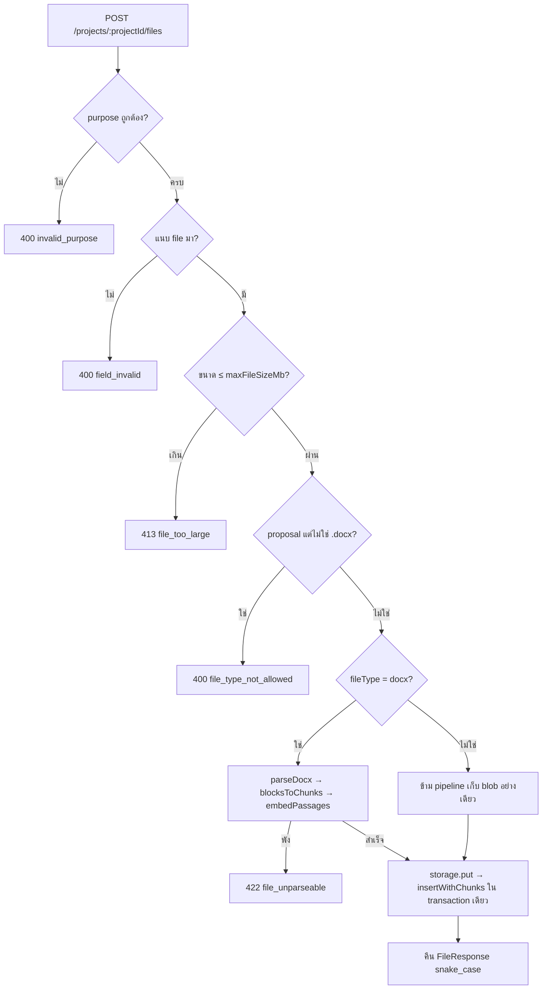
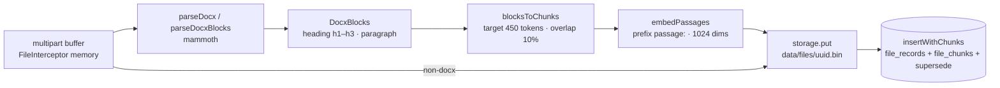
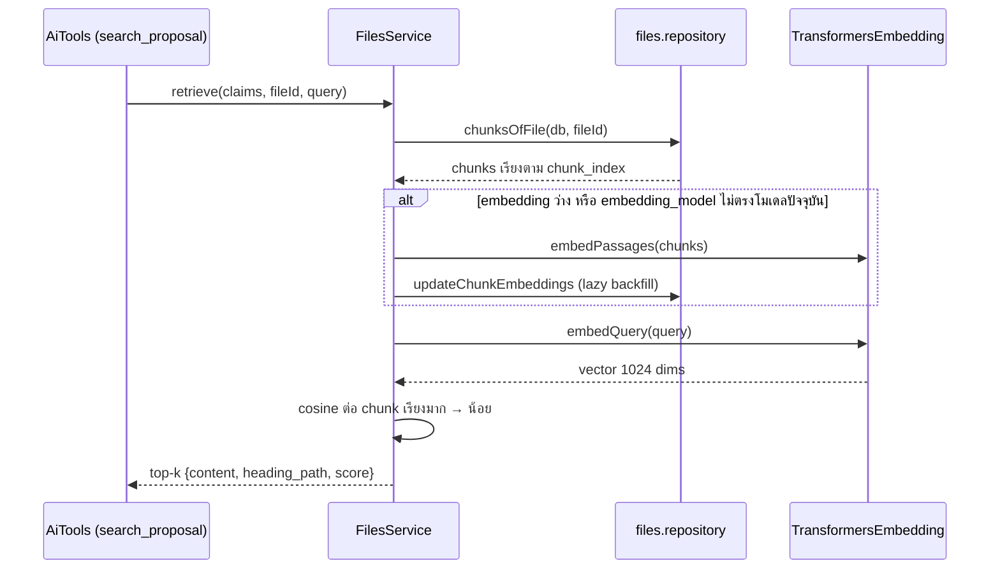

# files

> โมดูลจัดการไฟล์แนบของโปรเจกต์: อัปโหลดแบบ multipart, เก็บ blob บนดิสก์, archive/ลบ และเตรียมเนื้อหา .docx เป็น chunk + embedding สำหรับ semantic search ให้โมดูล AI

## Overview

- รับไฟล์อัปโหลด ตรวจ purpose/ขนาด/MIME แล้วเก็บ blob ผ่าน `FileStorage` พร้อมบันทึก metadata ลงตาราง `file_records`
- สำหรับไฟล์ .docx รัน pipeline parse → chunk → embed ให้เสร็จก่อนเขียนทุกอย่างลงฐานข้อมูลใน transaction เดียว
- ให้บริการดาวน์โหลดเนื้อหา ลงรายการ จัดเก็บ (archive) และลบ โดยห้ามลบไฟล์ที่ถูกใช้เป็น evidence ของ task
- เปิด `FilesService.retrieve()` ให้ ai module ค้น proposal แบบ semantic (cosine top-k) พร้อม lazy re-embed เมื่อ embedding model เปลี่ยน
- **ไม่ควรทำ / Out of scope:**
  - การเรียก LLM หรือ agent loop — อยู่ใน `features/ai` ซึ่งอ่านข้อมูลผ่านโมดูลนี้เท่านั้น
  - pipeline chunk/embed สำหรับไฟล์ non-docx — pdf และอื่น ๆ เก็บ blob อย่างเดียว ไม่ตัด chunk
  - การเลือกที่เก็บข้อมูลเอง — กำหนดผ่าน port `FILE_STORAGE` (ปัจจุบัน bind เป็น `DiskStorage` เท่านั้น)

## Folder Structure

```text
files/
├── files.controller.ts   # HTTP boundary: upload (multipart), list, content, archive, delete
├── files.service.ts      # use-case: ตรวจ limit/purpose, pipeline parse→chunk→embed, archive lifecycle, retrieve
├── files.repository.ts   # Drizzle queries + `insertWithChunks` (transaction: file + chunks + supersede)
├── files.module.ts       # wiring DI: bind DiskStorage / TransformersEmbedding, export FilesService
├── docx.ts               # mammoth: แยก plain text และ blocks (heading h1–h3 / paragraph)
└── chunking.ts           # pure functions: pack ย่อหน้าเป็น chunk ตาม target tokens + overlap
```

## Business Rules

- `purpose` ต้องเป็น `proposal`, `task_deliverable` หรือ `evidence` เท่านั้น — ค่าอื่นถูกปฏิเสธด้วย `400 invalid_purpose` ทั้งตอน upload และตอน filter ด้วย `GET /files?purpose=`
- อัปโหลดต้องแนบ multipart field ชื่อ `file` — ไม่มี → `400 field_invalid`
- ขนาดไฟล์ต้องไม่เกิน `config().files.maxFileSizeMb` (25 MB ใน config.toml) — เกิน → `413 file_too_large` (ตรวจจาก byte size ใน service เพราะ `FileInterceptor` เก็บ buffer ไว้ใน memory)
- purpose `proposal` ต้องเป็นไฟล์ .docx (MIME `application/vnd.openxmlformats-officedocument.wordprocessingml.document`) เท่านั้น — ไม่ใช่ → `400 file_type_not_allowed`
- `file_type` จำแนกจาก mimetype เป็น `docx` / `pdf` / `other`
- ไฟล์ docx ต้อง parse → chunk → embed สำเร็จก่อนเขียนทุกอย่าง — ขั้นใดพัง → `422 file_unparseable` โดยไม่ทิ้ง record หรือ chunk ครึ่ง ๆ
- ทุกอย่างของการ upload เขียนใน transaction เดียว (`insertWithChunks`): insert `file_records` → proposal ที่ยังไม่ถูกแทน (superseded_at is null) ทุกฉบับถูกตั้ง `superseded_at` และลบ chunks ทิ้ง → อัปเดต `projects.proposal_file_id` → insert chunks ใหม่ (เฉพาะ purpose `proposal` เท่านั้นที่มี supersede)
- การเข้าถึงไฟล์ทุกเส้นทางผ่าน `visibleFile`: ไม่พบ record หรือ `projectId` เป็น null → `404 file_not_found` แล้วจึงตรวจสิทธิ์ด้วย `ProjectsService.assertVisible()`
- ดาวน์โหลด `/files/:fileId/content` เจอ blob หายบน storage → `410 file_content_gone`
- archive เป็น idempotent — ไฟล์ที่ archive แล้วคืน record เดิมโดยไม่แก้ `archived_at` ซ้ำ
- ลบไฟล์ที่ task อ้างเป็น evidence (`tasks.evidence_type = 'file'` และ `evidence_ref` = file_id) → `409 file_in_use` ต้อง archive แทน
- ลบสำเร็จ: ลบ record (chunks ถูกลบตาม FK cascade) แล้วลบ blob ทิ้ง; หากเป็น proposal ที่ `projects.proposal_file_id` ชี้อยู่ FK ตั้งค่าเป็น null ให้เอง (onDelete: set null)
- `GET /files` ต้องส่ง `project_id` — ไม่ส่ง → `400 project_id_required`; เรียงผลลัพธ์ไฟล์ปัจจุบัน (superseded_at is null) ก่อน แล้วไล่ตาม `uploaded_at` มาก → น้อย; envelope คืน `has_more` เป็น false เสมอ
- chunking: นับ token แบบ whitespace-delimited pack ย่อหน้าจนใกล้ `chunkTargetTokens` (450) เกิน → เปิด chunk ใหม่โดยนำท้ายก้อนก่อน `chunkOverlapPercent` (10%) มาต่อหัว; ย่อหน้ายาวเกิน target เองถูกตัดเป็นหลาย chunk; heading ไม่มีเนื้อหาตามหลังไม่เกิด chunk เปล่า
- ทุก chunk มี `chunk_index` เริ่มที่ 0 ตามลำดับเอกสาร และ `heading_path` รวม heading ที่ยังเปิดอยู่ทุกระดับ (เช่น `H1 > H2`) เป็น null เมื่อไม่เคยมี heading
- embedding ใช้ prefix `passage: ` สำหรับ chunk และ `query: ` สำหรับคำค้น (ตระกูล e5) พร้อม mean pooling + L2 normalize ขนาด 1024 dims; ชื่อโมเดลจาก `files.rag.embeddingModel` ถูกเก็บลง `file_chunks.embedding_model` ทุก chunk
- `retrieve()`: หาก chunk ใด embedding เป็น null หรือ `embedding_model` ไม่ตรงโมเดลปัจจุบัน → re-embed ทั้งไฟล์แล้วบันทึกทับ (lazy backfill) จากนั้นเรียงด้วย cosine มาก → น้อย คืน top-k ตาม `files.rag.topK` (5)
- multipart ตั้ง `defParamCharset: "utf8"` เพื่อไม่ให้ชื่อไฟล์ภาษาไทยเพี้ยน; blob ถูกตั้งชื่อ UUID ใหม่ (`.bin`) ป้องกัน path traversal; ตอนดาวน์โหลดตั้ง `Content-Disposition` ตาม RFC 6266/5987 มี `filename*=UTF-8''…` สำหรับชื่อ non-ASCII

## Usage

Entry points สำหรับผู้เรียก:

- HTTP: `POST /projects/:projectId/files` (multipart field `file` + body `purpose`), `GET /files?project_id=&purpose=`, `GET /files/:fileId/content` (binary attachment), `POST /files/:fileId/archive`, `DELETE /files/:fileId`
- Internal: `FilesService.retrieve(claims, fileId, query)` — ai module (`AiTools` tool search_proposal) ใช้ค้น proposal; `filesRepo.activeProposal(db, projectId)` และ `filesRepo.chunksOfFile(db, fileId)` — ai module ใช้ใน tool read_proposal

```ts
// ใน ai.tools.ts — RAG retrieval สำรอง (ADR-0025)
const hits = await this.files.retrieve(ctx.claims, proposalFileId, query);
```

ข้อกำหนดก่อนใช้งาน:

- migrate ฐานข้อมูลให้มีตาราง `file_records` และ `file_chunks` (`pnpm db:migrate`)
- ตั้งค่า `[files]` (maxFileSizeMb, storagePath) และ `[files.rag]` (chunkTargetTokens, chunkOverlapPercent, topK, embeddingModel) ใน config.toml — loader validate ตอน bootstrap และไม่ reload ระหว่างรัน
- การเรียก embedding ครั้งแรกจะโหลดโมเดล ONNX ตาม `embeddingModel` (lazy load, ใช้ cache หลังจากนั้น)

## Dependencies

### Internal

- `features/auth` — type `AccessClaims` จาก `@CurrentUser()`; ทุก route อยู่ใต้ global AuthGuard
- `features/projects` — `ProjectsService.assertVisible()` ตรวจสิทธิ์เข้าถึงโปรเจกต์ก่อนทุก operation; type `Db` จาก projects.repository; import `ProjectsModule`
- `shared/config` — `config().files` (maxFileSizeMb, storagePath, rag.*)
- `shared/ports` — `FILE_STORAGE` / `FileStorage` และ `EMBEDDING` / `Embedding` (port injection)
- `shared/adapters` — `DiskStorage` (เก็บ blob บนดิสก์) และ `TransformersEmbedding` (ONNX) ซึ่ง bind ใน files.module
- `shared/http` — `ApiError` (error envelope) และ `attachmentDisposition` (Content-Disposition)
- `shared/contracts` — `listOf` / `ListEnvelope` สำหรับ list response
- `database` — `DB` token; schema `fileRecords`, `fileChunks`, `projects`, `tasks`

### External packages

- `mammoth` — แยก plain text (`extractRawText`) และ HTML blocks (`convertToHtml`) จาก .docx
- `@nestjs/platform-express` — `FileInterceptor` รับ multipart เป็น memory buffer
- `multer` — multipart parser ใต้ `FileInterceptor` (option `defParamCharset`)
- `drizzle-orm` — query builder, `sql` template และ transaction
- `@huggingface/transformers` — feature-extraction pipeline (onnxruntime-node) สำหรับ embed chunk/query

### External services

- PostgreSQL — ตาราง `file_records`, `file_chunks` และอ้างอิง `projects`, `tasks` (หากล่ม: upload/list/download/retrieve ใช้งานไม่ได้ทั้งโมดูล)
- ดิสก์ local — โฟลเดอร์ `files.storagePath` (`data/files`) เก็บ blob ผ่าน `DiskStorage` (หากไฟล์หาย: metadata ยังอยู่แต่ `/content` ตอบ `410 file_content_gone`)
- HuggingFace Hub — ดาวน์โหลดโมเดล ONNX `Xenova/multilingual-e5-large` ครั้งแรกที่ embedding ถูกเรียก (หากโหลดไม่ได้: upload .docx ตอบ `422 file_unparseable` เพราะขั้น embed อยู่ใน try เดียวกับ parse)

## Diagrams

### Workflow — upload



### Data Flow — pipeline .docx → chunk → embedding



### Sequence — retrieve (search_proposal)


