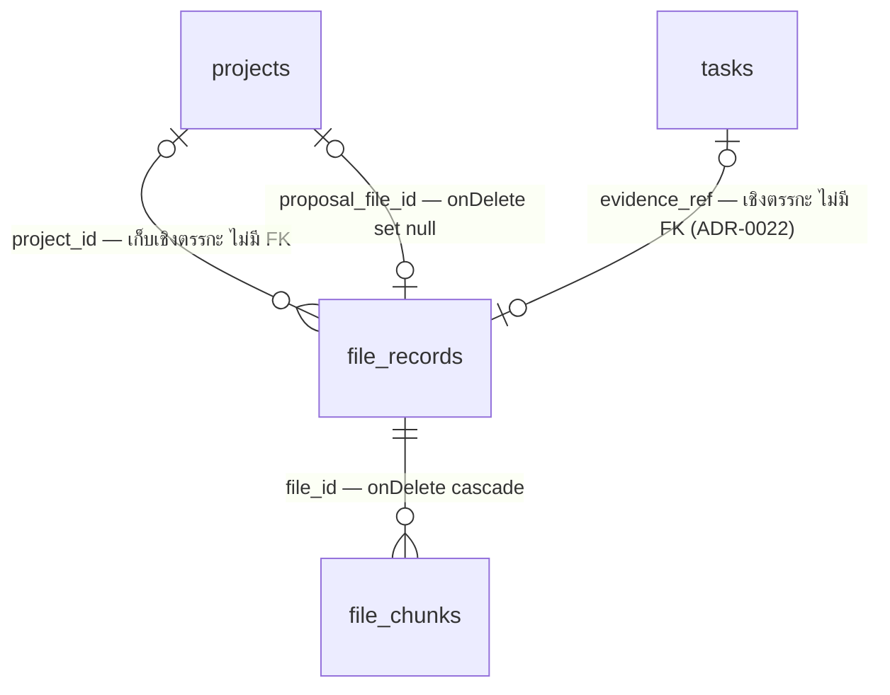

# files

> โมดูลจัดการไฟล์แนบของโปรเจกต์วิจัย — อัปโหลด ดาวน์โหลด archive/ลบ และแตก .docx เป็น chunks + embedding สำหรับค้นหาแบบ semantic (RAG)

## Table of Contents

- [Overview](#overview)
- [Folder Structure](#folder-structure)
- [Business Rules](#business-rules)
- [Usage](#usage)
- [Dependencies](#dependencies)
- [Diagrams](#diagrams)

## Overview

- จัดการไฟล์แนบของโปรเจกต์วิจัย: อัปโหลด ดาวน์โหลด archive ลบ และเก็บ metadata ลง `file_records`
- แตกไฟล์ .docx เป็นชิ้นข้อความ (chunk) พร้อม embedding เพื่อให้ `features/ai` ค้นหาแบบ semantic (RAG) ได้

**Out of scope:**

- การใช้ไฟล์กับ AI (chat/analyze) — อยู่ที่ `features/ai` เรียก `FilesService.retrieve()` (search_proposal) และ `chunksOfFile` + `expandToSections` (read_proposal — section เต็ม, SPEC ff2569 Task 8)
- การตรวจสิทธิ์ผู้ใช้ — ทำโดย global AuthGuard (`features/auth`) และสิทธิ์ระดับโปรเจกต์ (`features/projects`)

## Folder Structure

```text
files/
├── files.controller.ts   # HTTP boundary — รับ multipart (multer) และตั้ง header ให้ /content
├── files.service.ts      # use cases — ตรวจสิทธิ์/ขนาด/ชนิดไฟล์, supersede, evidence protection, fast path FF2569 + VLM caption, retrieve()
├── files.repository.ts   # Drizzle query — file_records/file_chunks, insertWithChunks (transaction เดียว)
├── files.module.ts       # ผูก provider — DiskStorage + TransformersEmbedding + AI_CLIENT (OpenRouter/Mock), export FilesService
├── docx.ts               # แตก .docx เป็น plain text + blocks (heading 1–3 / paragraph) ด้วย mammoth
├── docx-form.ts          # parse OOXML ตรง (jszip) — paragraphs/tables/checkbox (w14:checked)/images + block ordinal
├── form-extract.ts       # pure functions — match เอกสารเข้า template schema ต่อ field (tolerant matching, sequential cursor, negation-aware enum)
├── chunking.ts           # pure functions — blocksToChunks (generic) + fieldsToChunks (fast path) ตาม target token + overlap จาก config.toml
├── retrieval.ts          # pure helper — expandToSections: pack ต่อ heading_path เป็น section เต็ม (read_proposal)
└── templates/
    └── ff2569.ts         # schema ฟอร์ม FF2569 (zod-validated) — fieldId/sectionId/enum labels — single source of truth ของการ map เอกสาร
```

## Business Rules

**การเข้าถึง**

- ทุก operation ต้องผ่าน `ProjectsService.assertVisible()` ของโปรเจกต์เจ้าของไฟล์ และผู้ใช้ที่ไม่มีสิทธิ์จะได้ 404 เสมอ เพื่อไม่เปิดเผยว่าไฟล์นั้นมีอยู่

**การอัปโหลด**

- ไฟล์เกิน `files.maxFileSizeMb` (25 MB) ถูกปฏิเสธทันที เพราะ multer เก็บไฟล์เป็น buffer ใน memory ทั้งไฟล์ — ไม่จำกัดขนาดคือความเสี่ยงล่มของ service
- `purpose` รับเฉพาะ `proposal`, `task_deliverable`, `evidence` และ proposal ต้องเป็น .docx เท่านั้น เพราะ pipeline แตกเนื้อหาอ่านได้เฉพาะ docx
- ไฟล์ .docx ที่ parse ไม่ได้ถูกปฏิเสธ (422) ก่อนเขียนอะไรลง DB หรือ disk — ระบบจึงไม่มีข้อมูลครึ่งไฟล์ค้างอยู่

**ความสมบูรณ์ของ proposal**

- แต่ละโปรเจกต์มี proposal ที่ยัง active ได้ตัวเดียว — อัปโหลดตัวใหม่จะ mark ตัวเก่าเป็น superseded ลบ chunks เก่าทั้งหมด และชี้ `projects.proposal_file_id` มาที่ตัวใหม่ ภายใน transaction เดียว

**Evidence และการลบ**

- ไฟล์ที่ task อ้างเป็น evidence ห้ามลบ (409 `file_in_use`) เพราะลบแล้วบันทึกงานจะอ้างไฟล์ที่หายไป — ต้อง archive แทน

**ความสมบูรณ์ของ RAG**

- chunk ทุกตัวต้องมาจากโมเดล embedding เดียวกับ `files.rag.embeddingModel` — เจอ vector จากโมเดลเก่าจะ re-embed ก่อนคำนวณ cosine ทุกครั้ง เพื่อกันการเทียบคะแนนข้ามโมเดล

**Ingest ฟอร์ม FF2569 (fast path)**

- เอกสารที่ extract ไม่ได้ field, match ไม่ครบ (misses > fields) หรือ parse OOXML พัง ต้อง fallback generic path เสมอ — อัปโหลดยังสำเร็จปกติ เพราะไม่ใช่ฟอร์มไม่ใช่เหตุปฏิเสธไฟล์
- VLM caption เป็น best-effort — quota หมด/เรียกพลาด/ฟอร์แมตรูปที่โมเดลไม่รองรับ (emf/wmf) ต้องข้ามแล้ว warn ห้ามทำให้อัปโหลดล้ม และ usage ทุก call ต้องนับโควตาผู้อัปโหลดผ่าน reconcile เดิม (ADR-0023)

## Usage

| Route | Purpose |
| --- | --- |
| `POST /projects/:projectId/files` | อัปโหลดไฟล์ — multipart field `file` + `purpose` |
| `GET /files` | รายการไฟล์ของโปรเจกต์ — กรองตาม `project_id` (บังคับ) และ `purpose` |
| `GET /files/:fileId/content` | ดาวน์โหลดเนื้อไฟล์ |
| `POST /files/:fileId/archive` | archive ไฟล์ — idempotent |
| `DELETE /files/:fileId` | ลบไฟล์ — evidence ถูกปฏิเสธ |

Entry point สำหรับโมดูลอื่น: `FilesService.retrieve(claims, fileId, query)` — คืน top-k chunks เรียงตามความคล้ายคลึง ใช้โดย `features/ai` (ADR-0025); `FilesModule` exports `FilesService` สำหรับ inject

```ts
// features/ai — ค้นเนื้อหา proposal ด้วย semantic search (ADR-0025)
const hits = await this.files.retrieve(
  claims,
  proposalFileId,
  "งบประมาณรวมของโครงการ",
);
// ได้ [{ content, heading_path, score }] เรียงจากมากไปน้อย จำกัดตาม files.rag.topK
```

- ต้องรัน `pnpm db:migrate` แล้ว (ตาราง `file_records`, `file_chunks`)
- `file_chunks.meta` (jsonb, nullable) — chunk จาก fast path FF2569 เก็บ `{template_version, field_ids: string[], section_id, enum_value?, part/parts?}` (field ใน chunkGroup → `field_ids` ครบทุก field ในกลุ่ม; ข้อมูลเก่าแบบ `field_id` เดี่ยวอ่านเป็น generic ได้); generic path ไม่เก็บ (null) (SPEC ff2569 Rev 2, migration 0009)
- ต้องตั้งค่า `[files]` ใน config.toml — `storagePath` และ `[files.rag]` รวม knob `formFastPath` (ปิด/เปิด fast path) กับ `vlmModel` (ตั้งค่าว่างเพื่อปิด VLM caption) (loader zod-validate แล้ว fail-fast)

## Dependencies

### Internal

| Module | Used for |
| --- | --- |
| `features/auth` | รับตัวตนผู้ใช้ (`AccessClaims`, `@CurrentUser()`) จาก global AuthGuard |
| `features/projects` | ตรวจสิทธิ์เข้าถึงโปรเจกต์ด้วย `assertVisible()` |
| `features/ai` | นับโควตา VLM caption ผ่าน `chargeQuota()` (reconcile ADR-0023) — AiModule import กลับมาไม่ได้ จึง bind `AI_CLIENT` เอง |
| `database` | schema `file_records` / `file_chunks` และ connection ผ่าน token `DB` |
| `shared/config` | ค่าตั้ง `[files]` / `[files.rag]` จาก config.toml |
| `shared/ports` | interface `FileStorage`, `Embedding`, `AiClient` ที่ service inject |
| `shared/adapters` | implementation `DiskStorage` (blob), `TransformersEmbedding` (vector), `OpenRouterClient`/`MockAiClient` (VLM caption) |

### External packages

| Package | Used for |
| --- | --- |
| `mammoth` | แตกข้อความและ blocks (heading/paragraph) จาก .docx |
| `jszip` | อ่าน OOXML ของ .docx ตรงสำหรับฟอร์ม (parseDocxForm / readDocxImage) |
| `@nestjs/platform-express` | รับ multipart upload เป็น buffer ใน memory (multer) |
| `drizzle-orm` | query + transaction กับ Postgres |

### External services

| Service | Used for | Impact |
| --- | --- | --- |
| PostgreSQL | เก็บ `file_records`, `file_chunks` — metadata, chunks, vectors | ล่ม → อัปโหลด/ลิสต์/ค้นหาใช้ไม่ได้ทั้งโมดูล |
| Local disk | เก็บ blob เนื้อไฟล์จริง — ที่อยู่จาก `files.storagePath` | ไฟล์หาย → ดาวน์โหลดตอบ 410 `file_content_gone` |
| ONNX embedding runtime | รันโมเดล `Xenova/multilingual-e5-large` — CUDA fp16 ก่อน fallback CPU q8 | ล่ม → อัปโหลด .docx และ `retrieve()` ใช้ไม่ได้ |
| OpenRouter (VLM) | caption รูปในฟิลด์แบบ image ตอน fast path (`files.rag.vlmModel`) | ล่ม/quota หมด → ข้าม caption + warn — อัปโหลดยังสำเร็จ (best-effort) |

## Diagrams

### Workflow — Proposal supersede

```mermaid
swimlane-beta LR
    subgraph ctrl [files.controller]
        A[POST /projects/:projectId/files]
    end
    subgraph svc [files.service]
        B{mimetype === DOCX_MIME?}
    end
    subgraph tx [files.repository.insertWithChunks]
        C[insert file_records ตัวใหม่]
        D{purpose === proposal?}
        E[set superseded_at บน proposal เดิม]
        F[delete file_chunks ของ proposal เดิม]
        G[update projects.proposal_file_id → ตัวใหม่]
        H[insert file_chunks ตัวใหม่]
    end
    subgraph res [Response]
        I[400 file_type_not_allowed]
        J[FileResponse]
    end
    A --> B
    B -->|ไม่ใช่ .docx| I
    B -->|ใช่| C
    C --> D
    D -->|ไม่ใช่| H
    D -->|ใช่| E
    E --> F
    F --> G
    G --> H
    H --> J
```

### Data Flow — docx upload pipeline

```mermaid
swimlane-beta LR
    subgraph http [files.controller]
        A[multipart buffer จาก multer]
    end
    subgraph svc [files.service]
        C{fileType === docx ∧ formFastPath?}
        D{fields > 0 ∧ misses ≤ fields?}
        E[captionImages — VLM best-effort]
    end
    subgraph form [docx.ts + docx-form.ts + form-extract.ts]
        P[parseDocx]
        F[parseDocxForm — OOXML ตรง]
        G[extractFields — เทียบ templates/ff2569]
        Q[parseDocxBlocks — fallback generic]
    end
    subgraph chunk [chunking.ts]
        H[fieldsToChunks — chunk + meta jsonb]
        I[blocksToChunks]
    end
    subgraph embed [TransformersEmbedding]
        J[embedPassages]
    end
    subgraph store [files.repository + DiskStorage]
        K[storage.put → storagePath]
        L[insertWithChunks — file + chunks + supersede]
    end
    A --> C
    C -->|ใช่| P
    C -->|ไม่ใช่ docx| K
    P --> F
    F --> G
    G --> D
    D -->|ผ่าน — fast path| E
    D -->|ไม่ผ่าน| Q
    E --> H
    Q --> I
    H --> J
    I --> J
    J --> K
    K --> L
```

### Entity-Relationship — file tables และการอ้างอิง


