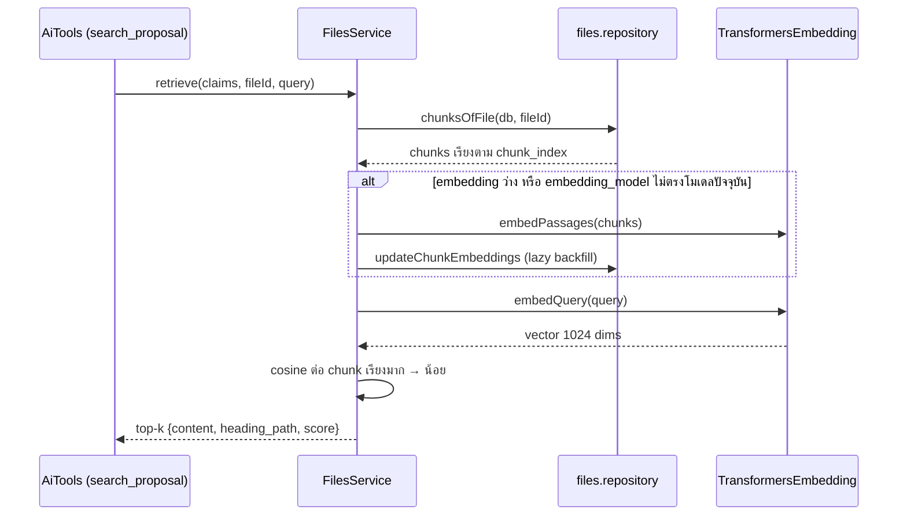

# files

> โมดูลจัดการไฟล์แนบของโปรเจกต์: อัปโหลดแบบ multipart, เก็บ blob บนดิสก์, archive/ลบ และเตรียมเนื้อหา .docx เป็น chunk + embedding สำหรับ semantic search ให้โมดูล AI

## Table of Contents

- [Overview](#overview)
- [Folder Structure](#folder-structure)
- [Business Rules](#business-rules)
- [Usage](#usage)
- [Dependencies](#dependencies)
- [Diagrams](#diagrams)

## Overview

- รับไฟล์อัปโหลดแล้วตรวจ purpose ขนาด และ MIME ทีละข้อ ไฟล์ที่ผ่านถูกเก็บ blob ผ่าน port `FileStorage` พร้อม metadata ลงตาราง `file_records`
- ไฟล์ .docx ต้องรัน pipeline parse → chunk → embed ให้เสร็จก่อนจึงเขียนลงฐานข้อมูล ทุกอย่างถูกเขียนใน transaction เดียว
- ให้บริการดาวน์โหลดเนื้อหา ลงรายการ archive และลบ ไฟล์ที่ task ใช้เป็น evidence ห้ามลบ
- เปิด `FilesService.retrieve()` ให้ ai module ค้น proposal แบบ semantic (cosine top-k) embedding model เปลี่ยนเมื่อไร re-embed อัตโนมัติเมื่อนั้น
- **Out of scope:**
  - การเรียก LLM หรือ agent loop — อยู่ใน `features/ai` ซึ่งอ่านข้อมูลผ่านโมดูลนี้เท่านั้น
  - pipeline chunk/embed ของไฟล์ non-docx — pdf และอื่น ๆ เก็บ blob อย่างเดียว ไม่ตัด chunk
  - การเลือกที่เก็บข้อมูลเอง — กำหนดผ่าน port `FILE_STORAGE` (ปัจจุบัน bind เป็น `DiskStorage` เท่านั้น)

## Folder Structure

```text
files/
├── files.controller.ts   # HTTP boundary: upload (multipart), list, content, archive, delete
├── files.service.ts      # use case: ตรวจ limit/purpose, pipeline parse→chunk→embed, retrieve RAG
├── files.repository.ts   # Drizzle queries + insertWithChunks (transaction: file + chunks + supersede)
├── files.module.ts       # wiring DI: bind DiskStorage / TransformersEmbedding, export FilesService
├── docx.ts               # mammoth: แยก plain text และ blocks (heading h1–h3 / paragraph)
└── chunking.ts           # pure functions: pack ย่อหน้าเป็น chunk ตาม target tokens + overlap
```

## Business Rules

**การอัปโหลด**

- `purpose` ต้องเป็น `proposal`, `task_deliverable` หรือ `evidence` เท่านั้น ค่าอื่น → 400 `invalid_purpose` ตรวจทั้งตอน upload และตอน filter ด้วย `GET /files?purpose=`
- อัปโหลดต้องแนบ multipart field ชื่อ `file` ไม่มี → 400 `field_invalid`
- ขนาดไฟล์ต้องไม่เกิน `config().files.maxFileSizeMb` (25 MB ใน config.toml) เกิน → 413 `file_too_large` การตรวจทำจาก byte size ใน service เพราะ `FileInterceptor` เก็บ buffer ไว้ใน memory
- purpose `proposal` ต้องเป็นไฟล์ .docx เท่านั้น MIME ที่ยอมรับคือ `application/vnd.openxmlformats-officedocument.wordprocessingml.document` ไม่ใช่ → 400 `file_type_not_allowed`
- `file_type` จำแนกจาก mimetype เป็น `docx` / `pdf` / `other`

**pipeline .docx**

- ไฟล์ docx ต้อง parse → chunk → embed สำเร็จก่อนเขียนทุกอย่างลงฐานข้อมูล ขั้นใดพัง → 422 `file_unparseable` โดยไม่ทิ้ง record หรือ chunk ครึ่ง ๆ
- การ extract เก็บเฉพาะ heading h1–h3 และย่อหน้า ตาราง รายการ หรือ element อื่นของ docx ไม่เข้า chunk
- chunking นับ token แบบ whitespace-delimited แล้ว pack ย่อหน้าจนใกล้ `chunkTargetTokens` (450) ยิ่ง pack เกิน → เปิด chunk ใหม่โดยนำท้ายก้อนก่อน `chunkOverlapPercent` (10%) มาต่อหัว
- ย่อหน้ายาวเกิน target เองถูกตัดเป็นหลาย chunk heading ที่ไม่มีเนื้อหาตามหลังไม่เกิด chunk เปล่า
- ทุก chunk มี `chunk_index` เริ่มที่ 0 ตามลำดับเอกสาร และมี `heading_path` รวม heading ที่ยังเปิดอยู่ทุกระดับ (เช่น `H1 > H2`) เอกสารที่ไม่เคยมี heading → `heading_path` เป็น null
- embedding ใช้ prefix `passage: ` สำหรับ chunk และ `query: ` สำหรับคำค้น (ตระกูล e5) ขนาด 1024 dims พร้อม mean pooling + L2 normalize — batch ละ 16 chunks
- ชื่อโมเดลจาก `files.rag.embeddingModel` ถูกเก็บลง `file_chunks.embedding_model` ทุก chunk ไว้ใช้ตรวจของเก่า

**การเข้าถึงและ lifecycle ของไฟล์**

- ทุกเส้นทางผ่าน `visibleFile`: ไม่พบ record หรือ `projectId` เป็น null → 404 `file_not_found` แล้วจึงตรวจสิทธิ์ด้วย `ProjectsService.assertVisible()`
- การ upload ทั้งหมดเขียนใน transaction เดียว (`insertWithChunks`) ลำดับมี 4 ขั้น: insert `file_records` → proposal เดิมที่ยังไม่ถูกแทนทุกฉบับถูกตั้ง `superseded_at` และลบ chunks ทิ้ง → อัปเดต `projects.proposal_file_id` → insert chunks ใหม่ การ supersede เกิดเฉพาะ purpose `proposal`
- ดาวน์โหลด `/files/:fileId/content` เจอ blob หายบน storage → 410 `file_content_gone`
- archive เป็น idempotent — ไฟล์ที่ archive แล้วคืน record เดิมโดยไม่แก้ `archived_at` ซ้ำ
- ลบไฟล์ที่ task อ้างเป็น evidence → 409 `file_in_use` ต้อง archive แทน (ADR-0022)
- ลบสำเร็จ: ลบ record (chunks หายตาม FK cascade) แล้วลบ blob ถ้าเป็น proposal ที่ `projects.proposal_file_id` ชี้อยู่ FK ตั้งค่าเป็น null ให้เอง

**การค้นแบบ semantic (retrieve)**

- ถ้า chunk ใด embedding เป็น null หรือ `embedding_model` ไม่ตรงโมเดลปัจจุบัน → re-embed ทั้งไฟล์แล้วบันทึกทับ (lazy backfill)
- เรียงผลด้วย cosine มาก → น้อย แล้วคืน top-k ตาม `files.rag.topK` (5)
- `GET /files` ต้องส่ง `project_id` ไม่ส่ง → 400 `project_id_required` เรียงไฟล์ปัจจุบัน (superseded_at is null) ก่อน แล้วไล่ตาม `uploaded_at` มาก → น้อย envelope คืน `has_more` เป็น false เสมอ

**ความปลอดภัยของชื่อไฟล์**

- multipart ตั้ง `defParamCharset: "utf8"` เพื่อไม่ให้ชื่อไฟล์ภาษาไทยเพี้ยน
- blob ถูกตั้งชื่อ UUID ใหม่ (`.bin`) ป้องกัน path traversal
- ตอนดาวน์โหลดตั้ง `Content-Disposition` ตาม RFC 6266/5987 มี `filename*=UTF-8''…` สำหรับชื่อ non-ASCII

## Usage

| Route | Purpose |
| --- | --- |
| `POST /projects/:projectId/files` | อัปโหลด — multipart field `file` + body `purpose` |
| `GET /files` | ลงรายการไฟล์ของโครงการ — query `project_id` (บังคับ), `purpose` |
| `GET /files/:fileId/content` | ดาวน์โหลดเนื้อหาจริง (binary attachment) |
| `POST /files/:fileId/archive` | archive (idempotent) |
| `DELETE /files/:fileId` | ลบ — ถูกกันถ้าเป็น evidence ของ task |

Entry point ภายในสำหรับโมดูลอื่น:

- `FilesService.retrieve(claims, fileId, query)` — ai module (tool `search_proposal`) ใช้ค้น proposal แบบ cosine top-k
- `filesRepo.activeProposal(db, projectId)` และ `filesRepo.chunksOfFile(db, fileId)` — ai module ใช้อ่าน extracted text ของ proposal (tool `read_proposal`)

```ts
// ใน ai.tools.ts — RAG retrieval (ADR-0025)
const hits = await this.files.retrieve(ctx.claims, proposalFileId, query);
```

- Prerequisites: migrate ให้มีตาราง `file_records` + `file_chunks` (`pnpm db:migrate`); ตั้งค่า `[files]` และ `[files.rag]` ใน config.toml — loader validate ตอน bootstrap และไม่ reload ระหว่างรัน
- การ embed ครั้งแรกจะโหลดโมเดล ONNX ตาม `embeddingModel` แบบ lazy load แล้วใช้ cache หลังจากนั้น

## Dependencies

### Internal

| Module | Used in | Used for |
| --- | --- | --- |
| `features/auth` | controller / service | type `AccessClaims` และ `@CurrentUser()` — ทุก route อยู่ใต้ global AuthGuard |
| `features/projects` | `files.service.ts` | `ProjectsService.assertVisible()` ตรวจสิทธิ์ก่อนทุก operation; import `ProjectsModule` และ type `Db` |
| `shared/config` | `files.service.ts` | อ่าน `config().files` (maxFileSizeMb, storagePath, rag.*) |
| `shared/ports` | `files.module.ts` | port `FILE_STORAGE` / `FileStorage` และ `EMBEDDING` / `Embedding` |
| `shared/adapters` | `files.module.ts` | `DiskStorage` (เก็บ blob บนดิสก์) และ `TransformersEmbedding` (ONNX) |
| `shared/http` | controller / service | `ApiError` (error envelope) และ `attachmentDisposition` (Content-Disposition) |
| `shared/contracts` | `files.service.ts` | `listOf` / `ListEnvelope` สำหรับ list response |
| `database` | `files.repository.ts` | token `DB`; schema `fileRecords`, `fileChunks`, `projects`, `tasks` |

### External packages

| Package | Used in | Used for |
| --- | --- | --- |
| `mammoth` | `docx.ts` | แยก plain text (`extractRawText`) และ HTML blocks (`convertToHtml`) จาก .docx |
| `@nestjs/platform-express` | `files.controller.ts` | `FileInterceptor` รับ multipart เป็น memory buffer |
| `multer` | `files.controller.ts` | multipart parser ใต้ `FileInterceptor` (option `defParamCharset`) |
| `drizzle-orm` | `files.repository.ts` | query builder, `sql` template และ transaction |
| `@huggingface/transformers` | `transformers-embedding.ts` (adapter ที่ bind เข้า `EMBEDDING`) | feature-extraction pipeline (onnxruntime-node) embed chunk/query |

### External services

| Service | Used in | Used for | Impact |
| --- | --- | --- | --- |
| PostgreSQL | `files.repository.ts` | เก็บตาราง `file_records`, `file_chunks` และอ้างอิง `projects`, `tasks` | ล่ม → upload/list/download/retrieve ใช้ไม่ได้ทั้งโมดูล |
| ดิสก์ local | `DiskStorage` (`shared/adapters`) | เก็บ blob ที่ `files.storagePath` (`data/files`) | ไฟล์หาย → metadata ยังอยู่แต่ `/content` ตอบ 410 `file_content_gone` |
| HuggingFace Hub | `TransformersEmbedding` | ดาวน์โหลดโมเดล ONNX `Xenova/multilingual-e5-large` ครั้งแรกที่ embed | โหลดไม่ได้ → upload .docx ตอบ 422 `file_unparseable` เพราะขั้น embed อยู่ใน try เดียวกับ parse |

## Diagrams

### Workflow — อัปโหลด

```mermaid
swimlane-beta LR
    subgraph client [Client]
        A[POST /projects/:projectId/files multipart]
    end
    subgraph ctrl [files.controller]
        B[FileInterceptor — buffer ใน memory]
    end
    subgraph svc [files.service]
        C{purpose ถูกต้อง?}
        D{แนบ file มา?}
        E{ขนาด ≤ maxFileSizeMb?}
        F{proposal แต่ไม่ใช่ .docx?}
        G{fileType = docx?}
        H[parseDocx → blocksToChunks → embedPassages]
    end
    subgraph store [storage + repository]
        I[storage.put — data/files/uuid.bin]
        J[insertWithChunks — transaction เดียว]
    end
    subgraph res [Response]
        E1[400 invalid_purpose]
        E2[400 field_invalid]
        E3[413 file_too_large]
        E4[400 file_type_not_allowed]
        E5[422 file_unparseable]
        K[200 FileResponse snake_case]
    end
    A --> B
    B --> C
    C -->|ไม่| E1
    C -->|ใช่| D
    D -->|ไม่| E2
    D -->|มี| E
    E -->|เกิน| E3
    E -->|ผ่าน| F
    F -->|ใช่| E4
    F -->|ไม่ใช่| G
    G -->|ใช่| H
    H -->|พัง| E5
    G -->|ไม่ใช่ — ข้าม pipeline| I
    H -->|สำเร็จ| I
    I --> J
    J --> K
```

### Data Flow — pipeline .docx → chunk → embedding

```mermaid
swimlane-beta TB
    subgraph req [Request]
        P[multipart buffer — FileInterceptor memory]
    end
    subgraph parse [parse]
        D1[parseDocx / parseDocxBlocks — mammoth]
        D2[DocxBlocks — heading h1–h3 · paragraph]
    end
    subgraph chunk [chunk]
        C1[blocksToChunks — target 450 tokens · overlap 10%]
    end
    subgraph embed [embed]
        E1[embedPassages — prefix passage: · 1024 dims · batch 16]
    end
    subgraph persist [persist]
        S1[storage.put — data/files/uuid.bin]
        S2[(insertWithChunks — file_records + file_chunks + supersede)]
    end
    P --> D1
    D1 --> D2
    D2 --> C1
    C1 --> E1
    P -->|non-docx| S1
    E1 --> S1
    S1 --> S2
```

### Sequence — retrieve (search_proposal)



## Observations on the source

- ตัวสะกด "เฉพาาะ" ในต้นฉบับ (หัวข้อ pipeline .docx) สันนิษฐานว่าเจตนาคือ "เฉพาะ" จึงแก้ตามนั้น
- ชื่อ error `file_unparseable` ถูกใช้กับความล้มเหลวทั้ง parse, chunk และ embed ตามต้นฉบับ ชื่อบ่งถึงเฉพาะ parse แต่ตาม External services ขั้น embed ที่โหลดโมเดลไม่ได้ก็ตอบ 422 เดียวกัน — ยืนยันว่าตั้งใจใช้ชื่อเดียวทั้งสามขั้น
- ย่อหน้าเดียวตาม Business Rules บอกว่า pack เกิน target "→ เปิด chunk ใหม่" แต่ไม่ระบุชัดว่าเกณฑ์เกินคือ "ถัดจาก 450 ไปแล้ว" หรือ "พยายามให้ไม่เกิน 450" — ไม่แก้ความหมาย อ่านโค้ด `chunking.ts` เพื่อยืนยันได้
