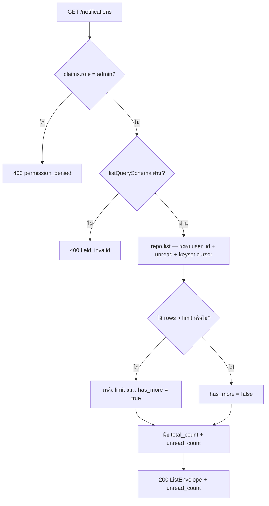
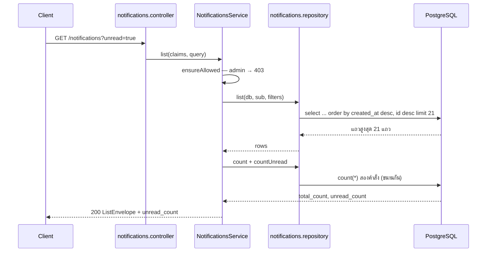
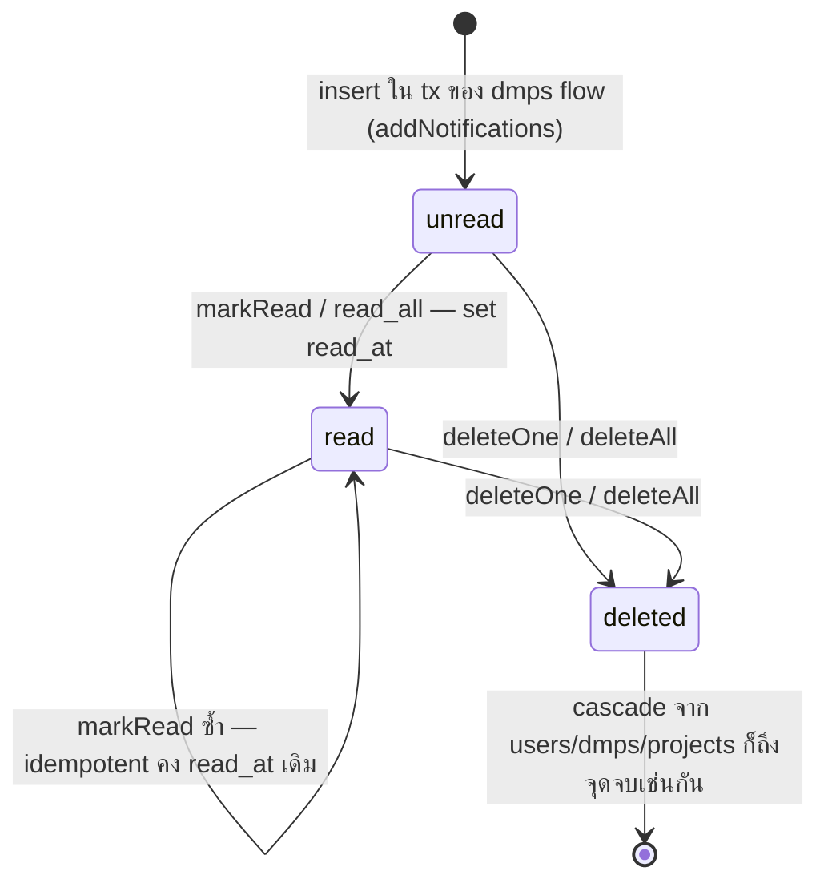

# notifications

> โมดูล read model ของระบบแจ้งเตือน (ADR-0013): ให้ผู้ใช้ดึงรายการแจ้งเตือนของตนเองแบบ polling พร้อม `unread_count`, ทำเครื่องหมายอ่าน และลบ ผ่าน REST API

## Overview

- read model ของตาราง `notifications` — ดึงรายการแบบ keyset pagination คืนเป็น ListEnvelope (ADR-0015) ที่แถม `unread_count`
- จัดการสถานะการอ่าน: mark read รายการเดียว, read all (idempotent) และลบรายการเดียว/ทั้งหมด เฉพาะของผู้ใช้ที่ sign in
- เป็นโมดูล "อ่านอย่างเดียว" — การ insert แจ้งเตือนเกิดใน transaction ของ dmps flows แล้ว FE รับข้อมูลด้วยการ poll ตาม ADR-0013
- **ไม่ควรทำ / Out of scope:**
  - การสร้าง (insert) แจ้งเตือน — เป็นหน้าที่ของ dmps flows (`addNotifications` ใน `dmps.repository.ts`)
  - การส่งแจ้งเตือนแบบ realtime (SSE/WebSocket/push) — FE ต้องเรียก `GET /notifications` เอง

## Folder Structure

```text
notifications/
├── notifications.controller.ts   # HTTP boundary บาง ๆ — ผูก 5 route ของ /notifications ให้ service
├── notifications.service.ts      # Business Logic — validate query (zod), บังคับ role, map snake_case, 404 ซ่อนการมีอยู่
├── notifications.repository.ts   # plain Drizzle functions (DI-free รับ Db) — list/count/markRead/delete
└── notifications.module.ts       # ประกาศ controller + provider เข้ากับ AppModule
```

## Business Rules

- การยืนยันตัวตนบังคับทุก route ผ่าน AuthGuard ระดับ global — `@CurrentUser()` คืน 401 `not_signed_in` เมื่อไม่มี claims
- ทุก operation ปฏิเสธ `claims.role === "admin"` ด้วย 403 `permission_denied` ("Admin has no notification access") — role อื่นเข้าถึงได้ปกติ
- พารามิเตอร์ query: `unread` รับเฉพาะ `"true"`/`"false"` (แปลงเป็น boolean), `limit` ต้องเป็นจำนวนเต็ม 1–100 (ค่า default 20), `starting_after` เป็น `notification_id` ของหน้าก่อน — ละเมิดใด ๆ → 400 `field_invalid` พร้อม JSON pointer ใน `param`
- เรียงลำดับผลลัพธ์ `created_at` มาก่อน (desc) โดยใช้ `notification_id` desc เป็น tiebreak; ดึง `limit + 1` แถวเพื่อคำนวณ `has_more`
- Cursor pagination เป็น keyset: เทียบ tuple `(created_at, notification_id)` น้อยกว่าของ `starting_after` — ถ้า id นั้นไม่มีอยู่จริง subquery คืน NULL เทียบไม่ได้ หน้าจึงว่าง (ไม่ error)
- `total_count` นับตามเงื่อนไขเดียวกับหน้าปัจจุบัน (รวมตัวกรอง unread) ส่วน `unread_count` นับ unread ทั้งหมดของผู้ใช้เสมอ — ไม่ขึ้นกับตัวกรอง
- การเข้าถึง scoped ที่ `user_id` จาก claims เสมอ — id ของผู้อื่นหรือ id ที่ไม่มีอยู่ตอบ 404 `notification_not_found` เท่ากันเพื่อซ่อนการมีอยู่
- mark read เป็น idempotent: UPDATE เฉพาะแถวที่ `read_at IS NULL` — อ่านซ้ำคง `read_at` เดิมและตอบ 200 ด้วยแถวเดิม (schema ไม่มี `updated_at`)
- `POST /notifications/read_all` อ่านทุก unread ของผู้ใช้ในครั้งเดียว ตอบ `{object: "notification_batch", updated: <จำนวน>}`; `DELETE /notifications` ตอบ `{object: "notification_batch", deleted: <จำนวน>}`
- ประเภทแจ้งเตือนกำหนดโดย pgEnum `notification_type` 8 ค่า: `dmp_submitted`, `dmp_approved`, `dmp_finalized`, `tasks_generated`, `tasks_cancelled`, `proposal_superseded`, `review_requested`, `dmp_returned`
- แถวแจ้งเตือนถูก insert ใน transaction เดียวกับ state change ของ dmps flows — ถ้า flow rollback แจ้งเตือนไม่เกิด
- FK เป็น `ON DELETE cascade` ทั้งสามเส้น: `user_id` → users, `dmp_id` → dmps, `project_id` → projects — ลบต้นทางแล้วแจ้งเตือนถูกลบตาม
- `read_at` เป็น nullable (ADR-0024: เป็นข้อมูล UX ไม่ใช่ record) และการลบเป็น hard delete — ไม่มี soft delete และลบแล้วหายถาวร
- การรับแจ้งเตือนเป็นแบบ pull (ADR-0013): FE poll `GET /notifications` เอง — โมดูลนี้ไม่มี SSE channel สำหรับ notification
- SSE event ที่ define เป็น discriminated union ใน `envelope.ts` (ADR-0018) เป็น stream ของ AI run ไม่ใช่ของ notification ประกอบด้วย event `status`, `tool`, `delta`, `proposal` ตามด้วย terminal event `done` หรือ `error` ตัวเดียว — FE ต้องเมิน event ที่ไม่รู้จัก (forward compatibility) และ `error` อาจแถม `usage` (นับโควตาแม้ fail/abort ตาม ADR-0023) กับ `resets_at` (เฉพาะ `quota_exceeded`)

## Usage

Entry points สำหรับ FE (ทุก route ต้อง sign in และห้าม admin):

- `GET /notifications` — query `unread=true|false`, `limit`, `starting_after` คืน `{object: "list", data, has_more, total_count, unread_count}`
- `POST /notifications/:notification_id/read` — mark read รายการเดียว (idempotent)
- `POST /notifications/read_all` — mark read ทั้งหมด
- `DELETE /notifications/:notification_id` — ลบรายการเดียว คืน `{object: "notification", notification_id, deleted: true}`
- `DELETE /notifications` — ลบทั้งหมด

```ts
// poll เฉพาะ unread หน้าแรก แล้วเลื่อนหน้าด้วย cursor
GET /notifications?unread=true&limit=20
GET /notifications?unread=true&starting_after=<notification_id ตัวสุดท้ายของหน้าก่อน>
```

- โมดูลไม่มี service API สำหรับ feature อื่น — `NotificationsService` ถูกเรียกจาก `NotificationsController` เท่านั้น (ฝั่งเขียนใช้ `addNotifications` ของ dmps โดยตรง)
- Prerequisites: `DATABASE_URL` พร้อม migration ตาราง `notifications` และ `JWT_SECRET` สำหรับ access token; section `notifications` ใน `config.toml` ไม่มีค่า tunable (`notifications: z.object({})`)

## Dependencies

### Internal

- `features/auth` — ใช้ type `AccessClaims` (จาก `jwt.ts`) และ decorator `CurrentUser` (จาก `session.ts`) เพื่ออ่าน claims ของผู้เรียก
- `features/dmps` — ยืม type `Db` จาก `dmps.repository.ts`; และเป็นคู่ตรงข้ามฝั่งเขียน (`addNotifications`, `approveTx` ใส่แถวแจ้งเตือนใน tx ของ flow)
- `shared/contracts` — ใช้ `listOf` และ type `ListEnvelope` จาก `envelope.ts` สำหรับรูปแบบ response แบบ list
- `shared/http` — ใช้ `ApiError` และ `fieldInvalid` จาก `error-envelope.ts` เพื่อยิง error envelope มาตรฐาน (ADR-0014)
- `database` — ใช้ DI token `DB` จาก `database.module.ts` และตาราง `notifications` จาก `schema/index.ts`
- ถูก register ที่ root เป็น `NotificationsModule` ใน `app.module.ts`

### External packages

- `@nestjs/common` (^12.3.3) — decorator `Controller`, `Injectable`, `Inject` และ HTTP verb decorators (`Get`, `Post`, `Delete`, `Query`, `Param`)
- `drizzle-orm` (^0.45.4) — สร้าง query select/update/delete รวมถึง keyset cursor ด้วย `sql` template
- `zod` (^3.25.76) — validate query string ผ่าน `listQuerySchema`

### External services

- PostgreSQL — เก็บตาราง `notifications` ผ่าน `DATABASE_URL` พร้อม FK ไป users/dmps/projects (หากล่ม: poll/mark read/delete ใช้ไม่ได้ และ flow ฝั่ง dmps ที่ insert แจ้งเตือน rollback ตาม)

## Diagrams

### Workflow — poll รายการแจ้งเตือน



### Sequence — poll เข้าถึงตาราง



### Lifecycle — สถานะของแถว notification


