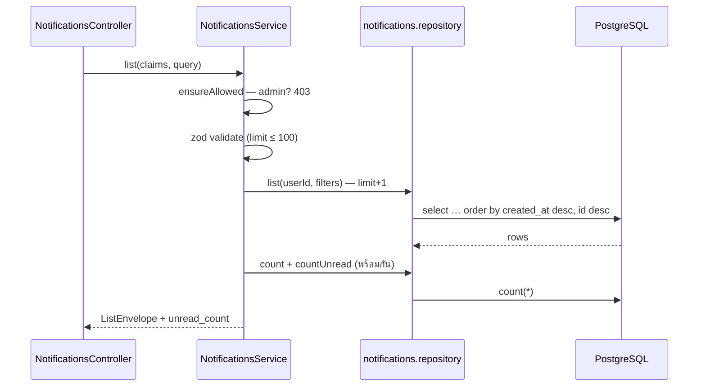

# notifications

> โฟลเดอร์นี้เป็น read model ของแจ้งเตือน (ADR-0013 poll) — ผู้ใช้เรียกดู อ่าน และลบ notification ของตัวเองผ่าน HTTP API

## Table of Contents

- [Overview](#overview)
- [Folder Structure](#folder-structure)
- [Business Rules](#business-rules)
- [Usage](#usage)
- [Dependencies](#dependencies)
- [Diagrams](#diagrams)

## Overview

- ให้ผู้ใช้ดูรายการแจ้งเตือนของตัวเอง (มี cursor pagination, นับ unread), ทำเครื่องหมายว่าอ่านแล้วทีละรายการหรือทั้งหมด และลบแจ้งเตือนได้
- ทำหน้าที่ "อ่าน" เท่านั้น — ตัวข้อมูลแจ้งเตือนถูกสร้างจาก flow อื่นแทรกใน transaction ของ dmps แล้ว

**Out of scope**
- ไม่สร้าง/เขียน notification เอง (การเขียนเกิดใน `addNotifications` ของ `dmps.repository`)
- ไม่รับผิดชอบการ push แบบ real-time เช่น SSE — FE เรียกแบบ poll ตาม ADR-0013

## Folder Structure

```text
notifications/
├── notifications.controller.ts   # HTTP boundary เท่านั้น (บาง)
├── notifications.service.ts      # validate query, เช็ค role, ซ่อน id ที่ไม่ใช่ของเจ้าของด้วย 404
├── notifications.repository.ts   # query Drizzle ล้วน ๆ กับตาราง notifications
└── notifications.module.ts       # ประกาศ controller + service ของ feature
```

## Business Rules

**การเข้าถึง**
- ทุก endpoint อนุญาตเฉพาะ role ที่มี notification (admin ถูกปฏิเสธด้วย 403 `permission_denied`)
- ทุก query/update/delete ผูกกับ `user_id` ของผู้ยืนยันตัวตนเสมอ — id ที่ไม่ใช่ของตัวเองตอบ 404 เพื่อซ่อนการมีอยู่

**ความถูกต้องของข้อมูล**
- `markRead` เป็น idempotent และแตะเฉพาะแถวที่ยังไม่อ่าน — `read_at` เดิมไม่ถูกเขียนทับ

## Usage

| Route | Purpose |
| --- | --- |
| `GET /notifications` | ดึงรายการแจ้งเตือนของตัวเอง (cursor pagination, `unread_count`) |
| `POST /notifications/:notification_id/read` | ทำเครื่องหมายว่าอ่านแล้วหนึ่งรายการ |
| `POST /notifications/read_all` | อ่านทั้งหมด |
| `DELETE /notifications/:notification_id` | ลบหนึ่งรายการ |
| `DELETE /notifications` | ลบทั้งหมด |

Prerequisites:
- AuthGuard ใช้งานอยู่ทั่วโลก (global guard) — ต้องแนบ bearer token
- ต้อง migrate ตาราง `notifications` ก่อน (`pnpm db:migrate`)

```ts
// service ทำงานกับ claims จาก AuthGuard — ตัวอย่าง flow การ list
const claims: AccessClaims = { sub: userId, role: "researcher", /* … */ };
const page = await notificationsService.list(claims, { limit: "20", unread: "true" });
// → { object: "list", data: NotificationResponse[], has_more, total_count, unread_count }
```

## Dependencies

**Internal**

| Module | Used for |
| --- | --- |
| auth | `AccessClaims` และ decorator `@CurrentUser()` |
| shared/http | `ApiError`, `fieldInvalid` สำหรับ error envelope |
| shared/contracts | `ListEnvelope` / `listOf` สำหรับรูปแบบรายการ |
| shared/database | token `DB` สำหรับ inject connection |
| dmps | type `Db` ของ repository (type-only import) |

**External packages**

| Package | Used for |
| --- | --- |
| @nestjs/common | Controller, DI decorator |
| drizzle-orm | query builder |
| zod | validate query string |

**External services**

| Service | Used for | Impact |
| --- | --- | --- |
| PostgreSQL | อ่าน/อัปเดตตาราง `notifications` | FE ไม่เห็นแจ้งเตือนและทำเครื่องหมายอ่านไม่ได้ |

## Diagrams

### Sequence — List notifications (happy path)


