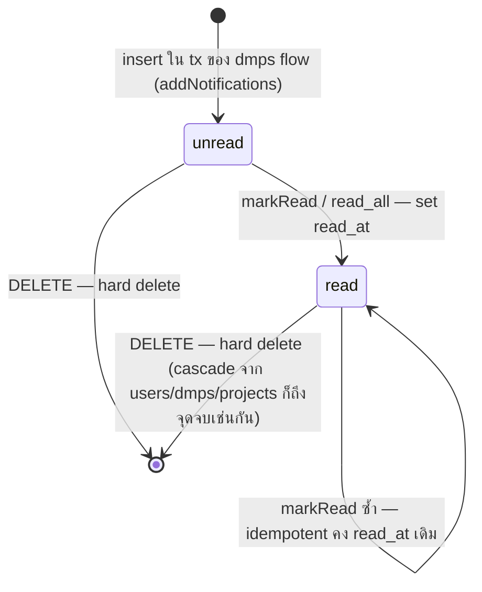

# notifications

> โมดูลนี้คือ read model ของระบบแจ้งเตือน ตาม ADR-0013 — ผู้ใช้เรียกผ่าน REST API เท่านั้น
> ผู้ใช้ดึงรายการแจ้งเตือนของตัวเองด้วยการ polling พร้อม `unread_count`
> ผู้ใช้ยังทำเครื่องหมายว่าอ่านแล้ว และลบรายการได้ด้วยตัวเอง

## Table of Contents

- [Overview](#overview)
- [Folder Structure](#folder-structure)
- [Business Rules](#business-rules)
- [Usage](#usage)
- [Dependencies](#dependencies)
- [Diagrams](#diagrams)

## Overview

- โมดูลนี้อ่านและจัดการตาราง `notifications` เท่านั้น — รูปแบบเช่นนี้เรียกว่า read model
- ทำได้ 3 อย่าง: ดึง list พร้อม `unread_count`, mark read และลบ
- จัดหน้าด้วย keyset pagination — ใช้แถวสุดท้ายของหน้าก่อนเป็น cursor แทนเลขหน้า
- list คืนผลลัพธ์ตามรูปแบบ ListEnvelope (ADR-0015) โดยแถม `unread_count` เพิ่มเข้ามา
- โมดูลนี้ไม่เคย insert แจ้งเตือนเอง — การเขียนเกิดใน transaction ของ dmps flows เท่านั้น
- **Out of scope:**
  - การสร้างแจ้งเตือน — เป็นหน้าที่ของ dmps ผ่าน `addNotifications` ใน `dmps.repository.ts`
  - การ push แบบ realtime เช่น SSE หรือ WebSocket — FE ต้อง poll `GET /notifications` เอง (ADR-0013)

## Folder Structure

```text
notifications/
├── notifications.controller.ts   # HTTP boundary บาง ๆ — ผูก 5 route ของ /notifications
├── notifications.service.ts      # validate query (zod), บังคับ role, map snake_case, 404 ซ่อนการมีอยู่
├── notifications.repository.ts   # plain Drizzle functions รับ Db — list/count/markRead/delete
└── notifications.module.ts       # ประกาศ controller + provider เข้ากับ AppModule
```

## Business Rules

**สิทธิ์และการมองเห็น**

- ทุก route อยู่ใต้ AuthGuard ระดับ global — ผู้เรียกต้อง sign in ทุกครั้งจึงผ่านได้
- service ปฏิเสธ `role = "admin"` ทุก operation — คืน 403 `permission_denied` ("Admin has no notification access")
- ตัวตรวจนี้คือเมธอด `ensureAllowed` — รันเป็นขั้นแรกก่อนทำอย่างอื่นเสมอ
- ทุก query ผูกด้วย `user_id` จาก claims ของผู้เรียกเสมอ
- การขอ id ของผู้อื่น หรือ id ที่ไม่มีอยู่จริง ตอบ 404 `notification_not_found` เท่ากัน — เพื่อซ่อนการมีอยู่ของข้อมูล

**พารามิเตอร์ query**

| พารามิเตอร์ | ค่าที่ยอมรับ | default |
| --- | --- | --- |
| `unread` | `"true"` หรือ `"false"` — แปลงเป็น boolean ให้เอง | — |
| `limit` | จำนวนเต็ม 1–100 | 20 |
| `starting_after` | `notification_id` ตัวสุดท้ายของหน้าก่อน | — |

- ทั้งสามค่าเป็น optional — ไม่ส่ง `unread` เท่ากับไม่กรองสถานะการอ่าน
- query ที่ละเมิดข้อใดข้อหนึ่ง ตอบ 400 `field_invalid` พร้อม JSON pointer ใน `param`
- error รายงานเฉพาะ issue แรกที่ zod ตรวจเจอ

**การเรียงลำดับและการแบ่งหน้า**

- เรียงผลลัพธ์ด้วย `created_at` จากมากไปน้อย
- ถ้า `created_at` ซ้ำกัน ใช้ `notification_id` แบบ desc ตัดสินอันดับ — บทบาทนี้เรียกว่า tiebreak
- query ดึง `limit + 1` แถว — ได้เกิน `limit` แปลว่ามีหน้าถัดไป (`has_more = true`) แล้วจึงตัดแถวเกินออก
- cursor ทำงานแบบ keyset — เทียบ tuple `(created_at, notification_id)` ให้น้อยกว่าคู่ของ `starting_after`
- ถ้า id ใน `starting_after` ไม่มีอยู่จริง subquery คืน NULL การเทียบจึงไม่ตรงแถวใดเลย — หน้าว่างโดยไม่ error
- `total_count` นับด้วยเงื่อนไขเดียวกับหน้าปัจจุบัน รวมตัวกรอง `unread` ด้วย
- `unread_count` นับ unread ทั้งหมดของผู้ใช้เสมอ — ไม่ขึ้นกับตัวกรองใน query

**สถานะการอ่านและการลบ**

- mark read ทำซ้ำได้ผลลัพธ์เดิม — คุณสมบัตินี้เรียกว่า idempotent
- UPDATE เกิดขึ้นเฉพาะแถวที่ `read_at IS NULL` — เรียกซ้ำจึงคง `read_at` เดิมและตอบ 200 ด้วยแถวเดิม
- `read_all` ตอบ `{object: "notification_batch", updated: <จำนวน>}`
- `DELETE /notifications` ตอบ `{object: "notification_batch", deleted: <จำนวน>}`
- การลบลบแถวออกจากฐานข้อมูลจริง — เรียกว่า hard delete ไม่มี soft delete และข้อมูลหายถาวร
- `read_at` เป็น nullable เพราะเป็นข้อมูลไว้ทำ UX ไม่ใช่ record (ADR-0024)
- FK ทั้งสามเส้นเป็น `ON DELETE cascade`: `user_id` → users, `dmp_id` → dmps, `project_id` → projects
- ลบต้นทางด้านใดด้านหนึ่ง แจ้งเตือนที่ผูกอยู่ถูกลบตามทันที

**ชนิดแจ้งเตือนและจุดเขียน**

- ชนิดแจ้งเตือนเก็บเป็น enum ฝั่ง PostgreSQL กำหนดโดย pgEnum `notification_type` — มี 8 ค่า: `dmp_submitted`, `dmp_approved`, `dmp_finalized`, `tasks_generated`, `tasks_cancelled`, `proposal_superseded`, `review_requested`, `dmp_returned`
- dmps flows insert แถวแจ้งเตือนใน transaction เดียวกับ state change ของ flow นั้น — ถ้า flow rollback แจ้งเตือนไม่เกิดขึ้นด้วย
- section `[notifications]` ใน `config.toml` ไม่มีค่า tunable — schema ประกาศเป็น `notifications: z.object({})`

## Usage

Entry points ทั้งหมดเป็น HTTP — ผู้เรียกต้อง sign in และห้าม admin:

| Route | Purpose |
| --- | --- |
| `GET /notifications` | ดึง list พร้อม `unread_count` — รับ query `unread`, `limit`, `starting_after` |
| `POST /notifications/:notification_id/read` | mark read รายการเดียว — เรียกซ้ำได้เพราะ idempotent |
| `POST /notifications/read_all` | mark read ทุก unread ในครั้งเดียว |
| `DELETE /notifications/:notification_id` | ลบรายการเดียว — คืน `{object: "notification", notification_id, deleted: true}` |
| `DELETE /notifications` | ลบแจ้งเตือนทั้งหมดของผู้ใช้ |

```text
GET /notifications?unread=true&limit=20
GET /notifications?unread=true&starting_after=<notification_id ตัวสุดท้ายของหน้าก่อน>
```

- โมดูลนี้ไม่เปิด service API ให้ feature อื่น — `NotificationsService` มี controller เป็นผู้เรียกเท่านั้น
- feature ที่ต้องการเขียนแจ้งเตือน เรียก `addNotifications` ของ dmps โดยตรง
- Prerequisites: `DATABASE_URL` ที่ migrate สร้างตาราง `notifications` แล้ว และ `JWT_SECRET` สำหรับ access token

## Dependencies

### Internal

| Module | Used in | Used for |
| --- | --- | --- |
| `features/auth` | controller / service | type `AccessClaims` และ decorator `@CurrentUser()` — ใช้อ่านตัวตนของผู้เรียก |
| `features/dmps` | `notifications.repository.ts` | ยืม type `Db` มาใช้ — เป็นคู่ตรงข้ามฝั่งเขียน โดย `addNotifications` ใส่แถวแจ้งเตือนใน tx ของ flow |
| `shared/contracts` | `notifications.service.ts` | ฟังก์ชัน `listOf` และ type `ListEnvelope` — กำหนดรูปแบบ response |
| `shared/http` | `notifications.service.ts` | `ApiError` + `fieldInvalid` — สร้าง error envelope มาตรฐาน (ADR-0014) |
| `database` | `notifications.repository.ts` | DI token `DB` และตาราง `notifications` |

### External packages

| Package | Used in | Used for |
| --- | --- | --- |
| `@nestjs/common` | controller / service | decorators (`Controller`, `Get`, `Post`, `Delete`, `Inject`) และกลไก DI |
| `drizzle-orm` | `notifications.repository.ts` | select/update/delete รวมถึง keyset cursor ที่เขียนด้วย `sql` template |
| `zod` | `notifications.service.ts` | validate query string ผ่าน schema `listQuerySchema` |

### External services

| Service | Used in | Used for | Impact |
| --- | --- | --- | --- |
| PostgreSQL | `notifications.repository.ts` | เก็บตาราง `notifications` พร้อม FK ไป users / dmps / projects | ล่ม → poll / mark read / delete ใช้ไม่ได้ทั้งหมด |

## Diagrams

### Workflow — poll รายการแจ้งเตือน

```mermaid
swimlane-beta LR
    subgraph client [Client]
        A[GET /notifications]
    end
    subgraph svc [notifications.service]
        B{role เป็น admin?}
        C{listQuerySchema ผ่าน?}
        D{rows > limit?}
    end
    subgraph repo [notifications.repository]
        E[list + count + countUnread]
    end
    subgraph res [Response]
        F[403 permission_denied]
        G[400 field_invalid]
        H[200 ListEnvelope + unread_count]
    end
    A --> B
    B -->|ใช่| F
    B -->|ไม่| C
    C -->|ไม่| G
    C -->|ผ่าน| E
    E --> D
    D -->|ใช่ — ตัดเหลือ limit, has_more = true| H
    D -->|ไม่ — has_more = false| H
```

### Lifecycle — สถานะของแถว notification



## Observations on the source

- ต้นฉบับเขียนว่า section `[notifications]` ใน `config.toml` "ว่างเปล่า" — แต่ไฟล์จริงมี `_appliesTo = ["src/features/notifications/"]` อยู่ใน section นั้น จึงไม่ว่างเปล่าทั้งก้อน
- ข้อสรุป "ไม่มีค่า tunable" ยังถูกต้อง เพราะ schema ประกาศ `notifications: z.object({})` และโค้ดไม่มีการอ่าน `_appliesTo` แต่อย่างใด
- comment ใน `config.toml` บรรทัดเดียวกันระบุว่า notifications เป็น "SSE/polling ตาม ADR-0024" — ขัดกับ ADR-0013 (notification-polling) ซึ่งเป็นตัวตัดสิน polling และตัด SSE ออก จึงน่าเป็น comment ที่ล้าสมัย
