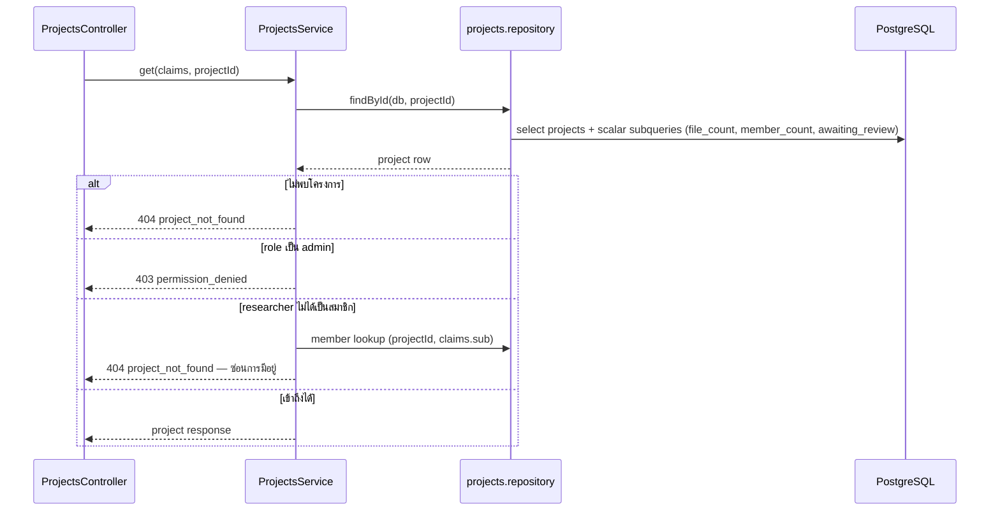
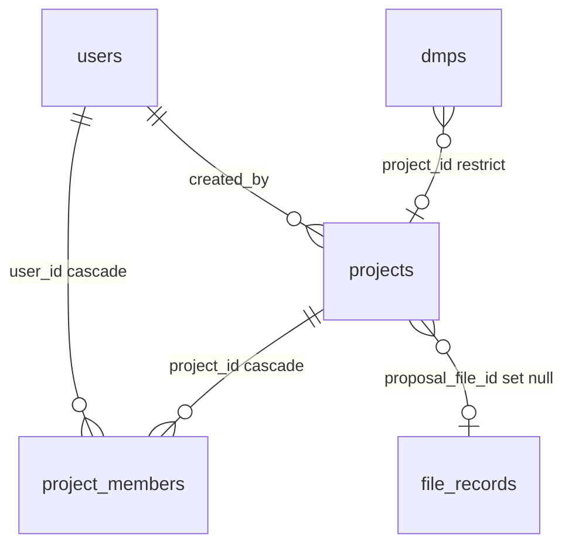

# projects

> โมดูลบริหารโครงการวิจัย: สร้าง ค้นรายการ ดูรายละเอียด/สมาชิก และลบ พร้อมเป็นผู้ตัดสินสิทธิ์การมองเห็นโครงการตาม role ให้ feature อื่นเรียกใช้

## Table of Contents

- [Overview](#overview)
- [Folder Structure](#folder-structure)
- [Business Rules](#business-rules)
- [Usage](#usage)
- [Dependencies](#dependencies)
- [Diagrams](#diagrams)

## Overview

- ดูแล lifecycle พื้นฐานของโครงการ ผ่าน 5 route: สร้าง ค้นรายการ ดูรายละเอียพร้อม counts ดูสมาชิก และลบ
- เป็นผู้เขียนตาราง `projects` และ `project_members` เป็นหลัก ระบบบังคับสิทธิ์มองเห็นตาม role ของผู้เรียก
- โมดูลนี้เปิด `ProjectsService.assertVisible()` ให้เป็น gate การมองเห็นโครงการ — files, dmps, tasks และ ai เรียกใช้ก่อนแตะทรัพยากรทุกครั้ง
- **Out of scope:**
  - การจัดการแผน (DMP) และเวอร์ชันของแผน — อยู่ใน `features/dmps` โมดูลนี้เพียงนับจำนวนแผนเพื่อกันการลบ
  - การจัดการไฟล์แนบ — อยู่ใน `features/files` โมดูลนี้เพียงนับ `file_count` เพื่อแสดงบนการ์ด
  - การแก้ข้อมูลโครงการหลังสร้าง — ไม่มี endpoint update ในโมดูลนี้

## Folder Structure

```text
projects/
├── projects.controller.ts   # HTTP boundary เท่านั้น — รับ request แล้วส่งต่อ service ทันที
├── projects.service.ts      # use case — ตรวจ role, validate ด้วย Zod, กฎการลบ, visibility gate
├── projects.repository.ts   # ฟังก์ชัน Drizzle แบบไม่ผูก DI — ทุกฟังก์ชันรับ Db เป็นพารามิเตอร์
└── projects.module.ts       # imports DatabaseModule, export ProjectsService ให้ feature อื่น
```

## Business Rules

**การสร้างโครงการ**

- สร้างได้เฉพาะ role `researcher` role อื่นได้ 403 `not_a_researcher`
- ระบบอนุมาน `plan_mode` จาก `account_type` ของผู้สร้างเสมอ: `citizen` → `independent` กรณีอื่น → `institutional` — ไม่รับค่า `plan_mode` หรือ `status` จาก client ระบบ omit ทิ้งออกจาก `createProjectSchema` ก่อน validate
- `project_name` ห้ามว่าง — service ตรวจทั้ง `z.string().min(1)` และ `trim().length === 0` กรณีละเมิดได้ 400 `project_name_required` พร้อม `param: "/project_name"`
- ต้องพบผู้ใช้ตาม `claims.sub` ก่อนสร้าง ไม่พบได้ 401 `not_signed_in`
- ผู้สร้างกลายเป็นสมาชิกทันทีด้วย `project_role: "researcher"` — service insert ทั้ง `projects` และ `project_members` ใน transaction เดียว
- ห้ามมีสมาชิกซ้ำในโครงการเดียวกัน — ฐานข้อมูลบังคับผ่าน composite PK (`project_id`, `user_id`) บน `project_members`

**สิทธิ์การมองเห็น**

- รายการที่เห็นต่างกันตาม role: `committee`/`chief` เห็นเฉพาะโครงการ `institutional` `researcher` เห็นเฉพาะที่ตนเป็นสมาชิก `admin` ไม่มีสิทธิ์เข้าถึงโครงการเลย และได้ 403 `permission_denied`
- เมื่อ `committee`/`chief` กรอง `plan_mode` ด้วยค่าอื่นที่ไม่ใช่ `institutional` ระบบคืนลิสต์ว่าง ไม่ throw error
- การอ่านรายเดี่ยว (`get` / `listMembers` / `remove`) ได้ 404 `project_not_found` ในสองกรณี: ไม่มีโครงการ หรือ `researcher` ไม่ได้เป็นสมาชิก — การตอบ 404 แทน 403 มีไว้เพื่อซ่อนการมีอยู่ของโครงการ
- `assertVisible()` เป็น gate กลาง: ไฟล์ไม่พบและไม่มีสิทธิ์ชี้ 404/403 เหมือนกัน — files, dmps, tasks, ai เรียกก่อนเข้าถึงทรัพยากรของโครงการทุกครั้ง

**พารามิเตอร์ query ของ list**

| พารามิเตอร์ | ค่าที่ยอมรับ | default |
| --- | --- | --- |
| `plan_mode` | ใช้ผลเฉพาะ committee/chief ค่าอื่นที่ไม่ใช่ `institutional` ได้ลิสต์ว่าง | — |
| `limit` | integer ≥ 1 cap ที่ 100 ค่าไม่ถูกต้องถูกแทนด้วย default เงียบ ๆ | 20 |
| `starting_after` | `project_id` ของรายการสุดท้ายหน้าก่อน | — |

**การเรียงลำดับและการแบ่งหน้า**

- เรียงตาม `project_id` จากน้อยไปมาก ตามลำดับตัวอักษรของ UUID — cursor เทียบ `project_id > starting_after` และดึง `limit + 1` เพื่อคำนวณ `has_more`
- `total_count` มาจากการนับแยกด้วยเงื่อนไขเดียวกัน

**การลบและข้อมูลประกอบการ์ด**

- ลบโครงการได้เมื่อไม่มีแผน (DMP) เหลืออยู่เลย นับรวมแผนที่ archive แล้วด้วย — ยังมีแผน → 409 `project_has_plans`
- เมื่อลบสำเร็จ `project_members` หายตาม FK cascade ส่วน `dmps.project_id` เป็น `restrict` ฐานข้อมูลจึงบังคับกฎลบด้านบนคู่กันไว้
- การ์ดโครงการแถม 3 ค่าจาก scalar subquery ใน query เดียว (ADR-0024): `file_count`, `member_count` และ `awaiting_review` — ค่า `awaiting_review` เป็น true เมื่อมี `dmp_versions` สถานะ `pending` อย่างน้อย 1
- `projects.status` มีค่า default `"draft"` contract นิยามได้ `draft|active|done` — โมดูลนี้ไม่มี endpoint เปลี่ยนสถานะหลังสร้าง

## Usage

| Route | Purpose |
| --- | --- |
| `POST /projects` | สร้างโครงการ (researcher) |
| `GET /projects` | รายการตาม role — query `plan_mode`, `limit`, `starting_after` |
| `GET /projects/:projectId` | รายละเอียดพร้อม `file_count` / `member_count` / `awaiting_review` |
| `GET /projects/:projectId/members` | รายชื่อสมาชิก |
| `DELETE /projects/:projectId` | ลบเมื่อไม่มีแผนเหลืออยู่ |

Entry point ภายในสำหรับโมดูลอื่น: `ProjectsService` export จาก `ProjectsModule` — feature files, dmps, tasks, ai เรียก `assertVisible()` เป็น gate ก่อนเข้าถึงทรัพยากร

```ts
// ใน service ของ feature อื่น เช่น files.service.ts
await this.projectsService.assertVisible(claims, projectId); // throw 404/403 เมื่อไม่เห็นโครงการ
```

- Prerequisites: import `DatabaseModule` ทำผ่าน `ProjectsModule` แล้ว ตั้งค่า `DATABASE_URL` และผู้เรียกต้องผ่าน AuthGuard เพื่อให้ `@CurrentUser()` ได้ `AccessClaims` (`sub`, `username`, `role`)

## Dependencies

### Internal

| Module | Used in | Used for |
| --- | --- | --- |
| `features/auth` | controller / service | type `AccessClaims` และ decorator `@CurrentUser()` อ่านตัวตนผู้เรียก |
| `shared/contracts` | `projects.service.ts` | `createProjectSchema` และ `listOf` / `ListEnvelope` |
| `shared/http` | `projects.service.ts` | `ApiError` + `fieldInvalid` สำหรับ error envelope |
| `database` | `projects.repository.ts` | token `DB` และตาราง `projects`, `projectMembers`, `users`, `dmps` (อ่าน `file_records`, `dmp_versions` ผ่าน raw SQL subquery) |

### External packages

| Package | Used in | Used for |
| --- | --- | --- |
| `@nestjs/common` | controller / module | decorators (`Controller`, `Get`, `Post`, `Delete`, `Inject`) และ DI |
| `drizzle-orm` | `projects.repository.ts` | query builder บน `NodePgDatabase` รวม `sql` template สำหรับ subquery |
| `zod` | `projects.service.ts` | mapping `ZodError` เป็น `fieldInvalid` (schema อยู่ใน shared/contracts) |

### External services

| Service | Used in | Used for | Impact |
| --- | --- | --- | --- |
| PostgreSQL | `projects.repository.ts` | เก็บตาราง `projects`, `project_members` และอ่าน `users`, `dmps`, `dmp_versions`, `file_records` | ล่ม → ทุก route ใช้ไม่ได้ และ feature ที่เรียก `assertVisible()` (files/dmps/tasks/ai) ล้มตามทั้งหมด |

## Diagrams

### Workflow — สร้างโครงการ

```mermaid
swimlane-beta LR
    subgraph client [Client]
        A[POST /projects]
    end
    subgraph svc [projects.service]
        B{role เป็น researcher?}
        C{project_name ไม่ว่าง?}
        D{พบ user ตาม claims.sub?}
        E[derive plan_mode จาก account_type]
    end
    subgraph repo [projects.repository]
        F[transaction insert projects + project_members role researcher]
    end
    subgraph res [Response]
        G[403 not_a_researcher]
        H[400 project_name_required]
        I[401 not_signed_in]
        J[200 project — file_count 0 · member_count 1 · awaiting_review false]
    end
    A --> B
    B -->|ไม่| G
    B -->|ใช่| C
    C -->|ว่าง| H
    C -->|ผ่าน| D
    D -->|ไม่พบ| I
    D -->|พบ| E
    E --> F
    F --> J
```

### Sequence — อ่านโครงการเดี่ยวพร้อม gate การมองเห็น



### Entity-Relationship — ความสัมพันธ์รอบโครงการ


