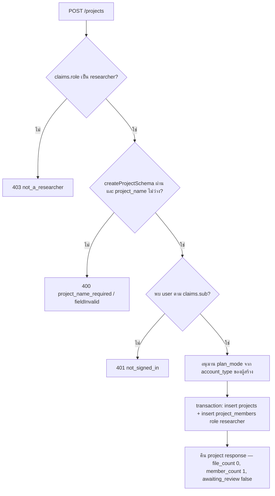
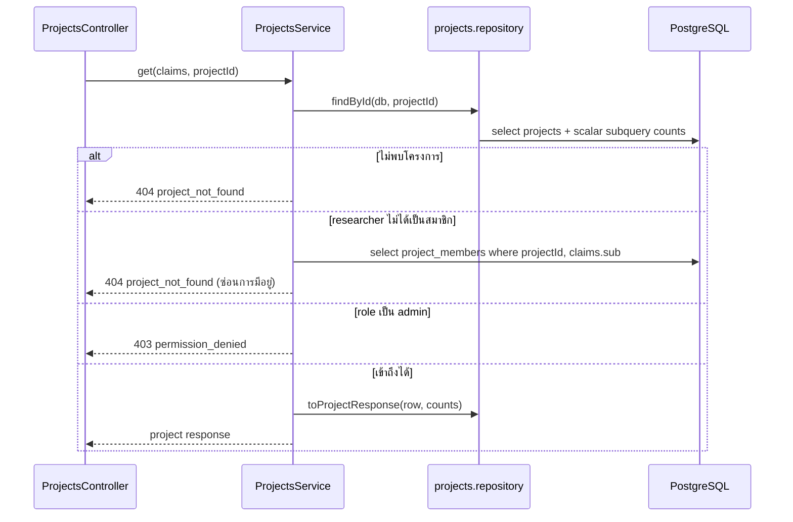

# projects

> โมดูลบริหาร "โครงการวิจัย" ของระบบ: สร้าง ค้นรายการ ดูรายละเอียด ดูสมาชิก และลบโครงการ พร้อมเป็นผู้บังคับสิทธิ์การมองเห็นโครงการตาม role ให้ feature อื่นอ้างอิง

## Overview

- รับผิดชอบ lifecycle พื้นฐานของโครงการ: สร้าง ค้นรายการ ดูรายละเอียด ดูสมาชิก และลบ (ผ่าน 5 route ใน `projects.controller.ts`)
- เป็นผู้เขียน/อ่านตาราง `projects` และ `project_members` เป็นหลัก พร้อมตรวจสิทธิ์การเข้าถึงโครงการตาม role ของผู้เรียก (researcher / committee / chief / admin)
- เปิด `ProjectsService.assertVisible()` เป็น gate การมองเห็นโครงการให้ feature อื่นเรียกใช้ (files, dmps, tasks, ai)
- ตอบผลลัพธ์ตาม contract ของ FE: ฟิลด์ snake_case, list แบบ `{object, data, has_more, total_count}` และ error แบบ envelope `{error: {type, code, message, param?}}`
- **ไม่ควรทำ / Out of scope:**
  - การจัดการแผนข้อมูล (DMP) และเวอร์ชันของแผน — อยู่ใน `features/dmps` (โฟลเดอร์นี้เพียงนับจำนวนแผนเพื่อกันการลบ)
  - การจัดการไฟล์แนบโครงการ — อยู่ใน `features/files` (โฟลเดอร์นี้เพียงนับ `file_count` แสดงบนการ์ด)
  - การแก้ไขข้อมูลโครงการหรือเปลี่ยน `status` หลังสร้าง — ไม่มี endpoint update ในโฟลเดอร์นี้

## Folder Structure

```text
projects/
├── projects.controller.ts    # HTTP boundary เท่านั้น — รับ request แล้วส่งต่อ service ทันที
├── projects.service.ts       # Use-case layer — ตรวจ role, validate ด้วย Zod, กฎการลบ, visibility gate
├── projects.repository.ts    # ฟังก์ชัน Drizzle แบบไม่ผูก DI — ทุกฟังก์ชันรับ Db เป็นพารามิเตอร์
└── projects.module.ts        # imports DatabaseModule และ export ProjectsService ให้ feature อื่น
```

## Business Rules

- สร้างโครงการได้เฉพาะ role `researcher` เท่านั้น — role อื่นได้รับ 403 `not_a_researcher`
- `plan_mode` ของโครงการอนุมานจาก `account_type` ของผู้สร้างเสมอ: `citizen` → `independent`, กรณีอื่น → `institutional`; ไม่รับค่า `plan_mode` หรือ `status` จาก client (ถูก omit ออกจาก `createProjectSchema` ก่อน validate)
- `project_name` ห้ามว่าง — ตรวจทั้ง `z.string().min(1)` ใน contract และ `trim().length === 0` ใน service กรณีละเมิดได้ 400 `project_name_required` พร้อม `param: "/project_name"`
- การสร้างต้องพบผู้ใช้ตาม `claims.sub` ในฐานข้อมูลก่อน ไม่เช่นนั้นได้รับ 401 `not_signed_in`
- ผู้สร้างกลายเป็นสมาชิกของโครงการทันทีด้วย `project_role: "researcher"` โดย insert ทั้ง `projects` และ `project_members` ใน transaction เดียวกัน
- ห้ามมีสมาชิกซ้ำในโครงการเดียวกัน — `project_members` ใช้ composite PK (`project_id`, `user_id`)
- สิทธิ์การค้นรายการ: `committee` และ `chief` เห็นเฉพาะโครงการ `institutional`; `researcher` เห็นเฉพาะโครงการที่ตนเป็นสมาชิก; `admin` ไม่มีสิทธิ์เข้าถึงโครงการ (403 `permission_denied`)
- เมื่อ `committee`/`chief` กรอง `plan_mode` ด้วยค่าอื่นที่ไม่ใช่ `institutional` ระบบจะคืน list ว่าง ไม่ throw error
- การอ่านโครงการเดี่ยว (`get`/`listMembers`/`remove`): ได้ 404 `project_not_found` เมื่อไม่มีโครงการ หรือเมื่อ `researcher` ไม่ได้เป็นสมาชิก — เพื่อซ่อนการมีอยู่ของโครงการ ไม่เปิดเผยว่า id นั้นมีจริง
- Pagination แบบ cursor: `limit` ค่าเริ่มต้น 20 และ cap ที่ 100 (ค่าที่ไม่ใช่ integer ≥ 1 จะถูกแทนด้วยค่าเริ่มต้น) เรียงตาม `project_id` จากน้อยไปมาก โดย `starting_after` เป็น cursor และ `has_more` ได้จากการ query ด้วย `limit + 1`
- ลบโครงการได้เมื่อไม่มีแผน (DMP) เหลืออยู่เลย โดยนับรวมแผนที่ archive แล้วด้วย — หากยังมีแผนจะได้รับ 409 `project_has_plans`
- การลบ `projects` จะลบ `project_members` ตามตาม FK (`onDelete: "cascade") ส่วน `dmps.project_id` เป็น `onDelete: "restrict"` ซึ่งเป็นเงื่อนไขฐานข้อมูลคู่กับกฎลบด้านบน
- `awaiting_review` บนการ์ดโครงการเป็น true เมื่อมี `dmp_versions` ที่ `status = 'pending'` อย่างน้อย 1 รายการ โดยนับรวมใน query เดียวกับข้อมูลโครงการผ่าน scalar subquery

## Usage

Entry points สำหรับ HTTP และโมดูลอื่น (ทุก route อยู่ใต้ global AuthGuard — ไม่มี `@Public()`):

- HTTP: `POST /projects`, `GET /projects` (query: `plan_mode`, `limit`, `starting_after`), `GET /projects/:projectId`, `GET /projects/:projectId/members`, `DELETE /projects/:projectId` (ผูกที่ `@Controller("projects")`)
- Internal: `ProjectsService` ถูก export จาก `ProjectsModule`; feature files, dmps, tasks, ai เรียก `assertVisible()` เป็น gate ก่อนเข้าถึงทรัพยากรของโครงการ

```ts
// ใน service ของ feature อื่น เช่น files.service.ts
await this.projectsService.assertVisible(claims, projectId); // throw 404/403 เมื่อไม่เห็นโครงการ
```

- Prerequisite: ต้อง import `DatabaseModule` (ผ่าน `ProjectsModule`) และตั้งค่า `DATABASE_URL` ใน environment; ผู้เรียกต้องผ่านการยืนยันตัวตนเพื่อให้ `@CurrentUser()` ได้ `AccessClaims` (`sub`, `username`, `role`)

## Dependencies

### Internal

- `features/auth` — ใช้ type `AccessClaims` (`jwt.ts`) และ decorator `CurrentUser()` (`session.ts`) เพื่ออ่านตัวตนผู้เรียก; พึ่ง global AuthGuard ครอบทุก route
- `database` — ใช้ token `DB` จาก `DatabaseModule` และตารางจาก `@/database/schema/index.js`: `projects`, `projectMembers`, `users`, `dmps` พร้อมอ่าน `file_records` และ `dmp_versions` ผ่าน raw SQL subquery
- `shared/contracts` — ใช้ `createProjectSchema` จาก `project.ts` และ `listOf` / `ListEnvelope` จาก `envelope.ts`
- `shared/http` — ใช้ `ApiError` และ `fieldInvalid` สำหรับยิง error ตาม envelope format

### External packages

- `@nestjs/common` — decorator `Controller`, `Get`, `Post`, `Delete`, `Inject` และกลไก DI ของ NestJS
- `drizzle-orm` — query builder ติดต่อ Postgres (`NodePgDatabase`) รวม `sql` template สำหรับ subquery
- `zod` — validate request body ผ่าน `createProjectSchema` และ mapping `ZodError`

### External services

- PostgreSQL — เชื่อมผ่าน `DATABASE_URL` โดย `DatabaseModule` เก็บตาราง `projects`, `project_members` และอ่าน `file_records`, `dmps`, `dmp_versions`, `users` (หากล่ม: ทุก route ของโมดูลใช้งานไม่ได้ และ feature files / dmps / tasks / ai ที่เรียก `assertVisible()` ล้มตามทั้งหมด)

## Diagrams

### Workflow — สร้างโครงการ



### Sequence — อ่านโครงการเดี่ยวพร้อมตรวจสิทธิ์



### Entity-Relationship — ความสัมพันธ์รอบโครงการ


