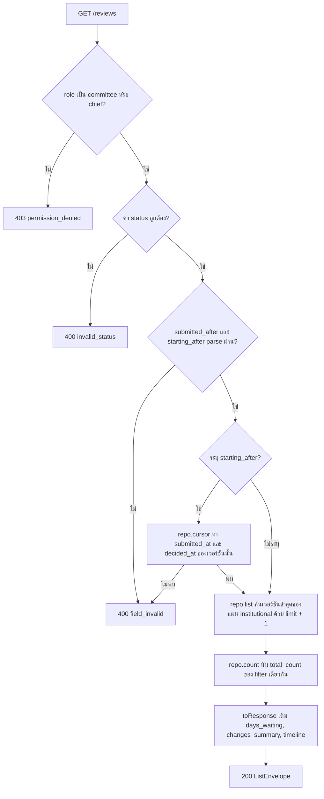
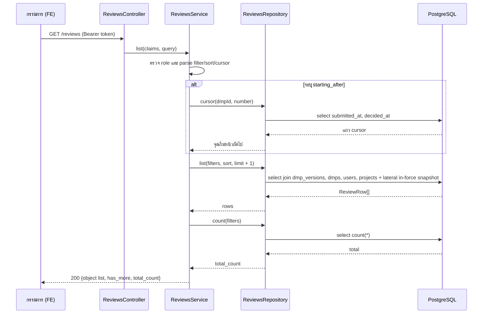

# reviews

> Read model ของคิวพิจารณา (flow #6, มุมกรรมการ): รวมเวอร์ชันล่าสุดของทุกแผน institutional ที่รอหรือผ่านการตัดสิน ให้อ่านได้จาก endpoint เดียวคือ `GET /reviews`

## Overview

- เป็น read model อย่างเดียว — query SQL ตรงจาก 4 ตาราง แล้ว enrich ด้วย `days_waiting`, `changes_summary`, `timeline` ก่อนตอบกลับ
- รองรับ filter (`status`, `decided_by`, `project_id`, `submitted_after`), sort 3 แบบ และ keyset cursor pagination
- บังคับสิทธิ์ที่ระดับ service: อ่านคิวได้เฉพาะ role `committee` และ `chief`
- ตอบทุก response ในรูปแบบ `ListEnvelope` — `{object:"list", data, has_more, total_count}`
- **ไม่ควรทำ / Out of scope:**
  - การตัดสิน approve/reject และการเขียนสถานะใด ๆ — อยู่ที่ `features/dmps` (`DmpsService.decide()`)
  - การสร้าง task จากแผนที่อนุมัติ — `generateTasks` ถูกเรียกจาก `features/dmps` เท่านั้น
  - การส่ง/อ่าน notification — เขียนใน transaction ของ dmps flows และอ่านผ่าน `features/notifications`

## Folder Structure

```text
reviews/
├── reviews.controller.ts   # HTTP boundary เท่านั้น — รับ GET /reviews + @CurrentUser แล้วส่งต่อ service
├── reviews.service.ts      # ตรวจ role, parse filter/sort/cursor, enrich เป็น ReviewResponse
├── reviews.repository.ts   # read model SQL ตรง: listReviews / countReviews / findCursor
└── reviews.module.ts       # ประกาศ controller + providers เข้าระบบ DI
```

## Business Rules

- อ่านคิวได้เฉพาะ role `committee` หรือ `chief` (ตรวจจาก `AccessClaims.role`) — role อื่นได้ 403 `permission_denied`
- คิวรวมเฉพาะเวอร์ชันล่าสุด (`max(number)`) ของแผนที่ `plan_mode = 'institutional'` เท่านั้น
- `status` รับได้เฉพาะ `pending`, `approved`, `rejected` (ส่งซ้ำหรือคั่น comma ได้) — ค่าอื่น → 400 `invalid_status`; ไม่ส่ง = แสดงทุกสถานะ
- `decided_by=me` แปลงเป็น user id ของผู้เรียก (`claims.sub`) ก่อน query
- `submitted_after` ต้อง parse เป็น date-time ได้ มิฉะนั้น 400 `field_invalid`
- `sort` รองรับ `submitted_at` (default, asc), `-submitted_at` (desc), `-decided_at` (desc, nulls last เพื่อให้ pending ที่ยังไม่ตัดสินไปอยู่ท้าย) — ค่าอื่นเงียบ ๆ fallback เป็น `submitted_at`
- `limit` default 20 และห้ามเกิน 100 — ค่าที่ไม่ใช่ integer ตั้งแต่ 1 ขึ้นไปจะถูกแทนด้วย default
- pagination เป็น keyset cursor: `starting_after` ต้องเป็น review id รูปแบบ `<dmp_id>:<version>`; หาเวอร์ชันไม่พบ → 400 `field_invalid`; cursor ผูกคู่ (timestamp, `dmp_id`) เพื่อให้ลำดับนิ่งแม้ค่า timestamp ซ้ำ
- `has_more` มาจากการ query ด้วย `limit + 1` แล้วตัดเกิน; `total_count` นับจาก filter เดียวกันโดยไม่สน cursor และ limit
- `id` ของ review เป็น id สังเคราะห์ `<dmp_id>:<version>` — ไม่ใช่คอลัมน์หรือ FK จริง
- `days_waiting` นับจำนวนวันปฏิทิน (เทียบ UTC midnight) ระหว่าง `submitted_at` กับวันนี้ ไม่นับชั่วโมง
- `is_revision` เป็น true เมื่อแผนมี `active_version` อยู่ก่อนแล้ว (revision ของแผนที่เคยอนุมัติ)
- `changes_summary` นับจาก `FieldChange[]` ที่จดบนเวอร์ชัน: `edit_type = 'major'` นับเป็น major ที่เหลือทั้งหมดนับเป็น minor
- `timeline` คำนวณจาก `begin_date`/`end_date` ของ version in force (ไม่มีใช้ draft แทน): ยังไม่เริ่ม → `Starts …`, อยู่ระหว่าง → `Week N of M`, เลยกำหนด → `Timeline ended`, ไม่มีวันที่ → `No timeline set`
- สถานะที่คิวแสดงถูกเขียนโดย `features/dmps` ตามกติกาการตัดสิน: ตัดสินได้เฉพาะ committee/chief (admin → 403, researcher → 404 เพื่อซ่อนการมีอยู่ของแผน), เฉพาะแผน institutional (ไม่ใช่ → 403 `plan_not_reviewable`), body บังคับ `position` และ reject ต้องมี `note` (400 `note_required`)
- ตัดสินซ้ำไม่ได้: update แบบ CAS บนเงื่อนไข `status = 'pending'` และดัชนี partial unique `dmp_versions_one_pending_uq` บังคับว่าแผนหนึ่งมี pending ได้ครั้งละหนึ่ง — ตัดสินซ้ำ → 409 `version_not_pending`
- approve ตั้ง `dmps.status = 'approved'` + `active_version` ใน transaction เดียวกับ carry/drop minor edits, การยกเลิก task ของ output ที่ถูกลบ (`cancel_reason = 'output_removed'`), การสร้าง task ด้วย `generateTasks` (ครั้งเดียวเมื่อ `tasks_generated = false`) และ notification `dmp_approved` (+ `tasks_cancelled` ถ้ามีการยกเลิก)
- reject: ถ้าเป็นการส่งครั้งแรก (`active_version` เป็น null) แผนกลับเป็น `draft` แต่ถ้าเป็น revision แผนยัง `approved` โดย version in force คงเดิม — พร้อม notification `dmp_returned`
- ผู้ตัดสินถูกจด snapshot `{user_id, name, position, mbox}` ไว้ที่ `decision_approver` ณ เวลาตัดสิน เพื่อให้คิวแสดงย้อนหลังได้แม้โปรไฟล์เปลี่ยนภายหลัง

## Usage

Entry points สำหรับผู้เรียกและโมดูลอื่น:

- HTTP: `GET /reviews` พร้อม query `status`, `decided_by`, `project_id`, `submitted_after`, `sort`, `limit`, `starting_after` (ผูกที่ `ReviewsController` ไม่มี global prefix — port มาจาก env `PORT`)
- Internal: `ReviewsService.list(claims, query)` คืน `Promise<ListEnvelope<ReviewResponse>>`

```ts
// GET /reviews?status=pending,approved&sort=-submitted_at&limit=50&starting_after=9f1c…:2
const claims: AccessClaims = { sub: "…", username: "…", role: "committee" };
const page = await reviewsService.list(claims, {
  status: "pending,approved",
  sort: "-submitted_at",
  limit: "50",
  starting_after: "9f1c…:2",
});
// → { object: "list", data: ReviewResponse[], has_more, total_count }
```

ข้อกำหนดก่อนใช้: Bearer access token (ระบบบังคับด้วย `AuthGuard` ทั้งแอป, HS256 ด้วย `JWT_SECRET`), env `DATABASE_URL` พร้อมใช้งาน, ผู้เรียกต้องมี role `committee`/`chief` และรายการจะปรากฏในคิวต่อเมื่อมีการ submit เวอร์ชันจาก `features/dmps` แล้วเท่านั้น

## Dependencies

### Internal

- `features/auth` — `AuthGuard` (global guard ทั้งแอป), decorator `CurrentUser` และ type `AccessClaims`
- `shared/contracts/envelope.ts` — `listOf()` และ type `ListEnvelope` สำหรับรูปร่าง response
- `shared/http/error-envelope.ts` — `ApiError` สำหรับยิง 403/400 ออกเป็น error envelope รูปแบบเดียวกันทั้งระบบ
- `features/dmps` — type `Db` (`NodePgDatabase`) ถูก import มาจาก `dmps.repository.ts`; และเป็นคู่ตรงข้ามของ read model นี้: `DmpsService.decide()` → `approveTx`/`rejectTx` เป็นผู้เขียนคอลัมน์ `status`, `submitted_at`, `decided_*`, `changes` ที่คิวนี้อ่าน
- `database/schema` — raw SQL อ่านตาราง `dmp_versions`, `dmps`, `users`, `projects` (ผ่าน FK/lateral join ใน query เดียว)

### External packages

- `@nestjs/common` — decorator `Controller`, `Get`, `Query`, `Inject`, `Injectable` และกลไก DI
- `drizzle-orm` — `sql` template tag และ type `SQL` สำหรับเขียน query ดิบ
- `pg` — PostgreSQL driver ที่ทำงานอยู่หลัง type `Db`; ทุก query ออกทาง `db.execute()`

### External services

- PostgreSQL — แหล่งข้อมูลเดียวของคิว (env `DATABASE_URL`); หากล่ม `GET /reviews` ใช้งานไม่ได้ทั้ง endpoint และกรรมการมองไม่เห็นคิวพิจารณา

## Diagrams

### Workflow



### Sequence



### Entity-Relationship

ความสัมพันธ์ที่ query ของ read model นี้ join — review คือเวอร์ชันล่าสุดของแผน institutional และ in-force snapshot ถูกดึงด้วย lateral join จาก `active_version`:


