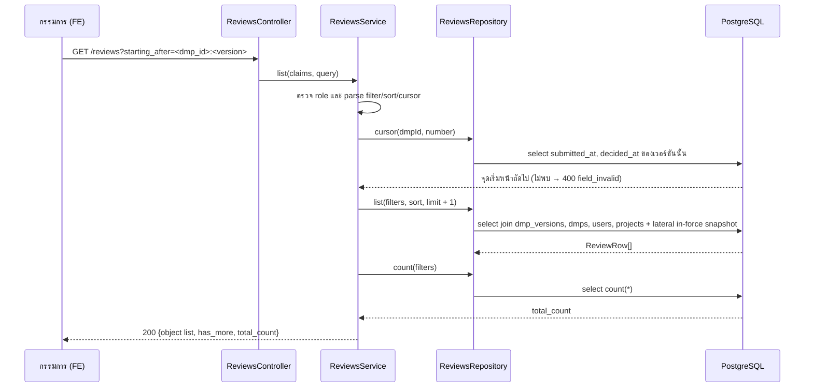
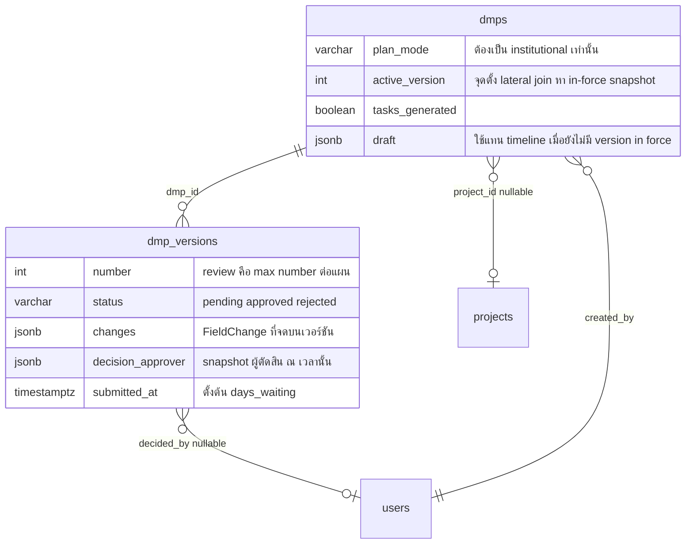

# reviews

> โมดูลนี้คือ read model ของคิวพิจารณา มองจากมุมของกรรมการ — read model คือโค้ดอ่านอย่างเดียวที่ประกอบข้อมูลจากหลายตารางให้พร้อมใช้ คิวนี้รวมเวอร์ชันล่าสุดของทุกแผน institutional ที่รอหรือผ่านการตัดสิน กรรมการอ่านคิวได้จาก endpoint เดียวคือ `GET /reviews` ส่วนการตัดสินเองไม่ได้อยู่ในโฟลเดอร์นี้

## Table of Contents

- [Overview](#overview)
- [Folder Structure](#folder-structure)
- [Business Rules](#business-rules)
- [Usage](#usage)
- [Dependencies](#dependencies)
- [Diagrams](#diagrams)

## Overview

- เป็น read model อ่านอย่างเดียว — query SQL ตรงเข้าฐานข้อมูล แล้วประกอบผลลัพธ์เอง ไม่เขียนข้อมูลกลับเข้าฐานข้อมูล
- query ดึงข้อมูลจาก 4 ตาราง แล้วเติม `days_waiting`, `changes_summary`, `timeline` ก่อนตอบกลับ
- รองรับ filter 4 ตัว: `status`, `decided_by`, `project_id`, `submitted_after`
- รองรับ sort 3 แบบ และ pagination แบบ keyset cursor — keyset cursor คือการใช้ cursor ชี้ตำแหน่งสุดท้ายของหน้าก่อน แทนการนับ offset
- บังคับสิทธิ์ที่ระดับ service ไม่ใช่ระดับ controller — อ่านคิวได้เฉพาะ role `committee` และ `chief`
- ทุก response อยู่ในรูป ListEnvelope — `{object:"list", data, has_more, total_count}`
- **Out of scope:**
  - การตัดสิน approve/reject และการเขียนสถานะใด ๆ อยู่ที่ `features/dmps` — entry point คือ `DmpsService.decide()`
  - การสร้าง task จากแผนที่อนุมัติ — `generateTasks` ถูกเรียกจาก `features/dmps` เท่านั้น
  - การสร้าง/อ่าน notification — การเขียนเกิดใน transaction ของ dmps flows ส่วนการอ่านทำผ่าน `features/notifications`

## Folder Structure

โฟลเดอร์นี้มี 4 ไฟล์ แยกหน้าที่กันชัดเจน ไล่ตามทิศทาง request ได้จากบนลงล่าง

```text
reviews/
├── reviews.controller.ts   # HTTP boundary เท่านั้น — รับ GET /reviews + @CurrentUser แล้วส่งต่อ service
├── reviews.service.ts      # ตรวจ role, parse filter/sort/cursor, เติม days_waiting / changes_summary / timeline
├── reviews.repository.ts   # read model SQL ตรง (db.execute): listReviews / countReviews / findCursor
└── reviews.module.ts       # ประกาศ controller + providers เข้าระบบ DI
```

## Business Rules

**สิทธิ์เข้าถึง**

- อ่านคิวได้เฉพาะ role `committee` หรือ `chief` — role อื่นได้ 403 `permission_denied`
- คิวรวมเฉพาะแผนที่ `plan_mode = 'institutional'` เท่านั้น
- แต่ละแผนปรากฏในคิวด้วยเวอร์ชันล่าสุดเท่านั้น คือ version number ที่มากที่สุด (`max(number)`)

**ฝั่งตัดสิน (เขียนโดย `features/dmps` — ย่อหน้านี้อธิบาย flow คู่กันเพื่อให้คิวอ่านเข้าใจ)**

- ตัดสินได้เฉพาะ role `committee` และ `chief` เช่นเดียวกับการอ่านคิว — `admin` ได้ 403 `permission_denied`
- `researcher` ได้ 404 `dmp_not_found` — ตอบ 404 แทน 403 เพื่อซ่อนว่าแผนนั้นมีอยู่
- ตัดสินได้เฉพาะแผน institutional — แผนอื่นได้ 403 `plan_not_reviewable`
- body ของคำขอตัดสินต้องมี `position` ทุกครั้ง
- กรณี reject ต้องมี `note` เพิ่มด้วย — ขาด → 400 `note_required` เพราะห้ามส่งแผนกลับโดยไม่มีเหตุผล
- ตัดสินซ้ำไม่ได้ — โค้ด update ด้วยเทคนิค CAS โดยกำหนดเงื่อนไข `status = 'pending'`
- CAS ย่อมาจาก compare-and-set — คือการ update ที่สำเร็จเฉพาะเมื่อค่าเดิมยังตรงเงื่อนไข
- ถ้ากรรมการคนอื่นตัดสิน version เดิมไปก่อน เงื่อนไขจะไม่ตรง update ล้มเหลว → 409 `version_not_pending`
- ดัชนี `dmp_versions_one_pending_uq` เป็น partial unique index — คือ unique index ที่บังคับเฉพาะแถวที่ตรงเงื่อนไข
- ดัชนีนี้บังคับว่าแผนหนึ่งมี version pending ได้ครั้งละหนึ่ง
- approve ทำงานทุกขั้นใน transaction เดียว
- ถ้า version ที่ตัดสินเป็น revision จะ carry หรือ drop minor edits ตาม entity id ด้วย `carryEdits` แล้ว rebase working copy ของ author
- task ของ output ที่ revision ลบออก ถ้ายังอยู่สถานะ `todo` หรือ `in_progress` จะกลายเป็น `cancelled` พร้อม `cancel_reason: 'output_removed'`
- สร้าง task ชุดแรกด้วย `generateTasks` — ทำครั้งเดียวเมื่อ `tasks_generated = false`
- insert notification `dmp_approved` — ถ้ามีการยกเลิก task เพิ่ม notification `tasks_cancelled` อีกชุด
- reject แบ่งตามประวัติของแผน
- ถ้าเป็นการส่งครั้งแรก — แผนยังไม่มี `active_version` (ค่า null) — แผนกลับเป็น `draft`
- ถ้าเป็น revision แผนยัง `approved` โดย version in force คงเดิม (ADR-0021)
- ทุกกรณี reject ระบบส่ง notification `dmp_returned` ถึง author
- ผู้ตัดสินถูกจดเป็น snapshot `{user_id, name, position, mbox}` ไว้ที่ `decision_approver` ณ เวลาตัดสิน
- คิวจึงแสดงชื่อผู้ตัดสินย้อนหลังได้ แม้โปรไฟล์ของผู้ตัดสินเปลี่ยนภายหลัง

**พารามิเตอร์ query**

| พารามิเตอร์ | ค่าที่ยอมรับ | default |
| --- | --- | --- |
| `status` | `pending`, `approved`, `rejected` — ส่งหลายค่าได้ คั่นด้วย comma หรือส่งซ้ำ — ค่าอื่น → 400 `invalid_status` | — (แสดงทุกสถานะ) |
| `decided_by` | user id หรือ `me` — ค่า `me` จะถูกแปลงเป็น `claims.sub` | — |
| `project_id` | uuid ของโครงการ | — |
| `submitted_after` | date-time ที่ parse ได้ — parse ไม่ได้ → 400 `field_invalid` | — |
| `sort` | `submitted_at` เรียง asc — `-submitted_at` เรียง desc — `-decided_at` เรียง desc แบบ nulls last จึงไล่ pending ที่ยังไม่ตัดสินไปไว้ท้าย | `submitted_at` |
| `limit` | integer ≥ 1 — cap สูงสุดที่ 100 — ค่าไม่ถูกต้องจะใช้ default แทน | 20 |
| `starting_after` | review id รูปแบบ `<dmp_id>:<version>` — หาเวอร์ชันนั้นไม่พบ → 400 `field_invalid` | — |

- ค่า `sort` ที่ไม่อยู่ในชุดด้านบน จะ fallback เป็น `submitted_at` เงียบ ๆ โดยไม่ throw

**การเรียงลำดับและการแบ่งหน้า**

- pagination ใช้แบบ keyset cursor
- cursor ผูกคู่ค่า: timestamp ตาม sort ที่เลือก และ `dmp_id`
- การผูกสองค่านี้ทำให้ลำดับนิ่ง แม้หลายแถวมี timestamp ซ้ำกัน
- `has_more` มาจากการ query ด้วย `limit + 1` แถว แล้วตัดแถวเกินทิ้ง
- `total_count` นับจาก filter เดียวกัน โดยไม่สน cursor และ limit

**ข้อมูลที่คำนวณเพิ่มใน response**

- `id` ของแต่ละ review เป็น id สังเคราะห์ รูปแบบ `<dmp_id>:<version>` — ไม่ใช่คอลัมน์จริงและไม่ใช่ FK
- `days_waiting` นับจำนวนวันปฏิทินระหว่าง `submitted_at` กับวันนี้ — เทียบที่ขอบเวลา UTC midnight จึงไม่นับชั่วโมง
- `changes_summary` นับจาก `FieldChange[]` ที่จดบนเวอร์ชัน — รายการที่ `edit_type = 'major'` นับเป็น major ส่วนที่เหลือนับเป็น minor
- `is_revision` เป็น true เมื่อแผนมี `active_version` อยู่ก่อนแล้ว — ตรงกับกรณี revision ในหัวข้อฝั่งตัดสินด้านบน
- `timeline` อ่านจาก version in force — ถ้ายังไม่มี version in force จะใช้ `draft` ของแผนแทน
- service แปลง timeline เป็นข้อความ 4 แบบ: ไม่มีวันที่ → `No timeline set` — ยังไม่เริ่ม → `Starts <date>` — เลยกำหนด → `Timeline ended` — ระหว่างทาง → `Week N of M`

## Usage

| Route | Purpose |
| --- | --- |
| `GET /reviews` | คิวพิจารณาของ committee/chief — query `status`, `decided_by`, `project_id`, `submitted_after`, `sort`, `limit`, `starting_after` |

- เส้นทางตัดสินอยู่ที่ `features/dmps`: `POST /dmps/:dmpId/versions/:number/approve` และ `POST /dmps/:dmpId/versions/:number/reject`
- Internal: `ReviewsService.list(claims, query)` คืน `Promise<ListEnvelope<ReviewResponse>>`

```ts
// GET /reviews?status=pending,approved&sort=-submitted_at&limit=50&starting_after=9f1c…:2
const claims: AccessClaims = { sub: "…", username: "…", role: "committee" };
const page = await reviewsService.list(claims, {
  status: "pending,approved",
  sort: "-submitted_at",
  limit: "50",
  starting_after: "9f1c…:2",
});
// → { object: "list", data: ReviewResponse[], has_more, total_count }
```

- ต้องแนบ Bearer access token ทุกครั้ง — AuthGuard เป็น guard ระดับทั้งแอป
- token ตรวจด้วยอัลกอริทึม HS256 ด้วย key `JWT_SECRET`
- `DATABASE_URL` ต้องพร้อมใช้งาน
- ผู้เรียกต้องมี role `committee` หรือ `chief`
- รายการจะปรากฏในคิวต่อเมื่อมีการ submit เวอร์ชันจาก `features/dmps` แล้วเท่านั้น

> [!NOTE] **TODO: confirm** — โค้ดไม่พบ guard กันกรรมการตัดสินแผนของตนเอง โดย `DmpsService.decide()` ไม่ได้เทียบ `claims.sub` กับ `dmps.createdBy` — committee/chief ที่เผลอเป็น author ของแผนจะตัดสินแผนตัวเองได้ หรือเป็นเจตนาให้มีกันไว้?

## Dependencies

### Internal

| Module | Used in | Used for |
| --- | --- | --- |
| `features/auth` | controller / service | type `AccessClaims` และ decorator `@CurrentUser()` — AuthGuard เป็น global guard ทั้งแอป |
| `features/dmps` | `reviews.repository.ts` | ยืม type `Db` (`NodePgDatabase`) — เป็นคู่ตรงข้ามของ read model นี้ — `decide()` → `approveTx`/`rejectTx` เขียนคอลัมน์ `status`, `submitted_at`, `decided_*`, `changes` ที่คิวนี้อ่าน |
| `shared/contracts` | `reviews.service.ts` | `listOf()` และ type `ListEnvelope` |
| `shared/http` | `reviews.service.ts` | `ApiError` ยิง 403/400 ออกเป็น error envelope มาตรฐาน ตาม ADR-0014 |
| `database/schema` | `reviews.repository.ts` | raw SQL อ่านตาราง `dmp_versions`, `dmps`, `users`, `projects` — join/lateral ทั้งหมดใน query เดียว |

### External packages

| Package | Used in | Used for |
| --- | --- | --- |
| `@nestjs/common` | ทุกไฟล์ .ts | decorators `Controller`, `Get`, `Query`, `Inject`, `Injectable` และระบบ DI |
| `drizzle-orm` | `reviews.repository.ts` | `sql` template tag และ type `SQL` สำหรับ query ดิบ |
| `pg` | อยู่หลัง type `Db` | PostgreSQL driver — ทุก query ออกทาง `db.execute()` |

### External services

| Service | Used in | Used for | Impact |
| --- | --- | --- | --- |
| PostgreSQL | `reviews.repository.ts` | แหล่งข้อมูลเดียวของคิว — เชื่อมต่อผ่าน `DATABASE_URL` | ล่ม → `GET /reviews` ใช้ไม่ได้ทั้ง endpoint — กรรมการมองไม่เห็นคิว |

## Diagrams

### Workflow — ดึงคิวพิจารณา

```mermaid
swimlane-beta LR
    subgraph client [กรรมการ]
        A[GET /reviews]
    end
    subgraph svc [reviews.service]
        B{role เป็น committee หรือ chief?}
        C{ค่า status ถูกต้อง?}
        D{submitted_after และ starting_after parse ผ่าน?}
        E[เติม days_waiting · changes_summary · timeline]
    end
    subgraph repo [reviews.repository]
        F{ระบุ starting_after?}
        G[cursor — หา submitted_at ของเวอร์ชันนั้น]
        H[list — เวอร์ชันล่าสุดของแผน institutional ด้วย limit + 1]
        I[count — total_count ของ filter เดียวกัน]
    end
    subgraph res [Response]
        J[403 permission_denied]
        K[400 invalid_status]
        L[400 field_invalid]
        M[200 ListEnvelope]
    end
    A --> B
    B -->|ไม่| J
    B -->|ใช่| C
    C -->|ไม่| K
    C -->|ใช่| D
    D -->|ไม่| L
    D -->|ผ่าน| F
    F -->|ใช่| G
    G -->|ไม่พบ| L
    G -->|พบ| H
    F -->|ไม่ระบุ| H
    H --> I
    I --> E
    E --> M
```

### Sequence — poll หน้าถัดไปด้วย cursor



### Entity-Relationship — ความสัมพันธ์ที่ query ของคิว join

review คือเวอร์ชันล่าสุดของแผน institutional และ in-force snapshot ถูกดึงด้วย lateral join จาก `active_version`:


