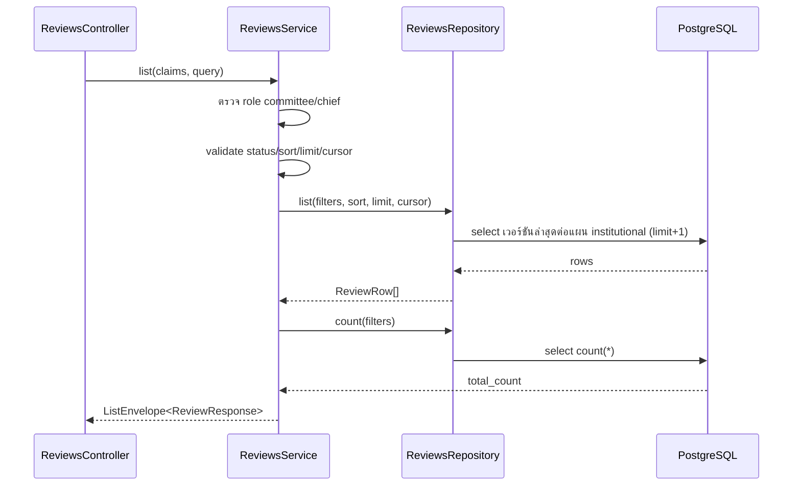

# reviews

> โฟลเดอร์นี้คือ read model ของคิวพิจารณา (flow #6) มุมกรรมการ — ดึงเวอร์ชันล่าสุดของแผน institutional มาแสดงเป็นรายการ review พร้อม filter, sort, pagination

## Table of Contents

- [Overview](#overview)
- [Folder Structure](#folder-structure)
- [Business Rules](#business-rules)
- [Usage](#usage)
- [Dependencies](#dependencies)
- [Diagrams](#diagrams)

## Overview

- ให้กรรมการ/chief อ่านรายการเวอร์ชันล่าสุดของแผน institutional ทั้งที่รอพิจารณาและตัดสินแล้ว พร้อมสถิติสรุป (จำนวน, วันรอ, major/minor, timeline)
- เป็นโมดูลอ่านอย่างเดียว — ไม่มีการเขียนสถานะใด ๆ ในโฟลเดอร์นี้
- **Out of scope:**
- การตัดสิน approve/reject และการสร้าง task หลังอนุมัติ — อยู่ที่ `reviews`/`dmps` flow การ submit และ `tasks`
- การ submit เวอร์ชันใหม่ของนักวิจัย — อยู่ที่ feature `dmps`

## Folder Structure

```text
reviews/
├── reviews.module.ts       # ประกาศ module: controller + service + repository
├── reviews.controller.ts   # บาง — HTTP boundary เท่านั้น (GET /reviews)
├── reviews.service.ts      # ตรวจสิทธิ์, validate query, แปลงแถวเป็น ReviewResponse
└── reviews.repository.ts   # SQL อ่านล่าสุดต่อแผน — sort + cursor + limit+1 (has_more)
```

## Business Rules

**สิทธิ์การเข้าถึง**

- อ่านคิวได้เฉพาะ role `committee` และ `chief` — อื่น ๆ ได้ 403 `permission_denied` เพื่อไม่ให้บุคคลภายนอกคณะกรรมการเห็นข้อมูลการตัดสิน

**ขอบเขตข้อมูล**

- แสดงเฉพาะเวอร์ชันล่าสุด (number สูงสุด) ต่อแผน และเฉพาะแผน `plan_mode = 'institutional'` เท่านั้น — ป้องกันการนับซ้ำของเวอร์ชันเก่าและการรั่วไหลของแผนประเภทอื่น

**ความถูกต้องของ query**

- `status` ที่ไม่ใช่ pending/approved/rejected ต้องถูกปฏิเสธ ไม่ผ่านเงียบ ๆ — ป้องกัน dashboard แสดงตัวเลขผิดจาก filter ที่ตั้งใจ
- `limit` clamp ที่ค่าสูงสุดและใช้ limit+1 ตรวจ `has_more` — ป้องกัน query หนักที่โหลดทั้งตารางจนกระทบระบบ

## Usage

| Route | Purpose |
| --- | --- |
| `GET /reviews` | ดึงรายการ review ของคิวกรรมการ พร้อม filter/sort/pagination |

ตัวอย่างการเรียกใช้จากโค้ด:

```ts
const page = await reviewsService.list(claims, {
  status: ["pending"],
  sort: "-submitted_at",
  limit: "20",
  starting_after: "<dmp_id>:3", // cursor จาก review id รูปแบบ `dmpId:number`
});
// → ListEnvelope<ReviewResponse> { object: "list", data, has_more, total_count }
```

## Dependencies

### Internal

| Module | Used for |
| --- | --- |
| `auth` | ชนิด `AccessClaims` และ `@CurrentUser()` เพื่อตรวจ role |
| `dmps` | ชนิด `Db` ที่ repository ใช้ติดต่อฐานข้อมูล |
| `database` | token `DB` สำหรับ inject การเชื่อมต่อ Postgres |
| `shared/contracts` | `listOf()` / `ListEnvelope` สำหรับรูปร่างผลลัพธ์ |
| `shared/http` | `ApiError` สำหรับ throw error ตาม envelope |

### External packages

| Package | Used for |
| --- | --- |
| `@nestjs/common` | Controller, DI (`@Inject`), `@Get`/`@Query` |
| `drizzle-orm` | ประกอบ SQL (filter, sort, cursor, limit) |

### External services

| Service | Used for | Impact |
| --- | --- | --- |
| PostgreSQL | อ่าน `dmp_versions`/`dmps`/`users`/`projects` | คิวพิจารณาใช้งานไม่ได้ทั้งหมด |

## Diagrams

### Sequence — อ่านคิวพิจารณา


