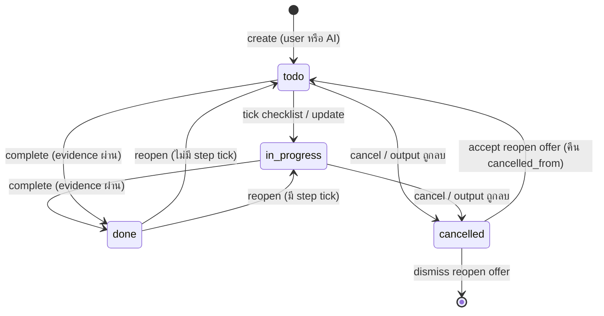
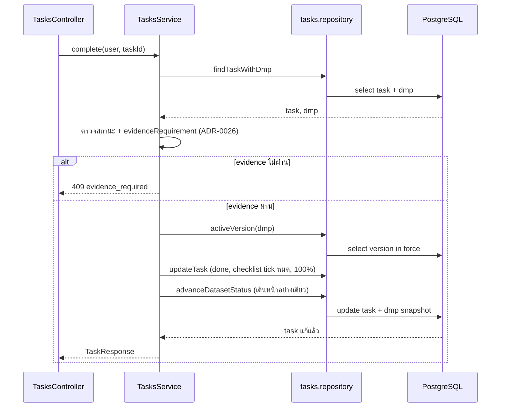

# tasks

> จัดการงาน lifecycle (task) ที่ผูกกับ output ของแผนข้อมูลวิจัย — สร้าง/แก้ไข, checklist, หลักฐาน (evidence), การปิดงาน, และ reopen offer เมื่อ output หายจากแผน

## Table of Contents

- [Overview](#overview)
- [Folder Structure](#folder-structure)
- [Business Rules](#business-rules)
- [Usage](#usage)
- [Dependencies](#dependencies)
- [Diagrams](#diagrams)

## Overview

- บริหารงานที่ต้องทำตามแผนข้อมูลวิจัย (DMP): สร้างงานเอง หรือรับงานที่ AI สร้าง, ติดตามความคืบหน้าผ่าน checklist, แนบหลักฐาน และปิดงานเมื่อเสร็จ
- ปิดงานจะผลักสถานะของ output ในแผนไปข้างหน้าตาม stage ของงาน และเสนอให้เปิดงานคืน (reopen offer) เมื่อ output ถูกลบออกจากแผน
- **Out of scope:**
  - ไม่รับผิดชอบการอนุมัติแผนหรือการสร้างงานอัตโนมัติตอน approve (อยู่ที่ feature `dmps` / domain-engine)
  - ไม่จัดการตัวไฟล์หลักฐานเอง — ตรวจแค่ว่า file id อยู่บนโครงการของแผน

## Folder Structure

```text
tasks/
├── tasks.module.ts      # ประกาศ module, import ProjectsModule, export TasksService
├── tasks.controller.ts  # HTTP boundary — เรียก service ตรง ๆ ไม่มี logic
├── tasks.service.ts     # use-case ทั้งหมด: สิทธิ์, validation, mapping เป็น TaskResponse
└── tasks.repository.ts  # query Drizzle, กฎสถานะ output (STAGE_TARGET, DATASET_STATUS_RANK)
```

## Business Rules

**สิทธิ์การเข้าถึง**
- บัญชี admin เข้าถึง task ไม่ได้ทุกกรณี (403 `permission_denied`) — ป้องกันการแก้ข้อมูลงานของนักวิจัยโดยพลการ
- researcher เห็นและแก้ได้เฉพาะ task ของแผนที่ตนเขียนเอง; ไม่ใช่เจ้าของ → 404 เพื่อซ่อนการมีอยู่ของ resource
- ทุกการสร้าง/แก้ task ต้องเป็น researcher และเป็นเจ้าของแผนเท่านั้น

**ความสมบูรณ์ของข้อมูล**
- ทุกการสร้าง task (ทั้งมือและ AI) ต้องอ้าง version ของแผนที่กำลังมีผล (`plan_not_in_force` ถ้าไม่มี) เพื่อผูก `source_version_id`
- `dataset_id` ที่ระบุต้องเป็น output ใน version ที่กำลังมีผลเท่านั้น (`dataset_not_in_force`)
- ปิดงาน (`complete`) ต้องมีหลักฐานตอบความต้องการของ stage (ADR-0026): collect/process/analyse ต้อง `evidence_linked`, preserve/share ของแผนแบบ repository ต้อง `system_verified`
- การปิดงานผลักสถานะ output เดินหน้าได้อย่างเดียว — ห้ามย้อนกลับ
- สถานะ `done` ตั้งผ่าน endpoint complete เท่านั้น ห้ามตั้งผ่าน PATCH (`use_complete`)
- หลักฐานและ checklist ของงานที่เสร็จแล้วแก้ไม่ได้ ต้อง reopen ก่อน
- ลบ task ได้เมื่อยังไม่มีงานที่บันทึกไว้ (ไม่มี evidence, ไม่มี step ที่ tick, ไม่เคย complete); มีแล้วต้อง cancel แทน

**การเก็บรักษางานที่มีคนลงมือ**
- งาน AI ที่ถูก generate ซ้ำแบบ `replace` จะถูกลบเฉพาะงานที่ยังไม่ถูกแตะเท่านั้น; งานที่ถูกแก้/มีหลักฐานต้องรอด
- การ replace checklist ทั้งก้อนต้องคง step ที่ tick แล้วไว้เสมอ
- งานที่ถูก cancel เพราะ output หายจากแผน เก็บสถานะเดิมไว้ใน `cancelled_from` เพื่อคืนตอนยอมรับ reopen offer

## Usage

| Route | Purpose |
| --- | --- |
| `GET /tasks` | ดึงรายการงาน (ต้องส่ง `project_id` หรือ `dmp_id`) |
| `POST /tasks` | สร้างงานเอง |
| `POST /dmps/:dmpId/tasks/generated` | บันทึกงานที่ AI สร้าง (add/replace) |
| `PATCH /tasks/:taskId` | แก้รายละเอียดงาน |
| `POST /tasks/:taskId/complete` | ปิดงานเมื่อเสร็จ |
| `POST /tasks/:taskId/reopen` | เปิดงานที่เสร็จแล้วคืน |
| `POST /tasks/:taskId/cancel` | ยกเลิกงาน |
| `DELETE /tasks/:taskId` | ลบงานที่ยังไม่มีบันทึกงาน |
| `POST /tasks/:taskId/checklist` | เพิ่ม step ใน checklist |
| `PUT /tasks/:taskId/checklist` | แทน checklist ทั้งก้อน |
| `PATCH /tasks/:taskId/checklist/:itemId` | แก้ step เดี่ยว |
| `DELETE /tasks/:taskId/checklist/:itemId` | ลบ step |
| `PUT /tasks/:taskId/evidence` | แนบหลักฐาน |
| `DELETE /tasks/:taskId/evidence` | เอาหลักฐานออก |
| `GET /dmps/:dmpId/reopen-offers` | ดูข้อเสนอเปิดงานคืน |
| `POST /reopen-offers/:offerId/accept` | ยอมรับข้อเสนอ เชื่อมงานกลับ output |
| `POST /reopen-offers/:offerId/dismiss` | ปัดข้อเสนอทิ้ง |

Prerequisites:
- ต้องมี bearer token ของ researcher/committee/chief (admin โดนปิดทุก endpoint)
- แผนต้องมี version ที่กำลังมีผลก่อนสร้างหรือปิดงาน

ตัวอย่าง — ปิดงาน:

```bash
curl -X POST http://localhost:3000/tasks/$TASK_ID/complete \
  -H "Authorization: Bearer $TOKEN"
# 409 evidence_required ถ้าหลักฐานยังไม่ตอบความต้องการของ stage
```

## Dependencies

### Internal

| Module | Used for |
| --- | --- |
| `projects` | ตรวจว่าผู้ใช้ (committee/chief) เห็นโครงการของแผนได้ (`assertVisible`) |
| `auth` | `AccessClaims` + `@CurrentUser()` เพื่อรู้ role และ user id |
| `shared/contracts` | Zod schema ของ task, checklist, evidence และ enums |
| `shared/http` | `ApiError`, `fieldInvalid`, `ListEnvelope` |
| `database` | `DB` token, schema `tasks` / `dmps` / `dmp_versions` / `reopen_offers` |

### External packages

| Package | Used for |
| --- | --- |
| `@nestjs/common` | Decorator controller, DI |
| `drizzle-orm` | Query ทุก table |
| `zod` | Validate body/query ทุก boundary |

### External services

| Service | Used for | Impact |
| --- | --- | --- |
| PostgreSQL | เก็บ task, checklist (jsonb), evidence, reopen offers | อ่าน/เขียน task ไม่ได้ทั้ง feature |

## Diagrams

### Lifecycle — Task status



### Sequence — Complete a task


