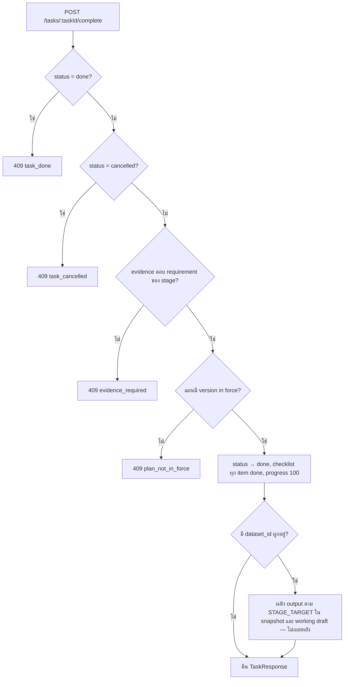
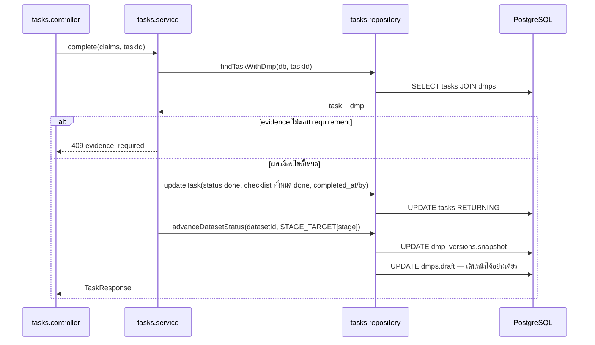
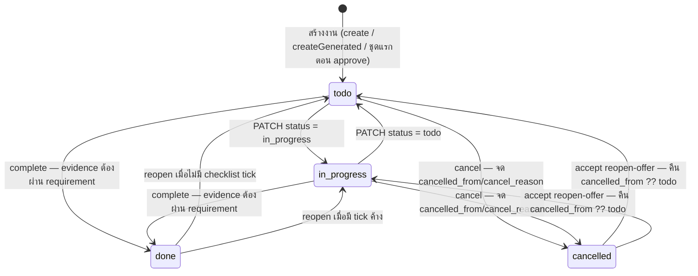
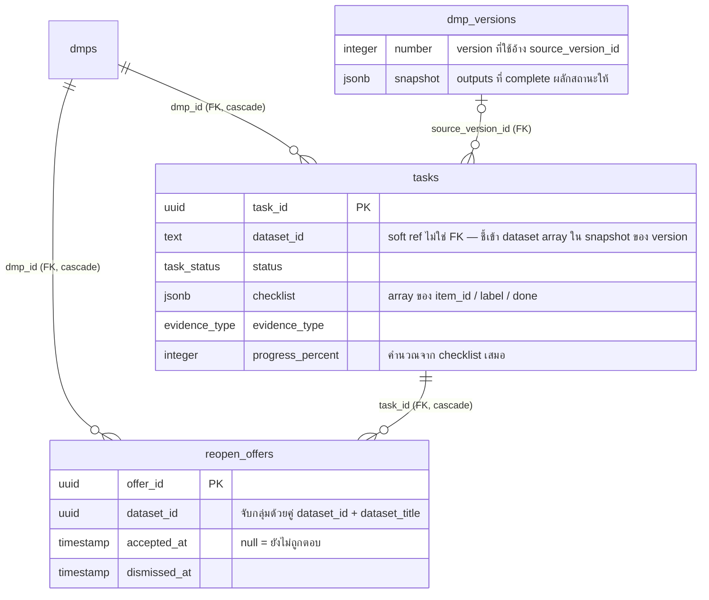

# tasks

> โมดูลบริหารงาน (task) ที่ผูกกับแผนข้อมูลวิจัย (DMP): รับงานอัตโนมัติที่เสนอมา จัดการ checklist และ evidence ปิดงาน และดูแลการเชื่อมงานกลับเมื่อ output ที่ถูกลบไปกลับคืน

## Overview

- จัดการ lifecycle ของ task ที่อ้างอิงแผน (`dmp`): สร้าง แก้ไข แบ่งเป็น checklist แนบ evidence ปิดงาน (`complete`) เปิดคืน (`reopen`) และยกเลิก (`cancel`)
- รับชุดงานที่ฝั่ง AI เสนอผ่าน `POST /dmps/:dmpId/tasks/generated` ในโหมด `add` หรือ `replace`
- เมื่อ `complete` จะผลักสถานะของ output ใน version in force และ working draft ไปข้างหน้าเท่านั้น
- ดูแล `reopen_offers`: เสนองานที่ถูก cancel เพราะ output ถูกลบ ให้เลือกยอมรับ (เชื่อม output กลับ) หรือปัดทิ้ง
  > [!NOTE] **TODO: confirm** — โค้ดทั้ง repo ไม่มีจุดใด INSERT ลงตาราง `reopen_offers` (`tasks.repository.ts` อ่าน/ปิดอย่างเดียว, `dmps.repository.ts` cancel task โดยไม่สร้าง offer) — ใครคือผู้สร้างแถว offer ตามที่ flow นี้ออกแบบไว้?
- บังคับสิทธิ์เอง: `admin` เข้าไม่ได้ทั้งโมดูล, `researcher` ทำได้เฉพาะแผนที่ตนเป็นผู้เขียน, `committee`/`chief` อ่านได้ผ่านความเป็นสมาชิกโครงการ
- **ไม่ควรทำ / Out of scope:**
  - การสร้างชุดงานแรกตอน approve แผน — `features/dmps` เป็นผู้เรียก `generateTasks` จาก `shared/domain-engine`
  - การ cancel task เมื่อ revision ลบ output ทิ้ง (`cancel_reason: "output_removed"`) — เขียนโดย `features/dmps` ตอนตัดสิน version
  - การอัปโหลดไฟล์ที่ใช้เป็น evidence — โมดูลนี้ตรวจสอบไฟล์ผ่านตาราง `file_records` เท่านั้น

## Folder Structure

```text
tasks/
├── tasks.controller.ts   # HTTP boundary — จับ route แล้วส่งต่อ service ทันที (thin controller)
├── tasks.service.ts      # Business Logic: สิทธิ์, Zod validation, status transition, evidence requirement
├── tasks.repository.ts   # Drizzle queries: CRUD, ลำดับการเรียง, advanceDatasetStatus, จัดกลุ่ม reopen_offers
└── tasks.module.ts       # ผูก controller/service, import ProjectsModule, export TasksService
```

## Business Rules

- สิทธิ์: `admin` โดน `403 permission_denied` ทุกเส้นทางของ tasks; `researcher` อ่าน/แก้ได้เฉพาะแผนที่ตนเองเป็นผู้เขียน (ถ้าไม่ใช่ → `404 task_not_found` เพื่อซ่อนการมีอยู่ของ task); `committee`/`chief` ต้องผ่าน `projects.assertVisible()` ก่อนอ่านระดับโครงการ
- `list` ต้องส่ง `project_id` หรือ `dmp_id` อย่างน้อยหนึ่ง มิฉะนั้น `400 filter_required`; `status` ที่ส่งมาต้องเป็น `todo|in_progress|done|cancelled` (`400 invalid_status`); `limit` default 20 และ cap ที่ 100; `starting_after` ต้องเป็น task ในลิสต์เดียวกัน (`400 field_invalid`)
- ลำดับผลลัพธ์ของ list ตายตัว: เรียงตาม `lifecycle_stage` ตาม `STAGE_ORDER` (collect → process → analyse → preserve → share) แล้วตามด้วย `title` และ `task_id` pagination จึงคาดเดาได้
- สร้าง task ต้องมี version in force (`409 plan_not_in_force`); `dataset_id` ที่อ้างถึงต้องอยู่ใน outputs ของ version in force (`400 dataset_not_in_force`); `generated_by` ถูกบังคับเป็น `"user"` เสมอ ไม่ว่า body จะส่งอะไรมา
- การปิดงานห้ามผ่าน `PATCH` ที่ `status=done` (`409 use_complete`) — ต้องเรียก `POST /tasks/:taskId/complete` เท่านั้น ส่วน `PATCH` ยังอนุญาต `status` อื่น (`todo`/`in_progress`/`cancelled`)
- ก่อน `complete` ต้องมี evidence ตอบ requirement ตาม stage ของงาน: ไม่ผูก output → `declared` (ผ่านเสมอ); `collect`/`process`/`analyse` → `evidence_linked` (รับ `file`|`url`|`rdm_deposit`); `preserve`/`share` ของแผน institutional → `system_verified` (ยอมรับ `rdm_deposit` เท่านั้น); แผน `independent` รับ `file`|`url` ได้ชั่วคราว ไม่ผ่าน → `409 evidence_required` พร้อม requirement ที่ต้องการ
- `complete` สำเร็จ: tick checklist ทุก item เป็น done, `progress_percent` เป็น 100, บันทึก `completed_at`/`completed_by`; ถ้า task ผูก output อยู่ จะผลักสถานะ output ไปตาม `STAGE_TARGET` (เช่น `analyse` → `processed`) ทั้งใน `snapshot` ของ version in force และ working draft — เทียบ `DATASET_STATUS_RANK` เดินหน้าได้อย่างเดียว ไม่มีการถอยหลัง
- เปลี่ยน `dataset_id` ของ task ที่ปิดแล้ว → `409 output_locked` (ต้อง reopen ก่อน)
- `reopen` ได้เฉพาะสถานะ `done` (`409 task_not_done`); สถานะใหม่คือ `in_progress` ถ้ามี checklist item ถูก tick ค้างอยู่ ไม่งั้นเป็น `todo`; ล้าง `completed_at`/`completed_by` แต่ evidence และ ticks คงอยู่
- `cancel` ของ task สถานะ `done` → `409 task_done` (ต้อง reopen ก่อน); cancel งานที่ถูก cancel อยู่แล้วคืนผลลัพธ์เดิมเฉย ๆ (idempotent); การ cancel จะจด `cancelled_from` (สถานะก่อน cancel), `cancel_reason: "manual"` และ `cancelled_at`
- `DELETE` task ได้เฉพาะเมื่อยังไม่มีงานที่บันทึกไว้ (evidence เป็น `none`, ไม่มี item ถูก tick, ไม่เคย complete) ไม่งั้น `409 task_has_recorded_work` — ต้อง cancel แทน
- checklist: `PATCH` item ที่ไม่มี id ต้องโดน `404 item_not_found`; label เว้นวรรคล้วน → `400 label_required`; การแทนที่ทั้งชุด (`PUT`) จะคง step ที่ถูก tick แล้วไว้ (preservation) และเติม step ใหม่ให้ `item_id` ใหม่ทุกอัน; `progress_percent` คำนวณจาก checklist เสมอ = `round(done ÷ ทั้งหมด × 100)` และเป็น 0 เมื่อไม่มี item
- evidence: task ที่ปิดแล้วแก้หรือล้าง evidence ไม่ได้ (`409 task_done` ต้อง reopen ก่อน); ref ที่ตรงรูปแบบ DOI (`DOI_RE`) ถูกบังคับเป็น `rdm_deposit` เสมอ; type `file` ต้องเป็นไฟล์บนโครงการของแผน (`404 file_not_found`); type อื่นที่ไม่ใช่ `none` ต้องมี `ref` ไม่ว่าง (`400 ref_required`)
- โหมด `replace` ของ `POST /dmps/:dmpId/tasks/generated` ลบเฉพาะ AI task ที่ยังไม่ถูกแตะ (`generated_by = ai`, `status = todo`, `progress 0`, evidence `none`) แล้ว set `dmps.tasks_generated = true` ทั้งสองโหมด; `dataset_id` ทุกตัวที่ส่งมาต้องอยู่ใน version in force
- reopen offer: `accept` รับ `task_ids` ที่ต้องอยู่ใน offer เท่านั้น (`400 task_not_offered`); เชื่อม output กลับโดยหาด้วย `dataset_id` ก่อน ถ้าไม่เจอ (id เปลี่ยนใหม่) ใช้ชื่อเดิมจาก `cancelled_dataset_title`; สถานะงานคืนเป็น `cancelled_from` หรือ `todo` และล้าง audit ของการ cancel ทั้งหมด; ปิด offer ด้วย `accepted_at` (หรือ `dismissed_at` เมื่อ dismiss); offer ที่ตอบไปแล้ว → `409 offer_closed`
- list reopen offer จัดกลุ่มด้วยคู่ `dataset_id|dataset_title` ของแผน และใช้ `offer_id` แถวแรกเป็นตัวแทนของกลุ่ม

## Usage

Entry points สำหรับ frontend และโมดูลอื่น (ผูกที่ `TasksController`, export `TasksService` ผ่าน `TasksModule`):

```text
GET    /tasks?project_id=…|dmp_id=…&status=todo&limit=20&starting_after=…
POST   /tasks                                  # สร้าง task เอง
POST   /dmps/:dmpId/tasks/generated            # นำเข้าชุดงานที่ AI เสนอ (mode add|replace)
PATCH  /tasks/:taskId                          # แก้ metadata (ห้าม status=done)
POST   /tasks/:taskId/complete | reopen | cancel
DELETE /tasks/:taskId
POST   /tasks/:taskId/checklist                # เพิ่ม step
PUT    /tasks/:taskId/checklist                # แทนที่ step ที่ยังไม่ถูก tick
PATCH  /tasks/:taskId/checklist/:itemId
DELETE /tasks/:taskId/checklist/:itemId
PUT    /tasks/:taskId/evidence                 # แนบ evidence
DELETE /tasks/:taskId/evidence                 # ล้าง evidence
GET    /dmps/:dmpId/reopen-offers              # offer ที่ยังไม่ถูกตอบ (จัดกลุ่มตาม output)
POST   /reopen-offers/:offerId/accept | dismiss
```

- ทุก response เป็น object `task` ตาม `TaskResponse` (ค่าว่างเป็น `null`); การ list คืน envelope `{object:"list", data, has_more, total_count}`
- ข้อกำหนดก่อนใช้: แผนต้องมี version in force ก่อนสร้างหรือปิดงาน (`409 plan_not_in_force`) และชุดงานแรกของแผนถูกสร้างอัตโนมัติตอน approve โดย `features/dmps`

## Dependencies

### Internal

- `features/auth` — type `AccessClaims` และ param decorator `CurrentUser` สำหรับอ่าน claims จาก AuthGuard
- `features/projects` — `ProjectsService.assertVisible()` ตรวจว่า `committee`/`chief` มองเห็นโครงการของแผน
- `shared/contracts` — `createTaskSchema`, `updateTaskSchema`, `taskEvidenceSchema`, `TaskChecklistItem`, `listOf`/`ListEnvelope` และ enums `TaskStatus`/`LifecycleStage`/`Priority`
- `shared/http` — `ApiError` และ `fieldInvalid` จาก error envelope
- `database` — `DB` จาก `database.module`; schema `tasks`, `dmps`, `dmp_versions`, `reopen_offers`, `file_records`
- หมายเหตุ: โมดูลนี้ไม่ได้ import `shared/domain-engine` โดยตรง — ชุดงานอัตโนมัติตอน approve สร้างโดย `features/dmps` แล้วเข้ามาที่ตาราง `tasks` เฉย ๆ

### External packages

- `@nestjs/common` — decorators (`@Controller`, `@Get`, `@Inject` ฯลฯ) และ DI ของ module
- `drizzle-orm` — สร้าง query และ type `NodePgDatabase` ที่ใช้เป็น `Db`
- `zod` — validate body ทุก endpoint (`createTaskSchema`, `generatedBodySchema`, checklist/evidence/accept schemas)

### External services

- PostgreSQL — เก็บตาราง `tasks`/`reopen_offers` และอ่าน-เขียน `dmps`/`dmp_versions` (เชื่อมผ่าน `DATABASE_URL`; หากล่ม: จัดการงานไม่ได้ทั้งโมดูลและ `complete` ไม่สามารถผลักสถานะ output ได้)

## Diagrams

### Workflow



### Sequence



### Lifecycle



### Entity-Relationship


