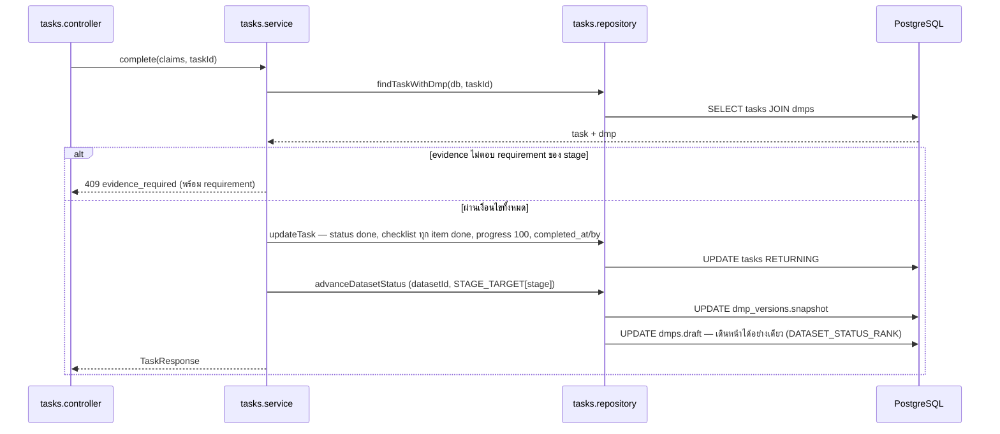
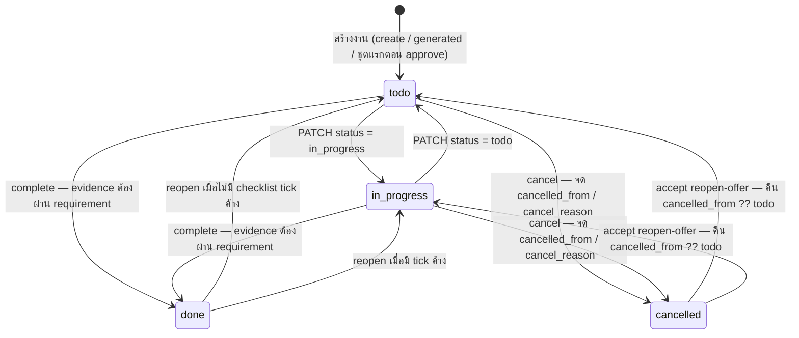
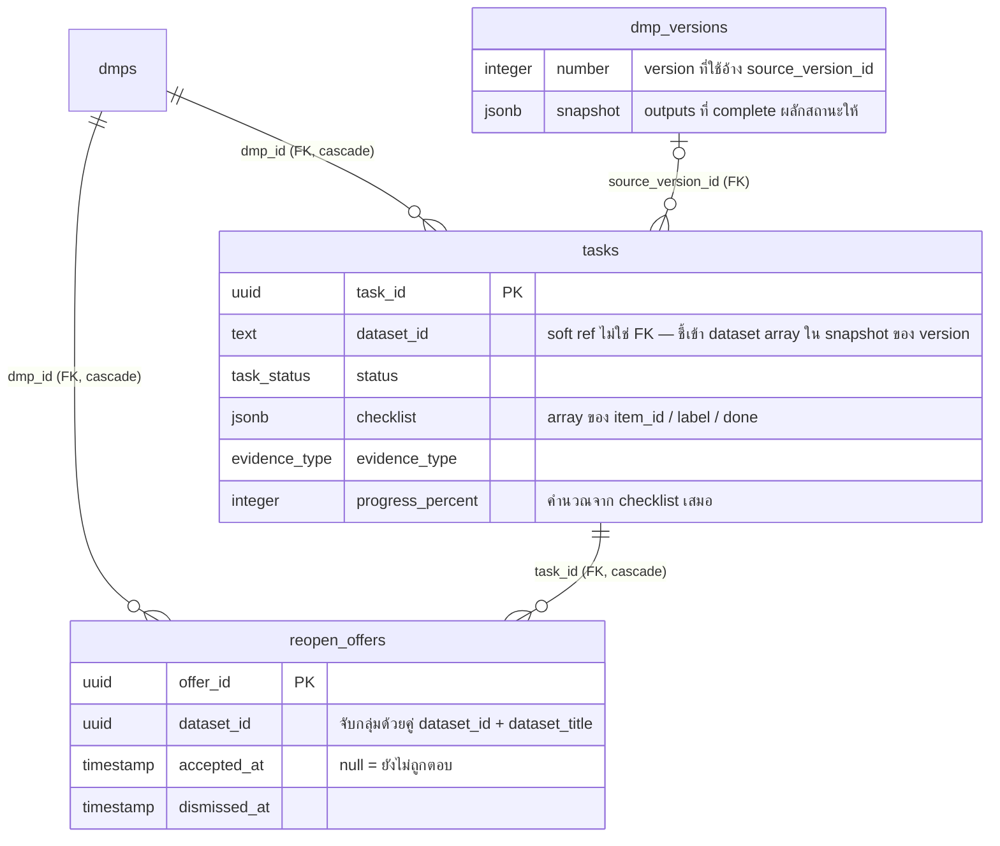

# tasks

> โมดูลบริหารงาน (task) ที่ผูกกับแผนข้อมูลวิจัย (DMP) — สร้าง/แก้งาน, จัดการ checklist และ evidence, ปิดงาน (`complete`) และดูแลการเชื่อมงานกลับเมื่อ output ที่ถูกลบไปกลับคืน (reopen offers)

## Table of Contents

- [Overview](#overview)
- [Folder Structure](#folder-structure)
- [Business Rules](#business-rules)
- [Usage](#usage)
- [Dependencies](#dependencies)
- [Diagrams](#diagrams)

## Overview

- โมดูลนี้จัดการ lifecycle ของ task ที่อ้างอิงแผน: สร้าง แก้ไข แบ่งเป็น checklist แนบ evidence ปิดงาน (`complete`) เปิดคืน (`reopen`) และยกเลิก (`cancel`)
- รับชุดงานที่ฝั่ง AI เสนอผ่าน `POST /dmps/:dmpId/tasks/generated` — นำเข้าได้ในโหมด `add` หรือ `replace`
- เมื่อ `complete` ระบบผลักสถานะของ output ไปข้างหน้าเท่านั้น — ทั้งใน version in force และ working draft — ไม่มีการถอยหลัง
- โมดูลนี้ดูแล `reopen_offers` — เสนองานที่ถูก cancel เพราะ output ถูกลบ ให้ผู้ใช้เลือกยอมรับ (เชื่อม output กลับ) หรือปัดทิ้ง
- **Out of scope:**
  - การสร้างชุดงานแรกตอน approve แผน — `features/dmps` เป็นผู้เรียก `generateTasks` จาก `shared/domain-engine`
  - การ cancel task เมื่อ revision ลบ output ทิ้ง (`cancel_reason: "output_removed"`) — `features/dmps` เป็นผู้เขียนตอนตัดสิน version
  - การอัปโหลดไฟล์ที่ใช้เป็น evidence — โมดูลนี้ตรวจสอบไฟล์ผ่านตาราง `file_records` เท่านั้น

## Folder Structure

```text
tasks/
├── tasks.controller.ts   # HTTP boundary — รับ 17 route แล้วส่งต่อ service ทันที
├── tasks.service.ts      # use case: สิทธิ์, Zod validation, status transition, evidence requirement
├── tasks.repository.ts   # Drizzle queries: CRUD, ลำดับการเรียง, advanceDatasetStatus, จัดกลุ่ม reopen_offers
└── tasks.module.ts       # ผูก controller/service, import ProjectsModule, export TasksService
```

## Business Rules

**สิทธิ์และการมองเห็น**

- `admin` โดน 403 `permission_denied` ทุกเส้นทางของ tasks
- `researcher` อ่าน/แก้ได้เฉพาะแผนที่ตนเป็นผู้เขียน — แผนอื่นตอบ 404 `task_not_found` เพื่อซ่อนการมีอยู่
- `committee`/`chief` อ่านได้ผ่าน `projects.assertVisible()` — สิทธิ์นี้อยู่ระดับโครงการ
- ทุกการแก้ไข (create/update/complete/reopen/cancel/delete/checklist/evidence/offers) ต้องผ่าน `assertAuthor` — ตรวจ 2 อย่าง: role เป็น `researcher` (ไม่ใช่ → 403 `not_a_researcher`) และเป็นผู้เขียนแผน (ไม่ใช่ → 404 `task_not_found`)
- การสร้างงานเองถูกบังคับ `generated_by: "user"` เสมอ — ไม่ว่า body จะส่งอะไรมา

**พารามิเตอร์ query ของ list**

| พารามิเตอร์ | ค่าที่ยอมรับ | default |
| --- | --- | --- |
| `project_id` / `dmp_id` | ต้องส่งอย่างน้อยหนึ่ง — ไม่ส่งเลย → 400 `filter_required` | — |
| `status` | `todo`, `in_progress`, `done`, `cancelled` — ค่าอื่น → 400 `invalid_status` | — (ทุกสถานะ) |
| `limit` | integer ≥ 1 cap ที่ 100 — ค่าไม่ถูกต้องใช้ default | 20 |
| `starting_after` | task_id ในลิสต์เดียวกัน — id แปลกหน้า → 400 `field_invalid` | — |

**การเรียงลำดับและการแบ่งหน้า**

- ลำดับผลลัพธ์ตายตัว: เรียงตาม `lifecycle_stage` ตาม `STAGE_ORDER` (collect → process → analyse → preserve → share) แล้วตาม `title` และ `task_id` — pagination จึงคาดเดาได้
- `has_more` คำนวณจากตำแหน่งเริ่ม + limit เทียบกับจำนวนทั้งหมด — `total_count` คือจำนวน task ของ filter นั้น
- `researcher` ถูก scope เฉพาะแผนของตนในทุกการ list เสมอ

**การสร้างงานและ version in force**

- การสร้าง (ทั้ง manual และ generated) และ `complete` ต้องมี version in force — ไม่มี → 409 `plan_not_in_force`
- `dataset_id` ที่อ้างถึงต้องอยู่ใน outputs ของ version in force — ไม่อยู่ → 400 `dataset_not_in_force`
- `dataset_id` เป็น draft-internal id คอลัมน์ type text — ไม่ใช่ FK และไม่ใช่ uuid

**การปิดงาน (complete)**

- ปิดงานห้ามผ่าน `PATCH` ที่ `status=done` — โดน 409 `use_complete` ต้องเรียก `POST /tasks/:taskId/complete` เท่านั้น
- ก่อนปิด งานต้องมี evidence ตอบ requirement ตาม stage (ADR-0026) — ไม่ผ่าน → 409 `evidence_required` พร้อม requirement ที่ต้องการ

| stage ของงาน | requirement | evidence ที่ยอมรับ |
| --- | --- | --- |
| ไม่ผูก output | `declared` | อะไรก็ได้ (ผ่านเสมอ) |
| `collect` / `process` / `analyse` | `evidence_linked` | `file`, `url`, `rdm_deposit` |
| `preserve` / `share` — แผน institutional | `system_verified` | `rdm_deposit` เท่านั้น |
| `preserve` / `share` — แผน independent | `evidence_linked` | `file`, `url` |

- ปิดสำเร็จ: checklist ทุก item เป็น done, `progress_percent` เป็น 100, บันทึก `completed_at` / `completed_by`
- ถ้า task ผูก output ระบบผลักสถานะ output ตาม `STAGE_TARGET` (เช่น `analyse` → `processed`) — ทั้งใน snapshot ของ version in force และ working draft — โดยเทียบ `DATASET_STATUS_RANK` เดินหน้าได้อย่างเดียว

**การแก้ / reopen / cancel / delete**

- เปลี่ยน `dataset_id` ของ task ที่ปิดแล้ว → 409 `output_locked` — ต้อง reopen ก่อน
- `reopen` ได้เฉพาะสถานะ `done` (ไม่ใช่ → 409 `task_not_done`) — สถานะใหม่คือ `in_progress` ถ้ามี checklist tick ค้าง ไม่งั้นเป็น `todo` — ระบบล้าง `completed_at`/`completed_by` แต่ evidence และ ticks คงอยู่
- `cancel` ของ task สถานะ `done` → 409 `task_done` — ต้อง reopen ก่อน — การ cancel งานที่ถูก cancel อยู่แล้วคืนผลเดิม (idempotent)
- การ cancel จด `cancelled_from` (สถานะก่อน cancel), `cancel_reason: "manual"` และ `cancelled_at`
- `DELETE` ได้เฉพาะงานที่ยังไม่มีบันทึกใด ๆ (evidence `none`, ไม่มี tick, ไม่เคย complete) — มีแล้ว → 409 `task_has_recorded_work` ต้อง cancel แทน

**checklist**

- checklist เก็บเป็น jsonb array บน task โดยตรง ไม่แยก entity (ADR-0022)
- `progress_percent` คำนวณจาก checklist เสมอ: `round(done ÷ ทั้งหมด × 100)` และเป็น 0 เมื่อไม่มี item — ห้ามส่งค่ามาเอง
- เพิ่ม item ที่ label เว้นวรรคล้วน → 400 `label_required` — patch/delete item ที่ id ไม่มีจริง → 404 `item_not_found`
- การแทนที่ทั้งชุด (`PUT`) คง step ที่ถูก tick แล้วไว้ และเติม `item_id` ใหม่ให้ step ที่เพิ่มเข้ามา

**evidence**

- task ที่ปิดแล้วแก้หรือล้าง evidence ไม่ได้ → 409 `task_done` — ต้อง reopen ก่อน
- ref ที่ตรงรูปแบบ DOI (`DOI_RE`) ถูกบังคับเป็น `rdm_deposit` เสมอ
- type `file` ต้องเป็นไฟล์บนโครงการของแผน — ไม่ใช่ → 404 `file_not_found`
- type อื่นที่ไม่ใช่ `none` ต้องมี `ref` ไม่ว่าง → 400 `ref_required`

**การนำเข้าชุดงานจาก AI**

- โหมด `replace` ลบเฉพาะ AI task ที่ยังไม่ถูกแตะ (`generated_by = ai`, `status = todo`, `progress 0`, evidence `none`) — งานที่ถูกแตะแล้วถูกเก็บไว้ (ADR-0022)
- ทั้งสองโหมด set `dmps.tasks_generated = true` เพื่อกันสร้างซ้ำตอน approve/finalize
- `dataset_id` ทุกตัวที่ส่งมาต้องอยู่ใน version in force

**reopen offers**

- ระบบจัดกลุ่ม offer ด้วยคู่ `dataset_id` + `dataset_title` ของแผน — open คือกลุ่มที่ยังไม่มี `accepted_at` และ `dismissed_at`
  > [!NOTE] **TODO: confirm** — โค้ดทั้ง repo ไม่มีจุดใด INSERT ลงตาราง `reopen_offers` (`tasks.repository.ts` อ่าน/ปิดอย่างเดียว, `dmps.repository.ts` cancel task โดยไม่สร้าง offer) — ใครคือผู้สร้างแถว offer ตามที่ flow นี้ออกแบบไว้?
- `accept` รับ `task_ids` ที่ต้องอยู่ใน offer เท่านั้น — id นอกกลุ่ม → 400 `task_not_offered`
- การยอมรับเชื่อม output กลับ — หา output ด้วย `dataset_id` ก่อน ถ้าไม่เจอ (id เปลี่ยนใหม่) ใช้ชื่อเดิมจาก `cancelled_dataset_title` — สถานะงานคืนเป็น `cancelled_from` หรือ `todo` และระบบล้าง audit ของการ cancel ทั้งหมด
- offer ที่ตอบไปแล้ว → 409 `offer_closed` — การ dismiss ปิดทุกแถวในกลุ่มด้วย `dismissed_at`

## Usage

| Route | Purpose |
| --- | --- |
| `GET /tasks` | list — ต้องมี `project_id` หรือ `dmp_id` |
| `POST /tasks` | สร้าง task เอง (researcher เจ้าของแผน) |
| `POST /dmps/:dmpId/tasks/generated` | นำเข้าชุดงานที่ AI เสนอ — body mode `add` \| `replace` |
| `PATCH /tasks/:taskId` | แก้ metadata (ห้าม `status=done`) |
| `POST /tasks/:taskId/complete` | ปิดงาน — ตรวจ evidence requirement แล้วผลักสถานะ output |
| `POST /tasks/:taskId/reopen` | เปิดงานที่ปิดแล้วคืน |
| `POST /tasks/:taskId/cancel` | ยกเลิกงาน (idempotent เมื่อ cancel ซ้ำ) |
| `DELETE /tasks/:taskId` | ลบ — เฉพาะงานที่ยังไม่มีบันทึกใด ๆ |
| `POST /tasks/:taskId/checklist` | เพิ่ม step |
| `PUT /tasks/:taskId/checklist` | แทนที่ step ที่ยังไม่ถูก tick |
| `PATCH /tasks/:taskId/checklist/:itemId` | แก้ step หนึ่ง |
| `DELETE /tasks/:taskId/checklist/:itemId` | ลบ step หนึ่ง |
| `PUT /tasks/:taskId/evidence` | แนบ evidence |
| `DELETE /tasks/:taskId/evidence` | ล้าง evidence |
| `GET /dmps/:dmpId/reopen-offers` | offer ที่ยังไม่ถูกตอบ (จัดกลุ่มตาม output) |
| `POST /reopen-offers/:offerId/accept` | ยอมรับ offer — body `{ task_ids }` |
| `POST /reopen-offers/:offerId/dismiss` | ปัดทิ้งทั้งกลุ่ม |

- ทุก response เป็น object `task` (ค่าว่างเป็น `null`, `dataset_title` resolve จาก version in force) — การ list คืน envelope `{object:"list", data, has_more, total_count}`
- ข้อกำหนดก่อนใช้: แผนต้องมี version in force ก่อนสร้างหรือปิดงาน (`409 plan_not_in_force`) — ชุดงานแรกถูกสร้างอัตโนมัติตอน approve โดย `features/dmps`
- โมดูลนี้ไม่ได้ import `shared/domain-engine` — ชุดงานอัตโนมัติจาก `generateTasks` ถูก insert โดย dmps แล้วเข้ามาที่ตาราง `tasks` เฉย ๆ

> [!NOTE] **TODO: confirm** — คอลัมน์ `reopen_offers.dataset_id` นิยามเป็น uuid (`src/database/schema/index.ts`) แต่ `tasks.dataset_id` เป็น text (draft-internal id เช่น `"ds-soil-reads"`) — offer ที่สร้างจริงเก็บ id รูปแบบใด และใครคือผู้เขียนแถวเหล่านี้?

## Dependencies

### Internal

| Module | Used in | Used for |
| --- | --- | --- |
| `features/auth` | controller / service | type `AccessClaims` และ decorator `@CurrentUser()` จาก AuthGuard |
| `features/projects` | `tasks.service.ts` | `ProjectsService.assertVisible()` ตรวจว่า committee/chief มองเห็นโครงการของแผน |
| `shared/contracts` | `tasks.service.ts` | `createTaskSchema`, `updateTaskSchema`, `taskEvidenceSchema`, `TaskChecklistItem`, `listOf` / `ListEnvelope` และ enum `TaskStatus` / `LifecycleStage` / `Priority` |
| `shared/http` | `tasks.service.ts` | `ApiError` และ `fieldInvalid` จาก error envelope |
| `database` | `tasks.repository.ts` | token `DB`; schema `tasks`, `dmps`, `dmp_versions`, `reopen_offers`, `file_records` |

### External packages

| Package | Used in | Used for |
| --- | --- | --- |
| `@nestjs/common` | ทุกไฟล์ .ts | decorators (`@Controller`, `@Get`, `@Inject` ฯลฯ) และ DI |
| `drizzle-orm` | `tasks.repository.ts` | query และ type `NodePgDatabase` ที่ใช้เป็น `Db` |
| `zod` | `tasks.service.ts` | validate body ทุก endpoint (`generatedBodySchema`, checklist/evidence/accept schemas) |

### External services

| Service | Used in | Used for | Impact |
| --- | --- | --- | --- |
| PostgreSQL | `tasks.repository.ts` | เก็บตาราง `tasks` / `reopen_offers` และอ่าน-เขียน `dmps` / `dmp_versions` (`DATABASE_URL`) | ล่ม → จัดการงานไม่ได้ทั้งโมดูล และ `complete` ผลักสถานะ output ไม่ได้ |

## Diagrams

### Sequence — complete (ปิดงานและผลักสถานะ output)



### Lifecycle — สถานะของ task



### Entity-Relationship — ความสัมพันธ์รอบ task


