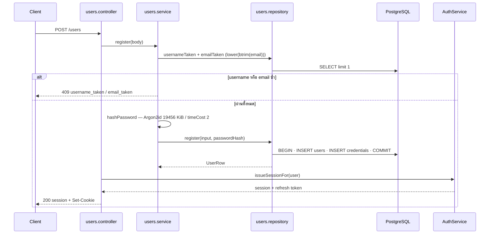

# users

> โมดูลบัญชีผู้ใช้: รับสมัครสมาชิก researcher แล้ว sign-in ทันที ตรวจ username ว่าง อ่าน/แก้โปรไฟล์ตนเอง และเป็นเจ้าของการ hash/verify รหัสผ่านด้วย Argon2id

## Table of Contents

- [Overview](#overview)
- [Folder Structure](#folder-structure)
- [Business Rules](#business-rules)
- [Usage](#usage)
- [Dependencies](#dependencies)
- [Diagrams](#diagrams)

## Overview

- รับสมัครสมาชิกด้วย `POST /users` — สมัครเสร็จคือ sign-in ทันที ได้ session พร้อม refresh cookie
- เก็บรหัสผ่านเป็น hash Argon2id — ห้ามเก็บ plaintext โดยตั้งค่าตามค่า OWASP minimum ใน `config.toml` (ADR-0029)
- ให้ endpoint โปรไฟล์ตนเอง: `GET /users/me` และ `PATCH /users/me`
- ตรวจ username ว่างที่ `GET /users/username-available`
- เป็น owner ตาราง `users` + `credentials`

**Out of scope:**

- การออก access/refresh token — โมดูลนี้ยืม `AuthService.issueSessionFor()` จาก `features/auth` เท่านั้น
- การแก้ role หรือโควตา AI — role ผูกกับสถาบัน (OC-1) และไม่มี endpoint ในโมดูลนี้เขียนทับ

## Folder Structure

```text
users/
├── users.module.ts       # wiring NestJS: import DatabaseModule + AuthModule, export UsersService
├── users.controller.ts   # HTTP boundary บาง ๆ: ผูก 4 route แล้วส่งต่อ service
├── users.service.ts      # use case: ปฏิเสธ role, validate, ตรวจซ้ำ, hash, patchMe
├── users.repository.ts   # Drizzle ตาราง users/credentials + toUserResponse (snake_case)
└── argon2.ts             # hashPassword / verifyPassword — Argon2id ตาม [auth.argon2]
```

## Business Rules

**การสมัครสมาชิก**

- สมัครเองได้เฉพาะ `researcher` — ระบบบันทึก `role: "researcher"` เสมอ
- body ที่แนบ field `role` เข้ามาถูกปฏิเสธด้วย 400 `role_not_allowed`
- เหตุผล (OC-1): role อื่นนอกจาก `researcher` สถาบันเป็นผู้สร้าง
  > [!NOTE] **TODO: confirm** — ทั้ง repo ไม่มี code path สร้างบัญชี `admin` / `chief` / `committee` (register บังคับ researcher, `pnpm db:seed` ไม่สร้าง user role อื่น) — บัญชี role อื่นถูกสร้างด้วยกลไกใด (seed ภายนอก / SQL มือ)?
- `account_type` เลือกได้ 2 แบบ:
  - `institutional` — ต้องระบุ `organization` ซึ่งระบบเก็บเป็น `affiliation` ของ user
  - `citizen` — ไม่มี affiliation
- สมัครสำเร็จ: insert `users` + `credentials` ใน transaction เดียว แล้ว sign-in ทันที (`issueSessionFor` + Set-Cookie)

**ฟิลด์ที่ยอมรับ**

| พารามิเตอร์ | ค่าที่ยอมรับ | default |
| --- | --- | --- |
| `username` | regex `^[a-z0-9._-]+$` ยาว 3–30 ตัวอักษร | — |
| `password` | ยาวอย่างน้อย 8 ตัว มีตัวอักษร ≥ 1 และตัวเลข ≥ 1 | — |
| `confirm_password` | ต้องตรงกับ `password` | — |
| `email` | รูปแบบอีเมล แล้ว normalize ด้วย trim + lowercase ก่อนบันทึก | — |
| `phone` | regex `^\+?[\d\s-]{9,15}$` (optional) | — |
| `orcid` | regex `^\d{4}-\d{4}-\d{4}-\d{3}[\dX]$` (optional) | — |
| `name`, `surname` | ยาวอย่างน้อย 1 ตัวอักษร | — |

- body ผ่าน schema ไม่ได้ → 400 `field_invalid`
- error ใช้ issue แรกของ Zod เป็น JSON pointer ใน `param`

**การเก็บรหัสผ่าน**

| พารามิเตอร์ | ค่า | default |
| --- | --- | --- |
| `memoryCostKiB` | 19456 | — |
| `timeCost` | 2 | — |
| `parallelism` | 1 | — |

- ค่าทั้งหมดอ่านจาก `config.toml` `[auth.argon2]` (OWASP minimum, ADR-0029)
- โหลดครั้งเดียวตอน bootstrap — แก้แล้วต้อง restart
- พารามิเตอร์ฝังอยู่ในตัว hash ด้วย จึงแก้ config แล้ว hash เดิมยัง verify ผ่าน

**ความซ้ำของ username / email**

- username ซ้ำ → 409 `username_taken`
- email เทียบหลัง normalize: `lower(btrim(email))`
- email ซ้ำ → 409 `email_taken`
- DB บังคับซ้ำอีกชั้นด้วย unique index `users_email_normalized_uq`
- ตรวจ username ว่างก็ normalize ก่อนเช่นกัน
- query `username` หายไป → 400 `parameter_missing` ที่ `/username`

**โปรไฟล์ตนเอง (me)**

- `GET /users/me` และ `PATCH /users/me` ต้อง sign-in — ไม่พบ user → 401 `not_signed_in`
- `PATCH /users/me` แก้ได้เฉพาะ `title`, `name`, `surname`, `email`
- validate ไม่ผ่าน: field `email` → 400 `email_invalid`, field อื่น → 400 `name_required`
- email ใหม่ซ้ำกับบัญชีอื่น → 409 `email_taken`
- response เป็น snake_case ผ่าน `toUserResponse()` — password hash ไม่หลุดออก response เด็ดขาด

## Usage

| Route | Purpose |
| --- | --- |
| `POST /users` | สมัครสมาชิก researcher — จบด้วย session + Set-Cookie (`@Public()`) |
| `GET /users/username-available` | ตรวจ username ว่าง (`@Public()`) |
| `GET /users/me` | อ่านโปรไฟล์ผู้ใช้ปัจจุบัน |
| `PATCH /users/me` | แก้ title / name / surname / email |

Entry point ภายในสำหรับโมดูลอื่น:

- `verifyPassword(passwordHash, password)` — เทียบรหัสผ่านกับ hash ที่เก็บไว้ `features/auth` เรียกตอน sign-in
- `usersRepo.findByUsername` / `findCredential` / `toUserResponse` — `features/auth` ใช้อ่านข้อมูลผู้ใช้และแต่ง response

```ts
// features/auth/auth.service.ts — ตรวจรหัสผ่านตอน sign-in
const ok = await verifyPassword(credential.passwordHash, password);
```

- ต้อง migrate ตาราง `users` + `credentials` ก่อน และ `config.toml` ต้องมีคีย์ `[auth.argon2]`
- loader validate ทุกคีย์ตอน bootstrap — ใส่ผิดชนิด fail-fast

## Dependencies

### Internal

| Module | Used in | Used for |
| --- | --- | --- |
| `features/auth` | `users.controller.ts` | `AuthService.issueSessionFor()`, `@Public()`, `@CurrentUser()`, `setRefreshCookie()` |
| `shared/contracts` | `users.service.ts` | `registrationSchema`, `userProfileSchema`, `ORCID` และ enum `UserRole` / `AccountType` |
| `shared/http` | `users.service.ts` | `ApiError` + `fieldInvalid` สำหรับ error envelope |
| `shared/config` | `argon2.ts` | อ่านพารามิเตอร์ `[auth.argon2]` |
| `database` | `users.repository.ts` | token `DB` และตาราง `users` / `credentials` |

### External packages

| Package | Used in | Used for |
| --- | --- | --- |
| `argon2` | `argon2.ts` | hash และ verify รหัสผ่าน Argon2id |
| `drizzle-orm` | `users.repository.ts` | query ตาราง users / credentials บน `NodePgDatabase` |
| `zod` | `users.service.ts` | cast `ZodError` เพื่อสร้าง `fieldInvalid` |
| `@nestjs/common` | controller / module | decorators และ DI (explicit `@Inject` เพราะ tsx ไม่ emit design:paramtypes) |

### External services

| Service | Used in | Used for | Impact |
| --- | --- | --- | --- |
| PostgreSQL | `users.repository.ts` | เก็บตาราง `users` + `credentials` | ล่ม → สมัครสมาชิกและอ่าน/แก้โปรไฟล์ใช้ไม่ได้ และ sign-in ล้มตาม |

## Diagrams

### Workflow — สมัครสมาชิก

```mermaid
swimlane-beta LR
    subgraph client [Client]
        A[POST /users]
    end
    subgraph ctrl [users.controller]
        B{แนบ field role?}
    end
    subgraph svc [users.service]
        C{registrationSchema ผ่าน?}
        D{username หรือ email ซ้ำ?}
        E[hashPassword — Argon2id]
    end
    subgraph repo [users.repository]
        F[transaction insert users + credentials]
    end
    subgraph auth [features/auth]
        G[issueSessionFor]
    end
    subgraph res [Response]
        H[400 role_not_allowed]
        I[400 field_invalid]
        J[409 username_taken / email_taken]
        K[200 session + Set-Cookie refresh_token]
    end
    A --> B
    B -->|ใช่| H
    B -->|ไม่| C
    C -->|ไม่| I
    C -->|ผ่าน| D
    D -->|ซ้ำ| J
    D -->|ไม่ซ้ำ| E
    E --> F
    F --> G
    G --> K
```

### Sequence — สมัครสมาชิก (happy path)


