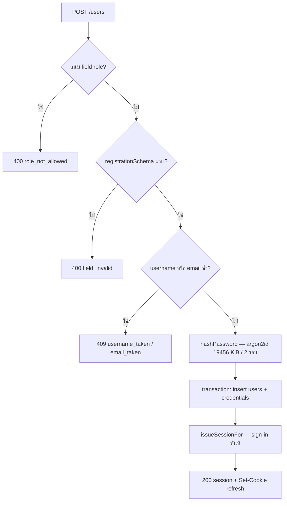
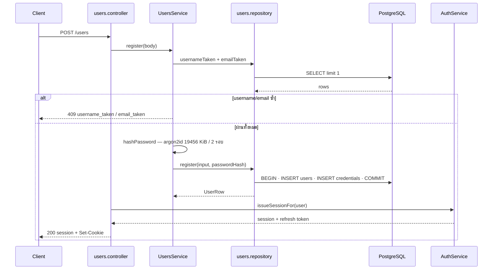

# users

> โมดูลข้อมูลผู้ใช้ของระบบ: รับสมัครสมาชิก researcher, จัดการโปรไฟล์ส่วนตัว (`me`) และเป็นเจ้าของการ hash/verify รหัสผ่านด้วย Argon2id

## Overview

- รับผิดชอบการสมัครสมาชิก `POST /users` — validate ด้วย Zod, ตรวจ username/email ซ้ำ แล้ว insert ตาราง `users` + `credentials` ใน transaction เดียว จบด้วยการ sign-in ทันที
- เก็บรหัสผ่านเป็น hash Argon2id (ADR-0029) ตามพารามิเตอร์ใน `config.toml` `[auth.argon2]`
- ให้ endpoint อ่าน/แก้โปรไฟล์ตนเอง (`GET /users/me`, `PATCH /users/me`) และตรวจ username ว่าง (`GET /users/username-available`)
- **ไม่ควรทำ / Out of scope:**
  - การออก session / refresh token — ยืม `AuthService.issueSessionFor()` จาก `features/auth` เท่านั้น
  - การแก้ role หรือโควตา AI ของผู้ใช้ — role กำหนดโดยสถาบัน และไม่มี endpoint ใดในโมดูลนี้เขียนทับได้

## Folder Structure

```text
users/
├── users.controller.ts   # HTTP boundary เท่านั้น — ผูก routes, เรียก service + auth
├── users.service.ts      # use-case layer — validate → ตรวจซ้ำ → transaction insert
├── users.repository.ts   # Drizzle queries ตาราง users/credentials + toUserResponse (snake_case)
├── users.module.ts       # NestJS module — import DatabaseModule/AuthModule, export UsersService
└── argon2.ts             # hashPassword/verifyPassword — Argon2id ตาม [auth.argon2] ใน config.toml
```

## Business Rules

- สมัครด้วยตนเองได้เฉพาะ `researcher`: body ที่แนบ field `role` เข้ามาถูกปฏิเสธทันทีด้วย 400 `role_not_allowed` และระบบบันทึก `role = "researcher"` เสมอ (OC-1 — บทบาทอื่นสถาบันเป็นผู้สร้างให้)
- `username` ต้องยาว 3–30 ตัวอักษร และใช้ได้เฉพาะตัวอักษรพิมพ์เล็ก ตัวเลข `.`, `-`, `_` (regex `^[a-z0-9._-]+$`); ซ้ำ → 409 `username_taken`
- `email` ถูก normalize ด้วย trim + lowercase ก่อนบันทึก และความ unique แบบ normalize ถูกบังคับซ้ำอีกชั้นที่ DB ผ่าน unique index `users_email_normalized_uq` บน `lower(btrim(email))`; ซ้ำ → 409 `email_taken`
- `password` ต้องยาวอย่างน้อย 8 ตัวอักษร มีตัวอักษรอย่างน้อย 1 ตัว และตัวเลขอย่างน้อย 1 ตัว พร้อม `confirm_password` ที่ตรงกัน
- รหัสผ่านถูก hash ด้วย Argon2id เท่านั้น ห้ามเก็บ plaintext; พารามิเตอร์อ่านจาก `config.toml` `[auth.argon2]` — `memoryCostKiB = 19456`, `timeCost = 2`, `parallelism = 1` (OWASP minimum, ADR-0029); แก้ค่าแล้วต้อง restart และ hash เดิมยัง verify ได้เพราะพารามิเตอร์ฝังอยู่ใน hash
- สมัครประเภท `institutional` ต้องระบุ `organization` ซึ่งถูกเก็บเป็น `affiliation` ของ user; ประเภท `citizen` ไม่มี affiliation
- `phone` (optional) ต้องตรง `/^\+?[\d\s-]{9,15}$/`; `orcid` (optional) ต้องตรง `/^\d{4}-\d{4}-\d{4}-\d{3}[\dX]$/` — รูปแบบเดียวกับ contributor ในแผน
- body ที่ validate ไม่ผ่าน → 400 `field_invalid` โดยใช้ issue แรกของ Zod เป็น JSON pointer ใน `param`
- response user เป็น snake_case ผ่าน `toUserResponse()` และไม่มี password hash ออกทาง response เด็ดขาด
- `POST /users` และ `GET /users/username-available` เป็น `@Public()` ไม่ต้อง sign-in; query `username` หายไป → 400 `parameter_missing` ที่ `/username` และการตรวจใช้ชื่อที่ normalize ด้วย trim + lowercase แล้ว
- `GET /users/me` และ `PATCH /users/me` ต้อง sign-in ผ่าน global AuthGuard; ไม่พบ user → 401 `not_signed_in`
- `PATCH /users/me` แก้ได้เฉพาะ `title`, `name`, `surname`, `email`; issue ที่ field `email` → 400 `email_invalid` ส่วน field อื่น → 400 `name_required`; email ใหม่ซ้ำกับบัญชีอื่น → 409 `email_taken`
- สมัครสำเร็จเท่ากับ sign-in ทันที: controller เรียก `AuthService.issueSessionFor()` และตั้ง refresh cookie ก่อนตอบ session กลับ

## Usage

Entry points สำหรับ client และโมดูลอื่น:

- HTTP (prefix `/users`, ผูกที่ `UsersController`): `POST /users` (สมัคร + sign-in ทันที), `GET /users/username-available?username=…`, `GET /users/me`, `PATCH /users/me`
- Internal: `UsersService` export จาก `UsersModule`; `verifyPassword()` ใน `argon2.ts` ถูก `features/auth` เรียกตอน sign-in

```ts
// features/auth/auth.service.ts — ตรวจรหัสผ่านตอน sign-in
import { verifyPassword } from "@/features/users/argon2.js";

const ok = await verifyPassword(credential.passwordHash, password);
```

- ต้องมีตาราง `users` และ `credentials` ตาม migration ล่าสุด และคีย์ `[auth.argon2]` ใน `config.toml` — loader validate ทุกคีย์ตอน bootstrap (ใส่ผิดชนิด fail-fast) และแก้ค่าแล้วต้อง restart

## Dependencies

### Internal

- `features/auth` — `AuthService.issueSessionFor()`, `@Public()`, `@CurrentUser()`, `setRefreshCookie()` จาก `session.ts` (ใช้ใน users.controller.ts)
- `shared/contracts` — `registrationSchema`, `userProfileSchema`, `AccountType`, `UserRole`, `ORCID`
- `shared/http/error-envelope` — `ApiError`, `fieldInvalid` สำหรับ error envelope `{error:{type,code,message,param?}}`
- `shared/config` — `config()` อ่านพารามิเตอร์ `[auth.argon2]` (ใน argon2.ts)
- `database` — `DB` injection token และตาราง `users` / `credentials` จาก `schema/index.ts`

### External packages

- `argon2` (^0.45.2) — hash และ verify รหัสผ่าน Argon2id
- `zod` (^3.25.76) — validate request body ผ่าน schema ใน `shared/contracts`
- `drizzle-orm` (^0.45.4) — query ตาราง `users` / `credentials` บน `NodePgDatabase`
- `@nestjs/common` (^12.3.3) — decorator `Controller`/`Get`/`Post`/`Patch`, `@Inject()` DI และ `@Injectable()`

### External services

- PostgreSQL — เก็บตาราง `users` และ `credentials` ผ่าน `DATABASE_URL` (หากล่ม: สมัครสมาชิกและอ่าน/แก้โปรไฟล์ใช้งานไม่ได้ทั้งโมดูล)

## Diagrams

### Workflow



### Sequence


